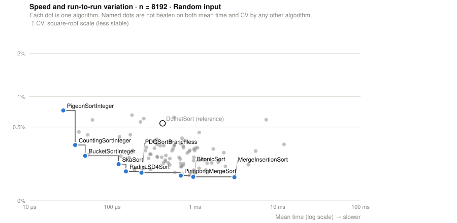

# SortAlgorithms

This repository shows implementation for the Major Sort Algorithm.
Aim not to use LINQ or similar ease to use, but memory unefficient technique.

## Table of Contents

- [Benchmark](#benchmark)
  - [DistributionBenchmark](#distributionbenchmark)
  - [ExchangeBenchmark](#exchangebenchmark)
  - [HeapBenchmark](#heapbenchmark)
  - [InsertionBenchmark](#insertionbenchmark)
  - [IntKeyBenchmark](#intkeybenchmark)
  - [MergeBenchmark](#mergebenchmark)
  - [MergeSlowBenchmark](#mergeslowbenchmark)
  - [NetworkBenchmark](#networkbenchmark)
  - [PartitionBenchmark](#partitionbenchmark)
  - [SelectionBenchmark](#selectionbenchmark)
  - [StringBenchmark](#stringbenchmark)
  - [TreeBenchmark](#treebenchmark)
- [Implemented Sort Algorithm](#implemented-sort-algorithm)
  - [Exchange](#exchange)
  - [Selection](#selection)
  - [Insertion](#insertion)
  - [Merge](#merge)
  - [Heap](#heap)
  - [Partition](#partition)
  - [Distribution](#distribution)
  - [Network](#network)
  - [Tree](#tree)
  - [Joke](#joke)

## Benchmark

<!-- BENCHMARK_START -->
Interactive results: https://guitarrapc.github.io/SortAlgorithms/ (rankings per size, scaling exponents, run-to-run stability, history).

<picture>
  <source media="(prefers-color-scheme: dark)" srcset=".github/images/benchmark/pareto-dark.svg">
  
</picture>

#### Fastest per category and input pattern

Measured at each category's largest size. "≈ 2nd" means the 99.9% confidence intervals of the two fastest overlap. 🟢 🟡 🔴 mark a CV below 2%, below 5%, and 5% or more. DotnetSort is a shared reference and is not ranked.

| Category | n | Random | 1-Moved | Sorted | Reversed | PipeOrgan | ManyDup |
|---|--:|---|---|---|---|---|---|
| Exchange | 1024 | **CombSort**<br>×3.01 vs 2nd 🟢 | **CocktailShakerSort**<br>×11.45 vs 2nd 🟡 | **CocktailShakerSort**<br>×1.26 vs 2nd 🟢 | **CombSort**<br>×1.15 vs 2nd 🟢 | **CombSort**<br>×6.26 vs 2nd 🟢 | **CombSort**<br>×3.48 vs 2nd 🟢 |
| Selection | 1024 | **SelectionSortSimd**<br>≈ 2nd 🟢 | **DoubleSelectionSortSimd**<br>×1.48 vs 2nd 🟢 | **DoubleSelectionSortSimd**<br>×1.51 vs 2nd 🟢 | **DoubleSelectionSortSimd**<br>×1.02 vs 2nd 🟢 | **DoubleSelectionSortSimd**<br>×1.62 vs 2nd 🟢 | **BingoSort**<br>×2.80 vs 2nd 🟢 |
| Insertion | 8192 | **ShellSortKnuth1973**<br>×1.07 vs 2nd 🟢 | **InsertionSort**<br>×1.14 vs 2nd 🟡 | **InsertionSort**<br>×1.24 vs 2nd 🟡 | **ShellSortKnuth1973**<br>×1.15 vs 2nd 🟢 | **ShellSortKnuth1973**<br>×1.12 vs 2nd 🟢 | **ShellSortSedgewick1986**<br>×1.04 vs 2nd 🟢 |
| Merge | 8192 | **Driftsort**<br>≈ 2nd 🟢 | **TimSort**<br>×1.50 vs 2nd 🟢 | **SpinSort**<br>≈ 2nd 🔴 | **NaturalMergeSort**<br>≈ 2nd 🟡 | **Driftsort**<br>×1.18 vs 2nd 🟢 | **Driftsort**<br>×1.43 vs 2nd 🟡 |
| MergeSlow | 1024 | **StrandSort**<br>only one 🟢 | **StrandSort**<br>only one 🟢 | **StrandSort**<br>only one 🟢 | **StrandSort**<br>only one 🟢 | **StrandSort**<br>only one 🟢 | **StrandSort**<br>only one 🟢 |
| Heap | 8192 | **HeapSort**<br>×1.01 vs 2nd 🟢 | **SmoothSort**<br>×3.16 vs 2nd 🟢 | **SmoothSort**<br>×3.61 vs 2nd 🟢 | **PairingHeapSort**<br>×3.14 vs 2nd 🟢 | **PairingHeapSort**<br>×1.08 vs 2nd 🟢 | **HeapSort**<br>×1.02 vs 2nd 🟢 |
| Partition | 8192 | **SimdQuickSort**<br>×3.28 vs 2nd 🟢 | **FluxSort**<br>×1.29 vs 2nd 🟢 | **Ips4oSort**<br>≈ 2nd 🔴 | **Ips4oSort**<br>≈ 2nd 🟡 | **FluxSort**<br>×1.26 vs 2nd 🟢 | **PDQSortBranchless**<br>×1.10 vs 2nd 🟢 |
| Distribution | 8192 | **PigeonSortInteger**<br>×1.40 vs 2nd 🟢 | **PigeonSortInteger**<br>×1.24 vs 2nd 🟢 | **SpreadSort**<br>×4.93 vs 2nd 🟢 | **PigeonSortInteger**<br>×1.38 vs 2nd 🟢 | **PigeonSortInteger**<br>×1.30 vs 2nd 🟢 | **PigeonSortInteger**<br>×1.30 vs 2nd 🟢 |
| Network | 8192 | **BitonicSortAnyLengthSimd**<br>×2.99 vs 2nd 🟢 | **BitonicSortAnyLengthSimd**<br>×2.59 vs 2nd 🟢 | **BitonicSortAnyLengthSimd**<br>×2.59 vs 2nd 🟢 | **BitonicSortAnyLengthSimd**<br>×2.63 vs 2nd 🟢 | **BitonicSortAnyLengthSimd**<br>×2.56 vs 2nd 🟢 | **BitonicSortAnyLengthSimd**<br>×3.12 vs 2nd 🟢 |
| Tree | 8192 | **BinaryTreeSort**<br>×1.22 vs 2nd 🟢 | **CartesianTreeSort**<br>×2.13 vs 2nd 🟢 | **CartesianTreeSort**<br>×2.01 vs 2nd 🟢 | **CartesianTreeSort**<br>×1.97 vs 2nd 🟢 | **CartesianTreeSort**<br>×2.04 vs 2nd 🟢 | **BalancedBinaryTreeSort**<br>×1.07 vs 2nd 🟢 |

<details>
<summary>Benchmark results (2026-11-22 08:54 UTC)</summary>

Workflow run: https://github.com/guitarrapc/SortAlgorithms/actions/runs/45002371533

### DistributionBenchmark

```
BenchmarkDotNet v0.16.0-preview.2, Linux Ubuntu 24.04.5 LTS (Noble Numbat)
AMD EPYC 9V74 3.59GHz, 1 CPU, 4 logical and 2 physical cores
Memory: 15.61 GB Total, 12.44 GB Available
.NET SDK 11.0.100
  [Host]     : .NET 11.0.0 (11.0.0, 11.0.26.53018), X64 RyuJIT x86-64-v4
  Job-GKDVVL : .NET 11.0.0 (11.0.0, 11.0.26.53018), X64 RyuJIT x86-64-v4
EnvironmentVariables=DOTNET_TieredCompilation=0  InvocationCount=64  IterationCount=8  
UnrollFactor=1  WarmupCount=2  
```

| Method              | Size | Pattern            | Mean           | Error        | StdDev       | Ratio  | RatioSD | Rank | Allocated | Alloc Ratio |
| -------------------- |----- |------------------- |---------------:|-------------:|-------------:|-------:|--------:|-----:|----------:|------------:|
| **CountingSort**        | **256**  | **Random**             |     **1,314.7 ns** |     **24.80 ns** |     **11.01 ns** |   **1.42** |    **0.03** |    **2** |         **-** |          **NA** |
| CountingSortInteger | 256  | Random             |       923.6 ns |     45.40 ns |     20.16 ns |   1.00 |    0.00 |    2 |         - |          NA |
| PigeonSort          | 256  | Random             |     2,044.5 ns |    715.86 ns |    374.41 ns |   2.21 |    0.39 |    3 |         - |          NA |
| PigeonSortInteger   | 256  | Random             |       712.9 ns |     22.38 ns |     11.71 ns |   0.77 |    0.02 |    1 |         - |          NA |
| BucketSort          | 256  | Random             |     1,429.9 ns |     27.80 ns |     12.34 ns |   1.55 |    0.03 |    2 |         - |          NA |
| BucketSortInteger   | 256  | Random             |     1,214.1 ns |     24.90 ns |     11.06 ns |   1.32 |    0.03 |    2 |         - |          NA |
| FlashSort           | 256  | Random             |     4,008.0 ns |    226.84 ns |    118.64 ns |   4.34 |    0.15 |    5 |         - |          NA |
| RadixLSD4Sort       | 256  | Random             |     2,255.2 ns |     29.37 ns |     10.47 ns |   2.44 |    0.05 |    3 |         - |          NA |
| RotateLSDRadixSort  | 256  | Random             |    52,954.8 ns |    114.07 ns |     40.68 ns |  57.36 |    1.16 |    8 |         - |          NA |
| RadixLSD256Sort     | 256  | Random             |     1,059.3 ns |     31.91 ns |     14.17 ns |   1.15 |    0.03 |    2 |         - |          NA |
| Radsort             | 256  | Random             |     7,942.8 ns |    397.97 ns |    208.15 ns |   8.60 |    0.27 |    7 |         - |          NA |
| RadixLSD10Sort      | 256  | Random             |     3,189.4 ns |     50.66 ns |     22.49 ns |   3.45 |    0.07 |    4 |         - |          NA |
| RadixMSD4Sort       | 256  | Random             |     5,241.5 ns |    239.95 ns |    125.50 ns |   5.68 |    0.17 |    6 |         - |          NA |
| RadixMSD10Sort      | 256  | Random             |     4,860.1 ns |    230.87 ns |    120.75 ns |   5.26 |    0.16 |    6 |         - |          NA |
| AmericanFlagSort    | 256  | Random             |     2,414.9 ns |     38.15 ns |     19.95 ns |   2.62 |    0.06 |    3 |         - |          NA |
| SkaSort             | 256  | Random             |     3,218.5 ns |     76.55 ns |     27.30 ns |   3.49 |    0.08 |    4 |         - |          NA |
| SpreadSort          | 256  | Random             |     6,044.9 ns |    194.20 ns |    101.57 ns |   6.55 |    0.17 |    6 |         - |          NA |
| DotnetSort          | 256  | Random             |     5,787.2 ns |    184.44 ns |     81.89 ns |   6.27 |    0.15 |    6 |         - |          NA |
|      |                    |                |              |              |        |         |      |           |             |
| **CountingSort**        | **256**  | **SingleElementMoved** |     **1,255.3 ns** |     **22.38 ns** |      **9.94 ns** |   **1.56** |    **0.02** |    **3** |         **-** |          **NA** |
| CountingSortInteger | 256  | SingleElementMoved |       805.7 ns |     16.04 ns |      7.12 ns |   1.00 |    0.00 |    2 |         - |          NA |
| PigeonSort          | 256  | SingleElementMoved |     1,136.6 ns |     33.80 ns |     15.01 ns |   1.41 |    0.02 |    3 |         - |          NA |
| PigeonSortInteger   | 256  | SingleElementMoved |       627.4 ns |      6.89 ns |      3.06 ns |   0.78 |    0.01 |    1 |         - |          NA |
| BucketSort          | 256  | SingleElementMoved |     1,385.0 ns |     45.33 ns |     20.13 ns |   1.72 |    0.03 |    3 |         - |          NA |
| BucketSortInteger   | 256  | SingleElementMoved |     1,136.4 ns |     16.68 ns |      7.41 ns |   1.41 |    0.01 |    3 |         - |          NA |
| FlashSort           | 256  | SingleElementMoved |     3,169.1 ns |     92.61 ns |     48.44 ns |   3.93 |    0.07 |    5 |         - |          NA |
| RadixLSD4Sort       | 256  | SingleElementMoved |     2,206.6 ns |    123.37 ns |     54.78 ns |   2.74 |    0.07 |    4 |         - |          NA |
| RotateLSDRadixSort  | 256  | SingleElementMoved |    34,918.4 ns |    485.06 ns |    253.70 ns |  43.34 |    0.46 |    8 |         - |          NA |
| RadixLSD256Sort     | 256  | SingleElementMoved |     1,017.8 ns |     43.12 ns |     19.15 ns |   1.26 |    0.02 |    3 |         - |          NA |
| Radsort             | 256  | SingleElementMoved |     7,300.6 ns |     33.34 ns |     14.80 ns |   9.06 |    0.08 |    7 |         - |          NA |
| RadixLSD10Sort      | 256  | SingleElementMoved |     3,204.2 ns |    292.61 ns |    153.04 ns |   3.98 |    0.18 |    5 |         - |          NA |
| RadixMSD4Sort       | 256  | SingleElementMoved |     5,580.2 ns |     52.83 ns |     18.84 ns |   6.93 |    0.06 |    6 |         - |          NA |
| RadixMSD10Sort      | 256  | SingleElementMoved |     4,945.8 ns |    308.51 ns |    161.36 ns |   6.14 |    0.20 |    6 |         - |          NA |
| AmericanFlagSort    | 256  | SingleElementMoved |     1,660.9 ns |     43.14 ns |     19.16 ns |   2.06 |    0.03 |    3 |         - |          NA |
| SkaSort             | 256  | SingleElementMoved |     2,406.8 ns |     17.92 ns |      9.37 ns |   2.99 |    0.03 |    4 |         - |          NA |
| SpreadSort          | 256  | SingleElementMoved |       885.1 ns |    415.69 ns |    184.57 ns |   1.10 |    0.21 |    2 |         - |          NA |
| DotnetSort          | 256  | SingleElementMoved |     1,067.0 ns |    104.57 ns |     46.43 ns |   1.32 |    0.05 |    3 |         - |          NA |
|      |                    |                |              |              |        |         |      |           |             |
| **CountingSort**        | **256**  | **Sorted**             |     **1,226.3 ns** |     **62.61 ns** |     **22.33 ns** |   **1.60** |    **0.03** |    **2** |         **-** |          **NA** |
| CountingSortInteger | 256  | Sorted             |       764.8 ns |     14.91 ns |      5.32 ns |   1.00 |    0.00 |    2 |         - |          NA |
| PigeonSort          | 256  | Sorted             |     1,109.0 ns |      5.72 ns |      2.54 ns |   1.45 |    0.01 |    2 |         - |          NA |
| PigeonSortInteger   | 256  | Sorted             |       562.4 ns |      5.31 ns |      2.36 ns |   0.74 |    0.01 |    2 |         - |          NA |
| BucketSort          | 256  | Sorted             |     1,310.2 ns |     24.81 ns |     11.02 ns |   1.71 |    0.02 |    2 |         - |          NA |
| BucketSortInteger   | 256  | Sorted             |     1,043.7 ns |      4.91 ns |      2.18 ns |   1.36 |    0.01 |    2 |         - |          NA |
| FlashSort           | 256  | Sorted             |     2,796.0 ns |     53.14 ns |     27.80 ns |   3.66 |    0.04 |    4 |         - |          NA |
| RadixLSD4Sort       | 256  | Sorted             |     3,181.3 ns |    848.76 ns |    443.92 ns |   4.16 |    0.55 |    4 |         - |          NA |
| RotateLSDRadixSort  | 256  | Sorted             |    34,176.0 ns |    254.44 ns |    112.97 ns |  44.69 |    0.32 |    7 |         - |          NA |
| RadixLSD256Sort     | 256  | Sorted             |       898.5 ns |     21.79 ns |      9.68 ns |   1.17 |    0.01 |    2 |         - |          NA |
| Radsort             | 256  | Sorted             |     7,282.2 ns |     16.10 ns |      5.74 ns |   9.52 |    0.06 |    6 |         - |          NA |
| RadixLSD10Sort      | 256  | Sorted             |     3,052.3 ns |     25.39 ns |     11.28 ns |   3.99 |    0.03 |    4 |         - |          NA |
| RadixMSD4Sort       | 256  | Sorted             |     5,466.9 ns |     27.96 ns |      9.97 ns |   7.15 |    0.05 |    5 |         - |          NA |
| RadixMSD10Sort      | 256  | Sorted             |     4,698.9 ns |    235.73 ns |    123.29 ns |   6.14 |    0.16 |    5 |         - |          NA |
| AmericanFlagSort    | 256  | Sorted             |     1,273.5 ns |     11.10 ns |      4.93 ns |   1.67 |    0.01 |    2 |         - |          NA |
| SkaSort             | 256  | Sorted             |     2,031.6 ns |     62.95 ns |     27.95 ns |   2.66 |    0.04 |    3 |         - |          NA |
| SpreadSort          | 256  | Sorted             |       254.2 ns |      6.25 ns |      2.23 ns |   0.33 |    0.00 |    1 |         - |          NA |
| DotnetSort          | 256  | Sorted             |       651.4 ns |      4.81 ns |      2.13 ns |   0.85 |    0.01 |    2 |         - |          NA |
|      |                    |                |              |              |        |         |      |           |             |
| **CountingSort**        | **256**  | **Reversed**           |     **1,185.3 ns** |     **17.08 ns** |      **7.58 ns** |   **1.55** |    **0.01** |    **4** |         **-** |          **NA** |
| CountingSortInteger | 256  | Reversed           |       763.1 ns |      7.52 ns |      3.94 ns |   1.00 |    0.00 |    3 |         - |          NA |
| PigeonSort          | 256  | Reversed           |     1,165.5 ns |      9.09 ns |      4.75 ns |   1.53 |    0.01 |    4 |         - |          NA |
| PigeonSortInteger   | 256  | Reversed           |       556.4 ns |      7.13 ns |      3.17 ns |   0.73 |    0.01 |    2 |         - |          NA |
| BucketSort          | 256  | Reversed           |     1,402.5 ns |      6.00 ns |      2.66 ns |   1.84 |    0.01 |    4 |         - |          NA |
| BucketSortInteger   | 256  | Reversed           |     1,077.3 ns |     19.27 ns |      8.55 ns |   1.41 |    0.01 |    4 |         - |          NA |
| FlashSort           | 256  | Reversed           |     2,694.8 ns |     22.66 ns |     10.06 ns |   3.53 |    0.02 |    6 |         - |          NA |
| RadixLSD4Sort       | 256  | Reversed           |     2,124.7 ns |     81.01 ns |     35.97 ns |   2.78 |    0.05 |    5 |         - |          NA |
| RotateLSDRadixSort  | 256  | Reversed           |    35,069.4 ns |    319.53 ns |    167.12 ns |  45.96 |    0.30 |    9 |         - |          NA |
| RadixLSD256Sort     | 256  | Reversed           |       928.1 ns |     16.55 ns |      7.35 ns |   1.22 |    0.01 |    4 |         - |          NA |
| Radsort             | 256  | Reversed           |     7,235.0 ns |     31.74 ns |     14.09 ns |   9.48 |    0.05 |    8 |         - |          NA |
| RadixLSD10Sort      | 256  | Reversed           |     3,254.8 ns |    235.98 ns |    123.42 ns |   4.27 |    0.15 |    6 |         - |          NA |
| RadixMSD4Sort       | 256  | Reversed           |     5,633.3 ns |    280.61 ns |    146.76 ns |   7.38 |    0.18 |    7 |         - |          NA |
| RadixMSD10Sort      | 256  | Reversed           |     4,703.3 ns |    185.71 ns |     97.13 ns |   6.16 |    0.12 |    7 |         - |          NA |
| AmericanFlagSort    | 256  | Reversed           |     1,370.7 ns |     25.42 ns |     11.29 ns |   1.80 |    0.02 |    4 |         - |          NA |
| SkaSort             | 256  | Reversed           |     2,206.5 ns |     25.63 ns |     11.38 ns |   2.89 |    0.02 |    5 |         - |          NA |
| SpreadSort          | 256  | Reversed           |       377.4 ns |      7.68 ns |      4.02 ns |   0.49 |    0.01 |    1 |         - |          NA |
| DotnetSort          | 256  | Reversed           |     1,109.9 ns |    212.11 ns |     94.18 ns |   1.45 |    0.12 |    4 |         - |          NA |
|      |                    |                |              |              |        |         |      |           |             |
| **CountingSort**        | **256**  | **PipeOrgan**          |     **1,213.4 ns** |     **23.72 ns** |     **10.53 ns** |   **1.54** |    **0.01** |    **3** |         **-** |          **NA** |
| CountingSortInteger | 256  | PipeOrgan          |       787.1 ns |      4.75 ns |      1.70 ns |   1.00 |    0.00 |    2 |         - |          NA |
| PigeonSort          | 256  | PipeOrgan          |     1,117.8 ns |     10.96 ns |      4.87 ns |   1.42 |    0.01 |    3 |         - |          NA |
| PigeonSortInteger   | 256  | PipeOrgan          |       635.6 ns |     19.61 ns |      8.71 ns |   0.81 |    0.01 |    1 |         - |          NA |
| BucketSort          | 256  | PipeOrgan          |     1,359.3 ns |      8.63 ns |      3.08 ns |   1.73 |    0.00 |    3 |         - |          NA |
| BucketSortInteger   | 256  | PipeOrgan          |     1,143.8 ns |     23.31 ns |     12.19 ns |   1.45 |    0.01 |    3 |         - |          NA |
| FlashSort           | 256  | PipeOrgan          |     3,445.0 ns |    220.03 ns |    115.08 ns |   4.38 |    0.14 |    5 |         - |          NA |
| RadixLSD4Sort       | 256  | PipeOrgan          |     2,162.3 ns |     25.65 ns |      9.15 ns |   2.75 |    0.01 |    4 |         - |          NA |
| RotateLSDRadixSort  | 256  | PipeOrgan          |    34,472.5 ns |    212.07 ns |    110.91 ns |  43.80 |    0.16 |    8 |         - |          NA |
| RadixLSD256Sort     | 256  | PipeOrgan          |       984.5 ns |      9.79 ns |      4.35 ns |   1.25 |    0.01 |    3 |         - |          NA |
| Radsort             | 256  | PipeOrgan          |     7,306.9 ns |     33.10 ns |     11.81 ns |   9.28 |    0.02 |    7 |         - |          NA |
| RadixLSD10Sort      | 256  | PipeOrgan          |     3,149.8 ns |    199.32 ns |     88.50 ns |   4.00 |    0.11 |    5 |         - |          NA |
| RadixMSD4Sort       | 256  | PipeOrgan          |     5,498.5 ns |     30.04 ns |     13.34 ns |   6.99 |    0.02 |    6 |         - |          NA |
| RadixMSD10Sort      | 256  | PipeOrgan          |     4,676.9 ns |     26.16 ns |      9.33 ns |   5.94 |    0.02 |    6 |         - |          NA |
| AmericanFlagSort    | 256  | PipeOrgan          |     1,885.1 ns |     35.12 ns |     15.59 ns |   2.40 |    0.02 |    4 |         - |          NA |
| SkaSort             | 256  | PipeOrgan          |     2,701.0 ns |     18.59 ns |      8.26 ns |   3.43 |    0.01 |    5 |         - |          NA |
| SpreadSort          | 256  | PipeOrgan          |     1,367.5 ns |     24.78 ns |     11.00 ns |   1.74 |    0.01 |    3 |         - |          NA |
| DotnetSort          | 256  | PipeOrgan          |     1,959.9 ns |    227.42 ns |    118.95 ns |   2.49 |    0.14 |    4 |         - |          NA |
|      |                    |                |              |              |        |         |      |           |             |
| **CountingSort**        | **256**  | **ManyDuplicates**     |     **1,207.4 ns** |     **16.99 ns** |      **7.54 ns** |   **1.53** |    **0.02** |    **2** |         **-** |          **NA** |
| CountingSortInteger | 256  | ManyDuplicates     |       790.2 ns |     28.75 ns |     12.76 ns |   1.00 |    0.00 |    1 |         - |          NA |
| PigeonSort          | 256  | ManyDuplicates     |     1,403.1 ns |    231.78 ns |    121.23 ns |   1.78 |    0.15 |    2 |         - |          NA |
| PigeonSortInteger   | 256  | ManyDuplicates     |       752.4 ns |    110.44 ns |     57.76 ns |   0.95 |    0.07 |    1 |         - |          NA |
| BucketSort          | 256  | ManyDuplicates     |     2,154.1 ns |    158.56 ns |     70.40 ns |   2.73 |    0.09 |    4 |         - |          NA |
| BucketSortInteger   | 256  | ManyDuplicates     |     1,329.9 ns |     73.90 ns |     38.65 ns |   1.68 |    0.05 |    2 |         - |          NA |
| FlashSort           | 256  | ManyDuplicates     |     3,790.0 ns |    212.15 ns |    110.96 ns |   4.80 |    0.15 |    5 |         - |          NA |
| RadixLSD4Sort       | 256  | ManyDuplicates     |     1,773.1 ns |     26.52 ns |     11.78 ns |   2.24 |    0.04 |    3 |         - |          NA |
| RotateLSDRadixSort  | 256  | ManyDuplicates     |    46,345.6 ns |    335.31 ns |    148.88 ns |  58.66 |    0.91 |    8 |         - |          NA |
| RadixLSD256Sort     | 256  | ManyDuplicates     |     1,069.3 ns |    139.99 ns |     62.16 ns |   1.35 |    0.08 |    2 |         - |          NA |
| Radsort             | 256  | ManyDuplicates     |     8,860.9 ns |    246.37 ns |    128.86 ns |  11.22 |    0.23 |    7 |         - |          NA |
| RadixLSD10Sort      | 256  | ManyDuplicates     |     2,202.3 ns |     44.54 ns |     19.78 ns |   2.79 |    0.05 |    4 |         - |          NA |
| RadixMSD4Sort       | 256  | ManyDuplicates     |     2,643.3 ns |     33.90 ns |     12.09 ns |   3.35 |    0.05 |    4 |         - |          NA |
| RadixMSD10Sort      | 256  | ManyDuplicates     |     2,958.3 ns |     29.23 ns |     15.29 ns |   3.74 |    0.06 |    4 |         - |          NA |
| AmericanFlagSort    | 256  | ManyDuplicates     |     2,473.0 ns |    113.04 ns |     59.12 ns |   3.13 |    0.09 |    4 |         - |          NA |
| SkaSort             | 256  | ManyDuplicates     |     2,811.3 ns |    145.57 ns |     64.63 ns |   3.56 |    0.09 |    4 |         - |          NA |
| SpreadSort          | 256  | ManyDuplicates     |     5,594.9 ns |    185.95 ns |     97.26 ns |   7.08 |    0.16 |    6 |         - |          NA |
| DotnetSort          | 256  | ManyDuplicates     |     5,636.0 ns |    394.25 ns |    206.20 ns |   7.13 |    0.27 |    6 |         - |          NA |
|      |                    |                |              |              |        |         |      |           |             |
| **CountingSort**        | **1024** | **Random**             |     **4,668.7 ns** |     **21.11 ns** |      **9.37 ns** |   **1.39** |    **0.05** |    **2** |         **-** |          **NA** |
| CountingSortInteger | 1024 | Random             |     3,369.8 ns |    275.77 ns |    144.24 ns |   1.00 |    0.00 |    2 |         - |          NA |
| PigeonSort          | 1024 | Random             |     3,926.3 ns |     27.90 ns |     12.39 ns |   1.17 |    0.05 |    2 |         - |          NA |
| PigeonSortInteger   | 1024 | Random             |     2,669.4 ns |    304.71 ns |    159.37 ns |   0.79 |    0.05 |    1 |         - |          NA |
| BucketSort          | 1024 | Random             |     5,671.4 ns |     39.67 ns |     17.62 ns |   1.69 |    0.07 |    2 |         - |          NA |
| BucketSortInteger   | 1024 | Random             |     4,602.7 ns |     13.70 ns |      6.08 ns |   1.37 |    0.05 |    2 |         - |          NA |
| FlashSort           | 1024 | Random             |    15,308.6 ns |    140.78 ns |     73.63 ns |   4.55 |    0.18 |    5 |         - |          NA |
| RadixLSD4Sort       | 1024 | Random             |    10,405.1 ns |    217.90 ns |     96.75 ns |   3.09 |    0.12 |    4 |         - |          NA |
| RotateLSDRadixSort  | 1024 | Random             |   280,205.3 ns |  1,106.99 ns |    394.76 ns |  83.28 |    3.24 |    8 |         - |          NA |
| RadixLSD256Sort     | 1024 | Random             |     5,233.3 ns |    141.74 ns |     62.94 ns |   1.56 |    0.06 |    2 |         - |          NA |
| Radsort             | 1024 | Random             |    29,204.1 ns |    362.92 ns |    161.14 ns |   8.68 |    0.34 |    7 |         - |          NA |
| RadixLSD10Sort      | 1024 | Random             |    16,342.8 ns |    259.02 ns |    135.47 ns |   4.86 |    0.19 |    5 |         - |          NA |
| RadixMSD4Sort       | 1024 | Random             |    22,552.1 ns |    599.06 ns |    265.99 ns |   6.70 |    0.27 |    6 |         - |          NA |
| RadixMSD10Sort      | 1024 | Random             |    22,995.5 ns |    178.88 ns |     63.79 ns |   6.83 |    0.27 |    6 |         - |          NA |
| AmericanFlagSort    | 1024 | Random             |    16,906.0 ns |    207.95 ns |     92.33 ns |   5.02 |    0.20 |    5 |         - |          NA |
| SkaSort             | 1024 | Random             |    12,320.0 ns |    334.72 ns |    175.06 ns |   3.66 |    0.15 |    4 |         - |          NA |
| SpreadSort          | 1024 | Random             |     7,246.7 ns |    261.78 ns |    136.92 ns |   2.15 |    0.09 |    3 |         - |          NA |
| DotnetSort          | 1024 | Random             |    29,803.2 ns |    537.46 ns |    238.63 ns |   8.86 |    0.35 |    7 |         - |          NA |
|      |                    |                |              |              |        |         |      |           |             |
| **CountingSort**        | **1024** | **SingleElementMoved** |     **4,614.5 ns** |     **22.58 ns** |     **10.03 ns** |   **1.56** |    **0.01** |    **3** |         **-** |          **NA** |
| CountingSortInteger | 1024 | SingleElementMoved |     2,951.7 ns |     23.84 ns |     10.59 ns |   1.00 |    0.00 |    2 |         - |          NA |
| PigeonSort          | 1024 | SingleElementMoved |     3,982.3 ns |    185.70 ns |     97.12 ns |   1.35 |    0.03 |    3 |         - |          NA |
| PigeonSortInteger   | 1024 | SingleElementMoved |     2,456.8 ns |     53.12 ns |     23.59 ns |   0.83 |    0.01 |    1 |         - |          NA |
| BucketSort          | 1024 | SingleElementMoved |     5,241.0 ns |    334.00 ns |    174.69 ns |   1.78 |    0.06 |    3 |         - |          NA |
| BucketSortInteger   | 1024 | SingleElementMoved |     4,522.1 ns |    229.04 ns |    119.79 ns |   1.53 |    0.04 |    3 |         - |          NA |
| FlashSort           | 1024 | SingleElementMoved |    11,993.9 ns |    344.55 ns |    180.21 ns |   4.06 |    0.06 |    5 |         - |          NA |
| RadixLSD4Sort       | 1024 | SingleElementMoved |    12,017.3 ns |    322.24 ns |    168.54 ns |   4.07 |    0.06 |    5 |         - |          NA |
| RotateLSDRadixSort  | 1024 | SingleElementMoved |   177,307.5 ns |  1,617.41 ns |    845.94 ns |  60.07 |    0.34 |    9 |         - |          NA |
| RadixLSD256Sort     | 1024 | SingleElementMoved |     5,203.0 ns |     61.49 ns |     32.16 ns |   1.76 |    0.01 |    3 |         - |          NA |
| Radsort             | 1024 | SingleElementMoved |    19,393.3 ns |     71.53 ns |     25.51 ns |   6.57 |    0.02 |    7 |         - |          NA |
| RadixLSD10Sort      | 1024 | SingleElementMoved |    15,987.5 ns |    236.53 ns |    123.71 ns |   5.42 |    0.04 |    6 |         - |          NA |
| RadixMSD4Sort       | 1024 | SingleElementMoved |    26,093.3 ns |    153.22 ns |     68.03 ns |   8.84 |    0.04 |    8 |         - |          NA |
| RadixMSD10Sort      | 1024 | SingleElementMoved |    23,689.1 ns |    197.83 ns |    103.47 ns |   8.03 |    0.04 |    8 |         - |          NA |
| AmericanFlagSort    | 1024 | SingleElementMoved |     8,972.6 ns |    308.79 ns |    161.50 ns |   3.04 |    0.05 |    4 |         - |          NA |
| SkaSort             | 1024 | SingleElementMoved |     8,348.7 ns |    277.12 ns |    144.94 ns |   2.83 |    0.05 |    4 |         - |          NA |
| SpreadSort          | 1024 | SingleElementMoved |     4,736.4 ns |    159.68 ns |     83.51 ns |   1.60 |    0.03 |    3 |         - |          NA |
| DotnetSort          | 1024 | SingleElementMoved |     5,175.7 ns |    109.23 ns |     48.50 ns |   1.75 |    0.02 |    3 |         - |          NA |
|      |                    |                |              |              |        |         |      |           |             |
| **CountingSort**        | **1024** | **Sorted**             |     **5,064.0 ns** |    **111.59 ns** |     **49.55 ns** |   **1.76** |    **0.02** |    **5** |         **-** |          **NA** |
| CountingSortInteger | 1024 | Sorted             |     2,875.6 ns |     17.45 ns |      7.75 ns |   1.00 |    0.00 |    3 |         - |          NA |
| PigeonSort          | 1024 | Sorted             |     3,859.1 ns |     40.92 ns |     18.17 ns |   1.34 |    0.01 |    4 |         - |          NA |
| PigeonSortInteger   | 1024 | Sorted             |     2,170.4 ns |     23.04 ns |     10.23 ns |   0.75 |    0.00 |    2 |         - |          NA |
| BucketSort          | 1024 | Sorted             |     4,892.5 ns |    141.32 ns |     62.75 ns |   1.70 |    0.02 |    5 |         - |          NA |
| BucketSortInteger   | 1024 | Sorted             |     3,951.1 ns |     37.95 ns |     16.85 ns |   1.37 |    0.01 |    4 |         - |          NA |
| FlashSort           | 1024 | Sorted             |    10,958.4 ns |    258.50 ns |    135.20 ns |   3.81 |    0.05 |    7 |         - |          NA |
| RadixLSD4Sort       | 1024 | Sorted             |    12,109.0 ns |    441.10 ns |    230.70 ns |   4.21 |    0.08 |    7 |         - |          NA |
| RotateLSDRadixSort  | 1024 | Sorted             |   174,798.4 ns |  1,436.76 ns |    637.93 ns |  60.79 |    0.26 |   10 |         - |          NA |
| RadixLSD256Sort     | 1024 | Sorted             |     4,841.5 ns |     20.65 ns |     10.80 ns |   1.68 |    0.01 |    5 |         - |          NA |
| Radsort             | 1024 | Sorted             |    19,240.2 ns |    158.79 ns |     83.05 ns |   6.69 |    0.03 |    9 |         - |          NA |
| RadixLSD10Sort      | 1024 | Sorted             |    15,897.5 ns |     84.97 ns |     37.73 ns |   5.53 |    0.02 |    8 |         - |          NA |
| RadixMSD4Sort       | 1024 | Sorted             |    23,853.4 ns |    236.01 ns |    123.44 ns |   8.30 |    0.05 |    9 |         - |          NA |
| RadixMSD10Sort      | 1024 | Sorted             |    22,145.6 ns |    129.05 ns |     67.50 ns |   7.70 |    0.03 |    9 |         - |          NA |
| AmericanFlagSort    | 1024 | Sorted             |     7,344.5 ns |    238.44 ns |    124.71 ns |   2.55 |    0.04 |    6 |         - |          NA |
| SkaSort             | 1024 | Sorted             |     6,988.9 ns |    191.53 ns |    100.17 ns |   2.43 |    0.03 |    6 |         - |          NA |
| SpreadSort          | 1024 | Sorted             |       502.8 ns |     13.45 ns |      4.80 ns |   0.17 |    0.00 |    1 |         - |          NA |
| DotnetSort          | 1024 | Sorted             |     3,191.2 ns |    144.23 ns |     75.43 ns |   1.11 |    0.02 |    3 |         - |          NA |
|      |                    |                |              |              |        |         |      |           |             |
| **CountingSort**        | **1024** | **Reversed**           |     **4,337.8 ns** |     **30.83 ns** |     **16.12 ns** |   **1.44** |    **0.05** |    **3** |         **-** |          **NA** |
| CountingSortInteger | 1024 | Reversed           |     3,010.3 ns |    238.94 ns |    124.97 ns |   1.00 |    0.00 |    2 |         - |          NA |
| PigeonSort          | 1024 | Reversed           |     4,121.9 ns |     14.04 ns |      6.24 ns |   1.37 |    0.05 |    3 |         - |          NA |
| PigeonSortInteger   | 1024 | Reversed           |     2,198.2 ns |     10.37 ns |      3.70 ns |   0.73 |    0.03 |    1 |         - |          NA |
| BucketSort          | 1024 | Reversed           |     5,272.0 ns |     36.13 ns |     18.90 ns |   1.75 |    0.07 |    3 |         - |          NA |
| BucketSortInteger   | 1024 | Reversed           |     3,884.0 ns |     25.43 ns |      9.07 ns |   1.29 |    0.05 |    3 |         - |          NA |
| FlashSort           | 1024 | Reversed           |    10,636.2 ns |    345.11 ns |    180.50 ns |   3.54 |    0.15 |    5 |         - |          NA |
| RadixLSD4Sort       | 1024 | Reversed           |    11,641.4 ns |    364.16 ns |    190.46 ns |   3.87 |    0.16 |    5 |         - |          NA |
| RotateLSDRadixSort  | 1024 | Reversed           |   178,522.6 ns |    474.72 ns |    169.29 ns |  59.39 |    2.25 |    7 |         - |          NA |
| RadixLSD256Sort     | 1024 | Reversed           |     5,092.5 ns |    162.00 ns |     71.93 ns |   1.69 |    0.07 |    3 |         - |          NA |
| Radsort             | 1024 | Reversed           |    18,670.0 ns |    478.48 ns |    212.45 ns |   6.21 |    0.24 |    6 |         - |          NA |
| RadixLSD10Sort      | 1024 | Reversed           |    15,754.5 ns |     67.25 ns |     29.86 ns |   5.24 |    0.20 |    6 |         - |          NA |
| RadixMSD4Sort       | 1024 | Reversed           |    24,640.5 ns |    207.76 ns |    108.66 ns |   8.20 |    0.31 |    6 |         - |          NA |
| RadixMSD10Sort      | 1024 | Reversed           |    22,138.9 ns |    191.29 ns |    100.05 ns |   7.37 |    0.28 |    6 |         - |          NA |
| AmericanFlagSort    | 1024 | Reversed           |     8,376.2 ns |    261.87 ns |    136.96 ns |   2.79 |    0.11 |    4 |         - |          NA |
| SkaSort             | 1024 | Reversed           |     7,952.7 ns |    260.48 ns |    136.24 ns |   2.65 |    0.11 |    4 |         - |          NA |
| SpreadSort          | 1024 | Reversed           |     3,738.7 ns |     89.91 ns |     39.92 ns |   1.24 |    0.05 |    3 |         - |          NA |
| DotnetSort          | 1024 | Reversed           |     5,518.0 ns |    505.54 ns |    224.46 ns |   1.84 |    0.10 |    3 |         - |          NA |
|      |                    |                |              |              |        |         |      |           |             |
| **CountingSort**        | **1024** | **PipeOrgan**          |     **4,442.9 ns** |     **34.21 ns** |     **15.19 ns** |   **1.46** |    **0.01** |    **3** |         **-** |          **NA** |
| CountingSortInteger | 1024 | PipeOrgan          |     3,033.1 ns |     22.05 ns |      7.86 ns |   1.00 |    0.00 |    2 |         - |          NA |
| PigeonSort          | 1024 | PipeOrgan          |     4,014.8 ns |    278.56 ns |    145.69 ns |   1.32 |    0.05 |    3 |         - |          NA |
| PigeonSortInteger   | 1024 | PipeOrgan          |     2,445.5 ns |     11.19 ns |      4.97 ns |   0.81 |    0.00 |    1 |         - |          NA |
| BucketSort          | 1024 | PipeOrgan          |     5,023.4 ns |     23.16 ns |     10.28 ns |   1.66 |    0.01 |    3 |         - |          NA |
| BucketSortInteger   | 1024 | PipeOrgan          |     4,346.5 ns |    214.83 ns |    112.36 ns |   1.43 |    0.04 |    3 |         - |          NA |
| FlashSort           | 1024 | PipeOrgan          |    13,360.4 ns |    321.15 ns |    167.97 ns |   4.40 |    0.05 |    4 |         - |          NA |
| RadixLSD4Sort       | 1024 | PipeOrgan          |    10,565.4 ns |    340.54 ns |    178.11 ns |   3.48 |    0.06 |    4 |         - |          NA |
| RotateLSDRadixSort  | 1024 | PipeOrgan          |   176,075.3 ns |    774.52 ns |    343.89 ns |  58.05 |    0.17 |    6 |         - |          NA |
| RadixLSD256Sort     | 1024 | PipeOrgan          |     5,747.3 ns |    305.38 ns |    159.72 ns |   1.89 |    0.05 |    3 |         - |          NA |
| Radsort             | 1024 | PipeOrgan          |    19,045.0 ns |    208.05 ns |    108.81 ns |   6.28 |    0.04 |    5 |         - |          NA |
| RadixLSD10Sort      | 1024 | PipeOrgan          |    16,368.6 ns |    143.39 ns |     63.67 ns |   5.40 |    0.02 |    5 |         - |          NA |
| RadixMSD4Sort       | 1024 | PipeOrgan          |    24,697.3 ns |    209.67 ns |    109.66 ns |   8.14 |    0.04 |    5 |         - |          NA |
| RadixMSD10Sort      | 1024 | PipeOrgan          |    22,599.2 ns |    199.99 ns |    104.60 ns |   7.45 |    0.04 |    5 |         - |          NA |
| AmericanFlagSort    | 1024 | PipeOrgan          |    11,843.3 ns |    334.23 ns |    174.81 ns |   3.90 |    0.06 |    4 |         - |          NA |
| SkaSort             | 1024 | PipeOrgan          |    11,033.8 ns |    313.17 ns |    163.79 ns |   3.64 |    0.05 |    4 |         - |          NA |
| SpreadSort          | 1024 | PipeOrgan          |     5,033.1 ns |    254.57 ns |    133.15 ns |   1.66 |    0.04 |    3 |         - |          NA |
| DotnetSort          | 1024 | PipeOrgan          |    13,091.8 ns |    576.24 ns |    301.39 ns |   4.32 |    0.09 |    4 |         - |          NA |
|      |                    |                |              |              |        |         |      |           |             |
| **CountingSort**        | **1024** | **ManyDuplicates**     |     **4,252.3 ns** |     **37.28 ns** |     **19.50 ns** |   **1.48** |    **0.05** |    **2** |         **-** |          **NA** |
| CountingSortInteger | 1024 | ManyDuplicates     |     2,883.2 ns |    182.93 ns |     95.68 ns |   1.00 |    0.00 |    1 |         - |          NA |
| PigeonSort          | 1024 | ManyDuplicates     |     4,986.2 ns |    256.28 ns |    134.04 ns |   1.73 |    0.07 |    2 |         - |          NA |
| PigeonSortInteger   | 1024 | ManyDuplicates     |     2,372.6 ns |     27.61 ns |     12.26 ns |   0.82 |    0.03 |    1 |         - |          NA |
| BucketSort          | 1024 | ManyDuplicates     |     7,702.9 ns |    234.92 ns |    122.87 ns |   2.67 |    0.09 |    2 |         - |          NA |
| BucketSortInteger   | 1024 | ManyDuplicates     |     4,526.9 ns |    281.06 ns |    147.00 ns |   1.57 |    0.07 |    2 |         - |          NA |
| FlashSort           | 1024 | ManyDuplicates     |    13,727.2 ns |    209.65 ns |    109.65 ns |   4.77 |    0.15 |    3 |         - |          NA |
| RadixLSD4Sort       | 1024 | ManyDuplicates     |     6,820.2 ns |    253.09 ns |    132.37 ns |   2.37 |    0.08 |    2 |         - |          NA |
| RotateLSDRadixSort  | 1024 | ManyDuplicates     |   191,528.2 ns |  2,075.58 ns |  1,085.57 ns |  66.49 |    2.05 |    5 |         - |          NA |
| RadixLSD256Sort     | 1024 | ManyDuplicates     |     3,361.7 ns |    191.70 ns |    100.26 ns |   1.17 |    0.05 |    1 |         - |          NA |
| Radsort             | 1024 | ManyDuplicates     |    20,461.1 ns |    272.02 ns |     97.01 ns |   7.10 |    0.22 |    4 |         - |          NA |
| RadixLSD10Sort      | 1024 | ManyDuplicates     |     8,828.3 ns |    287.89 ns |    150.57 ns |   3.06 |    0.11 |    2 |         - |          NA |
| RadixMSD4Sort       | 1024 | ManyDuplicates     |     7,825.1 ns |    274.09 ns |    143.35 ns |   2.72 |    0.09 |    2 |         - |          NA |
| RadixMSD10Sort      | 1024 | ManyDuplicates     |     9,661.2 ns |    242.00 ns |    126.57 ns |   3.35 |    0.11 |    2 |         - |          NA |
| AmericanFlagSort    | 1024 | ManyDuplicates     |     7,398.4 ns |    301.41 ns |    157.65 ns |   2.57 |    0.09 |    2 |         - |          NA |
| SkaSort             | 1024 | ManyDuplicates     |     6,388.1 ns |    423.85 ns |    221.68 ns |   2.22 |    0.10 |    2 |         - |          NA |
| SpreadSort          | 1024 | ManyDuplicates     |     5,494.1 ns |    306.70 ns |    160.41 ns |   1.91 |    0.08 |    2 |         - |          NA |
| DotnetSort          | 1024 | ManyDuplicates     |    23,321.9 ns |    255.12 ns |    133.43 ns |   8.10 |    0.25 |    4 |         - |          NA |
|      |                    |                |              |              |        |         |      |           |             |
| **CountingSort**        | **4096** | **Random**             |    **18,949.8 ns** |    **148.37 ns** |     **65.88 ns** |   **1.41** |    **0.02** |    **2** |         **-** |          **NA** |
| CountingSortInteger | 4096 | Random             |    13,488.0 ns |    413.83 ns |    216.44 ns |   1.00 |    0.00 |    2 |         - |          NA |
| PigeonSort          | 4096 | Random             |    15,452.4 ns |    248.61 ns |    130.03 ns |   1.15 |    0.02 |    2 |         - |          NA |
| PigeonSortInteger   | 4096 | Random             |     9,965.6 ns |    277.02 ns |    144.89 ns |   0.74 |    0.02 |    1 |         - |          NA |
| BucketSort          | 4096 | Random             |    21,517.1 ns |    608.93 ns |    318.48 ns |   1.60 |    0.03 |    2 |         - |          NA |
| BucketSortInteger   | 4096 | Random             |    17,548.4 ns |    191.96 ns |    100.40 ns |   1.30 |    0.02 |    2 |         - |          NA |
| FlashSort           | 4096 | Random             |    60,850.7 ns |    200.51 ns |    104.87 ns |   4.51 |    0.07 |    5 |         - |          NA |
| RadixLSD4Sort       | 4096 | Random             |    49,656.0 ns |    277.89 ns |    123.38 ns |   3.68 |    0.06 |    4 |         - |          NA |
| RotateLSDRadixSort  | 4096 | Random             | 1,402,041.9 ns |  3,113.73 ns |  1,628.54 ns | 103.97 |    1.58 |    8 |         - |          NA |
| RadixLSD256Sort     | 4096 | Random             |    19,708.2 ns |    275.04 ns |    143.85 ns |   1.46 |    0.02 |    2 |         - |          NA |
| Radsort             | 4096 | Random             |    68,881.1 ns |    417.14 ns |    185.21 ns |   5.11 |    0.08 |    5 |         - |          NA |
| RadixLSD10Sort      | 4096 | Random             |    64,469.5 ns |    529.64 ns |    235.16 ns |   4.78 |    0.07 |    5 |         - |          NA |
| RadixMSD4Sort       | 4096 | Random             |    97,377.5 ns |    291.74 ns |    104.04 ns |   7.22 |    0.11 |    6 |         - |          NA |
| RadixMSD10Sort      | 4096 | Random             |    89,523.2 ns |  1,276.36 ns |    667.56 ns |   6.64 |    0.11 |    6 |         - |          NA |
| AmericanFlagSort    | 4096 | Random             |    61,717.4 ns |    204.79 ns |    107.11 ns |   4.58 |    0.07 |    5 |         - |          NA |
| SkaSort             | 4096 | Random             |    46,711.6 ns |    713.04 ns |    372.94 ns |   3.46 |    0.06 |    4 |         - |          NA |
| SpreadSort          | 4096 | Random             |    28,763.4 ns |    219.58 ns |    114.84 ns |   2.13 |    0.03 |    3 |         - |          NA |
| DotnetSort          | 4096 | Random             |   144,750.2 ns |    737.51 ns |    327.46 ns |  10.73 |    0.16 |    7 |         - |          NA |
|      |                    |                |              |              |        |         |      |           |             |
| **CountingSort**        | **4096** | **SingleElementMoved** |    **18,484.0 ns** |    **239.24 ns** |    **125.13 ns** |   **1.57** |    **0.02** |    **3** |         **-** |          **NA** |
| CountingSortInteger | 4096 | SingleElementMoved |    11,809.8 ns |    286.29 ns |    127.12 ns |   1.00 |    0.00 |    2 |         - |          NA |
| PigeonSort          | 4096 | SingleElementMoved |    15,406.4 ns |    163.74 ns |     85.64 ns |   1.30 |    0.01 |    3 |         - |          NA |
| PigeonSortInteger   | 4096 | SingleElementMoved |     9,813.8 ns |    321.98 ns |    142.96 ns |   0.83 |    0.01 |    1 |         - |          NA |
| BucketSort          | 4096 | SingleElementMoved |    22,593.2 ns |    420.85 ns |    220.11 ns |   1.91 |    0.03 |    3 |         - |          NA |
| BucketSortInteger   | 4096 | SingleElementMoved |    16,953.8 ns |    113.33 ns |     50.32 ns |   1.44 |    0.01 |    3 |         - |          NA |
| FlashSort           | 4096 | SingleElementMoved |    46,971.6 ns |    265.33 ns |    138.77 ns |   3.98 |    0.04 |    4 |         - |          NA |
| RadixLSD4Sort       | 4096 | SingleElementMoved |    64,595.7 ns |    468.69 ns |    208.10 ns |   5.47 |    0.06 |    5 |         - |          NA |
| RotateLSDRadixSort  | 4096 | SingleElementMoved |   857,809.5 ns |  2,193.71 ns |  1,147.35 ns |  72.64 |    0.74 |    7 |         - |          NA |
| RadixLSD256Sort     | 4096 | SingleElementMoved |    19,139.0 ns |    395.18 ns |    175.46 ns |   1.62 |    0.02 |    3 |         - |          NA |
| Radsort             | 4096 | SingleElementMoved |    44,508.1 ns |    224.19 ns |    117.26 ns |   3.77 |    0.04 |    4 |         - |          NA |
| RadixLSD10Sort      | 4096 | SingleElementMoved |    64,473.8 ns |    471.12 ns |    209.18 ns |   5.46 |    0.06 |    5 |         - |          NA |
| RadixMSD4Sort       | 4096 | SingleElementMoved |   101,033.5 ns |    772.56 ns |    343.02 ns |   8.56 |    0.09 |    6 |         - |          NA |
| RadixMSD10Sort      | 4096 | SingleElementMoved |    88,339.9 ns |    934.22 ns |    488.62 ns |   7.48 |    0.08 |    6 |         - |          NA |
| AmericanFlagSort    | 4096 | SingleElementMoved |    33,977.7 ns |    539.63 ns |    239.60 ns |   2.88 |    0.03 |    3 |         - |          NA |
| SkaSort             | 4096 | SingleElementMoved |    29,107.9 ns |     92.17 ns |     40.92 ns |   2.46 |    0.02 |    3 |         - |          NA |
| SpreadSort          | 4096 | SingleElementMoved |    17,921.6 ns |    268.63 ns |    119.27 ns |   1.52 |    0.02 |    3 |         - |          NA |
| DotnetSort          | 4096 | SingleElementMoved |    24,632.1 ns |    477.17 ns |    249.57 ns |   2.09 |    0.03 |    3 |         - |          NA |
|      |                    |                |              |              |        |         |      |           |             |
| **CountingSort**        | **4096** | **Sorted**             |    **18,898.2 ns** |    **720.27 ns** |    **376.72 ns** |   **1.62** |    **0.03** |    **4** |         **-** |          **NA** |
| CountingSortInteger | 4096 | Sorted             |    11,685.2 ns |    224.06 ns |    117.19 ns |   1.00 |    0.00 |    3 |         - |          NA |
| PigeonSort          | 4096 | Sorted             |    15,192.3 ns |    269.23 ns |    119.54 ns |   1.30 |    0.02 |    4 |         - |          NA |
| PigeonSortInteger   | 4096 | Sorted             |     8,691.5 ns |    253.54 ns |    132.61 ns |   0.74 |    0.01 |    2 |         - |          NA |
| BucketSort          | 4096 | Sorted             |    21,855.5 ns |    224.76 ns |    117.56 ns |   1.87 |    0.02 |    4 |         - |          NA |
| BucketSortInteger   | 4096 | Sorted             |    17,242.3 ns |    374.32 ns |    195.78 ns |   1.48 |    0.02 |    4 |         - |          NA |
| FlashSort           | 4096 | Sorted             |    44,861.4 ns |    323.35 ns |    169.12 ns |   3.84 |    0.04 |    5 |         - |          NA |
| RadixLSD4Sort       | 4096 | Sorted             |    66,541.5 ns |    706.46 ns |    369.49 ns |   5.70 |    0.06 |    6 |         - |          NA |
| RotateLSDRadixSort  | 4096 | Sorted             |   853,430.3 ns |  2,694.31 ns |  1,409.18 ns |  73.04 |    0.70 |    8 |         - |          NA |
| RadixLSD256Sort     | 4096 | Sorted             |    18,023.1 ns |    225.60 ns |    117.99 ns |   1.54 |    0.02 |    4 |         - |          NA |
| Radsort             | 4096 | Sorted             |    42,069.2 ns |    654.32 ns |    342.22 ns |   3.60 |    0.04 |    5 |         - |          NA |
| RadixLSD10Sort      | 4096 | Sorted             |    62,976.6 ns |    257.12 ns |    134.48 ns |   5.39 |    0.05 |    6 |         - |          NA |
| RadixMSD4Sort       | 4096 | Sorted             |    99,411.4 ns |    286.04 ns |    102.00 ns |   8.51 |    0.08 |    7 |         - |          NA |
| RadixMSD10Sort      | 4096 | Sorted             |    87,393.4 ns |    239.43 ns |     85.38 ns |   7.48 |    0.07 |    7 |         - |          NA |
| AmericanFlagSort    | 4096 | Sorted             |    28,187.2 ns |    242.16 ns |    107.52 ns |   2.41 |    0.02 |    4 |         - |          NA |
| SkaSort             | 4096 | Sorted             |    25,900.4 ns |    766.93 ns |    401.12 ns |   2.22 |    0.04 |    4 |         - |          NA |
| SpreadSort          | 4096 | Sorted             |     1,854.0 ns |    166.31 ns |     73.84 ns |   0.16 |    0.01 |    1 |         - |          NA |
| DotnetSort          | 4096 | Sorted             |    15,194.2 ns |    473.78 ns |    210.36 ns |   1.30 |    0.02 |    4 |         - |          NA |
|      |                    |                |              |              |        |         |      |           |             |
| **CountingSort**        | **4096** | **Reversed**           |    **17,592.1 ns** |    **240.38 ns** |    **125.72 ns** |   **1.49** |    **0.03** |    **3** |         **-** |          **NA** |
| CountingSortInteger | 4096 | Reversed           |    11,845.0 ns |    378.40 ns |    197.91 ns |   1.00 |    0.00 |    2 |         - |          NA |
| PigeonSort          | 4096 | Reversed           |    16,497.7 ns |    183.62 ns |     96.04 ns |   1.39 |    0.02 |    3 |         - |          NA |
| PigeonSortInteger   | 4096 | Reversed           |     8,697.2 ns |    249.53 ns |    130.51 ns |   0.73 |    0.02 |    1 |         - |          NA |
| BucketSort          | 4096 | Reversed           |    21,026.5 ns |    225.14 ns |    117.75 ns |   1.78 |    0.03 |    3 |         - |          NA |
| BucketSortInteger   | 4096 | Reversed           |    16,014.4 ns |    243.52 ns |    127.36 ns |   1.35 |    0.02 |    3 |         - |          NA |
| FlashSort           | 4096 | Reversed           |    42,709.0 ns |    382.78 ns |    200.20 ns |   3.61 |    0.06 |    5 |         - |          NA |
| RadixLSD4Sort       | 4096 | Reversed           |    74,857.9 ns |    834.19 ns |    370.39 ns |   6.32 |    0.10 |    6 |         - |          NA |
| RotateLSDRadixSort  | 4096 | Reversed           |   868,651.0 ns |  3,215.02 ns |  1,427.49 ns |  73.35 |    1.17 |    7 |         - |          NA |
| RadixLSD256Sort     | 4096 | Reversed           |    17,983.1 ns |    148.52 ns |     77.68 ns |   1.52 |    0.02 |    3 |         - |          NA |
| Radsort             | 4096 | Reversed           |    41,721.6 ns |    253.87 ns |    132.78 ns |   3.52 |    0.06 |    5 |         - |          NA |
| RadixLSD10Sort      | 4096 | Reversed           |    63,592.7 ns |    291.01 ns |    152.20 ns |   5.37 |    0.09 |    6 |         - |          NA |
| RadixMSD4Sort       | 4096 | Reversed           |   101,804.0 ns |    577.27 ns |    256.31 ns |   8.60 |    0.14 |    6 |         - |          NA |
| RadixMSD10Sort      | 4096 | Reversed           |    87,571.2 ns |    627.84 ns |    278.77 ns |   7.39 |    0.12 |    6 |         - |          NA |
| AmericanFlagSort    | 4096 | Reversed           |    31,248.5 ns |    550.23 ns |    244.30 ns |   2.64 |    0.05 |    4 |         - |          NA |
| SkaSort             | 4096 | Reversed           |    29,408.3 ns |    490.91 ns |    256.76 ns |   2.48 |    0.04 |    4 |         - |          NA |
| SpreadSort          | 4096 | Reversed           |    15,043.0 ns |    133.82 ns |     69.99 ns |   1.27 |    0.02 |    3 |         - |          NA |
| DotnetSort          | 4096 | Reversed           |    27,485.7 ns |  1,073.44 ns |    476.61 ns |   2.32 |    0.05 |    4 |         - |          NA |
|      |                    |                |              |              |        |         |      |           |             |
| **CountingSort**        | **4096** | **PipeOrgan**          |    **18,946.5 ns** |    **351.06 ns** |    **183.61 ns** |   **1.50** |    **0.02** |    **3** |         **-** |          **NA** |
| CountingSortInteger | 4096 | PipeOrgan          |    12,602.1 ns |    245.90 ns |    128.61 ns |   1.00 |    0.00 |    2 |         - |          NA |
| PigeonSort          | 4096 | PipeOrgan          |    15,294.1 ns |     68.88 ns |     30.58 ns |   1.21 |    0.01 |    3 |         - |          NA |
| PigeonSortInteger   | 4096 | PipeOrgan          |     9,908.8 ns |    382.38 ns |    169.78 ns |   0.79 |    0.01 |    1 |         - |          NA |
| BucketSort          | 4096 | PipeOrgan          |    21,270.5 ns |    193.88 ns |    101.40 ns |   1.69 |    0.02 |    3 |         - |          NA |
| BucketSortInteger   | 4096 | PipeOrgan          |    16,889.5 ns |     47.20 ns |     16.83 ns |   1.34 |    0.01 |    3 |         - |          NA |
| FlashSort           | 4096 | PipeOrgan          |    51,910.6 ns |    310.21 ns |    162.24 ns |   4.12 |    0.04 |    4 |         - |          NA |
| RadixLSD4Sort       | 4096 | PipeOrgan          |    53,587.5 ns |    460.35 ns |    240.77 ns |   4.25 |    0.05 |    4 |         - |          NA |
| RotateLSDRadixSort  | 4096 | PipeOrgan          |   856,618.8 ns |  1,429.10 ns |    634.53 ns |  67.98 |    0.67 |    6 |         - |          NA |
| RadixLSD256Sort     | 4096 | PipeOrgan          |    20,059.9 ns |  2,105.43 ns |    934.82 ns |   1.59 |    0.07 |    3 |         - |          NA |
| Radsort             | 4096 | PipeOrgan          |    42,668.9 ns |    162.71 ns |     85.10 ns |   3.39 |    0.03 |    4 |         - |          NA |
| RadixLSD10Sort      | 4096 | PipeOrgan          |    63,938.5 ns |    533.57 ns |    190.28 ns |   5.07 |    0.05 |    4 |         - |          NA |
| RadixMSD4Sort       | 4096 | PipeOrgan          |   104,800.0 ns |    595.06 ns |    264.21 ns |   8.32 |    0.08 |    5 |         - |          NA |
| RadixMSD10Sort      | 4096 | PipeOrgan          |    95,291.7 ns | 14,166.60 ns |  7,409.41 ns |   7.56 |    0.56 |    5 |         - |          NA |
| AmericanFlagSort    | 4096 | PipeOrgan          |    48,831.6 ns |  3,625.58 ns |  1,609.78 ns |   3.88 |    0.13 |    4 |         - |          NA |
| SkaSort             | 4096 | PipeOrgan          |    42,424.1 ns |    294.26 ns |    153.90 ns |   3.37 |    0.03 |    4 |         - |          NA |
| SpreadSort          | 4096 | PipeOrgan          |    20,616.9 ns |    247.86 ns |    110.05 ns |   1.64 |    0.02 |    3 |         - |          NA |
| DotnetSort          | 4096 | PipeOrgan          |    72,208.7 ns |  3,884.59 ns |  2,031.71 ns |   5.73 |    0.16 |    4 |         - |          NA |
|      |                    |                |              |              |        |         |      |           |             |
| **CountingSort**        | **4096** | **ManyDuplicates**     |    **17,127.5 ns** |    **298.50 ns** |    **156.12 ns** |   **1.52** |    **0.02** |    **3** |         **-** |          **NA** |
| CountingSortInteger | 4096 | ManyDuplicates     |    11,247.6 ns |    270.94 ns |    141.71 ns |   1.00 |    0.00 |    2 |         - |          NA |
| PigeonSort          | 4096 | ManyDuplicates     |    19,724.9 ns |    194.42 ns |     86.32 ns |   1.75 |    0.02 |    3 |         - |          NA |
| PigeonSortInteger   | 4096 | ManyDuplicates     |     8,889.0 ns |    455.45 ns |    238.21 ns |   0.79 |    0.02 |    1 |         - |          NA |
| BucketSort          | 4096 | ManyDuplicates     |    30,403.4 ns |    378.69 ns |    168.14 ns |   2.70 |    0.04 |    4 |         - |          NA |
| BucketSortInteger   | 4096 | ManyDuplicates     |    15,904.1 ns |    290.65 ns |    152.01 ns |   1.41 |    0.02 |    3 |         - |          NA |
| FlashSort           | 4096 | ManyDuplicates     |    53,545.7 ns |    610.16 ns |    319.13 ns |   4.76 |    0.06 |    5 |         - |          NA |
| RadixLSD4Sort       | 4096 | ManyDuplicates     |    27,158.2 ns |    148.93 ns |     77.89 ns |   2.41 |    0.03 |    4 |         - |          NA |
| RotateLSDRadixSort  | 4096 | ManyDuplicates     |   771,297.1 ns |  1,669.66 ns |    741.34 ns |  68.58 |    0.82 |    7 |         - |          NA |
| RadixLSD256Sort     | 4096 | ManyDuplicates     |    12,560.0 ns |    395.91 ns |    207.07 ns |   1.12 |    0.02 |    2 |         - |          NA |
| Radsort             | 4096 | ManyDuplicates     |    42,182.6 ns |    188.09 ns |     83.51 ns |   3.75 |    0.05 |    4 |         - |          NA |
| RadixLSD10Sort      | 4096 | ManyDuplicates     |    34,786.5 ns |    295.93 ns |    154.78 ns |   3.09 |    0.04 |    4 |         - |          NA |
| RadixMSD4Sort       | 4096 | ManyDuplicates     |    28,436.1 ns |    255.85 ns |    113.60 ns |   2.53 |    0.03 |    4 |         - |          NA |
| RadixMSD10Sort      | 4096 | ManyDuplicates     |    36,723.6 ns |    182.19 ns |     80.90 ns |   3.27 |    0.04 |    4 |         - |          NA |
| AmericanFlagSort    | 4096 | ManyDuplicates     |    26,818.2 ns |    221.84 ns |    116.03 ns |   2.38 |    0.03 |    4 |         - |          NA |
| SkaSort             | 4096 | ManyDuplicates     |    18,207.4 ns |    117.23 ns |     52.05 ns |   1.62 |    0.02 |    3 |         - |          NA |
| SpreadSort          | 4096 | ManyDuplicates     |    21,214.6 ns |    173.67 ns |     77.11 ns |   1.89 |    0.02 |    3 |         - |          NA |
| DotnetSort          | 4096 | ManyDuplicates     |    94,640.6 ns |    475.77 ns |    211.25 ns |   8.42 |    0.10 |    6 |         - |          NA |
|      |                    |                |              |              |        |         |      |           |             |
| **CountingSort**        | **8192** | **Random**             |    **39,520.2 ns** |    **600.19 ns** |    **313.91 ns** |   **1.42** |    **0.01** |    **2** |         **-** |          **NA** |
| CountingSortInteger | 8192 | Random             |    27,835.9 ns |    310.14 ns |    162.21 ns |   1.00 |    0.00 |    2 |         - |          NA |
| PigeonSort          | 8192 | Random             |    30,779.3 ns |    579.84 ns |    257.45 ns |   1.11 |    0.01 |    2 |         - |          NA |
| PigeonSortInteger   | 8192 | Random             |    19,877.1 ns |    211.39 ns |     93.86 ns |   0.71 |    0.01 |    1 |         - |          NA |
| BucketSort          | 8192 | Random             |    43,778.7 ns |    458.10 ns |    203.40 ns |   1.57 |    0.01 |    2 |         - |          NA |
| BucketSortInteger   | 8192 | Random             |    36,145.7 ns |    372.10 ns |    194.62 ns |   1.30 |    0.01 |    2 |         - |          NA |
| FlashSort           | 8192 | Random             |   133,018.1 ns |    502.72 ns |    262.93 ns |   4.78 |    0.03 |    3 |         - |          NA |
| RadixLSD4Sort       | 8192 | Random             |   114,724.0 ns |    382.56 ns |    169.86 ns |   4.12 |    0.02 |    3 |         - |          NA |
| RotateLSDRadixSort  | 8192 | Random             | 3,399,550.9 ns | 33,858.52 ns | 15,033.39 ns | 122.13 |    0.84 |    7 |         - |          NA |
| RadixLSD256Sort     | 8192 | Random             |    39,747.0 ns |    106.26 ns |     47.18 ns |   1.43 |    0.01 |    2 |         - |          NA |
| Radsort             | 8192 | Random             |    95,470.9 ns |    932.23 ns |    413.92 ns |   3.43 |    0.02 |    3 |         - |          NA |
| RadixLSD10Sort      | 8192 | Random             |   128,149.3 ns |  1,215.94 ns |    539.88 ns |   4.60 |    0.03 |    3 |         - |          NA |
| RadixMSD4Sort       | 8192 | Random             |   218,621.0 ns |    592.85 ns |    211.42 ns |   7.85 |    0.04 |    5 |         - |          NA |
| RadixMSD10Sort      | 8192 | Random             |   180,128.2 ns |    947.28 ns |    337.81 ns |   6.47 |    0.04 |    4 |         - |          NA |
| AmericanFlagSort    | 8192 | Random             |   122,331.4 ns |    554.63 ns |    246.26 ns |   4.39 |    0.03 |    3 |         - |          NA |
| SkaSort             | 8192 | Random             |    91,799.9 ns |    518.09 ns |    230.03 ns |   3.30 |    0.02 |    3 |         - |          NA |
| SpreadSort          | 8192 | Random             |    98,649.7 ns |    896.26 ns |    468.76 ns |   3.54 |    0.03 |    3 |         - |          NA |
| DotnetSort          | 8192 | Random             |   314,458.1 ns |  3,403.61 ns |  1,780.15 ns |  11.30 |    0.09 |    6 |         - |          NA |
|      |                    |                |              |              |        |         |      |           |             |
| **CountingSort**        | **8192** | **SingleElementMoved** |    **37,865.4 ns** |    **444.60 ns** |    **197.40 ns** |   **1.57** |    **0.01** |    **3** |         **-** |          **NA** |
| CountingSortInteger | 8192 | SingleElementMoved |    24,109.5 ns |    276.76 ns |    144.75 ns |   1.00 |    0.00 |    2 |         - |          NA |
| PigeonSort          | 8192 | SingleElementMoved |    30,523.3 ns |    230.22 ns |    120.41 ns |   1.27 |    0.01 |    3 |         - |          NA |
| PigeonSortInteger   | 8192 | SingleElementMoved |    19,519.8 ns |    154.41 ns |     68.56 ns |   0.81 |    0.01 |    1 |         - |          NA |
| BucketSort          | 8192 | SingleElementMoved |    41,814.0 ns |    299.54 ns |    133.00 ns |   1.73 |    0.01 |    3 |         - |          NA |
| BucketSortInteger   | 8192 | SingleElementMoved |    33,143.8 ns |    240.10 ns |    106.61 ns |   1.37 |    0.01 |    3 |         - |          NA |
| FlashSort           | 8192 | SingleElementMoved |    94,454.5 ns |  1,405.56 ns |    624.08 ns |   3.92 |    0.03 |    5 |         - |          NA |
| RadixLSD4Sort       | 8192 | SingleElementMoved |   168,968.8 ns |  2,021.83 ns |    897.71 ns |   7.01 |    0.05 |    7 |         - |          NA |
| RotateLSDRadixSort  | 8192 | SingleElementMoved | 2,175,213.2 ns |  5,144.90 ns |  2,690.88 ns |  90.23 |    0.52 |    9 |         - |          NA |
| RadixLSD256Sort     | 8192 | SingleElementMoved |    40,826.2 ns |    282.46 ns |    125.41 ns |   1.69 |    0.01 |    3 |         - |          NA |
| Radsort             | 8192 | SingleElementMoved |    60,682.5 ns |    841.72 ns |    440.24 ns |   2.52 |    0.02 |    4 |         - |          NA |
| RadixLSD10Sort      | 8192 | SingleElementMoved |   128,174.9 ns |    811.44 ns |    360.28 ns |   5.32 |    0.03 |    6 |         - |          NA |
| RadixMSD4Sort       | 8192 | SingleElementMoved |   213,841.6 ns |  3,925.40 ns |  1,399.84 ns |   8.87 |    0.07 |    8 |         - |          NA |
| RadixMSD10Sort      | 8192 | SingleElementMoved |   176,740.9 ns |    392.25 ns |    174.16 ns |   7.33 |    0.04 |    7 |         - |          NA |
| AmericanFlagSort    | 8192 | SingleElementMoved |    68,252.7 ns |  1,478.46 ns |    656.45 ns |   2.83 |    0.03 |    4 |         - |          NA |
| SkaSort             | 8192 | SingleElementMoved |    56,864.6 ns |    760.20 ns |    271.09 ns |   2.36 |    0.02 |    4 |         - |          NA |
| SpreadSort          | 8192 | SingleElementMoved |    40,466.8 ns |    369.55 ns |    193.28 ns |   1.68 |    0.01 |    3 |         - |          NA |
| DotnetSort          | 8192 | SingleElementMoved |    54,460.5 ns |  2,933.26 ns |  1,534.15 ns |   2.26 |    0.06 |    4 |         - |          NA |
|      |                    |                |              |              |        |         |      |           |             |
| **CountingSort**        | **8192** | **Sorted**             |    **42,211.7 ns** | **18,223.02 ns** |  **9,530.99 ns** |   **1.78** |    **0.38** |    **4** |         **-** |          **NA** |
| CountingSortInteger | 8192 | Sorted             |    23,725.9 ns |    687.14 ns |    359.39 ns |   1.00 |    0.00 |    3 |         - |          NA |
| PigeonSort          | 8192 | Sorted             |    30,210.5 ns |    480.10 ns |    251.10 ns |   1.27 |    0.02 |    4 |         - |          NA |
| PigeonSortInteger   | 8192 | Sorted             |    17,293.1 ns |    357.88 ns |    187.18 ns |   0.73 |    0.01 |    2 |         - |          NA |
| BucketSort          | 8192 | Sorted             |    42,185.2 ns |    657.99 ns |    344.14 ns |   1.78 |    0.03 |    4 |         - |          NA |
| BucketSortInteger   | 8192 | Sorted             |    33,708.0 ns |    212.03 ns |    110.90 ns |   1.42 |    0.02 |    4 |         - |          NA |
| FlashSort           | 8192 | Sorted             |    90,198.7 ns |    663.39 ns |    294.55 ns |   3.80 |    0.05 |    6 |         - |          NA |
| RadixLSD4Sort       | 8192 | Sorted             |   160,289.7 ns |  2,623.93 ns |  1,372.36 ns |   6.76 |    0.11 |    8 |         - |          NA |
| RotateLSDRadixSort  | 8192 | Sorted             | 2,164,766.9 ns |  3,970.35 ns |  2,076.57 ns |  91.26 |    1.29 |   10 |         - |          NA |
| RadixLSD256Sort     | 8192 | Sorted             |    37,697.6 ns |    696.39 ns |    364.22 ns |   1.59 |    0.03 |    4 |         - |          NA |
| Radsort             | 8192 | Sorted             |    57,820.8 ns |    376.88 ns |    197.12 ns |   2.44 |    0.04 |    5 |         - |          NA |
| RadixLSD10Sort      | 8192 | Sorted             |   125,909.3 ns |    775.90 ns |    276.69 ns |   5.31 |    0.08 |    7 |         - |          NA |
| RadixMSD4Sort       | 8192 | Sorted             |   220,306.8 ns | 13,316.59 ns |  6,964.83 ns |   9.29 |    0.31 |    9 |         - |          NA |
| RadixMSD10Sort      | 8192 | Sorted             |   175,267.7 ns |    615.43 ns |    273.26 ns |   7.39 |    0.11 |    8 |         - |          NA |
| AmericanFlagSort    | 8192 | Sorted             |    55,646.1 ns |    389.79 ns |    203.87 ns |   2.35 |    0.03 |    5 |         - |          NA |
| SkaSort             | 8192 | Sorted             |    50,889.5 ns |    923.89 ns |    410.21 ns |   2.15 |    0.03 |    5 |         - |          NA |
| SpreadSort          | 8192 | Sorted             |     3,506.5 ns |     39.78 ns |     14.18 ns |   0.15 |    0.00 |    1 |         - |          NA |
| DotnetSort          | 8192 | Sorted             |    34,452.1 ns |  4,302.88 ns |  2,250.49 ns |   1.45 |    0.09 |    4 |         - |          NA |
|      |                    |                |              |              |        |         |      |           |             |
| **CountingSort**        | **8192** | **Reversed**           |    **34,662.2 ns** |    **250.02 ns** |    **130.77 ns** |   **1.45** |    **0.01** |    **3** |         **-** |          **NA** |
| CountingSortInteger | 8192 | Reversed           |    23,965.4 ns |    390.81 ns |    204.40 ns |   1.00 |    0.00 |    2 |         - |          NA |
| PigeonSort          | 8192 | Reversed           |    32,557.6 ns |     63.01 ns |     27.98 ns |   1.36 |    0.01 |    3 |         - |          NA |
| PigeonSortInteger   | 8192 | Reversed           |    17,427.7 ns |    312.75 ns |    163.57 ns |   0.73 |    0.01 |    1 |         - |          NA |
| BucketSort          | 8192 | Reversed           |    42,258.3 ns |    502.76 ns |    262.95 ns |   1.76 |    0.02 |    3 |         - |          NA |
| BucketSortInteger   | 8192 | Reversed           |    31,412.8 ns |    189.21 ns |     67.47 ns |   1.31 |    0.01 |    3 |         - |          NA |
| FlashSort           | 8192 | Reversed           |    83,600.1 ns |    633.46 ns |    331.31 ns |   3.49 |    0.03 |    5 |         - |          NA |
| RadixLSD4Sort       | 8192 | Reversed           |   160,251.8 ns |  1,071.00 ns |    475.53 ns |   6.69 |    0.06 |    7 |         - |          NA |
| RotateLSDRadixSort  | 8192 | Reversed           | 2,209,599.4 ns | 10,935.80 ns |  4,855.56 ns |  92.21 |    0.76 |    9 |         - |          NA |
| RadixLSD256Sort     | 8192 | Reversed           |    37,184.9 ns |    617.94 ns |    274.37 ns |   1.55 |    0.02 |    3 |         - |          NA |
| Radsort             | 8192 | Reversed           |    57,862.9 ns |    590.67 ns |    262.26 ns |   2.41 |    0.02 |    4 |         - |          NA |
| RadixLSD10Sort      | 8192 | Reversed           |   125,574.2 ns |    369.32 ns |    131.70 ns |   5.24 |    0.04 |    6 |         - |          NA |
| RadixMSD4Sort       | 8192 | Reversed           |   216,740.9 ns |  1,157.95 ns |    605.63 ns |   9.04 |    0.08 |    8 |         - |          NA |
| RadixMSD10Sort      | 8192 | Reversed           |   177,554.0 ns |  1,836.57 ns |    960.56 ns |   7.41 |    0.07 |    7 |         - |          NA |
| AmericanFlagSort    | 8192 | Reversed           |    61,473.5 ns |  1,009.34 ns |    527.91 ns |   2.57 |    0.03 |    4 |         - |          NA |
| SkaSort             | 8192 | Reversed           |    57,456.7 ns |    325.95 ns |    170.48 ns |   2.40 |    0.02 |    4 |         - |          NA |
| SpreadSort          | 8192 | Reversed           |    57,061.8 ns |  1,107.89 ns |    491.91 ns |   2.38 |    0.03 |    4 |         - |          NA |
| DotnetSort          | 8192 | Reversed           |    60,686.1 ns |  3,444.46 ns |  1,529.36 ns |   2.53 |    0.06 |    4 |         - |          NA |
|      |                    |                |              |              |        |         |      |           |             |
| **CountingSort**        | **8192** | **PipeOrgan**          |    **36,514.0 ns** |    **496.49 ns** |    **259.67 ns** |   **1.44** |    **0.02** |    **2** |         **-** |          **NA** |
| CountingSortInteger | 8192 | PipeOrgan          |    25,355.2 ns |    612.66 ns |    320.43 ns |   1.00 |    0.00 |    2 |         - |          NA |
| PigeonSort          | 8192 | PipeOrgan          |    30,316.0 ns |    384.57 ns |    201.14 ns |   1.20 |    0.02 |    2 |         - |          NA |
| PigeonSortInteger   | 8192 | PipeOrgan          |    19,499.4 ns |    337.03 ns |    149.64 ns |   0.77 |    0.01 |    1 |         - |          NA |
| BucketSort          | 8192 | PipeOrgan          |    40,574.8 ns |    399.50 ns |    177.38 ns |   1.60 |    0.02 |    2 |         - |          NA |
| BucketSortInteger   | 8192 | PipeOrgan          |    33,588.8 ns |    350.86 ns |    155.79 ns |   1.32 |    0.02 |    2 |         - |          NA |
| FlashSort           | 8192 | PipeOrgan          |   114,100.0 ns |    930.85 ns |    413.30 ns |   4.50 |    0.06 |    4 |         - |          NA |
| RadixLSD4Sort       | 8192 | PipeOrgan          |   132,098.6 ns |    526.50 ns |    233.77 ns |   5.21 |    0.06 |    4 |         - |          NA |
| RotateLSDRadixSort  | 8192 | PipeOrgan          | 2,179,597.9 ns | 13,455.02 ns |  7,037.23 ns |  85.97 |    1.05 |    8 |         - |          NA |
| RadixLSD256Sort     | 8192 | PipeOrgan          |    40,579.7 ns |    332.10 ns |    173.70 ns |   1.60 |    0.02 |    2 |         - |          NA |
| Radsort             | 8192 | PipeOrgan          |    59,740.2 ns |    448.87 ns |    199.30 ns |   2.36 |    0.03 |    3 |         - |          NA |
| RadixLSD10Sort      | 8192 | PipeOrgan          |   127,683.4 ns |  3,455.28 ns |  1,232.19 ns |   5.04 |    0.07 |    4 |         - |          NA |
| RadixMSD4Sort       | 8192 | PipeOrgan          |   221,204.8 ns |  1,620.17 ns |    847.38 ns |   8.73 |    0.11 |    6 |         - |          NA |
| RadixMSD10Sort      | 8192 | PipeOrgan          |   178,103.0 ns |    758.09 ns |    336.60 ns |   7.03 |    0.08 |    5 |         - |          NA |
| AmericanFlagSort    | 8192 | PipeOrgan          |    97,539.9 ns |    703.11 ns |    312.19 ns |   3.85 |    0.05 |    4 |         - |          NA |
| SkaSort             | 8192 | PipeOrgan          |    86,339.9 ns |    626.59 ns |    278.21 ns |   3.41 |    0.04 |    4 |         - |          NA |
| SpreadSort          | 8192 | PipeOrgan          |    67,542.7 ns |    551.80 ns |    288.60 ns |   2.66 |    0.03 |    3 |         - |          NA |
| DotnetSort          | 8192 | PipeOrgan          |   281,938.2 ns |  6,416.46 ns |  3,355.93 ns |  11.12 |    0.18 |    7 |         - |          NA |
|      |                    |                |              |              |        |         |      |           |             |
| **CountingSort**        | **8192** | **ManyDuplicates**     |    **33,890.4 ns** |    **236.90 ns** |    **105.18 ns** |   **1.52** |    **0.00** |    **3** |         **-** |          **NA** |
| CountingSortInteger | 8192 | ManyDuplicates     |    22,225.9 ns |     56.22 ns |     24.96 ns |   1.00 |    0.00 |    2 |         - |          NA |
| PigeonSort          | 8192 | ManyDuplicates     |    54,524.7 ns |    216.63 ns |     96.19 ns |   2.45 |    0.00 |    5 |         - |          NA |
| PigeonSortInteger   | 8192 | ManyDuplicates     |    17,121.6 ns |     50.18 ns |     26.25 ns |   0.77 |    0.00 |    1 |         - |          NA |
| BucketSort          | 8192 | ManyDuplicates     |    59,964.3 ns |    327.96 ns |    116.96 ns |   2.70 |    0.01 |    5 |         - |          NA |
| BucketSortInteger   | 8192 | ManyDuplicates     |    32,014.4 ns |    562.74 ns |    294.32 ns |   1.44 |    0.01 |    3 |         - |          NA |
| FlashSort           | 8192 | ManyDuplicates     |   106,846.5 ns |    755.07 ns |    335.25 ns |   4.81 |    0.01 |    6 |         - |          NA |
| RadixLSD4Sort       | 8192 | ManyDuplicates     |    54,425.2 ns |    383.79 ns |    200.73 ns |   2.45 |    0.01 |    5 |         - |          NA |
| RotateLSDRadixSort  | 8192 | ManyDuplicates     | 1,629,306.9 ns |  5,446.31 ns |  2,418.20 ns |  73.31 |    0.13 |    8 |         - |          NA |
| RadixLSD256Sort     | 8192 | ManyDuplicates     |    25,240.2 ns |    580.71 ns |    303.72 ns |   1.14 |    0.01 |    2 |         - |          NA |
| Radsort             | 8192 | ManyDuplicates     |    53,448.3 ns |    487.16 ns |    216.30 ns |   2.40 |    0.01 |    5 |         - |          NA |
| RadixLSD10Sort      | 8192 | ManyDuplicates     |    69,113.4 ns |    431.54 ns |    191.61 ns |   3.11 |    0.01 |    5 |         - |          NA |
| RadixMSD4Sort       | 8192 | ManyDuplicates     |    56,788.5 ns |    620.76 ns |    275.62 ns |   2.56 |    0.01 |    5 |         - |          NA |
| RadixMSD10Sort      | 8192 | ManyDuplicates     |    73,464.1 ns |    568.44 ns |    252.39 ns |   3.31 |    0.01 |    5 |         - |          NA |
| AmericanFlagSort    | 8192 | ManyDuplicates     |    52,501.8 ns |    181.57 ns |     80.62 ns |   2.36 |    0.00 |    5 |         - |          NA |
| SkaSort             | 8192 | ManyDuplicates     |    34,665.9 ns |    297.31 ns |    132.01 ns |   1.56 |    0.01 |    3 |         - |          NA |
| SpreadSort          | 8192 | ManyDuplicates     |    42,351.3 ns |    324.67 ns |    169.81 ns |   1.91 |    0.01 |    4 |         - |          NA |
| DotnetSort          | 8192 | ManyDuplicates     |   190,953.5 ns |  1,116.00 ns |    583.69 ns |   8.59 |    0.03 |    7 |         - |          NA |

### ExchangeBenchmark

```
BenchmarkDotNet v0.16.0-preview.2, Linux Ubuntu 24.04.5 LTS (Noble Numbat)
AMD EPYC 9V74 3.59GHz, 1 CPU, 4 logical and 2 physical cores
Memory: 15.61 GB Total, 12.44 GB Available
.NET SDK 11.0.100
  [Host]     : .NET 11.0.0 (11.0.0, 11.0.26.53018), X64 RyuJIT x86-64-v4
  Job-GKDVVL : .NET 11.0.0 (11.0.0, 11.0.26.53018), X64 RyuJIT x86-64-v4
EnvironmentVariables=DOTNET_TieredCompilation=0  InvocationCount=64  IterationCount=8  
UnrollFactor=1  WarmupCount=2  
```

| Method             | Size | Pattern            | Mean         | Error       | StdDev      | Ratio | RatioSD | Rank | Allocated | Alloc Ratio |
| ------------------- |----- |------------------- |-------------:|------------:|------------:|------:|--------:|-----:|----------:|------------:|
| **BubbleSort**         | **256**  | **Random**             |  **42,036.7 ns** |   **383.51 ns** |   **170.28 ns** |  **1.00** |    **0.00** |    **4** |         **-** |          **NA** |
| CocktailShakerSort | 256  | Random             |  27,138.5 ns |   225.19 ns |    99.99 ns |  0.65 |    0.00 |    3 |         - |          NA |
| OddEvenSort        | 256  | Random             |  41,972.2 ns |   231.76 ns |   102.90 ns |  1.00 |    0.00 |    4 |         - |          NA |
| CombSort           | 256  | Random             |   8,124.1 ns |   159.60 ns |    83.47 ns |  0.19 |    0.00 |    2 |         - |          NA |
| CircleSort         | 256  | Random             |  22,933.2 ns |   381.36 ns |   199.46 ns |  0.55 |    0.00 |    3 |         - |          NA |
| DotnetSort         | 256  | Random             |   5,987.8 ns |   187.65 ns |    98.15 ns |  0.14 |    0.00 |    1 |         - |          NA |
|      |                    |              |             |             |       |         |      |           |             |
| **BubbleSort**         | **256**  | **SingleElementMoved** |   **4,521.4 ns** |   **133.96 ns** |    **59.48 ns** |  **1.00** |    **0.00** |    **4** |         **-** |          **NA** |
| CocktailShakerSort | 256  | SingleElementMoved |     304.4 ns |    10.45 ns |     4.64 ns |  0.07 |    0.00 |    1 |         - |          NA |
| OddEvenSort        | 256  | SingleElementMoved |   8,554.1 ns |   284.85 ns |   148.98 ns |  1.89 |    0.04 |    5 |         - |          NA |
| CombSort           | 256  | SingleElementMoved |   2,731.5 ns |   310.23 ns |   137.74 ns |  0.60 |    0.03 |    3 |         - |          NA |
| CircleSort         | 256  | SingleElementMoved |  10,487.1 ns |   360.84 ns |   188.73 ns |  2.32 |    0.05 |    6 |         - |          NA |
| DotnetSort         | 256  | SingleElementMoved |   1,141.6 ns |   195.07 ns |   102.03 ns |  0.25 |    0.02 |    2 |         - |          NA |
|      |                    |              |             |             |       |         |      |           |             |
| **BubbleSort**         | **256**  | **Sorted**             |     **220.7 ns** |     **5.57 ns** |     **2.47 ns** |  **1.00** |    **0.00** |    **2** |         **-** |          **NA** |
| CocktailShakerSort | 256  | Sorted             |     159.7 ns |     4.58 ns |     1.63 ns |  0.72 |    0.01 |    1 |         - |          NA |
| OddEvenSort        | 256  | Sorted             |     212.3 ns |    25.54 ns |    13.36 ns |  0.96 |    0.06 |    2 |         - |          NA |
| CombSort           | 256  | Sorted             |   2,264.1 ns |    67.62 ns |    24.11 ns | 10.26 |    0.15 |    5 |         - |          NA |
| CircleSort         | 256  | Sorted             |   1,699.3 ns |    48.06 ns |    21.34 ns |  7.70 |    0.12 |    4 |         - |          NA |
| DotnetSort         | 256  | Sorted             |     637.8 ns |    27.75 ns |    12.32 ns |  2.89 |    0.06 |    3 |         - |          NA |
|      |                    |              |             |             |       |         |      |           |             |
| **BubbleSort**         | **256**  | **Reversed**           |  **23,024.5 ns** |   **196.51 ns** |   **102.78 ns** |  **1.00** |    **0.00** |    **4** |         **-** |          **NA** |
| CocktailShakerSort | 256  | Reversed           |  21,562.7 ns |   190.07 ns |    99.41 ns |  0.94 |    0.01 |    4 |         - |          NA |
| OddEvenSort        | 256  | Reversed           |  19,592.6 ns |   137.99 ns |    61.27 ns |  0.85 |    0.00 |    4 |         - |          NA |
| CombSort           | 256  | Reversed           |   2,466.0 ns |   168.66 ns |    74.89 ns |  0.11 |    0.00 |    2 |         - |          NA |
| CircleSort         | 256  | Reversed           |   3,370.2 ns |   154.35 ns |    68.53 ns |  0.15 |    0.00 |    3 |         - |          NA |
| DotnetSort         | 256  | Reversed           |   1,150.7 ns |   124.59 ns |    55.32 ns |  0.05 |    0.00 |    1 |         - |          NA |
|      |                    |              |             |             |       |         |      |           |             |
| **BubbleSort**         | **256**  | **PipeOrgan**          |  **26,880.1 ns** |   **418.94 ns** |   **186.01 ns** |  **1.00** |    **0.00** |    **5** |         **-** |          **NA** |
| CocktailShakerSort | 256  | PipeOrgan          |  13,984.3 ns |   233.51 ns |   122.13 ns |  0.52 |    0.01 |    3 |         - |          NA |
| OddEvenSort        | 256  | PipeOrgan          |  21,856.6 ns |   281.39 ns |   147.17 ns |  0.81 |    0.01 |    4 |         - |          NA |
| CombSort           | 256  | PipeOrgan          |   2,444.9 ns |    46.21 ns |    20.52 ns |  0.09 |    0.00 |    2 |         - |          NA |
| CircleSort         | 256  | PipeOrgan          |  15,415.0 ns |   249.36 ns |   110.72 ns |  0.57 |    0.01 |    3 |         - |          NA |
| DotnetSort         | 256  | PipeOrgan          |   1,938.6 ns |   276.14 ns |   122.61 ns |  0.07 |    0.00 |    1 |         - |          NA |
|      |                    |              |             |             |       |         |      |           |             |
| **BubbleSort**         | **256**  | **ManyDuplicates**     |  **41,144.8 ns** |   **122.16 ns** |    **54.24 ns** |  **1.00** |    **0.00** |    **4** |         **-** |          **NA** |
| CocktailShakerSort | 256  | ManyDuplicates     |  26,766.6 ns |   214.25 ns |   112.05 ns |  0.65 |    0.00 |    3 |         - |          NA |
| OddEvenSort        | 256  | ManyDuplicates     |  43,795.2 ns |   279.88 ns |   124.27 ns |  1.06 |    0.00 |    4 |         - |          NA |
| CombSort           | 256  | ManyDuplicates     |   6,207.1 ns |   461.43 ns |   241.34 ns |  0.15 |    0.01 |    1 |         - |          NA |
| CircleSort         | 256  | ManyDuplicates     |  19,916.7 ns |   357.83 ns |   187.15 ns |  0.48 |    0.00 |    2 |         - |          NA |
| DotnetSort         | 256  | ManyDuplicates     |   5,543.3 ns |   352.86 ns |   184.55 ns |  0.13 |    0.00 |    1 |         - |          NA |
|      |                    |              |             |             |       |         |      |           |             |
| **BubbleSort**         | **1024** | **Random**             | **533,323.3 ns** | **4,657.24 ns** | **2,067.84 ns** |  **1.00** |    **0.00** |    **5** |         **-** |          **NA** |
| CocktailShakerSort | 1024 | Random             | 297,315.2 ns |   772.93 ns |   404.26 ns |  0.56 |    0.00 |    4 |         - |          NA |
| OddEvenSort        | 1024 | Random             | 480,478.4 ns | 1,675.03 ns |   743.72 ns |  0.90 |    0.00 |    5 |         - |          NA |
| CombSort           | 1024 | Random             |  42,491.5 ns |   246.39 ns |   128.87 ns |  0.08 |    0.00 |    2 |         - |          NA |
| CircleSort         | 1024 | Random             | 127,720.1 ns |   999.79 ns |   522.91 ns |  0.24 |    0.00 |    3 |         - |          NA |
| DotnetSort         | 1024 | Random             |  29,828.9 ns |   307.30 ns |   160.72 ns |  0.06 |    0.00 |    1 |         - |          NA |
|      |                    |              |             |             |       |         |      |           |             |
| **BubbleSort**         | **1024** | **SingleElementMoved** |  **66,560.5 ns** |   **268.31 ns** |   **119.13 ns** |  **1.00** |    **0.00** |    **4** |         **-** |          **NA** |
| CocktailShakerSort | 1024 | SingleElementMoved |   1,113.1 ns |    70.99 ns |    31.52 ns |  0.02 |    0.00 |    1 |         - |          NA |
| OddEvenSort        | 1024 | SingleElementMoved | 122,832.0 ns |   583.85 ns |   259.23 ns |  1.85 |    0.00 |    5 |         - |          NA |
| CombSort           | 1024 | SingleElementMoved |  12,746.8 ns |   146.05 ns |    76.39 ns |  0.19 |    0.00 |    3 |         - |          NA |
| CircleSort         | 1024 | SingleElementMoved | 120,072.8 ns |   311.67 ns |   138.39 ns |  1.80 |    0.00 |    5 |         - |          NA |
| DotnetSort         | 1024 | SingleElementMoved |   5,519.6 ns |   263.33 ns |   137.73 ns |  0.08 |    0.00 |    2 |         - |          NA |
|      |                    |              |             |             |       |         |      |           |             |
| **BubbleSort**         | **1024** | **Sorted**             |     **860.3 ns** |    **44.39 ns** |    **19.71 ns** |  **1.00** |    **0.00** |    **2** |         **-** |          **NA** |
| CocktailShakerSort | 1024 | Sorted             |     606.8 ns |    12.78 ns |     6.68 ns |  0.71 |    0.02 |    1 |         - |          NA |
| OddEvenSort        | 1024 | Sorted             |     764.8 ns |    69.26 ns |    30.75 ns |  0.89 |    0.04 |    2 |         - |          NA |
| CombSort           | 1024 | Sorted             |  11,720.0 ns |   478.79 ns |   250.42 ns | 13.63 |    0.40 |    5 |         - |          NA |
| CircleSort         | 1024 | Sorted             |   7,491.6 ns |   325.06 ns |   170.01 ns |  8.71 |    0.26 |    4 |         - |          NA |
| DotnetSort         | 1024 | Sorted             |   3,167.5 ns |   151.43 ns |    67.24 ns |  3.68 |    0.11 |    3 |         - |          NA |
|      |                    |              |             |             |       |         |      |           |             |
| **BubbleSort**         | **1024** | **Reversed**           | **340,463.6 ns** | **1,866.26 ns** |   **976.09 ns** |  **1.00** |    **0.00** |    **3** |         **-** |          **NA** |
| CocktailShakerSort | 1024 | Reversed           | 339,307.5 ns | 1,660.49 ns |   868.47 ns |  1.00 |    0.00 |    3 |         - |          NA |
| OddEvenSort        | 1024 | Reversed           | 319,285.8 ns | 3,824.70 ns | 2,000.39 ns |  0.94 |    0.01 |    3 |         - |          NA |
| CombSort           | 1024 | Reversed           |  12,791.9 ns |   188.73 ns |    98.71 ns |  0.04 |    0.00 |    2 |         - |          NA |
| CircleSort         | 1024 | Reversed           |  14,745.7 ns |   234.76 ns |   122.78 ns |  0.04 |    0.00 |    2 |         - |          NA |
| DotnetSort         | 1024 | Reversed           |   6,212.0 ns | 1,039.18 ns |   543.51 ns |  0.02 |    0.00 |    1 |         - |          NA |
|      |                    |              |             |             |       |         |      |           |             |
| **BubbleSort**         | **1024** | **PipeOrgan**          | **396,461.7 ns** | **9,832.97 ns** | **4,365.90 ns** |  **1.00** |    **0.00** |    **4** |         **-** |          **NA** |
| CocktailShakerSort | 1024 | PipeOrgan          | 220,979.2 ns | 1,594.44 ns |   568.59 ns |  0.56 |    0.01 |    3 |         - |          NA |
| OddEvenSort        | 1024 | PipeOrgan          | 349,286.1 ns | 2,474.19 ns | 1,098.56 ns |  0.88 |    0.01 |    4 |         - |          NA |
| CombSort           | 1024 | PipeOrgan          |  12,993.7 ns |   327.77 ns |   171.43 ns |  0.03 |    0.00 |    1 |         - |          NA |
| CircleSort         | 1024 | PipeOrgan          |  81,343.5 ns |   737.04 ns |   327.25 ns |  0.21 |    0.00 |    2 |         - |          NA |
| DotnetSort         | 1024 | PipeOrgan          |  15,927.7 ns | 8,000.59 ns | 4,184.46 ns |  0.04 |    0.01 |    1 |         - |          NA |
|      |                    |              |             |             |       |         |      |           |             |
| **BubbleSort**         | **1024** | **ManyDuplicates**     | **529,950.6 ns** | **2,345.26 ns** | **1,226.62 ns** |  **1.00** |    **0.00** |    **5** |         **-** |          **NA** |
| CocktailShakerSort | 1024 | ManyDuplicates     | 291,336.3 ns | 1,477.28 ns |   772.65 ns |  0.55 |    0.00 |    4 |         - |          NA |
| OddEvenSort        | 1024 | ManyDuplicates     | 495,729.5 ns |   588.32 ns |   209.80 ns |  0.94 |    0.00 |    5 |         - |          NA |
| CombSort           | 1024 | ManyDuplicates     |  28,319.8 ns |   409.65 ns |   214.26 ns |  0.05 |    0.00 |    2 |         - |          NA |
| CircleSort         | 1024 | ManyDuplicates     |  98,480.8 ns |   570.14 ns |   253.15 ns |  0.19 |    0.00 |    3 |         - |          NA |
| DotnetSort         | 1024 | ManyDuplicates     |  23,261.4 ns |   382.16 ns |   199.87 ns |  0.04 |    0.00 |    1 |         - |          NA |

### HeapBenchmark

```
BenchmarkDotNet v0.16.0-preview.2, Linux Ubuntu 24.04.5 LTS (Noble Numbat)
AMD EPYC 9V74 3.59GHz, 1 CPU, 4 logical and 2 physical cores
Memory: 15.61 GB Total, 12.44 GB Available
.NET SDK 11.0.100
  [Host]     : .NET 11.0.0 (11.0.0, 11.0.26.53018), X64 RyuJIT x86-64-v4
  Job-GKDVVL : .NET 11.0.0 (11.0.0, 11.0.26.53018), X64 RyuJIT x86-64-v4
EnvironmentVariables=DOTNET_TieredCompilation=0  InvocationCount=64  IterationCount=8  
UnrollFactor=1  WarmupCount=2  
```

| Method           | Size | Pattern            | Mean           | Error        | StdDev       | Ratio | RatioSD | Rank | Allocated | Alloc Ratio |
| ----------------- |----- |------------------- |---------------:|-------------:|-------------:|------:|--------:|-----:|----------:|------------:|
| **HeapSort**         | **256**  | **Random**             |     **6,752.3 ns** |    **143.59 ns** |     **63.75 ns** |  **1.00** |    **0.00** |    **1** |         **-** |          **NA** |
| MinHeapSort      | 256  | Random             |     7,051.2 ns |    254.25 ns |    132.98 ns |  1.04 |    0.02 |    1 |         - |          NA |
| TernaryHeapSort  | 256  | Random             |    10,688.1 ns |    255.70 ns |    133.74 ns |  1.58 |    0.02 |    2 |         - |          NA |
| BottomupHeapSort | 256  | Random             |     7,034.8 ns |    198.60 ns |    103.87 ns |  1.04 |    0.02 |    1 |         - |          NA |
| WeakHeapSort     | 256  | Random             |    12,511.5 ns |    269.49 ns |    119.65 ns |  1.85 |    0.02 |    2 |         - |          NA |
| SmoothSort       | 256  | Random             |    13,565.6 ns |    285.90 ns |    149.53 ns |  2.01 |    0.03 |    2 |         - |          NA |
| PoplarHeapSort   | 256  | Random             |    13,722.1 ns |    271.01 ns |    141.74 ns |  2.03 |    0.03 |    2 |         - |          NA |
| TournamentSort   | 256  | Random             |    13,468.4 ns |    101.04 ns |     44.86 ns |  1.99 |    0.02 |    2 |         - |          NA |
| BinomialHeapSort | 256  | Random             |    27,345.5 ns |    495.07 ns |    258.93 ns |  4.05 |    0.05 |    3 |         - |          NA |
| PairingHeapSort  | 256  | Random             |    16,193.4 ns |    164.00 ns |     85.77 ns |  2.40 |    0.02 |    2 |         - |          NA |
| DotnetSort       | 256  | Random             |     5,894.1 ns |    183.35 ns |     95.89 ns |  0.87 |    0.02 |    1 |         - |          NA |
|      |                    |                |              |              |       |         |      |           |             |
| **HeapSort**         | **256**  | **SingleElementMoved** |     **5,879.8 ns** |    **356.39 ns** |    **186.40 ns** |  **1.00** |    **0.00** |    **4** |         **-** |          **NA** |
| MinHeapSort      | 256  | SingleElementMoved |     5,610.4 ns |    300.69 ns |    157.27 ns |  0.96 |    0.04 |    4 |         - |          NA |
| TernaryHeapSort  | 256  | SingleElementMoved |     4,091.2 ns |    649.26 ns |    339.58 ns |  0.70 |    0.06 |    3 |         - |          NA |
| BottomupHeapSort | 256  | SingleElementMoved |     5,693.5 ns |    305.95 ns |    160.02 ns |  0.97 |    0.04 |    4 |         - |          NA |
| WeakHeapSort     | 256  | SingleElementMoved |     5,557.3 ns |    369.74 ns |    193.38 ns |  0.95 |    0.04 |    4 |         - |          NA |
| SmoothSort       | 256  | SingleElementMoved |     1,268.4 ns |     75.68 ns |     33.60 ns |  0.22 |    0.01 |    1 |         - |          NA |
| PoplarHeapSort   | 256  | SingleElementMoved |     2,981.5 ns |     37.93 ns |     13.53 ns |  0.51 |    0.01 |    2 |         - |          NA |
| TournamentSort   | 256  | SingleElementMoved |     4,499.7 ns |    580.56 ns |    303.64 ns |  0.77 |    0.05 |    3 |         - |          NA |
| BinomialHeapSort | 256  | SingleElementMoved |     6,114.3 ns |    382.96 ns |    170.04 ns |  1.04 |    0.04 |    4 |         - |          NA |
| PairingHeapSort  | 256  | SingleElementMoved |     4,352.5 ns |    195.03 ns |     86.59 ns |  0.74 |    0.03 |    3 |         - |          NA |
| DotnetSort       | 256  | SingleElementMoved |     1,111.0 ns |    207.69 ns |     92.21 ns |  0.19 |    0.02 |    1 |         - |          NA |
|      |                    |                |              |              |       |         |      |           |             |
| **HeapSort**         | **256**  | **Sorted**             |     **5,598.7 ns** |    **221.18 ns** |    **115.68 ns** |  **1.00** |    **0.00** |    **5** |         **-** |          **NA** |
| MinHeapSort      | 256  | Sorted             |     5,290.2 ns |    255.53 ns |    133.65 ns |  0.95 |    0.03 |    5 |         - |          NA |
| TernaryHeapSort  | 256  | Sorted             |     3,281.0 ns |    252.45 ns |    112.09 ns |  0.59 |    0.02 |    4 |         - |          NA |
| BottomupHeapSort | 256  | Sorted             |     5,389.0 ns |     29.83 ns |     13.24 ns |  0.96 |    0.02 |    5 |         - |          NA |
| WeakHeapSort     | 256  | Sorted             |     4,958.3 ns |    151.29 ns |     79.13 ns |  0.89 |    0.02 |    5 |         - |          NA |
| SmoothSort       | 256  | Sorted             |       944.6 ns |     22.02 ns |      9.78 ns |  0.17 |    0.00 |    2 |         - |          NA |
| PoplarHeapSort   | 256  | Sorted             |     2,611.0 ns |     31.37 ns |     11.19 ns |  0.47 |    0.01 |    3 |         - |          NA |
| TournamentSort   | 256  | Sorted             |     4,274.2 ns |    315.90 ns |    165.22 ns |  0.76 |    0.03 |    5 |         - |          NA |
| BinomialHeapSort | 256  | Sorted             |     5,191.1 ns |     68.65 ns |     35.90 ns |  0.93 |    0.02 |    5 |         - |          NA |
| PairingHeapSort  | 256  | Sorted             |     4,142.7 ns |     63.38 ns |     22.60 ns |  0.74 |    0.01 |    5 |         - |          NA |
| DotnetSort       | 256  | Sorted             |       627.7 ns |     11.32 ns |      4.04 ns |  0.11 |    0.00 |    1 |         - |          NA |
|      |                    |                |              |              |       |         |      |           |             |
| **HeapSort**         | **256**  | **Reversed**           |     **5,194.6 ns** |    **184.59 ns** |     **96.54 ns** |  **1.00** |    **0.00** |    **4** |         **-** |          **NA** |
| MinHeapSort      | 256  | Reversed           |     5,645.5 ns |    208.02 ns |     92.36 ns |  1.09 |    0.03 |    4 |         - |          NA |
| TernaryHeapSort  | 256  | Reversed           |     2,782.3 ns |    136.35 ns |     60.54 ns |  0.54 |    0.01 |    3 |         - |          NA |
| BottomupHeapSort | 256  | Reversed           |     5,717.5 ns |    376.86 ns |    197.10 ns |  1.10 |    0.04 |    4 |         - |          NA |
| WeakHeapSort     | 256  | Reversed           |     5,769.5 ns |    366.41 ns |    191.64 ns |  1.11 |    0.04 |    4 |         - |          NA |
| SmoothSort       | 256  | Reversed           |     3,919.4 ns |    294.08 ns |    153.81 ns |  0.75 |    0.03 |    4 |         - |          NA |
| PoplarHeapSort   | 256  | Reversed           |     4,699.2 ns |    399.94 ns |    209.18 ns |  0.90 |    0.04 |    4 |         - |          NA |
| TournamentSort   | 256  | Reversed           |     4,355.9 ns |    215.44 ns |    112.68 ns |  0.84 |    0.03 |    4 |         - |          NA |
| BinomialHeapSort | 256  | Reversed           |     5,163.3 ns |    155.30 ns |     68.95 ns |  0.99 |    0.02 |    4 |         - |          NA |
| PairingHeapSort  | 256  | Reversed           |     1,993.2 ns |     29.41 ns |     10.49 ns |  0.38 |    0.01 |    2 |         - |          NA |
| DotnetSort       | 256  | Reversed           |     1,057.6 ns |    239.20 ns |    125.10 ns |  0.20 |    0.02 |    1 |         - |          NA |
|      |                    |                |              |              |       |         |      |           |             |
| **HeapSort**         | **256**  | **PipeOrgan**          |     **5,439.8 ns** |    **235.27 ns** |    **123.05 ns** |  **1.00** |    **0.00** |    **3** |         **-** |          **NA** |
| MinHeapSort      | 256  | PipeOrgan          |     5,185.2 ns |    164.29 ns |     85.93 ns |  0.95 |    0.03 |    3 |         - |          NA |
| TernaryHeapSort  | 256  | PipeOrgan          |     3,135.2 ns |    358.09 ns |    187.29 ns |  0.58 |    0.03 |    2 |         - |          NA |
| BottomupHeapSort | 256  | PipeOrgan          |     5,537.1 ns |    216.50 ns |    113.23 ns |  1.02 |    0.03 |    3 |         - |          NA |
| WeakHeapSort     | 256  | PipeOrgan          |     5,322.7 ns |    248.96 ns |    130.21 ns |  0.98 |    0.03 |    3 |         - |          NA |
| SmoothSort       | 256  | PipeOrgan          |     4,083.8 ns |    423.43 ns |    221.46 ns |  0.75 |    0.04 |    3 |         - |          NA |
| PoplarHeapSort   | 256  | PipeOrgan          |     4,665.8 ns |    239.14 ns |    125.07 ns |  0.86 |    0.03 |    3 |         - |          NA |
| TournamentSort   | 256  | PipeOrgan          |     3,200.0 ns |    309.13 ns |    137.26 ns |  0.59 |    0.03 |    2 |         - |          NA |
| BinomialHeapSort | 256  | PipeOrgan          |     5,983.8 ns |    257.03 ns |    134.43 ns |  1.10 |    0.03 |    3 |         - |          NA |
| PairingHeapSort  | 256  | PipeOrgan          |     5,467.6 ns |    329.58 ns |    172.38 ns |  1.01 |    0.04 |    3 |         - |          NA |
| DotnetSort       | 256  | PipeOrgan          |     1,879.7 ns |    244.75 ns |    128.01 ns |  0.35 |    0.02 |    1 |         - |          NA |
|      |                    |                |              |              |       |         |      |           |             |
| **HeapSort**         | **256**  | **ManyDuplicates**     |     **6,634.3 ns** |    **209.86 ns** |    **109.76 ns** |  **1.00** |    **0.00** |    **1** |         **-** |          **NA** |
| MinHeapSort      | 256  | ManyDuplicates     |     6,709.1 ns |    294.54 ns |    154.05 ns |  1.01 |    0.03 |    1 |         - |          NA |
| TernaryHeapSort  | 256  | ManyDuplicates     |    10,177.8 ns |    352.50 ns |    184.36 ns |  1.53 |    0.04 |    2 |         - |          NA |
| BottomupHeapSort | 256  | ManyDuplicates     |     6,760.8 ns |    189.09 ns |     83.96 ns |  1.02 |    0.02 |    1 |         - |          NA |
| WeakHeapSort     | 256  | ManyDuplicates     |    10,704.3 ns |    446.12 ns |    233.33 ns |  1.61 |    0.04 |    2 |         - |          NA |
| SmoothSort       | 256  | ManyDuplicates     |    12,656.0 ns |    294.01 ns |    130.54 ns |  1.91 |    0.03 |    2 |         - |          NA |
| PoplarHeapSort   | 256  | ManyDuplicates     |    12,794.8 ns |    352.37 ns |    156.46 ns |  1.93 |    0.04 |    2 |         - |          NA |
| TournamentSort   | 256  | ManyDuplicates     |    13,310.3 ns |    671.21 ns |    298.02 ns |  2.01 |    0.05 |    2 |         - |          NA |
| BinomialHeapSort | 256  | ManyDuplicates     |    24,784.9 ns |    620.83 ns |    275.65 ns |  3.74 |    0.07 |    3 |         - |          NA |
| PairingHeapSort  | 256  | ManyDuplicates     |    15,389.8 ns |    174.91 ns |     91.48 ns |  2.32 |    0.04 |    2 |         - |          NA |
| DotnetSort       | 256  | ManyDuplicates     |     5,645.3 ns |    238.78 ns |    106.02 ns |  0.85 |    0.02 |    1 |         - |          NA |
|      |                    |                |              |              |       |         |      |           |             |
| **HeapSort**         | **1024** | **Random**             |    **30,664.5 ns** |    **167.70 ns** |     **74.46 ns** |  **1.00** |    **0.00** |    **1** |         **-** |          **NA** |
| MinHeapSort      | 1024 | Random             |    30,989.5 ns |    327.30 ns |    171.18 ns |  1.01 |    0.01 |    1 |         - |          NA |
| TernaryHeapSort  | 1024 | Random             |    52,798.9 ns |    335.46 ns |    119.63 ns |  1.72 |    0.01 |    2 |         - |          NA |
| BottomupHeapSort | 1024 | Random             |    32,518.1 ns |    279.02 ns |    123.89 ns |  1.06 |    0.00 |    1 |         - |          NA |
| WeakHeapSort     | 1024 | Random             |    64,275.8 ns |    163.21 ns |     85.36 ns |  2.10 |    0.01 |    3 |         - |          NA |
| SmoothSort       | 1024 | Random             |    70,930.5 ns |    159.82 ns |     70.96 ns |  2.31 |    0.01 |    3 |         - |          NA |
| PoplarHeapSort   | 1024 | Random             |    66,364.3 ns |    274.88 ns |    122.05 ns |  2.16 |    0.01 |    3 |         - |          NA |
| TournamentSort   | 1024 | Random             |    65,647.9 ns |    183.03 ns |     95.73 ns |  2.14 |    0.01 |    3 |         - |          NA |
| BinomialHeapSort | 1024 | Random             |   156,969.9 ns |  1,332.06 ns |    696.69 ns |  5.12 |    0.02 |    4 |         - |          NA |
| PairingHeapSort  | 1024 | Random             |    80,824.9 ns |    388.94 ns |    138.70 ns |  2.64 |    0.01 |    3 |         - |          NA |
| DotnetSort       | 1024 | Random             |    29,876.0 ns |    250.30 ns |    130.91 ns |  0.97 |    0.00 |    1 |         - |          NA |
|      |                    |                |              |              |       |         |      |           |             |
| **HeapSort**         | **1024** | **SingleElementMoved** |    **25,515.1 ns** |    **122.78 ns** |     **54.51 ns** |  **1.00** |    **0.00** |    **3** |         **-** |          **NA** |
| MinHeapSort      | 1024 | SingleElementMoved |    25,093.9 ns |    388.48 ns |    203.18 ns |  0.98 |    0.01 |    3 |         - |          NA |
| TernaryHeapSort  | 1024 | SingleElementMoved |    19,416.6 ns |    449.21 ns |    199.45 ns |  0.76 |    0.01 |    3 |         - |          NA |
| BottomupHeapSort | 1024 | SingleElementMoved |    25,044.2 ns |    367.13 ns |    192.02 ns |  0.98 |    0.01 |    3 |         - |          NA |
| WeakHeapSort     | 1024 | SingleElementMoved |    25,799.8 ns |    365.65 ns |    162.35 ns |  1.01 |    0.01 |    3 |         - |          NA |
| SmoothSort       | 1024 | SingleElementMoved |     4,769.8 ns |    118.87 ns |     62.17 ns |  0.19 |    0.00 |    1 |         - |          NA |
| PoplarHeapSort   | 1024 | SingleElementMoved |    12,962.4 ns |    415.20 ns |    217.16 ns |  0.51 |    0.01 |    2 |         - |          NA |
| TournamentSort   | 1024 | SingleElementMoved |    21,658.6 ns |    206.89 ns |     91.86 ns |  0.85 |    0.00 |    3 |         - |          NA |
| BinomialHeapSort | 1024 | SingleElementMoved |    26,126.9 ns |    552.46 ns |    197.01 ns |  1.02 |    0.01 |    3 |         - |          NA |
| PairingHeapSort  | 1024 | SingleElementMoved |    17,310.7 ns |    331.12 ns |    173.18 ns |  0.68 |    0.01 |    3 |         - |          NA |
| DotnetSort       | 1024 | SingleElementMoved |     5,167.7 ns |    139.09 ns |     49.60 ns |  0.20 |    0.00 |    1 |         - |          NA |
|      |                    |                |              |              |       |         |      |           |             |
| **HeapSort**         | **1024** | **Sorted**             |    **24,875.2 ns** |    **426.74 ns** |    **223.19 ns** |  **1.00** |    **0.00** |    **5** |         **-** |          **NA** |
| MinHeapSort      | 1024 | Sorted             |    23,211.7 ns |    301.90 ns |    157.90 ns |  0.93 |    0.01 |    5 |         - |          NA |
| TernaryHeapSort  | 1024 | Sorted             |    15,389.5 ns |    637.93 ns |    333.65 ns |  0.62 |    0.01 |    4 |         - |          NA |
| BottomupHeapSort | 1024 | Sorted             |    24,407.1 ns |    230.10 ns |    120.35 ns |  0.98 |    0.01 |    5 |         - |          NA |
| WeakHeapSort     | 1024 | Sorted             |    24,896.5 ns |    268.43 ns |    140.39 ns |  1.00 |    0.01 |    5 |         - |          NA |
| SmoothSort       | 1024 | Sorted             |     3,860.5 ns |    294.75 ns |    154.16 ns |  0.16 |    0.01 |    2 |         - |          NA |
| PoplarHeapSort   | 1024 | Sorted             |    11,496.2 ns |    231.63 ns |    102.84 ns |  0.46 |    0.01 |    3 |         - |          NA |
| TournamentSort   | 1024 | Sorted             |    20,680.8 ns |    780.52 ns |    408.23 ns |  0.83 |    0.02 |    5 |         - |          NA |
| BinomialHeapSort | 1024 | Sorted             |    22,967.2 ns |    190.02 ns |     99.39 ns |  0.92 |    0.01 |    5 |         - |          NA |
| PairingHeapSort  | 1024 | Sorted             |    17,125.6 ns |    177.22 ns |     92.69 ns |  0.69 |    0.01 |    4 |         - |          NA |
| DotnetSort       | 1024 | Sorted             |     3,220.8 ns |    205.02 ns |    107.23 ns |  0.13 |    0.00 |    1 |         - |          NA |
|      |                    |                |              |              |       |         |      |           |             |
| **HeapSort**         | **1024** | **Reversed**           |    **22,909.7 ns** |    **334.08 ns** |    **148.34 ns** |  **1.00** |    **0.00** |    **4** |         **-** |          **NA** |
| MinHeapSort      | 1024 | Reversed           |    25,032.5 ns |    387.32 ns |    202.58 ns |  1.09 |    0.01 |    4 |         - |          NA |
| TernaryHeapSort  | 1024 | Reversed           |    13,220.3 ns |    720.35 ns |    376.76 ns |  0.58 |    0.02 |    3 |         - |          NA |
| BottomupHeapSort | 1024 | Reversed           |    25,082.3 ns |    209.98 ns |    109.82 ns |  1.09 |    0.01 |    4 |         - |          NA |
| WeakHeapSort     | 1024 | Reversed           |    27,772.7 ns |    299.59 ns |    133.02 ns |  1.21 |    0.01 |    4 |         - |          NA |
| SmoothSort       | 1024 | Reversed           |    18,792.4 ns |    416.30 ns |    184.84 ns |  0.82 |    0.01 |    4 |         - |          NA |
| PoplarHeapSort   | 1024 | Reversed           |    21,263.9 ns |    637.38 ns |    283.00 ns |  0.93 |    0.01 |    4 |         - |          NA |
| TournamentSort   | 1024 | Reversed           |    21,460.4 ns |    811.92 ns |    424.65 ns |  0.94 |    0.02 |    4 |         - |          NA |
| BinomialHeapSort | 1024 | Reversed           |    22,971.1 ns |    437.53 ns |    194.26 ns |  1.00 |    0.01 |    4 |         - |          NA |
| PairingHeapSort  | 1024 | Reversed           |     7,967.3 ns |    263.76 ns |    137.95 ns |  0.35 |    0.01 |    2 |         - |          NA |
| DotnetSort       | 1024 | Reversed           |     5,522.6 ns |    423.51 ns |    221.50 ns |  0.24 |    0.01 |    1 |         - |          NA |
|      |                    |                |              |              |       |         |      |           |             |
| **HeapSort**         | **1024** | **PipeOrgan**          |    **24,474.5 ns** |    **240.21 ns** |    **125.64 ns** |  **1.00** |    **0.00** |    **2** |         **-** |          **NA** |
| MinHeapSort      | 1024 | PipeOrgan          |    23,143.4 ns |    275.08 ns |    143.87 ns |  0.95 |    0.01 |    2 |         - |          NA |
| TernaryHeapSort  | 1024 | PipeOrgan          |    14,509.1 ns |    542.28 ns |    240.77 ns |  0.59 |    0.01 |    1 |         - |          NA |
| BottomupHeapSort | 1024 | PipeOrgan          |    24,440.9 ns |    213.30 ns |    111.56 ns |  1.00 |    0.01 |    2 |         - |          NA |
| WeakHeapSort     | 1024 | PipeOrgan          |    27,035.2 ns |    527.33 ns |    275.80 ns |  1.10 |    0.01 |    2 |         - |          NA |
| SmoothSort       | 1024 | PipeOrgan          |    20,569.0 ns |    487.40 ns |    254.92 ns |  0.84 |    0.01 |    2 |         - |          NA |
| PoplarHeapSort   | 1024 | PipeOrgan          |    21,855.4 ns |    378.80 ns |    168.19 ns |  0.89 |    0.01 |    2 |         - |          NA |
| TournamentSort   | 1024 | PipeOrgan          |    15,183.7 ns |    946.39 ns |    494.98 ns |  0.62 |    0.02 |    1 |         - |          NA |
| BinomialHeapSort | 1024 | PipeOrgan          |    25,745.6 ns |    292.52 ns |    152.99 ns |  1.05 |    0.01 |    2 |         - |          NA |
| PairingHeapSort  | 1024 | PipeOrgan          |    22,503.0 ns |    244.95 ns |    128.11 ns |  0.92 |    0.01 |    2 |         - |          NA |
| DotnetSort       | 1024 | PipeOrgan          |    12,961.7 ns |    436.37 ns |    228.23 ns |  0.53 |    0.01 |    1 |         - |          NA |
|      |                    |                |              |              |       |         |      |           |             |
| **HeapSort**         | **1024** | **ManyDuplicates**     |    **29,372.6 ns** |    **324.08 ns** |    **169.50 ns** |  **1.00** |    **0.00** |    **2** |         **-** |          **NA** |
| MinHeapSort      | 1024 | ManyDuplicates     |    29,472.6 ns |    616.03 ns |    322.20 ns |  1.00 |    0.01 |    2 |         - |          NA |
| TernaryHeapSort  | 1024 | ManyDuplicates     |    48,514.4 ns |    196.75 ns |    102.91 ns |  1.65 |    0.01 |    3 |         - |          NA |
| BottomupHeapSort | 1024 | ManyDuplicates     |    30,078.4 ns |    336.58 ns |    176.04 ns |  1.02 |    0.01 |    2 |         - |          NA |
| WeakHeapSort     | 1024 | ManyDuplicates     |    49,430.1 ns |    704.34 ns |    368.38 ns |  1.68 |    0.01 |    3 |         - |          NA |
| SmoothSort       | 1024 | ManyDuplicates     |    63,745.5 ns |    536.91 ns |    238.39 ns |  2.17 |    0.01 |    4 |         - |          NA |
| PoplarHeapSort   | 1024 | ManyDuplicates     |    62,077.1 ns |    283.86 ns |    148.47 ns |  2.11 |    0.01 |    4 |         - |          NA |
| TournamentSort   | 1024 | ManyDuplicates     |    64,813.1 ns |  3,238.06 ns |  1,693.57 ns |  2.21 |    0.06 |    4 |         - |          NA |
| BinomialHeapSort | 1024 | ManyDuplicates     |   122,254.3 ns |  1,922.31 ns |    853.52 ns |  4.16 |    0.04 |    5 |         - |          NA |
| PairingHeapSort  | 1024 | ManyDuplicates     |    69,708.6 ns |    889.19 ns |    465.06 ns |  2.37 |    0.02 |    4 |         - |          NA |
| DotnetSort       | 1024 | ManyDuplicates     |    23,310.7 ns |    193.42 ns |    101.16 ns |  0.79 |    0.01 |    1 |         - |          NA |
|      |                    |                |              |              |       |         |      |           |             |
| **HeapSort**         | **4096** | **Random**             |   **130,554.9 ns** |    **726.43 ns** |    **322.54 ns** |  **1.00** |    **0.00** |    **1** |         **-** |          **NA** |
| MinHeapSort      | 4096 | Random             |   131,913.1 ns |  1,219.97 ns |    541.67 ns |  1.01 |    0.00 |    1 |         - |          NA |
| TernaryHeapSort  | 4096 | Random             |   251,288.9 ns |  1,689.64 ns |    750.21 ns |  1.92 |    0.01 |    2 |         - |          NA |
| BottomupHeapSort | 4096 | Random             |   143,946.5 ns |    614.68 ns |    272.92 ns |  1.10 |    0.00 |    1 |         - |          NA |
| WeakHeapSort     | 4096 | Random             |   311,069.2 ns |  1,550.93 ns |    688.62 ns |  2.38 |    0.01 |    3 |         - |          NA |
| SmoothSort       | 4096 | Random             |   343,556.2 ns |  3,649.36 ns |  1,620.34 ns |  2.63 |    0.01 |    3 |         - |          NA |
| PoplarHeapSort   | 4096 | Random             |   309,964.0 ns |  1,797.96 ns |    798.30 ns |  2.37 |    0.01 |    3 |         - |          NA |
| TournamentSort   | 4096 | Random             |   317,176.0 ns |  9,918.88 ns |  5,187.76 ns |  2.43 |    0.04 |    3 |         - |          NA |
| BinomialHeapSort | 4096 | Random             |   811,777.7 ns |  4,051.82 ns |  1,799.04 ns |  6.22 |    0.02 |    4 |         - |          NA |
| PairingHeapSort  | 4096 | Random             |   391,190.7 ns |    749.06 ns |    267.12 ns |  3.00 |    0.01 |    3 |         - |          NA |
| DotnetSort       | 4096 | Random             |   145,081.9 ns |  1,030.11 ns |    457.38 ns |  1.11 |    0.00 |    1 |         - |          NA |
|      |                    |                |              |              |       |         |      |           |             |
| **HeapSort**         | **4096** | **SingleElementMoved** |   **102,529.5 ns** |  **1,005.39 ns** |    **446.40 ns** |  **1.00** |    **0.00** |    **5** |         **-** |          **NA** |
| MinHeapSort      | 4096 | SingleElementMoved |   105,390.0 ns |  1,046.07 ns |    464.46 ns |  1.03 |    0.01 |    5 |         - |          NA |
| TernaryHeapSort  | 4096 | SingleElementMoved |   121,178.9 ns |  3,505.35 ns |  1,833.37 ns |  1.18 |    0.02 |    5 |         - |          NA |
| BottomupHeapSort | 4096 | SingleElementMoved |   111,825.6 ns |  1,225.63 ns |    641.03 ns |  1.09 |    0.01 |    5 |         - |          NA |
| WeakHeapSort     | 4096 | SingleElementMoved |   124,051.4 ns |    751.62 ns |    333.72 ns |  1.21 |    0.01 |    5 |         - |          NA |
| SmoothSort       | 4096 | SingleElementMoved |    18,933.4 ns |    202.14 ns |    105.72 ns |  0.18 |    0.00 |    1 |         - |          NA |
| PoplarHeapSort   | 4096 | SingleElementMoved |    56,542.6 ns |    369.46 ns |    164.04 ns |  0.55 |    0.00 |    3 |         - |          NA |
| TournamentSort   | 4096 | SingleElementMoved |   126,192.1 ns | 22,300.21 ns |  9,901.43 ns |  1.23 |    0.09 |    5 |         - |          NA |
| BinomialHeapSort | 4096 | SingleElementMoved |   115,902.8 ns |  3,128.67 ns |  1,389.15 ns |  1.13 |    0.01 |    5 |         - |          NA |
| PairingHeapSort  | 4096 | SingleElementMoved |    69,379.8 ns |    765.50 ns |    400.37 ns |  0.68 |    0.00 |    4 |         - |          NA |
| DotnetSort       | 4096 | SingleElementMoved |    25,094.7 ns |    841.00 ns |    439.86 ns |  0.24 |    0.00 |    2 |         - |          NA |
|      |                    |                |              |              |       |         |      |           |             |
| **HeapSort**         | **4096** | **Sorted**             |   **100,638.9 ns** |  **1,194.14 ns** |    **530.20 ns** |  **1.00** |    **0.00** |    **4** |         **-** |          **NA** |
| MinHeapSort      | 4096 | Sorted             |    98,428.3 ns |  1,091.26 ns |    484.53 ns |  0.98 |    0.01 |    4 |         - |          NA |
| TernaryHeapSort  | 4096 | Sorted             |    75,653.1 ns |  1,569.46 ns |    820.86 ns |  0.75 |    0.01 |    3 |         - |          NA |
| BottomupHeapSort | 4096 | Sorted             |   109,205.7 ns |    997.88 ns |    443.07 ns |  1.09 |    0.01 |    4 |         - |          NA |
| WeakHeapSort     | 4096 | Sorted             |   122,107.4 ns |    608.99 ns |    270.40 ns |  1.21 |    0.01 |    4 |         - |          NA |
| SmoothSort       | 4096 | Sorted             |    15,157.0 ns |    207.44 ns |    108.50 ns |  0.15 |    0.00 |    1 |         - |          NA |
| PoplarHeapSort   | 4096 | Sorted             |    51,386.2 ns |    172.34 ns |     76.52 ns |  0.51 |    0.00 |    2 |         - |          NA |
| TournamentSort   | 4096 | Sorted             |   101,698.7 ns |  2,140.78 ns |  1,119.67 ns |  1.01 |    0.01 |    4 |         - |          NA |
| BinomialHeapSort | 4096 | Sorted             |   102,225.6 ns |    540.19 ns |    239.85 ns |  1.02 |    0.01 |    4 |         - |          NA |
| PairingHeapSort  | 4096 | Sorted             |    70,199.1 ns |    407.33 ns |    180.86 ns |  0.70 |    0.00 |    3 |         - |          NA |
| DotnetSort       | 4096 | Sorted             |    15,657.9 ns |    627.19 ns |    328.03 ns |  0.16 |    0.00 |    1 |         - |          NA |
|      |                    |                |              |              |       |         |      |           |             |
| **HeapSort**         | **4096** | **Reversed**           |    **97,723.2 ns** |    **628.52 ns** |    **279.06 ns** |  **1.00** |    **0.00** |    **3** |         **-** |          **NA** |
| MinHeapSort      | 4096 | Reversed           |   102,348.6 ns |  4,453.95 ns |  2,329.50 ns |  1.05 |    0.02 |    3 |         - |          NA |
| TernaryHeapSort  | 4096 | Reversed           |    65,553.7 ns |  1,140.92 ns |    506.58 ns |  0.67 |    0.01 |    2 |         - |          NA |
| BottomupHeapSort | 4096 | Reversed           |   111,847.0 ns |    804.07 ns |    357.01 ns |  1.14 |    0.00 |    3 |         - |          NA |
| WeakHeapSort     | 4096 | Reversed           |   131,812.3 ns |  1,334.44 ns |    592.50 ns |  1.35 |    0.01 |    3 |         - |          NA |
| SmoothSort       | 4096 | Reversed           |   104,048.2 ns |  3,824.94 ns |  1,698.29 ns |  1.06 |    0.02 |    3 |         - |          NA |
| PoplarHeapSort   | 4096 | Reversed           |    96,910.2 ns |  1,272.64 ns |    565.06 ns |  0.99 |    0.01 |    3 |         - |          NA |
| TournamentSort   | 4096 | Reversed           |   177,657.6 ns | 13,452.39 ns |  7,035.86 ns |  1.82 |    0.07 |    4 |         - |          NA |
| BinomialHeapSort | 4096 | Reversed           |   100,640.2 ns |    240.93 ns |     85.92 ns |  1.03 |    0.00 |    3 |         - |          NA |
| PairingHeapSort  | 4096 | Reversed           |    31,830.7 ns |    223.22 ns |     99.11 ns |  0.33 |    0.00 |    1 |         - |          NA |
| DotnetSort       | 4096 | Reversed           |    28,308.4 ns |  2,983.41 ns |  1,324.65 ns |  0.29 |    0.01 |    1 |         - |          NA |
|      |                    |                |              |              |       |         |      |           |             |
| **HeapSort**         | **4096** | **PipeOrgan**          |   **101,936.9 ns** |  **1,076.83 ns** |    **563.20 ns** |  **1.00** |    **0.00** |    **2** |         **-** |          **NA** |
| MinHeapSort      | 4096 | PipeOrgan          |   100,345.6 ns |    938.70 ns |    416.79 ns |  0.98 |    0.01 |    2 |         - |          NA |
| TernaryHeapSort  | 4096 | PipeOrgan          |    73,653.6 ns |  2,538.78 ns |  1,327.83 ns |  0.72 |    0.01 |    1 |         - |          NA |
| BottomupHeapSort | 4096 | PipeOrgan          |   110,325.5 ns |  1,208.86 ns |    536.74 ns |  1.08 |    0.01 |    2 |         - |          NA |
| WeakHeapSort     | 4096 | PipeOrgan          |   133,139.5 ns |    763.55 ns |    399.35 ns |  1.31 |    0.01 |    2 |         - |          NA |
| SmoothSort       | 4096 | PipeOrgan          |   209,065.6 ns |  3,292.51 ns |  1,722.05 ns |  2.05 |    0.02 |    3 |         - |          NA |
| PoplarHeapSort   | 4096 | PipeOrgan          |   110,290.1 ns |  7,754.61 ns |  4,055.81 ns |  1.08 |    0.04 |    2 |         - |          NA |
| TournamentSort   | 4096 | PipeOrgan          |    76,410.7 ns |  8,435.35 ns |  4,411.85 ns |  0.75 |    0.04 |    1 |         - |          NA |
| BinomialHeapSort | 4096 | PipeOrgan          |   112,986.2 ns |  1,036.57 ns |    460.24 ns |  1.11 |    0.01 |    2 |         - |          NA |
| PairingHeapSort  | 4096 | PipeOrgan          |    93,385.4 ns |    792.41 ns |    351.83 ns |  0.92 |    0.01 |    2 |         - |          NA |
| DotnetSort       | 4096 | PipeOrgan          |    75,032.5 ns |  3,228.60 ns |  1,688.62 ns |  0.74 |    0.02 |    1 |         - |          NA |
|      |                    |                |              |              |       |         |      |           |             |
| **HeapSort**         | **4096** | **ManyDuplicates**     |   **120,817.5 ns** |    **318.84 ns** |    **141.57 ns** |  **1.00** |    **0.00** |    **2** |         **-** |          **NA** |
| MinHeapSort      | 4096 | ManyDuplicates     |   122,450.8 ns |  1,985.24 ns |    881.46 ns |  1.01 |    0.01 |    2 |         - |          NA |
| TernaryHeapSort  | 4096 | ManyDuplicates     |   227,222.5 ns |  3,766.07 ns |  1,969.73 ns |  1.88 |    0.02 |    3 |         - |          NA |
| BottomupHeapSort | 4096 | ManyDuplicates     |   127,754.1 ns |    602.64 ns |    267.58 ns |  1.06 |    0.00 |    2 |         - |          NA |
| WeakHeapSort     | 4096 | ManyDuplicates     |   222,544.2 ns |    997.32 ns |    521.62 ns |  1.84 |    0.00 |    3 |         - |          NA |
| SmoothSort       | 4096 | ManyDuplicates     |   298,147.6 ns |  1,629.64 ns |    852.33 ns |  2.47 |    0.01 |    4 |         - |          NA |
| PoplarHeapSort   | 4096 | ManyDuplicates     |   291,602.9 ns |    752.70 ns |    334.20 ns |  2.41 |    0.00 |    4 |         - |          NA |
| TournamentSort   | 4096 | ManyDuplicates     |   310,703.1 ns |  1,036.57 ns |    460.24 ns |  2.57 |    0.00 |    4 |         - |          NA |
| BinomialHeapSort | 4096 | ManyDuplicates     |   547,142.9 ns |  4,310.33 ns |  1,913.81 ns |  4.53 |    0.02 |    5 |         - |          NA |
| PairingHeapSort  | 4096 | ManyDuplicates     |   304,464.0 ns |  2,201.90 ns |    977.66 ns |  2.52 |    0.01 |    4 |         - |          NA |
| DotnetSort       | 4096 | ManyDuplicates     |    94,686.7 ns |    883.16 ns |    392.13 ns |  0.78 |    0.00 |    1 |         - |          NA |
|      |                    |                |              |              |       |         |      |           |             |
| **HeapSort**         | **8192** | **Random**             |   **268,896.9 ns** |    **211.09 ns** |     **75.28 ns** |  **1.00** |    **0.00** |    **1** |         **-** |          **NA** |
| MinHeapSort      | 8192 | Random             |   272,919.5 ns |  1,277.10 ns |    667.95 ns |  1.01 |    0.00 |    1 |         - |          NA |
| TernaryHeapSort  | 8192 | Random             |   539,476.5 ns |  3,957.73 ns |  2,069.97 ns |  2.01 |    0.01 |    2 |         - |          NA |
| BottomupHeapSort | 8192 | Random             |   309,182.5 ns |    778.47 ns |    345.64 ns |  1.15 |    0.00 |    1 |         - |          NA |
| WeakHeapSort     | 8192 | Random             |   674,757.8 ns |  1,425.39 ns |    632.88 ns |  2.51 |    0.00 |    3 |         - |          NA |
| SmoothSort       | 8192 | Random             |   741,051.4 ns |  1,193.65 ns |    624.30 ns |  2.76 |    0.00 |    3 |         - |          NA |
| PoplarHeapSort   | 8192 | Random             |   663,223.7 ns |  1,441.16 ns |    639.89 ns |  2.47 |    0.00 |    3 |         - |          NA |
| TournamentSort   | 8192 | Random             |   690,066.6 ns |  7,103.32 ns |  3,153.92 ns |  2.57 |    0.01 |    3 |         - |          NA |
| BinomialHeapSort | 8192 | Random             | 1,781,751.2 ns |  6,543.82 ns |  3,422.55 ns |  6.63 |    0.01 |    4 |         - |          NA |
| PairingHeapSort  | 8192 | Random             |   870,227.5 ns |  3,603.73 ns |  1,600.08 ns |  3.24 |    0.01 |    3 |         - |          NA |
| DotnetSort       | 8192 | Random             |   316,344.0 ns |  2,209.22 ns |  1,155.47 ns |  1.18 |    0.00 |    1 |         - |          NA |
|      |                    |                |              |              |       |         |      |           |             |
| **HeapSort**         | **8192** | **SingleElementMoved** |   **216,569.0 ns** |  **1,023.45 ns** |    **454.42 ns** |  **1.00** |    **0.00** |    **4** |         **-** |          **NA** |
| MinHeapSort      | 8192 | SingleElementMoved |   215,624.7 ns |    174.81 ns |     77.62 ns |  1.00 |    0.00 |    4 |         - |          NA |
| TernaryHeapSort  | 8192 | SingleElementMoved |   349,438.4 ns |  1,012.30 ns |    449.47 ns |  1.61 |    0.00 |    5 |         - |          NA |
| BottomupHeapSort | 8192 | SingleElementMoved |   243,847.1 ns |  1,258.93 ns |    558.97 ns |  1.13 |    0.00 |    4 |         - |          NA |
| WeakHeapSort     | 8192 | SingleElementMoved |   271,513.1 ns |    694.11 ns |    308.19 ns |  1.25 |    0.00 |    4 |         - |          NA |
| SmoothSort       | 8192 | SingleElementMoved |    37,488.6 ns |    529.87 ns |    277.13 ns |  0.17 |    0.00 |    1 |         - |          NA |
| PoplarHeapSort   | 8192 | SingleElementMoved |   118,367.6 ns |  2,305.39 ns |  1,205.76 ns |  0.55 |    0.01 |    3 |         - |          NA |
| TournamentSort   | 8192 | SingleElementMoved |   383,178.1 ns |  2,797.26 ns |  1,242.00 ns |  1.77 |    0.01 |    5 |         - |          NA |
| BinomialHeapSort | 8192 | SingleElementMoved |   269,014.0 ns | 87,654.13 ns | 45,844.80 ns |  1.24 |    0.20 |    4 |         - |          NA |
| PairingHeapSort  | 8192 | SingleElementMoved |   139,436.0 ns |  1,015.23 ns |    450.77 ns |  0.64 |    0.00 |    3 |         - |          NA |
| DotnetSort       | 8192 | SingleElementMoved |    53,016.6 ns |    513.31 ns |    268.47 ns |  0.24 |    0.00 |    2 |         - |          NA |
|      |                    |                |              |              |       |         |      |           |             |
| **HeapSort**         | **8192** | **Sorted**             |   **216,275.3 ns** |  **7,777.35 ns** |  **3,453.19 ns** |  **1.00** |    **0.00** |    **4** |         **-** |          **NA** |
| MinHeapSort      | 8192 | Sorted             |   200,792.4 ns |  1,783.60 ns |    932.86 ns |  0.93 |    0.01 |    4 |         - |          NA |
| TernaryHeapSort  | 8192 | Sorted             |   334,477.3 ns |  6,810.60 ns |  3,023.95 ns |  1.55 |    0.03 |    5 |         - |          NA |
| BottomupHeapSort | 8192 | Sorted             |   239,915.4 ns |    664.36 ns |    294.98 ns |  1.11 |    0.02 |    4 |         - |          NA |
| WeakHeapSort     | 8192 | Sorted             |   266,299.8 ns |  1,780.94 ns |    931.47 ns |  1.23 |    0.02 |    4 |         - |          NA |
| SmoothSort       | 8192 | Sorted             |    30,050.6 ns |    519.57 ns |    230.69 ns |  0.14 |    0.00 |    1 |         - |          NA |
| PoplarHeapSort   | 8192 | Sorted             |   108,434.9 ns |    686.21 ns |    304.68 ns |  0.50 |    0.01 |    2 |         - |          NA |
| TournamentSort   | 8192 | Sorted             |   391,823.1 ns |  8,950.53 ns |  3,974.09 ns |  1.81 |    0.03 |    5 |         - |          NA |
| BinomialHeapSort | 8192 | Sorted             |   213,469.3 ns |    780.15 ns |    346.39 ns |  0.99 |    0.01 |    4 |         - |          NA |
| PairingHeapSort  | 8192 | Sorted             |   138,754.8 ns |    862.75 ns |    383.07 ns |  0.64 |    0.01 |    3 |         - |          NA |
| DotnetSort       | 8192 | Sorted             |    35,200.9 ns |  3,692.30 ns |  1,639.40 ns |  0.16 |    0.01 |    1 |         - |          NA |
|      |                    |                |              |              |       |         |      |           |             |
| **HeapSort**         | **8192** | **Reversed**           |   **199,266.0 ns** |    **840.17 ns** |    **373.04 ns** |  **1.00** |    **0.00** |    **2** |         **-** |          **NA** |
| MinHeapSort      | 8192 | Reversed           |   218,816.4 ns |  1,912.48 ns |  1,000.27 ns |  1.10 |    0.01 |    2 |         - |          NA |
| TernaryHeapSort  | 8192 | Reversed           |   329,144.5 ns |  2,407.80 ns |  1,069.08 ns |  1.65 |    0.01 |    2 |         - |          NA |
| BottomupHeapSort | 8192 | Reversed           |   245,034.5 ns |  1,693.27 ns |    751.82 ns |  1.23 |    0.00 |    2 |         - |          NA |
| WeakHeapSort     | 8192 | Reversed           |   286,109.9 ns |    859.61 ns |    449.59 ns |  1.44 |    0.00 |    2 |         - |          NA |
| SmoothSort       | 8192 | Reversed           |   440,140.9 ns |  2,739.88 ns |  1,433.01 ns |  2.21 |    0.01 |    3 |         - |          NA |
| PoplarHeapSort   | 8192 | Reversed           |   322,279.2 ns |  6,213.53 ns |  2,758.85 ns |  1.62 |    0.01 |    2 |         - |          NA |
| TournamentSort   | 8192 | Reversed           |   502,859.1 ns | 18,622.47 ns |  9,739.91 ns |  2.52 |    0.05 |    3 |         - |          NA |
| BinomialHeapSort | 8192 | Reversed           |   212,696.6 ns |    775.49 ns |    344.32 ns |  1.07 |    0.00 |    2 |         - |          NA |
| PairingHeapSort  | 8192 | Reversed           |    63,531.7 ns |    335.11 ns |    175.27 ns |  0.32 |    0.00 |    1 |         - |          NA |
| DotnetSort       | 8192 | Reversed           |    62,159.6 ns |  6,514.21 ns |  3,407.06 ns |  0.31 |    0.02 |    1 |         - |          NA |
|      |                    |                |              |              |       |         |      |           |             |
| **HeapSort**         | **8192** | **PipeOrgan**          |   **211,959.3 ns** |  **1,172.87 ns** |    **520.76 ns** |  **1.00** |    **0.00** |    **1** |         **-** |          **NA** |
| MinHeapSort      | 8192 | PipeOrgan          |   203,519.6 ns |  2,026.70 ns |  1,060.00 ns |  0.96 |    0.01 |    1 |         - |          NA |
| TernaryHeapSort  | 8192 | PipeOrgan          |   374,522.1 ns |  1,825.98 ns |    955.02 ns |  1.77 |    0.01 |    2 |         - |          NA |
| BottomupHeapSort | 8192 | PipeOrgan          |   243,916.5 ns |  1,804.81 ns |    801.35 ns |  1.15 |    0.00 |    1 |         - |          NA |
| WeakHeapSort     | 8192 | PipeOrgan          |   289,928.5 ns |  1,418.65 ns |    741.98 ns |  1.37 |    0.00 |    1 |         - |          NA |
| SmoothSort       | 8192 | PipeOrgan          |   551,840.3 ns |  2,882.74 ns |  1,507.73 ns |  2.60 |    0.01 |    3 |         - |          NA |
| PoplarHeapSort   | 8192 | PipeOrgan          |   453,237.0 ns |  1,750.72 ns |    777.33 ns |  2.14 |    0.01 |    2 |         - |          NA |
| TournamentSort   | 8192 | PipeOrgan          |   396,457.2 ns |  2,223.57 ns |  1,162.97 ns |  1.87 |    0.01 |    2 |         - |          NA |
| BinomialHeapSort | 8192 | PipeOrgan          |   236,082.5 ns |  2,340.65 ns |  1,224.21 ns |  1.11 |    0.01 |    1 |         - |          NA |
| PairingHeapSort  | 8192 | PipeOrgan          |   189,161.3 ns |    780.10 ns |    346.37 ns |  0.89 |    0.00 |    1 |         - |          NA |
| DotnetSort       | 8192 | PipeOrgan          |   281,006.9 ns |  5,467.87 ns |  2,859.80 ns |  1.33 |    0.01 |    1 |         - |          NA |
|      |                    |                |              |              |       |         |      |           |             |
| **HeapSort**         | **8192** | **ManyDuplicates**     |   **243,951.8 ns** |    **847.70 ns** |    **443.37 ns** |  **1.00** |    **0.00** |    **2** |         **-** |          **NA** |
| MinHeapSort      | 8192 | ManyDuplicates     |   249,496.9 ns |  2,158.88 ns |  1,129.13 ns |  1.02 |    0.00 |    2 |         - |          NA |
| TernaryHeapSort  | 8192 | ManyDuplicates     |   496,680.1 ns |  2,018.68 ns |    896.30 ns |  2.04 |    0.00 |    3 |         - |          NA |
| BottomupHeapSort | 8192 | ManyDuplicates     |   274,527.2 ns |    671.22 ns |    298.02 ns |  1.13 |    0.00 |    2 |         - |          NA |
| WeakHeapSort     | 8192 | ManyDuplicates     |   466,181.3 ns |  2,605.66 ns |  1,362.81 ns |  1.91 |    0.01 |    3 |         - |          NA |
| SmoothSort       | 8192 | ManyDuplicates     |   625,564.0 ns |  1,214.26 ns |    635.08 ns |  2.56 |    0.01 |    4 |         - |          NA |
| PoplarHeapSort   | 8192 | ManyDuplicates     |   616,444.4 ns |  1,078.83 ns |    564.25 ns |  2.53 |    0.00 |    4 |         - |          NA |
| TournamentSort   | 8192 | ManyDuplicates     |   667,525.9 ns |  1,075.87 ns |    562.70 ns |  2.74 |    0.01 |    4 |         - |          NA |
| BinomialHeapSort | 8192 | ManyDuplicates     | 1,136,284.4 ns |  5,340.25 ns |  2,793.06 ns |  4.66 |    0.01 |    5 |         - |          NA |
| PairingHeapSort  | 8192 | ManyDuplicates     |   642,292.3 ns |  3,425.03 ns |  1,520.73 ns |  2.63 |    0.01 |    4 |         - |          NA |
| DotnetSort       | 8192 | ManyDuplicates     |   190,073.0 ns |    495.51 ns |    220.01 ns |  0.78 |    0.00 |    1 |         - |          NA |

### InsertionBenchmark

```
BenchmarkDotNet v0.16.0-preview.2, Linux Ubuntu 24.04.5 LTS (Noble Numbat)
AMD EPYC 9V74 3.59GHz, 1 CPU, 4 logical and 2 physical cores
Memory: 15.61 GB Total, 12.44 GB Available
.NET SDK 11.0.100
  [Host]     : .NET 11.0.0 (11.0.0, 11.0.26.53018), X64 RyuJIT x86-64-v4
  Job-GKDVVL : .NET 11.0.0 (11.0.0, 11.0.26.53018), X64 RyuJIT x86-64-v4
EnvironmentVariables=DOTNET_TieredCompilation=0  InvocationCount=64  IterationCount=8  
UnrollFactor=1  WarmupCount=2  
```

| Method                 | Size | Pattern            | Mean            | Error         | StdDev       | Ratio    | RatioSD | Rank | Allocated | Alloc Ratio |
| ----------------------- |----- |------------------- |----------------:|--------------:|-------------:|---------:|--------:|-----:|----------:|------------:|
| **InsertionSort**          | **256**  | **Random**             |      **7,277.3 ns** |     **154.93 ns** |     **68.79 ns** |     **1.00** |    **0.00** |    **2** |         **-** |          **NA** |
| PairInsertionSort      | 256  | Random             |      7,625.2 ns |     213.70 ns |    111.77 ns |     1.05 |    0.02 |    2 |         - |          NA |
| BinaryInsertSort       | 256  | Random             |     11,621.4 ns |     650.38 ns |    340.16 ns |     1.60 |    0.05 |    3 |         - |          NA |
| GnomeSort              | 256  | Random             |     10,959.0 ns |     271.19 ns |    141.84 ns |     1.51 |    0.02 |    3 |         - |          NA |
| LibrarySort            | 256  | Random             |     22,897.3 ns |     420.27 ns |    219.81 ns |     3.15 |    0.04 |    4 |         - |          NA |
| MergeInsertionSort     | 256  | Random             |     20,274.1 ns |     224.59 ns |     99.72 ns |     2.79 |    0.03 |    4 |         - |          NA |
| ShellSortKnuth1973     | 256  | Random             |      8,129.1 ns |     227.25 ns |    118.85 ns |     1.12 |    0.02 |    2 |         - |          NA |
| ShellSortSedgewick1986 | 256  | Random             |      8,089.4 ns |     162.96 ns |     72.36 ns |     1.11 |    0.01 |    2 |         - |          NA |
| ShellSortTokuda1992    | 256  | Random             |      8,655.1 ns |     315.48 ns |    165.00 ns |     1.19 |    0.02 |    2 |         - |          NA |
| ShellSortCiura2001     | 256  | Random             |      8,411.1 ns |      85.95 ns |     38.16 ns |     1.16 |    0.01 |    2 |         - |          NA |
| ShellSortLee2021       | 256  | Random             |      8,717.6 ns |     130.24 ns |     57.83 ns |     1.20 |    0.01 |    2 |         - |          NA |
| DotnetSort             | 256  | Random             |      5,934.2 ns |     317.42 ns |    166.02 ns |     0.82 |    0.02 |    1 |         - |          NA |
|      |                    |                 |               |              |          |         |      |           |             |
| **InsertionSort**          | **256**  | **SingleElementMoved** |        **202.5 ns** |      **14.57 ns** |      **6.47 ns** |     **1.00** |    **0.00** |    **1** |         **-** |          **NA** |
| PairInsertionSort      | 256  | SingleElementMoved |        236.3 ns |       9.57 ns |      4.25 ns |     1.17 |    0.04 |    1 |         - |          NA |
| BinaryInsertSort       | 256  | SingleElementMoved |        975.5 ns |      49.17 ns |     21.83 ns |     4.82 |    0.17 |    3 |         - |          NA |
| GnomeSort              | 256  | SingleElementMoved |        331.3 ns |      28.72 ns |     15.02 ns |     1.64 |    0.08 |    2 |         - |          NA |
| LibrarySort            | 256  | SingleElementMoved |     21,735.8 ns |     295.12 ns |    131.04 ns |   107.42 |    3.19 |    5 |         - |          NA |
| MergeInsertionSort     | 256  | SingleElementMoved |     10,151.0 ns |     265.16 ns |    138.68 ns |    50.17 |    1.60 |    4 |         - |          NA |
| ShellSortKnuth1973     | 256  | SingleElementMoved |        826.5 ns |      40.13 ns |     17.82 ns |     4.08 |    0.14 |    3 |         - |          NA |
| ShellSortSedgewick1986 | 256  | SingleElementMoved |        807.4 ns |      26.30 ns |     11.68 ns |     3.99 |    0.13 |    3 |         - |          NA |
| ShellSortTokuda1992    | 256  | SingleElementMoved |        976.2 ns |      32.87 ns |     14.59 ns |     4.82 |    0.16 |    3 |         - |          NA |
| ShellSortCiura2001     | 256  | SingleElementMoved |        894.1 ns |      15.00 ns |      6.66 ns |     4.42 |    0.13 |    3 |         - |          NA |
| ShellSortLee2021       | 256  | SingleElementMoved |        994.7 ns |      25.44 ns |     11.30 ns |     4.92 |    0.15 |    3 |         - |          NA |
| DotnetSort             | 256  | SingleElementMoved |      1,122.6 ns |     151.04 ns |     79.00 ns |     5.55 |    0.40 |    3 |         - |          NA |
|      |                    |                 |               |              |          |         |      |           |             |
| **InsertionSort**          | **256**  | **Sorted**             |        **150.1 ns** |      **13.11 ns** |      **4.67 ns** |     **1.00** |    **0.00** |    **1** |         **-** |          **NA** |
| PairInsertionSort      | 256  | Sorted             |        214.9 ns |      15.87 ns |      7.05 ns |     1.43 |    0.06 |    2 |         - |          NA |
| BinaryInsertSort       | 256  | Sorted             |        910.2 ns |       8.61 ns |      4.50 ns |     6.07 |    0.17 |    3 |         - |          NA |
| GnomeSort              | 256  | Sorted             |        223.6 ns |      22.84 ns |     10.14 ns |     1.49 |    0.08 |    2 |         - |          NA |
| LibrarySort            | 256  | Sorted             |     21,252.6 ns |     257.91 ns |    134.89 ns |   141.68 |    3.97 |    5 |         - |          NA |
| MergeInsertionSort     | 256  | Sorted             |      9,853.4 ns |     305.80 ns |    159.94 ns |    65.69 |    2.06 |    4 |         - |          NA |
| ShellSortKnuth1973     | 256  | Sorted             |        662.5 ns |      16.44 ns |      7.30 ns |     4.42 |    0.13 |    3 |         - |          NA |
| ShellSortSedgewick1986 | 256  | Sorted             |        641.9 ns |       4.30 ns |      1.91 ns |     4.28 |    0.12 |    3 |         - |          NA |
| ShellSortTokuda1992    | 256  | Sorted             |        790.1 ns |      24.03 ns |     12.57 ns |     5.27 |    0.16 |    3 |         - |          NA |
| ShellSortCiura2001     | 256  | Sorted             |        691.2 ns |      20.40 ns |      9.06 ns |     4.61 |    0.14 |    3 |         - |          NA |
| ShellSortLee2021       | 256  | Sorted             |        785.2 ns |      17.07 ns |      7.58 ns |     5.23 |    0.15 |    3 |         - |          NA |
| DotnetSort             | 256  | Sorted             |        664.2 ns |      69.38 ns |     30.81 ns |     4.43 |    0.23 |    3 |         - |          NA |
|      |                    |                 |               |              |          |         |      |           |             |
| **InsertionSort**          | **256**  | **Reversed**           |     **11,872.5 ns** |     **189.10 ns** |     **98.90 ns** |     **1.00** |    **0.00** |    **4** |         **-** |          **NA** |
| PairInsertionSort      | 256  | Reversed           |      9,525.3 ns |     291.50 ns |    152.46 ns |     0.80 |    0.01 |    3 |         - |          NA |
| BinaryInsertSort       | 256  | Reversed           |      4,634.1 ns |      41.25 ns |     18.31 ns |     0.39 |    0.00 |    2 |         - |          NA |
| GnomeSort              | 256  | Reversed           |     21,443.9 ns |     867.52 ns |    453.73 ns |     1.81 |    0.04 |    6 |         - |          NA |
| LibrarySort            | 256  | Reversed           |     17,674.2 ns |     165.77 ns |     86.70 ns |     1.49 |    0.01 |    5 |         - |          NA |
| MergeInsertionSort     | 256  | Reversed           |      9,896.4 ns |     278.69 ns |    145.76 ns |     0.83 |    0.01 |    3 |         - |          NA |
| ShellSortKnuth1973     | 256  | Reversed           |      1,139.6 ns |      65.89 ns |     34.46 ns |     0.10 |    0.00 |    1 |         - |          NA |
| ShellSortSedgewick1986 | 256  | Reversed           |      1,094.4 ns |      48.08 ns |     21.35 ns |     0.09 |    0.00 |    1 |         - |          NA |
| ShellSortTokuda1992    | 256  | Reversed           |      1,118.9 ns |      32.02 ns |     14.22 ns |     0.09 |    0.00 |    1 |         - |          NA |
| ShellSortCiura2001     | 256  | Reversed           |      1,169.1 ns |      44.92 ns |     19.95 ns |     0.10 |    0.00 |    1 |         - |          NA |
| ShellSortLee2021       | 256  | Reversed           |      1,155.3 ns |      16.84 ns |      7.48 ns |     0.10 |    0.00 |    1 |         - |          NA |
| DotnetSort             | 256  | Reversed           |      1,058.1 ns |     187.86 ns |     98.25 ns |     0.09 |    0.01 |    1 |         - |          NA |
|      |                    |                 |               |              |          |         |      |           |             |
| **InsertionSort**          | **256**  | **PipeOrgan**          |      **6,292.9 ns** |     **256.01 ns** |    **133.90 ns** |     **1.00** |    **0.00** |    **5** |         **-** |          **NA** |
| PairInsertionSort      | 256  | PipeOrgan          |      4,827.4 ns |     140.55 ns |     62.41 ns |     0.77 |    0.02 |    4 |         - |          NA |
| BinaryInsertSort       | 256  | PipeOrgan          |      2,999.1 ns |     191.61 ns |     85.08 ns |     0.48 |    0.02 |    3 |         - |          NA |
| GnomeSort              | 256  | PipeOrgan          |      9,877.1 ns |     272.06 ns |    142.29 ns |     1.57 |    0.04 |    6 |         - |          NA |
| LibrarySort            | 256  | PipeOrgan          |     14,988.5 ns |     236.33 ns |    123.60 ns |     2.38 |    0.05 |    7 |         - |          NA |
| MergeInsertionSort     | 256  | PipeOrgan          |     10,151.6 ns |     228.89 ns |    119.71 ns |     1.61 |    0.04 |    6 |         - |          NA |
| ShellSortKnuth1973     | 256  | PipeOrgan          |      1,060.6 ns |     136.47 ns |     71.37 ns |     0.17 |    0.01 |    1 |         - |          NA |
| ShellSortSedgewick1986 | 256  | PipeOrgan          |      1,028.5 ns |      42.75 ns |     18.98 ns |     0.16 |    0.00 |    1 |         - |          NA |
| ShellSortTokuda1992    | 256  | PipeOrgan          |      1,119.0 ns |      89.58 ns |     39.77 ns |     0.18 |    0.01 |    1 |         - |          NA |
| ShellSortCiura2001     | 256  | PipeOrgan          |      1,115.6 ns |     177.36 ns |     78.75 ns |     0.18 |    0.01 |    1 |         - |          NA |
| ShellSortLee2021       | 256  | PipeOrgan          |      1,156.6 ns |      36.93 ns |     19.31 ns |     0.18 |    0.00 |    1 |         - |          NA |
| DotnetSort             | 256  | PipeOrgan          |      1,808.6 ns |     154.75 ns |     68.71 ns |     0.29 |    0.01 |    2 |         - |          NA |
|      |                    |                 |               |              |          |         |      |           |             |
| **InsertionSort**          | **256**  | **ManyDuplicates**     |      **7,576.9 ns** |     **355.77 ns** |    **186.08 ns** |     **1.00** |    **0.00** |    **2** |         **-** |          **NA** |
| PairInsertionSort      | 256  | ManyDuplicates     |      7,149.9 ns |     211.97 ns |     94.11 ns |     0.94 |    0.02 |    2 |         - |          NA |
| BinaryInsertSort       | 256  | ManyDuplicates     |     11,331.1 ns |     326.66 ns |    170.85 ns |     1.50 |    0.04 |    3 |         - |          NA |
| GnomeSort              | 256  | ManyDuplicates     |     10,805.7 ns |     407.17 ns |    212.96 ns |     1.43 |    0.04 |    3 |         - |          NA |
| LibrarySort            | 256  | ManyDuplicates     |     23,885.5 ns |     288.60 ns |    150.94 ns |     3.15 |    0.07 |    4 |         - |          NA |
| MergeInsertionSort     | 256  | ManyDuplicates     |     20,553.8 ns |     267.63 ns |    139.98 ns |     2.71 |    0.06 |    4 |         - |          NA |
| ShellSortKnuth1973     | 256  | ManyDuplicates     |      7,575.4 ns |     154.41 ns |     80.76 ns |     1.00 |    0.03 |    2 |         - |          NA |
| ShellSortSedgewick1986 | 256  | ManyDuplicates     |      7,392.0 ns |     112.99 ns |     50.17 ns |     0.98 |    0.02 |    2 |         - |          NA |
| ShellSortTokuda1992    | 256  | ManyDuplicates     |      7,541.8 ns |      74.26 ns |     32.97 ns |     1.00 |    0.02 |    2 |         - |          NA |
| ShellSortCiura2001     | 256  | ManyDuplicates     |      7,388.6 ns |     213.96 ns |     95.00 ns |     0.98 |    0.03 |    2 |         - |          NA |
| ShellSortLee2021       | 256  | ManyDuplicates     |      7,185.2 ns |      35.33 ns |     12.60 ns |     0.95 |    0.02 |    2 |         - |          NA |
| DotnetSort             | 256  | ManyDuplicates     |      5,515.8 ns |     390.57 ns |    204.27 ns |     0.73 |    0.03 |    1 |         - |          NA |
|      |                    |                 |               |              |          |         |      |           |             |
| **InsertionSort**          | **1024** | **Random**             |     **95,967.4 ns** |   **4,682.31 ns** |  **2,448.94 ns** |     **1.00** |    **0.00** |    **4** |         **-** |          **NA** |
| PairInsertionSort      | 1024 | Random             |     90,571.8 ns |   1,712.97 ns |    895.91 ns |     0.94 |    0.02 |    4 |         - |          NA |
| BinaryInsertSort       | 1024 | Random             |     62,732.8 ns |     336.87 ns |    149.57 ns |     0.65 |    0.02 |    3 |         - |          NA |
| GnomeSort              | 1024 | Random             |    150,780.9 ns |     462.18 ns |    164.82 ns |     1.57 |    0.04 |    5 |         - |          NA |
| LibrarySort            | 1024 | Random             |    106,530.8 ns |     535.18 ns |    237.62 ns |     1.11 |    0.03 |    4 |         - |          NA |
| MergeInsertionSort     | 1024 | Random             |    106,055.8 ns |     517.43 ns |    229.74 ns |     1.11 |    0.03 |    4 |         - |          NA |
| ShellSortKnuth1973     | 1024 | Random             |     43,973.2 ns |     262.34 ns |    116.48 ns |     0.46 |    0.01 |    2 |         - |          NA |
| ShellSortSedgewick1986 | 1024 | Random             |     46,194.0 ns |     125.57 ns |     65.68 ns |     0.48 |    0.01 |    2 |         - |          NA |
| ShellSortTokuda1992    | 1024 | Random             |     47,727.5 ns |     309.31 ns |    161.78 ns |     0.50 |    0.01 |    2 |         - |          NA |
| ShellSortCiura2001     | 1024 | Random             |     47,228.4 ns |     260.53 ns |    115.68 ns |     0.49 |    0.01 |    2 |         - |          NA |
| ShellSortLee2021       | 1024 | Random             |     47,991.2 ns |     330.69 ns |    172.96 ns |     0.50 |    0.01 |    2 |         - |          NA |
| DotnetSort             | 1024 | Random             |     30,083.4 ns |     600.53 ns |    314.09 ns |     0.31 |    0.01 |    1 |         - |          NA |
|      |                    |                 |               |              |          |         |      |           |             |
| **InsertionSort**          | **1024** | **SingleElementMoved** |        **769.0 ns** |     **132.17 ns** |     **58.68 ns** |     **1.00** |    **0.00** |    **1** |         **-** |          **NA** |
| PairInsertionSort      | 1024 | SingleElementMoved |        882.4 ns |      46.25 ns |     20.54 ns |     1.15 |    0.08 |    1 |         - |          NA |
| BinaryInsertSort       | 1024 | SingleElementMoved |      4,700.2 ns |     189.29 ns |     84.04 ns |     6.14 |    0.41 |    3 |         - |          NA |
| GnomeSort              | 1024 | SingleElementMoved |      1,135.9 ns |      15.78 ns |      7.01 ns |     1.48 |    0.10 |    2 |         - |          NA |
| LibrarySort            | 1024 | SingleElementMoved |    193,935.5 ns |   1,591.00 ns |    832.12 ns |   253.34 |   16.50 |    6 |         - |          NA |
| MergeInsertionSort     | 1024 | SingleElementMoved |     48,328.6 ns |     289.33 ns |    151.33 ns |    63.13 |    4.11 |    5 |         - |          NA |
| ShellSortKnuth1973     | 1024 | SingleElementMoved |      3,603.1 ns |     302.73 ns |    158.33 ns |     4.71 |    0.36 |    3 |         - |          NA |
| ShellSortSedgewick1986 | 1024 | SingleElementMoved |      7,099.0 ns |   2,487.46 ns |  1,300.99 ns |     9.27 |    1.72 |    4 |         - |          NA |
| ShellSortTokuda1992    | 1024 | SingleElementMoved |      4,147.9 ns |      28.70 ns |     10.23 ns |     5.42 |    0.35 |    3 |         - |          NA |
| ShellSortCiura2001     | 1024 | SingleElementMoved |      4,144.9 ns |      63.97 ns |     28.40 ns |     5.41 |    0.35 |    3 |         - |          NA |
| ShellSortLee2021       | 1024 | SingleElementMoved |      4,180.0 ns |      47.73 ns |     24.96 ns |     5.46 |    0.36 |    3 |         - |          NA |
| DotnetSort             | 1024 | SingleElementMoved |      5,191.9 ns |     161.83 ns |     71.86 ns |     6.78 |    0.45 |    3 |         - |          NA |
|      |                    |                 |               |              |          |         |      |           |             |
| **InsertionSort**          | **1024** | **Sorted**             |        **611.2 ns** |      **18.22 ns** |      **8.09 ns** |     **1.00** |    **0.00** |    **1** |         **-** |          **NA** |
| PairInsertionSort      | 1024 | Sorted             |        731.0 ns |      13.12 ns |      5.82 ns |     1.20 |    0.02 |    1 |         - |          NA |
| BinaryInsertSort       | 1024 | Sorted             |      4,263.5 ns |     284.66 ns |    126.39 ns |     6.98 |    0.21 |    3 |         - |          NA |
| GnomeSort              | 1024 | Sorted             |        888.5 ns |      32.42 ns |     14.39 ns |     1.45 |    0.03 |    2 |         - |          NA |
| LibrarySort            | 1024 | Sorted             |    193,072.7 ns |   2,003.52 ns |  1,047.88 ns |   315.92 |    4.21 |    5 |         - |          NA |
| MergeInsertionSort     | 1024 | Sorted             |     48,210.4 ns |     202.98 ns |    106.16 ns |    78.89 |    0.99 |    4 |         - |          NA |
| ShellSortKnuth1973     | 1024 | Sorted             |      3,155.2 ns |      80.59 ns |     35.78 ns |     5.16 |    0.08 |    3 |         - |          NA |
| ShellSortSedgewick1986 | 1024 | Sorted             |      3,513.8 ns |      26.01 ns |     13.60 ns |     5.75 |    0.07 |    3 |         - |          NA |
| ShellSortTokuda1992    | 1024 | Sorted             |      3,757.5 ns |      28.68 ns |     15.00 ns |     6.15 |    0.08 |    3 |         - |          NA |
| ShellSortCiura2001     | 1024 | Sorted             |      3,701.3 ns |      23.50 ns |     10.43 ns |     6.06 |    0.08 |    3 |         - |          NA |
| ShellSortLee2021       | 1024 | Sorted             |      3,767.2 ns |      41.35 ns |     18.36 ns |     6.16 |    0.08 |    3 |         - |          NA |
| DotnetSort             | 1024 | Sorted             |      3,225.0 ns |     313.35 ns |    139.13 ns |     5.28 |    0.22 |    3 |         - |          NA |
|      |                    |                 |               |              |          |         |      |           |             |
| **InsertionSort**          | **1024** | **Reversed**           |    **178,697.1 ns** |   **1,620.79 ns** |    **847.71 ns** |     **1.00** |    **0.00** |    **5** |         **-** |          **NA** |
| PairInsertionSort      | 1024 | Reversed           |    145,791.3 ns |     192.87 ns |    100.87 ns |     0.82 |    0.00 |    5 |         - |          NA |
| BinaryInsertSort       | 1024 | Reversed           |     34,667.2 ns |     750.53 ns |    333.24 ns |     0.19 |    0.00 |    3 |         - |          NA |
| GnomeSort              | 1024 | Reversed           |    301,200.3 ns |   2,839.39 ns |  1,485.06 ns |     1.69 |    0.01 |    6 |         - |          NA |
| LibrarySort            | 1024 | Reversed           |    151,638.9 ns |     808.52 ns |    288.33 ns |     0.85 |    0.00 |    5 |         - |          NA |
| MergeInsertionSort     | 1024 | Reversed           |     48,403.7 ns |     261.91 ns |    136.99 ns |     0.27 |    0.00 |    4 |         - |          NA |
| ShellSortKnuth1973     | 1024 | Reversed           |      5,616.5 ns |     268.86 ns |    140.62 ns |     0.03 |    0.00 |    1 |         - |          NA |
| ShellSortSedgewick1986 | 1024 | Reversed           |      5,751.6 ns |     226.82 ns |    118.63 ns |     0.03 |    0.00 |    1 |         - |          NA |
| ShellSortTokuda1992    | 1024 | Reversed           |      6,034.5 ns |     212.28 ns |    111.03 ns |     0.03 |    0.00 |    1 |         - |          NA |
| ShellSortCiura2001     | 1024 | Reversed           |      5,708.7 ns |     312.71 ns |    138.85 ns |     0.03 |    0.00 |    1 |         - |          NA |
| ShellSortLee2021       | 1024 | Reversed           |      9,754.9 ns |   2,999.57 ns |  1,568.83 ns |     0.05 |    0.01 |    2 |         - |          NA |
| DotnetSort             | 1024 | Reversed           |      5,791.5 ns |     713.28 ns |    373.06 ns |     0.03 |    0.00 |    1 |         - |          NA |
|      |                    |                 |               |              |          |         |      |           |             |
| **InsertionSort**          | **1024** | **PipeOrgan**          |    **138,775.8 ns** |  **48,410.74 ns** | **21,494.67 ns** |     **1.00** |    **0.00** |    **7** |         **-** |          **NA** |
| PairInsertionSort      | 1024 | PipeOrgan          |     75,185.5 ns |   4,121.04 ns |  1,469.60 ns |     0.56 |    0.11 |    5 |         - |          NA |
| BinaryInsertSort       | 1024 | PipeOrgan          |     20,254.6 ns |     305.26 ns |    159.66 ns |     0.15 |    0.03 |    3 |         - |          NA |
| GnomeSort              | 1024 | PipeOrgan          |    148,016.8 ns |   1,189.69 ns |    528.23 ns |     1.10 |    0.22 |    7 |         - |          NA |
| LibrarySort            | 1024 | PipeOrgan          |     91,419.8 ns |   1,914.80 ns |    850.18 ns |     0.68 |    0.14 |    6 |         - |          NA |
| MergeInsertionSort     | 1024 | PipeOrgan          |     49,069.0 ns |     163.67 ns |     85.60 ns |     0.36 |    0.07 |    4 |         - |          NA |
| ShellSortKnuth1973     | 1024 | PipeOrgan          |      5,259.7 ns |     146.68 ns |     76.72 ns |     0.04 |    0.01 |    1 |         - |          NA |
| ShellSortSedgewick1986 | 1024 | PipeOrgan          |      5,380.1 ns |      51.03 ns |     18.20 ns |     0.04 |    0.01 |    1 |         - |          NA |
| ShellSortTokuda1992    | 1024 | PipeOrgan          |      5,681.5 ns |     157.26 ns |     82.25 ns |     0.04 |    0.01 |    1 |         - |          NA |
| ShellSortCiura2001     | 1024 | PipeOrgan          |      5,534.8 ns |     107.90 ns |     47.91 ns |     0.04 |    0.01 |    1 |         - |          NA |
| ShellSortLee2021       | 1024 | PipeOrgan          |      5,774.9 ns |     150.57 ns |     78.75 ns |     0.04 |    0.01 |    1 |         - |          NA |
| DotnetSort             | 1024 | PipeOrgan          |     12,909.8 ns |     432.90 ns |    192.21 ns |     0.10 |    0.02 |    2 |         - |          NA |
|      |                    |                 |               |              |          |         |      |           |             |
| **InsertionSort**          | **1024** | **ManyDuplicates**     |     **92,111.9 ns** |     **955.61 ns** |    **424.30 ns** |     **1.00** |    **0.00** |    **4** |         **-** |          **NA** |
| PairInsertionSort      | 1024 | ManyDuplicates     |     87,782.4 ns |     371.73 ns |    132.56 ns |     0.95 |    0.00 |    4 |         - |          NA |
| BinaryInsertSort       | 1024 | ManyDuplicates     |     60,906.5 ns |     184.85 ns |     96.68 ns |     0.66 |    0.00 |    3 |         - |          NA |
| GnomeSort              | 1024 | ManyDuplicates     |    147,775.9 ns |   1,990.12 ns |  1,040.87 ns |     1.60 |    0.01 |    5 |         - |          NA |
| LibrarySort            | 1024 | ManyDuplicates     |    112,928.1 ns |     591.76 ns |    309.50 ns |     1.23 |    0.01 |    4 |         - |          NA |
| MergeInsertionSort     | 1024 | ManyDuplicates     |    105,405.7 ns |     935.81 ns |    415.50 ns |     1.14 |    0.01 |    4 |         - |          NA |
| ShellSortKnuth1973     | 1024 | ManyDuplicates     |     33,813.7 ns |     391.57 ns |    173.86 ns |     0.37 |    0.00 |    2 |         - |          NA |
| ShellSortSedgewick1986 | 1024 | ManyDuplicates     |     34,860.7 ns |     124.97 ns |     55.49 ns |     0.38 |    0.00 |    2 |         - |          NA |
| ShellSortTokuda1992    | 1024 | ManyDuplicates     |     35,001.8 ns |     188.70 ns |     98.69 ns |     0.38 |    0.00 |    2 |         - |          NA |
| ShellSortCiura2001     | 1024 | ManyDuplicates     |     34,346.5 ns |     160.16 ns |     83.77 ns |     0.37 |    0.00 |    2 |         - |          NA |
| ShellSortLee2021       | 1024 | ManyDuplicates     |     33,468.6 ns |     275.01 ns |    122.11 ns |     0.36 |    0.00 |    2 |         - |          NA |
| DotnetSort             | 1024 | ManyDuplicates     |     23,269.4 ns |     353.37 ns |    184.82 ns |     0.25 |    0.00 |    1 |         - |          NA |
|      |                    |                 |               |              |          |         |      |           |             |
| **InsertionSort**          | **4096** | **Random**             |  **1,421,290.5 ns** |  **17,111.59 ns** |  **7,597.65 ns** |     **1.00** |    **0.00** |    **6** |         **-** |          **NA** |
| PairInsertionSort      | 4096 | Random             |  1,343,373.8 ns |  15,992.23 ns |  8,364.25 ns |     0.95 |    0.01 |    6 |         - |          NA |
| BinaryInsertSort       | 4096 | Random             |    399,396.5 ns |   1,865.04 ns |    975.45 ns |     0.28 |    0.00 |    3 |         - |          NA |
| GnomeSort              | 4096 | Random             |  2,328,574.9 ns |  17,603.47 ns |  7,816.05 ns |     1.64 |    0.01 |    7 |         - |          NA |
| LibrarySort            | 4096 | Random             |    480,078.0 ns |   2,095.96 ns |  1,096.23 ns |     0.34 |    0.00 |    4 |         - |          NA |
| MergeInsertionSort     | 4096 | Random             |    745,469.3 ns |   1,759.76 ns |    781.34 ns |     0.52 |    0.00 |    5 |         - |          NA |
| ShellSortKnuth1973     | 4096 | Random             |    217,133.2 ns |   1,276.12 ns |    667.44 ns |     0.15 |    0.00 |    2 |         - |          NA |
| ShellSortSedgewick1986 | 4096 | Random             |    231,742.8 ns |   1,160.67 ns |    607.05 ns |     0.16 |    0.00 |    2 |         - |          NA |
| ShellSortTokuda1992    | 4096 | Random             |    241,485.7 ns |   1,106.59 ns |    491.33 ns |     0.17 |    0.00 |    2 |         - |          NA |
| ShellSortCiura2001     | 4096 | Random             |    238,104.3 ns |     952.81 ns |    423.05 ns |     0.17 |    0.00 |    2 |         - |          NA |
| ShellSortLee2021       | 4096 | Random             |    242,736.1 ns |   1,152.39 ns |    602.72 ns |     0.17 |    0.00 |    2 |         - |          NA |
| DotnetSort             | 4096 | Random             |    145,378.9 ns |   2,234.21 ns |    992.00 ns |     0.10 |    0.00 |    1 |         - |          NA |
|      |                    |                 |               |              |          |         |      |           |             |
| **InsertionSort**          | **4096** | **SingleElementMoved** |      **2,816.6 ns** |      **64.36 ns** |     **22.95 ns** |     **1.00** |    **0.00** |    **1** |         **-** |          **NA** |
| PairInsertionSort      | 4096 | SingleElementMoved |      3,406.1 ns |     402.60 ns |    210.57 ns |     1.21 |    0.07 |    1 |         - |          NA |
| BinaryInsertSort       | 4096 | SingleElementMoved |     22,123.3 ns |     594.06 ns |    263.77 ns |     7.86 |    0.11 |    3 |         - |          NA |
| GnomeSort              | 4096 | SingleElementMoved |      4,409.3 ns |     253.77 ns |    132.73 ns |     1.57 |    0.05 |    2 |         - |          NA |
| LibrarySort            | 4096 | SingleElementMoved |  2,358,290.6 ns |   9,242.93 ns |  4,834.23 ns |   837.34 |    6.50 |    5 |         - |          NA |
| MergeInsertionSort     | 4096 | SingleElementMoved |    371,735.1 ns |   2,470.54 ns |  1,292.14 ns |   131.99 |    1.08 |    4 |         - |          NA |
| ShellSortKnuth1973     | 4096 | SingleElementMoved |     16,281.5 ns |     300.27 ns |    133.32 ns |     5.78 |    0.06 |    3 |         - |          NA |
| ShellSortSedgewick1986 | 4096 | SingleElementMoved |     18,534.2 ns |     250.86 ns |    131.20 ns |     6.58 |    0.07 |    3 |         - |          NA |
| ShellSortTokuda1992    | 4096 | SingleElementMoved |     20,550.3 ns |     404.57 ns |    211.60 ns |     7.30 |    0.09 |    3 |         - |          NA |
| ShellSortCiura2001     | 4096 | SingleElementMoved |     20,137.3 ns |     329.33 ns |    172.25 ns |     7.15 |    0.08 |    3 |         - |          NA |
| ShellSortLee2021       | 4096 | SingleElementMoved |     20,735.3 ns |     261.87 ns |    116.27 ns |     7.36 |    0.07 |    3 |         - |          NA |
| DotnetSort             | 4096 | SingleElementMoved |     24,825.3 ns |     360.52 ns |    160.07 ns |     8.81 |    0.09 |    3 |         - |          NA |
|      |                    |                 |               |              |          |         |      |           |             |
| **InsertionSort**          | **4096** | **Sorted**             |      **2,365.8 ns** |     **256.51 ns** |    **134.16 ns** |     **1.00** |    **0.00** |    **1** |         **-** |          **NA** |
| PairInsertionSort      | 4096 | Sorted             |      2,907.9 ns |     233.38 ns |    103.62 ns |     1.23 |    0.07 |    2 |         - |          NA |
| BinaryInsertSort       | 4096 | Sorted             |     21,118.6 ns |     974.81 ns |    509.84 ns |     8.95 |    0.50 |    3 |         - |          NA |
| GnomeSort              | 4096 | Sorted             |      3,441.4 ns |     274.04 ns |    121.68 ns |     1.46 |    0.09 |    2 |         - |          NA |
| LibrarySort            | 4096 | Sorted             |  2,356,595.0 ns |   6,046.67 ns |  3,162.53 ns |   998.76 |   50.73 |    5 |         - |          NA |
| MergeInsertionSort     | 4096 | Sorted             |    369,631.1 ns |   1,913.69 ns |    849.69 ns |   156.66 |    7.97 |    4 |         - |          NA |
| ShellSortKnuth1973     | 4096 | Sorted             |     15,115.6 ns |     316.59 ns |    165.58 ns |     6.41 |    0.33 |    3 |         - |          NA |
| ShellSortSedgewick1986 | 4096 | Sorted             |     17,252.4 ns |     430.69 ns |    191.23 ns |     7.31 |    0.38 |    3 |         - |          NA |
| ShellSortTokuda1992    | 4096 | Sorted             |     19,331.8 ns |     390.69 ns |    204.34 ns |     8.19 |    0.42 |    3 |         - |          NA |
| ShellSortCiura2001     | 4096 | Sorted             |     18,783.4 ns |     337.40 ns |    149.81 ns |     7.96 |    0.41 |    3 |         - |          NA |
| ShellSortLee2021       | 4096 | Sorted             |     19,509.2 ns |     488.30 ns |    255.39 ns |     8.27 |    0.43 |    3 |         - |          NA |
| DotnetSort             | 4096 | Sorted             |     15,956.7 ns |   1,737.74 ns |    908.87 ns |     6.76 |    0.50 |    3 |         - |          NA |
|      |                    |                 |               |              |          |         |      |           |             |
| **InsertionSort**          | **4096** | **Reversed**           |  **2,785,561.4 ns** |   **4,722.56 ns** |  **2,096.84 ns** |    **1.000** |    **0.00** |    **5** |         **-** |          **NA** |
| PairInsertionSort      | 4096 | Reversed           |  2,304,133.9 ns |   8,256.92 ns |  3,666.12 ns |    0.827 |    0.00 |    4 |         - |          NA |
| BinaryInsertSort       | 4096 | Reversed           |    365,668.2 ns |   1,365.91 ns |    714.40 ns |    0.131 |    0.00 |    2 |         - |          NA |
| GnomeSort              | 4096 | Reversed           |  4,687,456.9 ns |  90,477.50 ns | 47,321.48 ns |    1.683 |    0.02 |    6 |         - |          NA |
| LibrarySort            | 4096 | Reversed           |  1,798,026.6 ns |   1,227.37 ns |    544.96 ns |    0.645 |    0.00 |    3 |         - |          NA |
| MergeInsertionSort     | 4096 | Reversed           |    371,991.9 ns |     603.33 ns |    267.88 ns |    0.134 |    0.00 |    2 |         - |          NA |
| ShellSortKnuth1973     | 4096 | Reversed           |     25,753.7 ns |     534.71 ns |    237.42 ns |    0.009 |    0.00 |    1 |         - |          NA |
| ShellSortSedgewick1986 | 4096 | Reversed           |     27,914.5 ns |     363.66 ns |    190.20 ns |    0.010 |    0.00 |    1 |         - |          NA |
| ShellSortTokuda1992    | 4096 | Reversed           |     29,203.7 ns |     348.53 ns |    182.29 ns |    0.010 |    0.00 |    1 |         - |          NA |
| ShellSortCiura2001     | 4096 | Reversed           |     28,115.4 ns |     275.74 ns |    122.43 ns |    0.010 |    0.00 |    1 |         - |          NA |
| ShellSortLee2021       | 4096 | Reversed           |     29,627.4 ns |     265.62 ns |     94.72 ns |    0.011 |    0.00 |    1 |         - |          NA |
| DotnetSort             | 4096 | Reversed           |     28,619.0 ns |   4,116.40 ns |  2,152.96 ns |    0.010 |    0.00 |    1 |         - |          NA |
|      |                    |                 |               |              |          |         |      |           |             |
| **InsertionSort**          | **4096** | **PipeOrgan**          |  **1,395,603.3 ns** |   **1,398.58 ns** |    **620.98 ns** |     **1.00** |    **0.00** |    **7** |         **-** |          **NA** |
| PairInsertionSort      | 4096 | PipeOrgan          |  1,154,302.4 ns |   2,865.36 ns |  1,272.24 ns |     0.83 |    0.00 |    6 |         - |          NA |
| BinaryInsertSort       | 4096 | PipeOrgan          |    203,177.1 ns |   1,613.51 ns |    843.90 ns |     0.15 |    0.00 |    3 |         - |          NA |
| GnomeSort              | 4096 | PipeOrgan          |  2,309,332.9 ns |   5,013.36 ns |  2,622.09 ns |     1.65 |    0.00 |    8 |         - |          NA |
| LibrarySort            | 4096 | PipeOrgan          |    847,384.1 ns |  15,691.32 ns |  8,206.86 ns |     0.61 |    0.01 |    5 |         - |          NA |
| MergeInsertionSort     | 4096 | PipeOrgan          |    374,170.3 ns |   4,254.34 ns |  1,888.95 ns |     0.27 |    0.00 |    4 |         - |          NA |
| ShellSortKnuth1973     | 4096 | PipeOrgan          |     24,918.1 ns |     225.13 ns |    117.75 ns |     0.02 |    0.00 |    1 |         - |          NA |
| ShellSortSedgewick1986 | 4096 | PipeOrgan          |     26,374.3 ns |     449.20 ns |    199.45 ns |     0.02 |    0.00 |    1 |         - |          NA |
| ShellSortTokuda1992    | 4096 | PipeOrgan          |     28,575.4 ns |     148.62 ns |     53.00 ns |     0.02 |    0.00 |    1 |         - |          NA |
| ShellSortCiura2001     | 4096 | PipeOrgan          |     28,291.3 ns |     388.45 ns |    203.17 ns |     0.02 |    0.00 |    1 |         - |          NA |
| ShellSortLee2021       | 4096 | PipeOrgan          |     28,779.4 ns |     243.26 ns |    108.01 ns |     0.02 |    0.00 |    1 |         - |          NA |
| DotnetSort             | 4096 | PipeOrgan          |     72,358.2 ns |   4,038.73 ns |  2,112.33 ns |     0.05 |    0.00 |    2 |         - |          NA |
|      |                    |                 |               |              |          |         |      |           |             |
| **InsertionSort**          | **4096** | **ManyDuplicates**     |  **1,383,465.2 ns** |  **10,266.99 ns** |  **5,369.83 ns** |     **1.00** |    **0.00** |    **6** |         **-** |          **NA** |
| PairInsertionSort      | 4096 | ManyDuplicates     |  1,296,053.0 ns |  11,057.19 ns |  5,783.13 ns |     0.94 |    0.01 |    6 |         - |          NA |
| BinaryInsertSort       | 4096 | ManyDuplicates     |    365,049.1 ns |   6,278.30 ns |  2,787.60 ns |     0.26 |    0.00 |    3 |         - |          NA |
| GnomeSort              | 4096 | ManyDuplicates     |  2,265,215.4 ns |   5,802.08 ns |  2,069.08 ns |     1.64 |    0.01 |    7 |         - |          NA |
| LibrarySort            | 4096 | ManyDuplicates     |    509,304.9 ns |   1,702.19 ns |    890.28 ns |     0.37 |    0.00 |    4 |         - |          NA |
| MergeInsertionSort     | 4096 | ManyDuplicates     |    733,204.8 ns |   1,069.99 ns |    559.62 ns |     0.53 |    0.00 |    5 |         - |          NA |
| ShellSortKnuth1973     | 4096 | ManyDuplicates     |    152,982.2 ns |   1,006.21 ns |    526.27 ns |     0.11 |    0.00 |    2 |         - |          NA |
| ShellSortSedgewick1986 | 4096 | ManyDuplicates     |    144,840.3 ns |     297.95 ns |    132.29 ns |     0.10 |    0.00 |    2 |         - |          NA |
| ShellSortTokuda1992    | 4096 | ManyDuplicates     |    146,213.3 ns |     301.22 ns |    133.74 ns |     0.11 |    0.00 |    2 |         - |          NA |
| ShellSortCiura2001     | 4096 | ManyDuplicates     |    144,988.7 ns |   1,040.67 ns |    544.29 ns |     0.10 |    0.00 |    2 |         - |          NA |
| ShellSortLee2021       | 4096 | ManyDuplicates     |    142,671.7 ns |     577.84 ns |    302.22 ns |     0.10 |    0.00 |    2 |         - |          NA |
| DotnetSort             | 4096 | ManyDuplicates     |     94,615.3 ns |     705.91 ns |    313.43 ns |     0.07 |    0.00 |    1 |         - |          NA |
|      |                    |                 |               |              |          |         |      |           |             |
| **InsertionSort**          | **8192** | **Random**             |  **5,599,056.6 ns** |  **35,740.83 ns** | **15,869.15 ns** |     **1.00** |    **0.00** |    **5** |         **-** |          **NA** |
| PairInsertionSort      | 8192 | Random             |  5,308,189.2 ns |  45,745.68 ns | 20,311.37 ns |     0.95 |    0.00 |    5 |         - |          NA |
| BinaryInsertSort       | 8192 | Random             |  1,135,364.9 ns |   3,080.88 ns |  1,367.93 ns |     0.20 |    0.00 |    3 |         - |          NA |
| GnomeSort              | 8192 | Random             |  9,243,153.4 ns |  35,001.26 ns | 15,540.78 ns |     1.65 |    0.01 |    6 |         - |          NA |
| LibrarySort            | 8192 | Random             |  1,043,337.0 ns |   5,492.78 ns |  2,872.83 ns |     0.19 |    0.00 |    3 |         - |          NA |
| MergeInsertionSort     | 8192 | Random             |  2,376,420.4 ns |  50,520.14 ns | 22,431.26 ns |     0.42 |    0.00 |    4 |         - |          NA |
| ShellSortKnuth1973     | 8192 | Random             |    482,198.6 ns |   1,166.93 ns |    610.33 ns |     0.09 |    0.00 |    2 |         - |          NA |
| ShellSortSedgewick1986 | 8192 | Random             |    514,304.9 ns |   5,211.82 ns |  2,314.08 ns |     0.09 |    0.00 |    2 |         - |          NA |
| ShellSortTokuda1992    | 8192 | Random             |    531,102.3 ns |   1,271.97 ns |    453.60 ns |     0.09 |    0.00 |    2 |         - |          NA |
| ShellSortCiura2001     | 8192 | Random             |    523,791.6 ns |   1,064.60 ns |    556.81 ns |     0.09 |    0.00 |    2 |         - |          NA |
| ShellSortLee2021       | 8192 | Random             |    535,506.7 ns |     901.73 ns |    471.62 ns |     0.10 |    0.00 |    2 |         - |          NA |
| DotnetSort             | 8192 | Random             |    314,031.9 ns |   2,868.97 ns |  1,500.53 ns |     0.06 |    0.00 |    1 |         - |          NA |
|      |                    |                 |               |              |          |         |      |           |             |
| **InsertionSort**          | **8192** | **SingleElementMoved** |      **5,713.0 ns** |     **273.85 ns** |    **121.59 ns** |     **1.00** |    **0.00** |    **1** |         **-** |          **NA** |
| PairInsertionSort      | 8192 | SingleElementMoved |      6,487.1 ns |     263.93 ns |    117.19 ns |     1.14 |    0.03 |    1 |         - |          NA |
| BinaryInsertSort       | 8192 | SingleElementMoved |     48,324.4 ns |   1,424.70 ns |    632.57 ns |     8.46 |    0.20 |    4 |         - |          NA |
| GnomeSort              | 8192 | SingleElementMoved |      8,827.5 ns |     447.71 ns |    159.66 ns |     1.55 |    0.04 |    2 |         - |          NA |
| LibrarySort            | 8192 | SingleElementMoved |  9,190,198.5 ns |  10,388.22 ns |  4,612.43 ns | 1,609.27 |   31.67 |    6 |         - |          NA |
| MergeInsertionSort     | 8192 | SingleElementMoved |  1,280,708.1 ns |   2,976.51 ns |  1,556.77 ns |   224.26 |    4.41 |    5 |         - |          NA |
| ShellSortKnuth1973     | 8192 | SingleElementMoved |     35,530.4 ns |     324.65 ns |    144.15 ns |     6.22 |    0.12 |    3 |         - |          NA |
| ShellSortSedgewick1986 | 8192 | SingleElementMoved |     43,182.0 ns |     402.01 ns |    178.50 ns |     7.56 |    0.15 |    4 |         - |          NA |
| ShellSortTokuda1992    | 8192 | SingleElementMoved |     45,055.2 ns |     282.48 ns |    125.42 ns |     7.89 |    0.16 |    4 |         - |          NA |
| ShellSortCiura2001     | 8192 | SingleElementMoved |     43,589.3 ns |     274.90 ns |    143.78 ns |     7.63 |    0.15 |    4 |         - |          NA |
| ShellSortLee2021       | 8192 | SingleElementMoved |     44,969.2 ns |     406.05 ns |    180.29 ns |     7.87 |    0.16 |    4 |         - |          NA |
| DotnetSort             | 8192 | SingleElementMoved |     54,427.8 ns |   2,596.37 ns |  1,152.80 ns |     9.53 |    0.27 |    4 |         - |          NA |
|      |                    |                 |               |              |          |         |      |           |             |
| **InsertionSort**          | **8192** | **Sorted**             |      **4,518.5 ns** |     **226.71 ns** |    **100.66 ns** |     **1.00** |    **0.00** |    **1** |         **-** |          **NA** |
| PairInsertionSort      | 8192 | Sorted             |      5,595.6 ns |      34.61 ns |     12.34 ns |     1.24 |    0.03 |    2 |         - |          NA |
| BinaryInsertSort       | 8192 | Sorted             |     46,967.8 ns |   2,207.70 ns |  1,154.67 ns |    10.40 |    0.32 |    4 |         - |          NA |
| GnomeSort              | 8192 | Sorted             |      6,948.2 ns |     414.57 ns |    216.83 ns |     1.54 |    0.05 |    3 |         - |          NA |
| LibrarySort            | 8192 | Sorted             |  8,895,774.4 ns |  67,699.24 ns | 30,058.88 ns | 1,969.54 |   40.12 |    6 |         - |          NA |
| MergeInsertionSort     | 8192 | Sorted             |  1,286,373.5 ns |   6,363.20 ns |  3,328.08 ns |   284.81 |    5.77 |    5 |         - |          NA |
| ShellSortKnuth1973     | 8192 | Sorted             |     33,689.0 ns |     225.98 ns |    100.34 ns |     7.46 |    0.15 |    4 |         - |          NA |
| ShellSortSedgewick1986 | 8192 | Sorted             |     41,411.7 ns |     367.36 ns |    192.14 ns |     9.17 |    0.19 |    4 |         - |          NA |
| ShellSortTokuda1992    | 8192 | Sorted             |     43,032.8 ns |     522.30 ns |    231.90 ns |     9.53 |    0.20 |    4 |         - |          NA |
| ShellSortCiura2001     | 8192 | Sorted             |     41,694.3 ns |     296.28 ns |    154.96 ns |     9.23 |    0.19 |    4 |         - |          NA |
| ShellSortLee2021       | 8192 | Sorted             |     42,921.4 ns |     345.46 ns |    180.68 ns |     9.50 |    0.19 |    4 |         - |          NA |
| DotnetSort             | 8192 | Sorted             |     35,277.6 ns |   4,287.12 ns |  2,242.25 ns |     7.81 |    0.49 |    4 |         - |          NA |
|      |                    |                 |               |              |          |         |      |           |             |
| **InsertionSort**          | **8192** | **Reversed**           | **11,099,064.1 ns** |  **14,067.57 ns** |  **7,357.61 ns** |    **1.000** |    **0.00** |    **5** |         **-** |          **NA** |
| PairInsertionSort      | 8192 | Reversed           |  9,245,166.7 ns | 169,749.80 ns | 88,782.43 ns |    0.833 |    0.01 |    4 |         - |          NA |
| BinaryInsertSort       | 8192 | Reversed           |  1,353,533.0 ns |   3,153.02 ns |  1,649.09 ns |    0.122 |    0.00 |    2 |         - |          NA |
| GnomeSort              | 8192 | Reversed           | 18,550,690.5 ns | 107,672.91 ns | 56,315.01 ns |    1.671 |    0.00 |    6 |         - |          NA |
| LibrarySort            | 8192 | Reversed           |  6,759,929.6 ns |  84,572.56 ns | 44,233.08 ns |    0.609 |    0.00 |    3 |         - |          NA |
| MergeInsertionSort     | 8192 | Reversed           |  1,279,523.0 ns |   2,204.64 ns |  1,153.07 ns |    0.115 |    0.00 |    2 |         - |          NA |
| ShellSortKnuth1973     | 8192 | Reversed           |     53,038.8 ns |     364.18 ns |    190.47 ns |    0.005 |    0.00 |    1 |         - |          NA |
| ShellSortSedgewick1986 | 8192 | Reversed           |     63,771.1 ns |     988.56 ns |    438.93 ns |    0.006 |    0.00 |    1 |         - |          NA |
| ShellSortTokuda1992    | 8192 | Reversed           |     66,903.0 ns |   2,028.87 ns |    900.83 ns |    0.006 |    0.00 |    1 |         - |          NA |
| ShellSortCiura2001     | 8192 | Reversed           |     61,216.2 ns |     281.80 ns |    147.39 ns |    0.006 |    0.00 |    1 |         - |          NA |
| ShellSortLee2021       | 8192 | Reversed           |     67,549.2 ns |     318.95 ns |    141.61 ns |    0.006 |    0.00 |    1 |         - |          NA |
| DotnetSort             | 8192 | Reversed           |     61,128.0 ns |   2,164.82 ns |  1,132.24 ns |    0.006 |    0.00 |    1 |         - |          NA |
|      |                    |                 |               |              |          |         |      |           |             |
| **InsertionSort**          | **8192** | **PipeOrgan**          |  **5,566,870.3 ns** |  **21,211.58 ns** |  **9,418.07 ns** |    **1.000** |    **0.00** |    **7** |         **-** |          **NA** |
| PairInsertionSort      | 8192 | PipeOrgan          |  4,637,379.0 ns |  97,367.00 ns | 50,924.83 ns |    0.833 |    0.01 |    6 |         - |          NA |
| BinaryInsertSort       | 8192 | PipeOrgan          |    774,751.4 ns |   1,758.00 ns |    780.56 ns |    0.139 |    0.00 |    3 |         - |          NA |
| GnomeSort              | 8192 | PipeOrgan          |  9,248,615.2 ns | 106,779.76 ns | 55,847.88 ns |    1.661 |    0.01 |    8 |         - |          NA |
| LibrarySort            | 8192 | PipeOrgan          |  2,834,904.3 ns |   8,096.91 ns |  3,595.08 ns |    0.509 |    0.00 |    5 |         - |          NA |
| MergeInsertionSort     | 8192 | PipeOrgan          |  1,300,477.9 ns |   3,649.13 ns |  1,620.24 ns |    0.234 |    0.00 |    4 |         - |          NA |
| ShellSortKnuth1973     | 8192 | PipeOrgan          |     54,299.3 ns |     500.75 ns |    261.90 ns |    0.010 |    0.00 |    1 |         - |          NA |
| ShellSortSedgewick1986 | 8192 | PipeOrgan          |     60,636.5 ns |     478.67 ns |    250.35 ns |    0.011 |    0.00 |    1 |         - |          NA |
| ShellSortTokuda1992    | 8192 | PipeOrgan          |     61,276.9 ns |     952.43 ns |    422.89 ns |    0.011 |    0.00 |    1 |         - |          NA |
| ShellSortCiura2001     | 8192 | PipeOrgan          |     62,987.6 ns |     588.20 ns |    307.64 ns |    0.011 |    0.00 |    1 |         - |          NA |
| ShellSortLee2021       | 8192 | PipeOrgan          |     62,280.9 ns |     676.66 ns |    353.90 ns |    0.011 |    0.00 |    1 |         - |          NA |
| DotnetSort             | 8192 | PipeOrgan          |    280,616.8 ns |   5,096.11 ns |  2,262.70 ns |    0.050 |    0.00 |    2 |         - |          NA |
|      |                    |                 |               |              |          |         |      |           |             |
| **InsertionSort**          | **8192** | **ManyDuplicates**     |  **5,498,509.3 ns** |  **90,300.65 ns** | **47,228.99 ns** |     **1.00** |    **0.00** |    **5** |         **-** |          **NA** |
| PairInsertionSort      | 8192 | ManyDuplicates     |  5,084,124.9 ns |  20,112.12 ns | 10,519.03 ns |     0.92 |    0.01 |    5 |         - |          NA |
| BinaryInsertSort       | 8192 | ManyDuplicates     |  1,032,707.4 ns |  29,866.44 ns | 15,620.73 ns |     0.19 |    0.00 |    3 |         - |          NA |
| GnomeSort              | 8192 | ManyDuplicates     |  9,011,916.0 ns |  67,800.31 ns | 24,178.24 ns |     1.64 |    0.01 |    6 |         - |          NA |
| LibrarySort            | 8192 | ManyDuplicates     |  1,083,710.9 ns |   4,002.24 ns |  1,777.02 ns |     0.20 |    0.00 |    3 |         - |          NA |
| MergeInsertionSort     | 8192 | ManyDuplicates     |  2,307,532.4 ns |   5,761.16 ns |  2,557.99 ns |     0.42 |    0.00 |    4 |         - |          NA |
| ShellSortKnuth1973     | 8192 | ManyDuplicates     |    319,592.7 ns |   1,579.54 ns |    701.33 ns |     0.06 |    0.00 |    2 |         - |          NA |
| ShellSortSedgewick1986 | 8192 | ManyDuplicates     |    280,528.2 ns |   1,054.40 ns |    551.47 ns |     0.05 |    0.00 |    2 |         - |          NA |
| ShellSortTokuda1992    | 8192 | ManyDuplicates     |    297,105.0 ns |   1,155.22 ns |    604.20 ns |     0.05 |    0.00 |    2 |         - |          NA |
| ShellSortCiura2001     | 8192 | ManyDuplicates     |    297,590.1 ns |     880.08 ns |    390.76 ns |     0.05 |    0.00 |    2 |         - |          NA |
| ShellSortLee2021       | 8192 | ManyDuplicates     |    290,390.7 ns |     708.01 ns |    314.36 ns |     0.05 |    0.00 |    2 |         - |          NA |
| DotnetSort             | 8192 | ManyDuplicates     |    190,559.7 ns |   1,247.68 ns |    652.56 ns |     0.03 |    0.00 |    1 |         - |          NA |

### MergeBenchmark

```
BenchmarkDotNet v0.16.0-preview.2, Linux Ubuntu 24.04.5 LTS (Noble Numbat)
AMD EPYC 9V74 3.59GHz, 1 CPU, 4 logical and 2 physical cores
Memory: 15.61 GB Total, 12.44 GB Available
.NET SDK 11.0.100
  [Host]     : .NET 11.0.0 (11.0.0, 11.0.26.53018), X64 RyuJIT x86-64-v4
  Job-GKDVVL : .NET 11.0.0 (11.0.0, 11.0.26.53018), X64 RyuJIT x86-64-v4
EnvironmentVariables=DOTNET_TieredCompilation=0  InvocationCount=64  IterationCount=8  
UnrollFactor=1  WarmupCount=2  
```

| Method                   | Size | Pattern            | Mean           | Error        | StdDev       | Ratio | RatioSD | Rank | Allocated | Alloc Ratio |
| ------------------------- |----- |------------------- |---------------:|-------------:|-------------:|------:|--------:|-----:|----------:|------------:|
| **MergeSort**                | **256**  | **Random**             |    **12,657.7 ns** |    **222.51 ns** |    **116.38 ns** |  **1.00** |    **0.00** |    **4** |         **-** |          **NA** |
| PingpongMergeSort        | 256  | Random             |    12,046.7 ns |    288.73 ns |    151.01 ns |  0.95 |    0.01 |    4 |         - |          NA |
| BottomupMergeSort        | 256  | Random             |     9,072.0 ns |    322.89 ns |    168.88 ns |  0.72 |    0.01 |    4 |         - |          NA |
| StdStableSort            | 256  | Random             |     5,406.8 ns |    271.20 ns |    141.84 ns |  0.43 |    0.01 |    3 |         - |          NA |
| RotateMergeSort          | 256  | Random             |    18,644.9 ns |    398.86 ns |    177.10 ns |  1.47 |    0.02 |    5 |         - |          NA |
| RotateMergeSortRecursive | 256  | Random             |    22,724.0 ns |    521.86 ns |    231.71 ns |  1.80 |    0.02 |    6 |         - |          NA |
| SymMergeSort             | 256  | Random             |    12,410.2 ns |    366.08 ns |    162.54 ns |  0.98 |    0.01 |    4 |         - |          NA |
| BlockMergeSort           | 256  | Random             |     9,790.1 ns |    250.22 ns |    130.87 ns |  0.77 |    0.01 |    4 |         - |          NA |
| NaturalMergeSort         | 256  | Random             |     9,144.6 ns |    301.89 ns |    134.04 ns |  0.72 |    0.01 |    4 |         - |          NA |
| PatienceSort             | 256  | Random             |    13,136.4 ns |    390.53 ns |    204.26 ns |  1.04 |    0.02 |    4 |         - |          NA |
| DropMergeSort            | 256  | Random             |     9,432.8 ns |    368.06 ns |    192.50 ns |  0.75 |    0.02 |    4 |         - |          NA |
| TimSort                  | 256  | Random             |    10,195.0 ns |    240.79 ns |    125.94 ns |  0.81 |    0.01 |    4 |         - |          NA |
| PowerSort                | 256  | Random             |     6,701.7 ns |    156.59 ns |     69.53 ns |  0.53 |    0.01 |    3 |         - |          NA |
| ShiftSort                | 256  | Random             |    10,120.9 ns |    337.40 ns |    176.47 ns |  0.80 |    0.01 |    4 |         - |          NA |
| SpinSort                 | 256  | Random             |     5,925.4 ns |    268.97 ns |    140.68 ns |  0.47 |    0.01 |    3 |         - |          NA |
| Glidesort                | 256  | Random             |     5,658.4 ns |    161.05 ns |     71.51 ns |  0.45 |    0.01 |    3 |         - |          NA |
| Driftsort                | 256  | Random             |     4,943.2 ns |    594.43 ns |    310.90 ns |  0.39 |    0.02 |    3 |         - |          NA |
| FlatStableSort           | 256  | Random             |     6,659.2 ns |    325.08 ns |    170.02 ns |  0.53 |    0.01 |    3 |         - |          NA |
| QuadSort                 | 256  | Random             |     3,516.1 ns |    357.10 ns |    186.77 ns |  0.28 |    0.01 |    2 |         - |          NA |
| SimdMergeSort            | 256  | Random             |     2,651.3 ns |    288.63 ns |    150.96 ns |  0.21 |    0.01 |    1 |         - |          NA |
| DotnetSort               | 256  | Random             |     5,798.7 ns |    100.20 ns |     44.49 ns |  0.46 |    0.01 |    3 |         - |          NA |
|      |                    |                |              |              |       |         |      |           |             |
| **MergeSort**                | **256**  | **SingleElementMoved** |     **3,575.0 ns** |    **269.14 ns** |    **140.77 ns** |  **1.00** |    **0.00** |    **6** |         **-** |          **NA** |
| PingpongMergeSort        | 256  | SingleElementMoved |     4,283.0 ns |    251.31 ns |    111.58 ns |  1.20 |    0.05 |    7 |         - |          NA |
| BottomupMergeSort        | 256  | SingleElementMoved |     1,352.5 ns |     67.38 ns |     29.92 ns |  0.38 |    0.02 |    4 |         - |          NA |
| StdStableSort            | 256  | SingleElementMoved |       579.1 ns |     30.61 ns |     13.59 ns |  0.16 |    0.01 |    2 |         - |          NA |
| RotateMergeSort          | 256  | SingleElementMoved |       508.8 ns |     34.21 ns |     15.19 ns |  0.14 |    0.01 |    2 |         - |          NA |
| RotateMergeSortRecursive | 256  | SingleElementMoved |       728.1 ns |     83.44 ns |     37.05 ns |  0.20 |    0.01 |    2 |         - |          NA |
| SymMergeSort             | 256  | SingleElementMoved |       396.1 ns |     41.83 ns |     18.57 ns |  0.11 |    0.01 |    1 |         - |          NA |
| BlockMergeSort           | 256  | SingleElementMoved |     2,271.6 ns |     32.58 ns |     14.47 ns |  0.64 |    0.02 |    5 |         - |          NA |
| NaturalMergeSort         | 256  | SingleElementMoved |       366.6 ns |     22.28 ns |      9.89 ns |  0.10 |    0.00 |    1 |         - |          NA |
| PatienceSort             | 256  | SingleElementMoved |     7,376.2 ns |    708.63 ns |    370.63 ns |  2.07 |    0.12 |    8 |         - |          NA |
| DropMergeSort            | 256  | SingleElementMoved |       517.5 ns |      9.95 ns |      4.42 ns |  0.14 |    0.01 |    2 |         - |          NA |
| TimSort                  | 256  | SingleElementMoved |       306.2 ns |     36.11 ns |     18.89 ns |  0.09 |    0.01 |    1 |         - |          NA |
| PowerSort                | 256  | SingleElementMoved |       344.9 ns |     18.96 ns |      9.91 ns |  0.10 |    0.00 |    1 |         - |          NA |
| ShiftSort                | 256  | SingleElementMoved |       388.5 ns |     38.21 ns |     16.97 ns |  0.11 |    0.01 |    1 |         - |          NA |
| SpinSort                 | 256  | SingleElementMoved |       672.6 ns |     34.42 ns |     15.28 ns |  0.19 |    0.01 |    2 |         - |          NA |
| Glidesort                | 256  | SingleElementMoved |       690.5 ns |    133.24 ns |     59.16 ns |  0.19 |    0.02 |    2 |         - |          NA |
| Driftsort                | 256  | SingleElementMoved |       585.0 ns |     16.14 ns |      7.17 ns |  0.16 |    0.01 |    2 |         - |          NA |
| FlatStableSort           | 256  | SingleElementMoved |     1,084.9 ns |     60.14 ns |     26.70 ns |  0.30 |    0.01 |    3 |         - |          NA |
| QuadSort                 | 256  | SingleElementMoved |       535.4 ns |     38.77 ns |     17.21 ns |  0.15 |    0.01 |    2 |         - |          NA |
| SimdMergeSort            | 256  | SingleElementMoved |     1,946.7 ns |     39.46 ns |     17.52 ns |  0.55 |    0.02 |    5 |         - |          NA |
| DotnetSort               | 256  | SingleElementMoved |     1,166.7 ns |    295.39 ns |    154.49 ns |  0.33 |    0.04 |    3 |         - |          NA |
|      |                    |                |              |              |       |         |      |           |             |
| **MergeSort**                | **256**  | **Sorted**             |     **3,332.0 ns** |     **42.10 ns** |     **15.01 ns** |  **1.00** |    **0.00** |    **6** |         **-** |          **NA** |
| PingpongMergeSort        | 256  | Sorted             |     4,043.2 ns |     49.76 ns |     22.09 ns |  1.21 |    0.01 |    7 |         - |          NA |
| BottomupMergeSort        | 256  | Sorted             |     1,164.2 ns |     74.48 ns |     33.07 ns |  0.35 |    0.01 |    4 |         - |          NA |
| StdStableSort            | 256  | Sorted             |       491.1 ns |      4.00 ns |      2.09 ns |  0.15 |    0.00 |    2 |         - |          NA |
| RotateMergeSort          | 256  | Sorted             |       255.4 ns |     36.96 ns |     19.33 ns |  0.08 |    0.01 |    1 |         - |          NA |
| RotateMergeSortRecursive | 256  | Sorted             |       410.4 ns |      4.32 ns |      1.54 ns |  0.12 |    0.00 |    2 |         - |          NA |
| SymMergeSort             | 256  | Sorted             |       234.1 ns |     14.40 ns |      6.39 ns |  0.07 |    0.00 |    1 |         - |          NA |
| BlockMergeSort           | 256  | Sorted             |     2,100.6 ns |    263.58 ns |    137.86 ns |  0.63 |    0.04 |    5 |         - |          NA |
| NaturalMergeSort         | 256  | Sorted             |       199.7 ns |     24.25 ns |     12.68 ns |  0.06 |    0.00 |    1 |         - |          NA |
| PatienceSort             | 256  | Sorted             |     6,162.5 ns |    176.51 ns |     92.32 ns |  1.85 |    0.03 |    8 |         - |          NA |
| DropMergeSort            | 256  | Sorted             |       460.5 ns |      7.49 ns |      3.32 ns |  0.14 |    0.00 |    2 |         - |          NA |
| TimSort                  | 256  | Sorted             |       150.8 ns |     34.57 ns |     15.35 ns |  0.05 |    0.00 |    1 |         - |          NA |
| PowerSort                | 256  | Sorted             |       134.5 ns |      3.28 ns |      1.17 ns |  0.04 |    0.00 |    1 |         - |          NA |
| ShiftSort                | 256  | Sorted             |       214.5 ns |     29.25 ns |     12.99 ns |  0.06 |    0.00 |    1 |         - |          NA |
| SpinSort                 | 256  | Sorted             |       122.4 ns |      0.92 ns |      0.33 ns |  0.04 |    0.00 |    1 |         - |          NA |
| Glidesort                | 256  | Sorted             |       168.0 ns |     27.12 ns |     12.04 ns |  0.05 |    0.00 |    1 |         - |          NA |
| Driftsort                | 256  | Sorted             |       192.1 ns |      6.08 ns |      2.70 ns |  0.06 |    0.00 |    1 |         - |          NA |
| FlatStableSort           | 256  | Sorted             |       998.4 ns |      9.47 ns |      4.20 ns |  0.30 |    0.00 |    4 |         - |          NA |
| QuadSort                 | 256  | Sorted             |       262.4 ns |     53.97 ns |     23.96 ns |  0.08 |    0.01 |    1 |         - |          NA |
| SimdMergeSort            | 256  | Sorted             |     1,970.1 ns |     79.58 ns |     35.33 ns |  0.59 |    0.01 |    5 |         - |          NA |
| DotnetSort               | 256  | Sorted             |       634.6 ns |     24.38 ns |     10.83 ns |  0.19 |    0.00 |    3 |         - |          NA |
|      |                    |                |              |              |       |         |      |           |             |
| **MergeSort**                | **256**  | **Reversed**           |     **7,095.2 ns** |     **82.09 ns** |     **36.45 ns** |  **1.00** |    **0.00** |    **6** |         **-** |          **NA** |
| PingpongMergeSort        | 256  | Reversed           |     6,336.7 ns |    341.67 ns |    178.70 ns |  0.89 |    0.02 |    6 |         - |          NA |
| BottomupMergeSort        | 256  | Reversed           |     3,822.8 ns |    323.41 ns |    169.15 ns |  0.54 |    0.02 |    5 |         - |          NA |
| StdStableSort            | 256  | Reversed           |     3,189.7 ns |      9.27 ns |      3.31 ns |  0.45 |    0.00 |    5 |         - |          NA |
| RotateMergeSort          | 256  | Reversed           |     4,451.9 ns |    317.27 ns |    165.94 ns |  0.63 |    0.02 |    5 |         - |          NA |
| RotateMergeSortRecursive | 256  | Reversed           |     6,038.3 ns |    180.28 ns |     80.04 ns |  0.85 |    0.01 |    6 |         - |          NA |
| SymMergeSort             | 256  | Reversed           |     1,739.3 ns |     21.18 ns |      9.41 ns |  0.25 |    0.00 |    3 |         - |          NA |
| BlockMergeSort           | 256  | Reversed           |     2,416.7 ns |      5.57 ns |      1.99 ns |  0.34 |    0.00 |    4 |         - |          NA |
| NaturalMergeSort         | 256  | Reversed           |       231.8 ns |     15.01 ns |      7.85 ns |  0.03 |    0.00 |    1 |         - |          NA |
| PatienceSort             | 256  | Reversed           |     1,296.9 ns |     72.84 ns |     32.34 ns |  0.18 |    0.00 |    2 |         - |          NA |
| DropMergeSort            | 256  | Reversed           |     1,231.2 ns |     68.56 ns |     30.44 ns |  0.17 |    0.00 |    2 |         - |          NA |
| TimSort                  | 256  | Reversed           |       202.1 ns |     21.54 ns |      9.56 ns |  0.03 |    0.00 |    1 |         - |          NA |
| PowerSort                | 256  | Reversed           |       184.8 ns |      1.56 ns |      0.56 ns |  0.03 |    0.00 |    1 |         - |          NA |
| ShiftSort                | 256  | Reversed           |     3,198.9 ns |      9.06 ns |      3.23 ns |  0.45 |    0.00 |    5 |         - |          NA |
| SpinSort                 | 256  | Reversed           |       223.2 ns |      4.13 ns |      1.47 ns |  0.03 |    0.00 |    1 |         - |          NA |
| Glidesort                | 256  | Reversed           |       222.9 ns |      3.76 ns |      1.34 ns |  0.03 |    0.00 |    1 |         - |          NA |
| Driftsort                | 256  | Reversed           |       231.9 ns |     14.37 ns |      6.38 ns |  0.03 |    0.00 |    1 |         - |          NA |
| FlatStableSort           | 256  | Reversed           |     1,737.4 ns |     15.35 ns |      6.81 ns |  0.24 |    0.00 |    3 |         - |          NA |
| QuadSort                 | 256  | Reversed           |       215.1 ns |      5.48 ns |      2.44 ns |  0.03 |    0.00 |    1 |         - |          NA |
| SimdMergeSort            | 256  | Reversed           |     2,541.7 ns |     44.46 ns |     15.86 ns |  0.36 |    0.00 |    4 |         - |          NA |
| DotnetSort               | 256  | Reversed           |     1,173.8 ns |     49.96 ns |     22.18 ns |  0.17 |    0.00 |    2 |         - |          NA |
|      |                    |                |              |              |       |         |      |           |             |
| **MergeSort**                | **256**  | **PipeOrgan**          |     **5,246.8 ns** |    **143.72 ns** |     **75.17 ns** |  **1.00** |    **0.00** |    **5** |         **-** |          **NA** |
| PingpongMergeSort        | 256  | PipeOrgan          |     5,321.9 ns |    322.67 ns |    168.76 ns |  1.01 |    0.03 |    5 |         - |          NA |
| BottomupMergeSort        | 256  | PipeOrgan          |     2,593.1 ns |    168.00 ns |     74.59 ns |  0.49 |    0.01 |    4 |         - |          NA |
| StdStableSort            | 256  | PipeOrgan          |     1,912.1 ns |     19.69 ns |     10.30 ns |  0.36 |    0.01 |    4 |         - |          NA |
| RotateMergeSort          | 256  | PipeOrgan          |     4,432.5 ns |    294.08 ns |    153.81 ns |  0.84 |    0.03 |    5 |         - |          NA |
| RotateMergeSortRecursive | 256  | PipeOrgan          |     5,616.0 ns |    318.06 ns |    141.22 ns |  1.07 |    0.03 |    5 |         - |          NA |
| SymMergeSort             | 256  | PipeOrgan          |     2,631.3 ns |     61.90 ns |     22.07 ns |  0.50 |    0.01 |    4 |         - |          NA |
| BlockMergeSort           | 256  | PipeOrgan          |     2,407.1 ns |     27.29 ns |     12.12 ns |  0.46 |    0.01 |    4 |         - |          NA |
| NaturalMergeSort         | 256  | PipeOrgan          |       385.2 ns |      7.34 ns |      3.26 ns |  0.07 |    0.00 |    1 |         - |          NA |
| PatienceSort             | 256  | PipeOrgan          |     4,664.1 ns |    326.35 ns |    170.69 ns |  0.89 |    0.03 |    5 |         - |          NA |
| DropMergeSort            | 256  | PipeOrgan          |     5,188.3 ns |    307.52 ns |    160.84 ns |  0.99 |    0.03 |    5 |         - |          NA |
| TimSort                  | 256  | PipeOrgan          |       592.9 ns |     12.23 ns |      4.36 ns |  0.11 |    0.00 |    2 |         - |          NA |
| PowerSort                | 256  | PipeOrgan          |       386.2 ns |      8.45 ns |      4.42 ns |  0.07 |    0.00 |    1 |         - |          NA |
| ShiftSort                | 256  | PipeOrgan          |     2,120.7 ns |    268.82 ns |    119.36 ns |  0.40 |    0.02 |    4 |         - |          NA |
| SpinSort                 | 256  | PipeOrgan          |     1,594.9 ns |     24.80 ns |     11.01 ns |  0.30 |    0.00 |    4 |         - |          NA |
| Glidesort                | 256  | PipeOrgan          |       998.4 ns |     32.94 ns |     14.63 ns |  0.19 |    0.00 |    3 |         - |          NA |
| Driftsort                | 256  | PipeOrgan          |       352.1 ns |      4.30 ns |      1.91 ns |  0.07 |    0.00 |    1 |         - |          NA |
| FlatStableSort           | 256  | PipeOrgan          |     1,470.8 ns |     23.01 ns |     10.22 ns |  0.28 |    0.00 |    4 |         - |          NA |
| QuadSort                 | 256  | PipeOrgan          |       688.2 ns |     20.25 ns |      8.99 ns |  0.13 |    0.00 |    2 |         - |          NA |
| SimdMergeSort            | 256  | PipeOrgan          |     1,968.8 ns |    255.31 ns |    113.36 ns |  0.38 |    0.02 |    4 |         - |          NA |
| DotnetSort               | 256  | PipeOrgan          |     1,791.4 ns |    132.37 ns |     58.77 ns |  0.34 |    0.01 |    4 |         - |          NA |
|      |                    |                |              |              |       |         |      |           |             |
| **MergeSort**                | **256**  | **ManyDuplicates**     |    **12,331.7 ns** |    **420.32 ns** |    **219.84 ns** |  **1.00** |    **0.00** |    **4** |         **-** |          **NA** |
| PingpongMergeSort        | 256  | ManyDuplicates     |    11,606.0 ns |    209.77 ns |    109.71 ns |  0.94 |    0.02 |    4 |         - |          NA |
| BottomupMergeSort        | 256  | ManyDuplicates     |     8,716.3 ns |    265.19 ns |    138.70 ns |  0.71 |    0.02 |    4 |         - |          NA |
| StdStableSort            | 256  | ManyDuplicates     |     4,915.7 ns |    336.66 ns |    176.08 ns |  0.40 |    0.02 |    3 |         - |          NA |
| RotateMergeSort          | 256  | ManyDuplicates     |    18,231.7 ns |    405.56 ns |    180.07 ns |  1.48 |    0.03 |    5 |         - |          NA |
| RotateMergeSortRecursive | 256  | ManyDuplicates     |    22,290.6 ns |    448.52 ns |    234.59 ns |  1.81 |    0.04 |    6 |         - |          NA |
| SymMergeSort             | 256  | ManyDuplicates     |    12,061.5 ns |    273.43 ns |    143.01 ns |  0.98 |    0.02 |    4 |         - |          NA |
| BlockMergeSort           | 256  | ManyDuplicates     |     9,486.7 ns |    336.23 ns |    175.85 ns |  0.77 |    0.02 |    4 |         - |          NA |
| NaturalMergeSort         | 256  | ManyDuplicates     |     8,963.9 ns |    287.59 ns |    150.41 ns |  0.73 |    0.02 |    4 |         - |          NA |
| PatienceSort             | 256  | ManyDuplicates     |    11,066.2 ns |    316.40 ns |    140.48 ns |  0.90 |    0.02 |    4 |         - |          NA |
| DropMergeSort            | 256  | ManyDuplicates     |     8,030.5 ns |    261.28 ns |    116.01 ns |  0.65 |    0.01 |    4 |         - |          NA |
| TimSort                  | 256  | ManyDuplicates     |     9,721.0 ns |    405.82 ns |    212.25 ns |  0.79 |    0.02 |    4 |         - |          NA |
| PowerSort                | 256  | ManyDuplicates     |     6,117.5 ns |    193.11 ns |    101.00 ns |  0.50 |    0.01 |    3 |         - |          NA |
| ShiftSort                | 256  | ManyDuplicates     |     9,715.2 ns |    358.99 ns |    187.76 ns |  0.79 |    0.02 |    4 |         - |          NA |
| SpinSort                 | 256  | ManyDuplicates     |     5,398.1 ns |    229.27 ns |    119.91 ns |  0.44 |    0.01 |    3 |         - |          NA |
| Glidesort                | 256  | ManyDuplicates     |     5,381.3 ns |    320.38 ns |    142.25 ns |  0.44 |    0.01 |    3 |         - |          NA |
| Driftsort                | 256  | ManyDuplicates     |     4,761.9 ns |    292.21 ns |    152.83 ns |  0.39 |    0.01 |    3 |         - |          NA |
| FlatStableSort           | 256  | ManyDuplicates     |     6,410.6 ns |    291.09 ns |    152.25 ns |  0.52 |    0.01 |    3 |         - |          NA |
| QuadSort                 | 256  | ManyDuplicates     |     3,536.7 ns |    320.28 ns |    167.51 ns |  0.29 |    0.01 |    2 |         - |          NA |
| SimdMergeSort            | 256  | ManyDuplicates     |     2,668.1 ns |    283.92 ns |    148.49 ns |  0.22 |    0.01 |    1 |         - |          NA |
| DotnetSort               | 256  | ManyDuplicates     |     5,598.4 ns |    468.87 ns |    245.23 ns |  0.45 |    0.02 |    3 |         - |          NA |
|      |                    |                |              |              |       |         |      |           |             |
| **MergeSort**                | **1024** | **Random**             |    **58,527.4 ns** |    **530.96 ns** |    **235.75 ns** |  **1.00** |    **0.00** |    **3** |         **-** |          **NA** |
| PingpongMergeSort        | 1024 | Random             |    58,772.6 ns |  7,570.20 ns |  3,361.22 ns |  1.00 |    0.05 |    3 |         - |          NA |
| BottomupMergeSort        | 1024 | Random             |    42,693.6 ns |    259.96 ns |    135.96 ns |  0.73 |    0.00 |    3 |         - |          NA |
| StdStableSort            | 1024 | Random             |    29,238.1 ns |    330.84 ns |    173.04 ns |  0.50 |    0.00 |    2 |         - |          NA |
| RotateMergeSort          | 1024 | Random             |   108,329.1 ns |  1,729.32 ns |    767.83 ns |  1.85 |    0.01 |    4 |         - |          NA |
| RotateMergeSortRecursive | 1024 | Random             |   127,676.3 ns |    417.64 ns |    185.43 ns |  2.18 |    0.01 |    4 |         - |          NA |
| SymMergeSort             | 1024 | Random             |    72,331.8 ns |    307.75 ns |    136.64 ns |  1.24 |    0.01 |    3 |         - |          NA |
| BlockMergeSort           | 1024 | Random             |    49,488.5 ns |    219.91 ns |    115.02 ns |  0.85 |    0.00 |    3 |         - |          NA |
| NaturalMergeSort         | 1024 | Random             |    44,547.8 ns |    401.78 ns |    210.14 ns |  0.76 |    0.00 |    3 |         - |          NA |
| PatienceSort             | 1024 | Random             |    64,593.3 ns |    278.82 ns |    145.83 ns |  1.10 |    0.00 |    3 |         - |          NA |
| DropMergeSort            | 1024 | Random             |    43,788.2 ns |    401.86 ns |    210.18 ns |  0.75 |    0.00 |    3 |         - |          NA |
| TimSort                  | 1024 | Random             |    50,169.5 ns |    285.86 ns |    149.51 ns |  0.86 |    0.00 |    3 |         - |          NA |
| PowerSort                | 1024 | Random             |    35,312.5 ns |    533.03 ns |    278.79 ns |  0.60 |    0.01 |    2 |         - |          NA |
| ShiftSort                | 1024 | Random             |    50,510.4 ns |    247.73 ns |    110.00 ns |  0.86 |    0.00 |    3 |         - |          NA |
| SpinSort                 | 1024 | Random             |    31,485.3 ns |    252.13 ns |    131.87 ns |  0.54 |    0.00 |    2 |         - |          NA |
| Glidesort                | 1024 | Random             |    24,378.4 ns |    207.74 ns |     92.24 ns |  0.42 |    0.00 |    1 |         - |          NA |
| Driftsort                | 1024 | Random             |    20,992.3 ns |    286.10 ns |    127.03 ns |  0.36 |    0.00 |    1 |         - |          NA |
| FlatStableSort           | 1024 | Random             |    34,339.5 ns |    398.33 ns |    208.34 ns |  0.59 |    0.00 |    2 |         - |          NA |
| QuadSort                 | 1024 | Random             |    17,828.8 ns |    251.63 ns |    131.61 ns |  0.30 |    0.00 |    1 |         - |          NA |
| SimdMergeSort            | 1024 | Random             |    16,479.3 ns |    121.03 ns |     53.74 ns |  0.28 |    0.00 |    1 |         - |          NA |
| DotnetSort               | 1024 | Random             |    30,154.1 ns |    510.87 ns |    267.19 ns |  0.52 |    0.00 |    2 |         - |          NA |
|      |                    |                |              |              |       |         |      |           |             |
| **MergeSort**                | **1024** | **SingleElementMoved** |    **13,871.2 ns** |    **216.29 ns** |    **113.12 ns** |  **1.00** |    **0.00** |    **7** |         **-** |          **NA** |
| PingpongMergeSort        | 1024 | SingleElementMoved |    16,952.7 ns |    121.25 ns |     53.84 ns |  1.22 |    0.01 |    8 |         - |          NA |
| BottomupMergeSort        | 1024 | SingleElementMoved |     5,182.0 ns |    121.99 ns |     54.17 ns |  0.37 |    0.00 |    5 |         - |          NA |
| StdStableSort            | 1024 | SingleElementMoved |     2,611.6 ns |     42.06 ns |     15.00 ns |  0.19 |    0.00 |    4 |         - |          NA |
| RotateMergeSort          | 1024 | SingleElementMoved |     1,500.9 ns |     99.87 ns |     44.34 ns |  0.11 |    0.00 |    3 |         - |          NA |
| RotateMergeSortRecursive | 1024 | SingleElementMoved |     2,184.9 ns |     43.46 ns |     19.29 ns |  0.16 |    0.00 |    4 |         - |          NA |
| SymMergeSort             | 1024 | SingleElementMoved |     1,221.2 ns |     33.42 ns |     14.84 ns |  0.09 |    0.00 |    2 |         - |          NA |
| BlockMergeSort           | 1024 | SingleElementMoved |     9,671.3 ns |    351.86 ns |    184.03 ns |  0.70 |    0.01 |    6 |         - |          NA |
| NaturalMergeSort         | 1024 | SingleElementMoved |     1,043.5 ns |     25.22 ns |     11.20 ns |  0.08 |    0.00 |    2 |         - |          NA |
| PatienceSort             | 1024 | SingleElementMoved |    38,155.6 ns |    718.42 ns |    318.98 ns |  2.75 |    0.03 |    9 |         - |          NA |
| DropMergeSort            | 1024 | SingleElementMoved |     1,884.9 ns |     42.64 ns |     22.30 ns |  0.14 |    0.00 |    4 |         - |          NA |
| TimSort                  | 1024 | SingleElementMoved |       743.4 ns |     35.78 ns |     15.89 ns |  0.05 |    0.00 |    1 |         - |          NA |
| PowerSort                | 1024 | SingleElementMoved |     1,053.0 ns |     14.84 ns |      7.76 ns |  0.08 |    0.00 |    2 |         - |          NA |
| ShiftSort                | 1024 | SingleElementMoved |     1,237.8 ns |     33.93 ns |     15.07 ns |  0.09 |    0.00 |    2 |         - |          NA |
| SpinSort                 | 1024 | SingleElementMoved |     2,841.0 ns |     45.72 ns |     20.30 ns |  0.20 |    0.00 |    4 |         - |          NA |
| Glidesort                | 1024 | SingleElementMoved |     1,850.1 ns |     10.68 ns |      3.81 ns |  0.13 |    0.00 |    4 |         - |          NA |
| Driftsort                | 1024 | SingleElementMoved |     1,102.8 ns |     45.82 ns |     16.34 ns |  0.08 |    0.00 |    2 |         - |          NA |
| FlatStableSort           | 1024 | SingleElementMoved |     4,597.7 ns |     22.40 ns |      7.99 ns |  0.33 |    0.00 |    5 |         - |          NA |
| QuadSort                 | 1024 | SingleElementMoved |     1,215.2 ns |     45.36 ns |     20.14 ns |  0.09 |    0.00 |    2 |         - |          NA |
| SimdMergeSort            | 1024 | SingleElementMoved |    12,501.0 ns |     44.92 ns |     16.02 ns |  0.90 |    0.01 |    7 |         - |          NA |
| DotnetSort               | 1024 | SingleElementMoved |     5,266.6 ns |    215.23 ns |     95.56 ns |  0.38 |    0.01 |    5 |         - |          NA |
|      |                    |                |              |              |       |         |      |           |             |
| **MergeSort**                | **1024** | **Sorted**             |    **13,374.0 ns** |    **243.44 ns** |    **127.32 ns** |  **1.00** |    **0.00** |    **8** |         **-** |          **NA** |
| PingpongMergeSort        | 1024 | Sorted             |    16,425.4 ns |    270.78 ns |    120.23 ns |  1.23 |    0.01 |    9 |         - |          NA |
| BottomupMergeSort        | 1024 | Sorted             |     4,521.9 ns |     18.44 ns |      8.19 ns |  0.34 |    0.00 |    6 |         - |          NA |
| StdStableSort            | 1024 | Sorted             |     2,386.1 ns |      7.80 ns |      3.46 ns |  0.18 |    0.00 |    4 |         - |          NA |
| RotateMergeSort          | 1024 | Sorted             |       966.1 ns |     24.28 ns |      8.66 ns |  0.07 |    0.00 |    2 |         - |          NA |
| RotateMergeSortRecursive | 1024 | Sorted             |     1,566.7 ns |     22.70 ns |     10.08 ns |  0.12 |    0.00 |    3 |         - |          NA |
| SymMergeSort             | 1024 | Sorted             |       938.5 ns |     12.50 ns |      6.54 ns |  0.07 |    0.00 |    2 |         - |          NA |
| BlockMergeSort           | 1024 | Sorted             |     8,501.2 ns |    286.34 ns |    149.76 ns |  0.64 |    0.01 |    7 |         - |          NA |
| NaturalMergeSort         | 1024 | Sorted             |       561.3 ns |     41.91 ns |     18.61 ns |  0.04 |    0.00 |    1 |         - |          NA |
| PatienceSort             | 1024 | Sorted             |    31,758.7 ns |    601.71 ns |    267.16 ns |  2.37 |    0.03 |   10 |         - |          NA |
| DropMergeSort            | 1024 | Sorted             |     1,736.8 ns |     19.00 ns |      8.43 ns |  0.13 |    0.00 |    3 |         - |          NA |
| TimSort                  | 1024 | Sorted             |       494.0 ns |      8.97 ns |      3.98 ns |  0.04 |    0.00 |    1 |         - |          NA |
| PowerSort                | 1024 | Sorted             |       506.2 ns |     47.89 ns |     21.27 ns |  0.04 |    0.00 |    1 |         - |          NA |
| ShiftSort                | 1024 | Sorted             |       635.6 ns |     39.40 ns |     17.49 ns |  0.05 |    0.00 |    1 |         - |          NA |
| SpinSort                 | 1024 | Sorted             |       433.1 ns |     12.66 ns |      5.62 ns |  0.03 |    0.00 |    1 |         - |          NA |
| Glidesort                | 1024 | Sorted             |       467.5 ns |     12.83 ns |      5.70 ns |  0.03 |    0.00 |    1 |         - |          NA |
| Driftsort                | 1024 | Sorted             |       513.6 ns |      8.15 ns |      2.91 ns |  0.04 |    0.00 |    1 |         - |          NA |
| FlatStableSort           | 1024 | Sorted             |     4,301.4 ns |    173.15 ns |     90.56 ns |  0.32 |    0.01 |    6 |         - |          NA |
| QuadSort                 | 1024 | Sorted             |       691.4 ns |     18.93 ns |      8.41 ns |  0.05 |    0.00 |    1 |         - |          NA |
| SimdMergeSort            | 1024 | Sorted             |    12,283.0 ns |    230.49 ns |    102.34 ns |  0.92 |    0.01 |    8 |         - |          NA |
| DotnetSort               | 1024 | Sorted             |     3,498.8 ns |    557.94 ns |    291.81 ns |  0.26 |    0.02 |    5 |         - |          NA |
|      |                    |                |              |              |       |         |      |           |             |
| **MergeSort**                | **1024** | **Reversed**           |    **29,066.1 ns** |    **280.94 ns** |    **124.74 ns** |  **1.00** |    **0.00** |    **6** |         **-** |          **NA** |
| PingpongMergeSort        | 1024 | Reversed           |    25,617.0 ns |    425.56 ns |    188.95 ns |  0.88 |    0.01 |    6 |         - |          NA |
| BottomupMergeSort        | 1024 | Reversed           |    15,466.8 ns |    128.81 ns |     67.37 ns |  0.53 |    0.00 |    4 |         - |          NA |
| StdStableSort            | 1024 | Reversed           |    13,781.7 ns |     82.07 ns |     36.44 ns |  0.47 |    0.00 |    4 |         - |          NA |
| RotateMergeSort          | 1024 | Reversed           |    20,506.2 ns |    242.22 ns |    126.69 ns |  0.71 |    0.00 |    5 |         - |          NA |
| RotateMergeSortRecursive | 1024 | Reversed           |    27,856.3 ns |    218.53 ns |    114.30 ns |  0.96 |    0.01 |    6 |         - |          NA |
| SymMergeSort             | 1024 | Reversed           |     7,717.1 ns |    522.01 ns |    273.02 ns |  0.27 |    0.01 |    3 |         - |          NA |
| BlockMergeSort           | 1024 | Reversed           |    11,688.3 ns |    287.65 ns |    150.45 ns |  0.40 |    0.01 |    4 |         - |          NA |
| NaturalMergeSort         | 1024 | Reversed           |       776.8 ns |     22.61 ns |     10.04 ns |  0.03 |    0.00 |    1 |         - |          NA |
| PatienceSort             | 1024 | Reversed           |     4,295.9 ns |     19.79 ns |      8.79 ns |  0.15 |    0.00 |    2 |         - |          NA |
| DropMergeSort            | 1024 | Reversed           |     5,510.1 ns |    195.77 ns |    102.39 ns |  0.19 |    0.00 |    3 |         - |          NA |
| TimSort                  | 1024 | Reversed           |       766.8 ns |      8.51 ns |      3.78 ns |  0.03 |    0.00 |    1 |         - |          NA |
| PowerSort                | 1024 | Reversed           |       736.6 ns |     17.38 ns |      7.72 ns |  0.03 |    0.00 |    1 |         - |          NA |
| ShiftSort                | 1024 | Reversed           |    14,568.9 ns |    260.63 ns |    136.31 ns |  0.50 |    0.00 |    4 |         - |          NA |
| SpinSort                 | 1024 | Reversed           |       793.0 ns |     58.22 ns |     25.85 ns |  0.03 |    0.00 |    1 |         - |          NA |
| Glidesort                | 1024 | Reversed           |       776.0 ns |     34.55 ns |     15.34 ns |  0.03 |    0.00 |    1 |         - |          NA |
| Driftsort                | 1024 | Reversed           |       789.5 ns |     33.88 ns |     12.08 ns |  0.03 |    0.00 |    1 |         - |          NA |
| FlatStableSort           | 1024 | Reversed           |     7,044.3 ns |    329.75 ns |    172.47 ns |  0.24 |    0.01 |    3 |         - |          NA |
| QuadSort                 | 1024 | Reversed           |       817.4 ns |     93.60 ns |     41.56 ns |  0.03 |    0.00 |    1 |         - |          NA |
| SimdMergeSort            | 1024 | Reversed           |    15,641.0 ns |    172.48 ns |     76.58 ns |  0.54 |    0.00 |    4 |         - |          NA |
| DotnetSort               | 1024 | Reversed           |     6,270.5 ns |  1,347.73 ns |    480.61 ns |  0.22 |    0.02 |    3 |         - |          NA |
|      |                    |                |              |              |       |         |      |           |             |
| **MergeSort**                | **1024** | **PipeOrgan**          |    **21,592.1 ns** |    **236.32 ns** |    **123.60 ns** |  **1.00** |    **0.00** |    **7** |         **-** |          **NA** |
| PingpongMergeSort        | 1024 | PipeOrgan          |    21,448.8 ns |    296.58 ns |    155.12 ns |  0.99 |    0.01 |    7 |         - |          NA |
| BottomupMergeSort        | 1024 | PipeOrgan          |    10,479.9 ns |    279.67 ns |    146.27 ns |  0.49 |    0.01 |    5 |         - |          NA |
| StdStableSort            | 1024 | PipeOrgan          |     8,577.3 ns |    575.30 ns |    300.89 ns |  0.40 |    0.01 |    5 |         - |          NA |
| RotateMergeSort          | 1024 | PipeOrgan          |    20,211.4 ns |    902.67 ns |    472.11 ns |  0.94 |    0.02 |    7 |         - |          NA |
| RotateMergeSortRecursive | 1024 | PipeOrgan          |    25,078.3 ns |    340.26 ns |    177.96 ns |  1.16 |    0.01 |    7 |         - |          NA |
| SymMergeSort             | 1024 | PipeOrgan          |    11,646.9 ns |    571.27 ns |    298.79 ns |  0.54 |    0.01 |    5 |         - |          NA |
| BlockMergeSort           | 1024 | PipeOrgan          |    12,063.2 ns |    262.71 ns |    137.40 ns |  0.56 |    0.01 |    5 |         - |          NA |
| NaturalMergeSort         | 1024 | PipeOrgan          |     1,460.3 ns |    142.91 ns |     74.74 ns |  0.07 |    0.00 |    1 |         - |          NA |
| PatienceSort             | 1024 | PipeOrgan          |    22,216.6 ns |    605.91 ns |    269.03 ns |  1.03 |    0.01 |    7 |         - |          NA |
| DropMergeSort            | 1024 | PipeOrgan          |    21,658.7 ns |    403.13 ns |    210.85 ns |  1.00 |    0.01 |    7 |         - |          NA |
| TimSort                  | 1024 | PipeOrgan          |     2,161.6 ns |     61.67 ns |     27.38 ns |  0.10 |    0.00 |    2 |         - |          NA |
| PowerSort                | 1024 | PipeOrgan          |     1,430.6 ns |    171.20 ns |     76.01 ns |  0.07 |    0.00 |    1 |         - |          NA |
| ShiftSort                | 1024 | PipeOrgan          |     9,372.9 ns |    268.90 ns |    140.64 ns |  0.43 |    0.01 |    5 |         - |          NA |
| SpinSort                 | 1024 | PipeOrgan          |     7,086.7 ns |    384.20 ns |    200.94 ns |  0.33 |    0.01 |    4 |         - |          NA |
| Glidesort                | 1024 | PipeOrgan          |     3,751.9 ns |     44.49 ns |     19.75 ns |  0.17 |    0.00 |    3 |         - |          NA |
| Driftsort                | 1024 | PipeOrgan          |     1,228.2 ns |     26.90 ns |     11.94 ns |  0.06 |    0.00 |    1 |         - |          NA |
| FlatStableSort           | 1024 | PipeOrgan          |     6,431.7 ns |    383.27 ns |    170.17 ns |  0.30 |    0.01 |    4 |         - |          NA |
| QuadSort                 | 1024 | PipeOrgan          |     2,426.2 ns |    154.83 ns |     68.75 ns |  0.11 |    0.00 |    2 |         - |          NA |
| SimdMergeSort            | 1024 | PipeOrgan          |    15,679.3 ns |    209.34 ns |     92.95 ns |  0.73 |    0.01 |    6 |         - |          NA |
| DotnetSort               | 1024 | PipeOrgan          |    12,822.3 ns |    464.93 ns |    206.43 ns |  0.59 |    0.01 |    5 |         - |          NA |
|      |                    |                |              |              |       |         |      |           |             |
| **MergeSort**                | **1024** | **ManyDuplicates**     |    **52,345.1 ns** |    **480.33 ns** |    **251.22 ns** |  **1.00** |    **0.00** |    **4** |         **-** |          **NA** |
| PingpongMergeSort        | 1024 | ManyDuplicates     |    49,716.6 ns |    242.65 ns |    126.91 ns |  0.95 |    0.00 |    4 |         - |          NA |
| BottomupMergeSort        | 1024 | ManyDuplicates     |    37,411.7 ns |    337.05 ns |    149.65 ns |  0.71 |    0.00 |    4 |         - |          NA |
| StdStableSort            | 1024 | ManyDuplicates     |    23,658.6 ns |  1,520.63 ns |    795.32 ns |  0.45 |    0.01 |    3 |         - |          NA |
| RotateMergeSort          | 1024 | ManyDuplicates     |    96,530.3 ns |  7,378.96 ns |  3,276.30 ns |  1.84 |    0.06 |    6 |         - |          NA |
| RotateMergeSortRecursive | 1024 | ManyDuplicates     |   112,925.5 ns |  2,049.72 ns |    910.09 ns |  2.16 |    0.02 |    6 |         - |          NA |
| SymMergeSort             | 1024 | ManyDuplicates     |    62,871.5 ns |    576.79 ns |    301.67 ns |  1.20 |    0.01 |    5 |         - |          NA |
| BlockMergeSort           | 1024 | ManyDuplicates     |    46,491.1 ns |    212.75 ns |     94.46 ns |  0.89 |    0.00 |    4 |         - |          NA |
| NaturalMergeSort         | 1024 | ManyDuplicates     |    38,515.6 ns |    238.44 ns |    124.71 ns |  0.74 |    0.00 |    4 |         - |          NA |
| PatienceSort             | 1024 | ManyDuplicates     |    41,046.5 ns |    424.50 ns |    222.02 ns |  0.78 |    0.01 |    4 |         - |          NA |
| DropMergeSort            | 1024 | ManyDuplicates     |    31,026.6 ns |    261.59 ns |    116.15 ns |  0.59 |    0.00 |    3 |         - |          NA |
| TimSort                  | 1024 | ManyDuplicates     |    43,722.9 ns |    162.16 ns |     72.00 ns |  0.84 |    0.00 |    4 |         - |          NA |
| PowerSort                | 1024 | ManyDuplicates     |    28,214.7 ns |    397.74 ns |    208.02 ns |  0.54 |    0.00 |    3 |         - |          NA |
| ShiftSort                | 1024 | ManyDuplicates     |    43,282.8 ns |    277.65 ns |    123.28 ns |  0.83 |    0.00 |    4 |         - |          NA |
| SpinSort                 | 1024 | ManyDuplicates     |    25,274.6 ns |    406.64 ns |    212.68 ns |  0.48 |    0.00 |    3 |         - |          NA |
| Glidesort                | 1024 | ManyDuplicates     |    14,130.0 ns |    461.24 ns |    241.24 ns |  0.27 |    0.00 |    2 |         - |          NA |
| Driftsort                | 1024 | ManyDuplicates     |    11,617.2 ns |    383.74 ns |    200.71 ns |  0.22 |    0.00 |    1 |         - |          NA |
| FlatStableSort           | 1024 | ManyDuplicates     |    28,678.2 ns |    232.54 ns |    121.62 ns |  0.55 |    0.00 |    3 |         - |          NA |
| QuadSort                 | 1024 | ManyDuplicates     |    17,859.7 ns |    172.77 ns |     90.36 ns |  0.34 |    0.00 |    2 |         - |          NA |
| SimdMergeSort            | 1024 | ManyDuplicates     |    15,768.0 ns |    214.58 ns |    112.23 ns |  0.30 |    0.00 |    2 |         - |          NA |
| DotnetSort               | 1024 | ManyDuplicates     |    23,303.8 ns |    545.87 ns |    285.50 ns |  0.45 |    0.01 |    3 |         - |          NA |
|      |                    |                |              |              |       |         |      |           |             |
| **MergeSort**                | **4096** | **Random**             |   **266,139.5 ns** |    **281.62 ns** |    **125.04 ns** |  **1.00** |    **0.00** |    **3** |         **-** |          **NA** |
| PingpongMergeSort        | 4096 | Random             |   253,729.9 ns |  2,593.61 ns |  1,356.51 ns |  0.95 |    0.00 |    3 |         - |          NA |
| BottomupMergeSort        | 4096 | Random             |   197,588.8 ns |    843.25 ns |    374.41 ns |  0.74 |    0.00 |    3 |         - |          NA |
| StdStableSort            | 4096 | Random             |   148,936.2 ns |  2,584.40 ns |  1,147.49 ns |  0.56 |    0.00 |    3 |         - |          NA |
| RotateMergeSort          | 4096 | Random             |   573,367.7 ns |  2,238.47 ns |  1,170.76 ns |  2.15 |    0.00 |    5 |         - |          NA |
| RotateMergeSortRecursive | 4096 | Random             |   663,511.0 ns |    947.57 ns |    495.60 ns |  2.49 |    0.00 |    5 |         - |          NA |
| SymMergeSort             | 4096 | Random             |   386,172.5 ns |  1,742.69 ns |    773.77 ns |  1.45 |    0.00 |    4 |         - |          NA |
| BlockMergeSort           | 4096 | Random             |   243,196.3 ns |    905.65 ns |    402.11 ns |  0.91 |    0.00 |    3 |         - |          NA |
| NaturalMergeSort         | 4096 | Random             |   207,758.3 ns |    353.86 ns |    126.19 ns |  0.78 |    0.00 |    3 |         - |          NA |
| PatienceSort             | 4096 | Random             |   304,210.3 ns |    812.22 ns |    360.63 ns |  1.14 |    0.00 |    3 |         - |          NA |
| DropMergeSort            | 4096 | Random             |   198,992.6 ns |  1,205.74 ns |    630.62 ns |  0.75 |    0.00 |    3 |         - |          NA |
| TimSort                  | 4096 | Random             |   261,537.0 ns | 70,942.00 ns | 37,104.04 ns |  0.98 |    0.13 |    3 |         - |          NA |
| PowerSort                | 4096 | Random             |   175,002.2 ns |    655.34 ns |    290.97 ns |  0.66 |    0.00 |    3 |         - |          NA |
| ShiftSort                | 4096 | Random             |   241,564.4 ns |    377.35 ns |    167.54 ns |  0.91 |    0.00 |    3 |         - |          NA |
| SpinSort                 | 4096 | Random             |   156,283.1 ns |  1,548.63 ns |    809.96 ns |  0.59 |    0.00 |    3 |         - |          NA |
| Glidesort                | 4096 | Random             |   100,791.1 ns |    992.11 ns |    518.89 ns |  0.38 |    0.00 |    2 |         - |          NA |
| Driftsort                | 4096 | Random             |    87,062.9 ns |  1,424.76 ns |    745.18 ns |  0.33 |    0.00 |    2 |         - |          NA |
| FlatStableSort           | 4096 | Random             |   163,763.8 ns |  1,834.44 ns |    959.45 ns |  0.62 |    0.00 |    3 |         - |          NA |
| QuadSort                 | 4096 | Random             |    82,917.0 ns |    360.86 ns |    160.22 ns |  0.31 |    0.00 |    2 |         - |          NA |
| SimdMergeSort            | 4096 | Random             |    68,141.0 ns |    285.06 ns |    126.57 ns |  0.26 |    0.00 |    1 |         - |          NA |
| DotnetSort               | 4096 | Random             |   145,339.6 ns |    421.14 ns |    186.99 ns |  0.55 |    0.00 |    3 |         - |          NA |
|      |                    |                |              |              |       |         |      |           |             |
| **MergeSort**                | **4096** | **SingleElementMoved** |    **54,950.4 ns** |    **129.28 ns** |     **57.40 ns** |  **1.00** |    **0.00** |    **8** |         **-** |          **NA** |
| PingpongMergeSort        | 4096 | SingleElementMoved |    67,526.4 ns |    140.27 ns |     62.28 ns |  1.23 |    0.00 |    9 |         - |          NA |
| BottomupMergeSort        | 4096 | SingleElementMoved |    20,064.6 ns |    179.76 ns |     94.02 ns |  0.37 |    0.00 |    5 |         - |          NA |
| StdStableSort            | 4096 | SingleElementMoved |    12,652.1 ns |     50.74 ns |     22.53 ns |  0.23 |    0.00 |    4 |         - |          NA |
| RotateMergeSort          | 4096 | SingleElementMoved |     5,082.7 ns |    255.85 ns |    133.82 ns |  0.09 |    0.00 |    2 |         - |          NA |
| RotateMergeSortRecursive | 4096 | SingleElementMoved |     7,489.5 ns |    259.14 ns |    135.53 ns |  0.14 |    0.00 |    3 |         - |          NA |
| SymMergeSort             | 4096 | SingleElementMoved |     4,482.3 ns |    296.00 ns |    154.81 ns |  0.08 |    0.00 |    2 |         - |          NA |
| BlockMergeSort           | 4096 | SingleElementMoved |    38,786.2 ns |    362.38 ns |    189.53 ns |  0.71 |    0.00 |    7 |         - |          NA |
| NaturalMergeSort         | 4096 | SingleElementMoved |     3,984.5 ns |    357.48 ns |    158.72 ns |  0.07 |    0.00 |    2 |         - |          NA |
| PatienceSort             | 4096 | SingleElementMoved |   267,252.9 ns |  8,337.89 ns |  4,360.88 ns |  4.86 |    0.08 |   11 |         - |          NA |
| DropMergeSort            | 4096 | SingleElementMoved |     7,399.0 ns |    288.22 ns |    150.75 ns |  0.13 |    0.00 |    3 |         - |          NA |
| TimSort                  | 4096 | SingleElementMoved |     2,530.1 ns |    190.12 ns |     99.44 ns |  0.05 |    0.00 |    1 |         - |          NA |
| PowerSort                | 4096 | SingleElementMoved |     4,036.6 ns |    389.82 ns |    203.88 ns |  0.07 |    0.00 |    2 |         - |          NA |
| ShiftSort                | 4096 | SingleElementMoved |     4,692.4 ns |    679.75 ns |    355.52 ns |  0.09 |    0.01 |    2 |         - |          NA |
| SpinSort                 | 4096 | SingleElementMoved |     8,410.8 ns |    309.94 ns |    162.10 ns |  0.15 |    0.00 |    3 |         - |          NA |
| Glidesort                | 4096 | SingleElementMoved |     6,921.0 ns |    280.25 ns |    146.58 ns |  0.13 |    0.00 |    3 |         - |          NA |
| Driftsort                | 4096 | SingleElementMoved |     3,691.0 ns |     61.88 ns |     27.47 ns |  0.07 |    0.00 |    2 |         - |          NA |
| FlatStableSort           | 4096 | SingleElementMoved |    16,787.5 ns |    284.82 ns |    126.46 ns |  0.31 |    0.00 |    5 |         - |          NA |
| QuadSort                 | 4096 | SingleElementMoved |     4,007.7 ns |    277.70 ns |    123.30 ns |  0.07 |    0.00 |    2 |         - |          NA |
| SimdMergeSort            | 4096 | SingleElementMoved |    94,141.2 ns |    323.70 ns |    143.73 ns |  1.71 |    0.00 |   10 |         - |          NA |
| DotnetSort               | 4096 | SingleElementMoved |    24,559.9 ns |    547.76 ns |    243.21 ns |  0.45 |    0.00 |    6 |         - |          NA |
|      |                    |                |              |              |       |         |      |           |             |
| **MergeSort**                | **4096** | **Sorted**             |    **53,411.0 ns** |  **1,538.68 ns** |    **683.18 ns** |  **1.00** |    **0.00** |    **7** |         **-** |          **NA** |
| PingpongMergeSort        | 4096 | Sorted             |    65,631.2 ns |    356.73 ns |    186.58 ns |  1.23 |    0.01 |    8 |         - |          NA |
| BottomupMergeSort        | 4096 | Sorted             |    18,625.7 ns |     70.55 ns |     31.32 ns |  0.35 |    0.00 |    5 |         - |          NA |
| StdStableSort            | 4096 | Sorted             |    12,181.5 ns |    334.51 ns |    174.95 ns |  0.23 |    0.00 |    4 |         - |          NA |
| RotateMergeSort          | 4096 | Sorted             |     3,899.9 ns |    441.31 ns |    230.81 ns |  0.07 |    0.00 |    2 |         - |          NA |
| RotateMergeSortRecursive | 4096 | Sorted             |     6,305.1 ns |    277.95 ns |    145.37 ns |  0.12 |    0.00 |    3 |         - |          NA |
| SymMergeSort             | 4096 | Sorted             |     3,621.0 ns |    163.12 ns |     72.43 ns |  0.07 |    0.00 |    2 |         - |          NA |
| BlockMergeSort           | 4096 | Sorted             |    33,592.2 ns |    196.05 ns |     87.05 ns |  0.63 |    0.01 |    6 |         - |          NA |
| NaturalMergeSort         | 4096 | Sorted             |     2,003.6 ns |    274.84 ns |    143.75 ns |  0.04 |    0.00 |    1 |         - |          NA |
| PatienceSort             | 4096 | Sorted             |   178,667.2 ns | 11,676.98 ns |  6,107.29 ns |  3.35 |    0.11 |   10 |         - |          NA |
| DropMergeSort            | 4096 | Sorted             |     6,883.5 ns |    390.31 ns |    204.14 ns |  0.13 |    0.00 |    3 |         - |          NA |
| TimSort                  | 4096 | Sorted             |     1,871.8 ns |     57.90 ns |     20.65 ns |  0.04 |    0.00 |    1 |         - |          NA |
| PowerSort                | 4096 | Sorted             |     1,906.2 ns |    128.78 ns |     57.18 ns |  0.04 |    0.00 |    1 |         - |          NA |
| ShiftSort                | 4096 | Sorted             |     2,384.7 ns |    217.42 ns |     96.54 ns |  0.04 |    0.00 |    1 |         - |          NA |
| SpinSort                 | 4096 | Sorted             |     1,669.9 ns |    186.51 ns |     82.81 ns |  0.03 |    0.00 |    1 |         - |          NA |
| Glidesort                | 4096 | Sorted             |     1,720.0 ns |    256.52 ns |    134.17 ns |  0.03 |    0.00 |    1 |         - |          NA |
| Driftsort                | 4096 | Sorted             |     1,899.7 ns |    175.96 ns |     78.13 ns |  0.04 |    0.00 |    1 |         - |          NA |
| FlatStableSort           | 4096 | Sorted             |    14,572.1 ns |    199.11 ns |    104.14 ns |  0.27 |    0.00 |    4 |         - |          NA |
| QuadSort                 | 4096 | Sorted             |     2,712.8 ns |    270.64 ns |    141.55 ns |  0.05 |    0.00 |    1 |         - |          NA |
| SimdMergeSort            | 4096 | Sorted             |    84,955.1 ns |    378.38 ns |    168.01 ns |  1.59 |    0.02 |    9 |         - |          NA |
| DotnetSort               | 4096 | Sorted             |    15,187.8 ns |    354.18 ns |    157.26 ns |  0.28 |    0.00 |    4 |         - |          NA |
|      |                    |                |              |              |       |         |      |           |             |
| **MergeSort**                | **4096** | **Reversed**           |   **119,394.0 ns** |  **1,018.65 ns** |    **452.29 ns** |  **1.00** |    **0.00** |    **6** |         **-** |          **NA** |
| PingpongMergeSort        | 4096 | Reversed           |   104,938.7 ns |    257.77 ns |    114.45 ns |  0.88 |    0.00 |    6 |         - |          NA |
| BottomupMergeSort        | 4096 | Reversed           |    63,513.8 ns |    184.02 ns |     65.62 ns |  0.53 |    0.00 |    5 |         - |          NA |
| StdStableSort            | 4096 | Reversed           |    57,962.5 ns |    232.28 ns |    103.13 ns |  0.49 |    0.00 |    5 |         - |          NA |
| RotateMergeSort          | 4096 | Reversed           |    93,912.1 ns |    478.76 ns |    212.57 ns |  0.79 |    0.00 |    6 |         - |          NA |
| RotateMergeSortRecursive | 4096 | Reversed           |   124,141.9 ns |    533.25 ns |    236.77 ns |  1.04 |    0.00 |    6 |         - |          NA |
| SymMergeSort             | 4096 | Reversed           |    32,458.1 ns |    407.56 ns |    213.16 ns |  0.27 |    0.00 |    4 |         - |          NA |
| BlockMergeSort           | 4096 | Reversed           |    52,371.8 ns |    131.89 ns |     68.98 ns |  0.44 |    0.00 |    5 |         - |          NA |
| NaturalMergeSort         | 4096 | Reversed           |     2,997.8 ns |    334.40 ns |    174.90 ns |  0.03 |    0.00 |    1 |         - |          NA |
| PatienceSort             | 4096 | Reversed           |    16,824.8 ns |    165.71 ns |     73.58 ns |  0.14 |    0.00 |    2 |         - |          NA |
| DropMergeSort            | 4096 | Reversed           |    24,100.0 ns |    299.07 ns |    156.42 ns |  0.20 |    0.00 |    3 |         - |          NA |
| TimSort                  | 4096 | Reversed           |     2,905.2 ns |    193.44 ns |    101.17 ns |  0.02 |    0.00 |    1 |         - |          NA |
| PowerSort                | 4096 | Reversed           |     2,839.1 ns |    199.13 ns |    104.15 ns |  0.02 |    0.00 |    1 |         - |          NA |
| ShiftSort                | 4096 | Reversed           |    65,437.2 ns |    456.33 ns |    238.67 ns |  0.55 |    0.00 |    5 |         - |          NA |
| SpinSort                 | 4096 | Reversed           |     2,971.3 ns |     54.13 ns |     24.03 ns |  0.02 |    0.00 |    1 |         - |          NA |
| Glidesort                | 4096 | Reversed           |     2,924.8 ns |    249.05 ns |    130.26 ns |  0.02 |    0.00 |    1 |         - |          NA |
| Driftsort                | 4096 | Reversed           |     2,841.6 ns |     54.39 ns |     24.15 ns |  0.02 |    0.00 |    1 |         - |          NA |
| FlatStableSort           | 4096 | Reversed           |    32,264.3 ns |    710.52 ns |    371.62 ns |  0.27 |    0.00 |    4 |         - |          NA |
| QuadSort                 | 4096 | Reversed           |     2,981.8 ns |     10.88 ns |      3.88 ns |  0.02 |    0.00 |    1 |         - |          NA |
| SimdMergeSort            | 4096 | Reversed           |    67,980.1 ns |    516.01 ns |    229.11 ns |  0.57 |    0.00 |    5 |         - |          NA |
| DotnetSort               | 4096 | Reversed           |    26,845.7 ns |    591.12 ns |    210.80 ns |  0.22 |    0.00 |    3 |         - |          NA |
|      |                    |                |              |              |       |         |      |           |             |
| **MergeSort**                | **4096** | **PipeOrgan**          |    **87,736.4 ns** |    **468.78 ns** |    **167.17 ns** |  **1.00** |    **0.00** |    **8** |         **-** |          **NA** |
| PingpongMergeSort        | 4096 | PipeOrgan          |    86,595.4 ns |    477.45 ns |    211.99 ns |  0.99 |    0.00 |    8 |         - |          NA |
| BottomupMergeSort        | 4096 | PipeOrgan          |    42,365.4 ns |    453.75 ns |    237.32 ns |  0.48 |    0.00 |    6 |         - |          NA |
| StdStableSort            | 4096 | PipeOrgan          |    36,632.9 ns |    515.19 ns |    228.75 ns |  0.42 |    0.00 |    6 |         - |          NA |
| RotateMergeSort          | 4096 | PipeOrgan          |    88,879.1 ns |    843.30 ns |    374.43 ns |  1.01 |    0.00 |    8 |         - |          NA |
| RotateMergeSortRecursive | 4096 | PipeOrgan          |   108,724.8 ns |    474.02 ns |    247.92 ns |  1.24 |    0.00 |    9 |         - |          NA |
| SymMergeSort             | 4096 | PipeOrgan          |    48,354.5 ns |  1,438.33 ns |    638.63 ns |  0.55 |    0.01 |    6 |         - |          NA |
| BlockMergeSort           | 4096 | PipeOrgan          |    49,056.6 ns |    306.50 ns |    136.09 ns |  0.56 |    0.00 |    6 |         - |          NA |
| NaturalMergeSort         | 4096 | PipeOrgan          |     5,521.2 ns |    415.26 ns |    217.19 ns |  0.06 |    0.00 |    1 |         - |          NA |
| PatienceSort             | 4096 | PipeOrgan          |   134,834.9 ns |  8,906.23 ns |  4,658.13 ns |  1.54 |    0.05 |   10 |         - |          NA |
| DropMergeSort            | 4096 | PipeOrgan          |    90,107.1 ns |  1,257.93 ns |    558.53 ns |  1.03 |    0.01 |    8 |         - |          NA |
| TimSort                  | 4096 | PipeOrgan          |     8,350.5 ns |    415.67 ns |    217.40 ns |  0.10 |    0.00 |    3 |         - |          NA |
| PowerSort                | 4096 | PipeOrgan          |     5,312.3 ns |    347.00 ns |    154.07 ns |  0.06 |    0.00 |    1 |         - |          NA |
| ShiftSort                | 4096 | PipeOrgan          |    40,753.2 ns |    208.56 ns |     92.60 ns |  0.46 |    0.00 |    6 |         - |          NA |
| SpinSort                 | 4096 | PipeOrgan          |     6,846.7 ns |    409.96 ns |    214.42 ns |  0.08 |    0.00 |    2 |         - |          NA |
| Glidesort                | 4096 | PipeOrgan          |    14,847.8 ns |    367.51 ns |    163.18 ns |  0.17 |    0.00 |    4 |         - |          NA |
| Driftsort                | 4096 | PipeOrgan          |     4,603.9 ns |    270.68 ns |    120.18 ns |  0.05 |    0.00 |    1 |         - |          NA |
| FlatStableSort           | 4096 | PipeOrgan          |    28,423.2 ns |    181.95 ns |     64.89 ns |  0.32 |    0.00 |    5 |         - |          NA |
| QuadSort                 | 4096 | PipeOrgan          |     9,544.5 ns |    437.99 ns |    229.08 ns |  0.11 |    0.00 |    3 |         - |          NA |
| SimdMergeSort            | 4096 | PipeOrgan          |    84,914.9 ns |    458.60 ns |    203.62 ns |  0.97 |    0.00 |    8 |         - |          NA |
| DotnetSort               | 4096 | PipeOrgan          |    71,037.3 ns |  1,575.16 ns |    823.84 ns |  0.81 |    0.01 |    7 |         - |          NA |
|      |                    |                |              |              |       |         |      |           |             |
| **MergeSort**                | **4096** | **ManyDuplicates**     |   **215,943.6 ns** |  **1,769.28 ns** |    **785.57 ns** |  **1.00** |    **0.00** |    **3** |         **-** |          **NA** |
| PingpongMergeSort        | 4096 | ManyDuplicates     |   203,232.1 ns |    995.15 ns |    441.85 ns |  0.94 |    0.00 |    3 |         - |          NA |
| BottomupMergeSort        | 4096 | ManyDuplicates     |   152,877.3 ns |  1,453.25 ns |    645.25 ns |  0.71 |    0.00 |    3 |         - |          NA |
| StdStableSort            | 4096 | ManyDuplicates     |    99,760.6 ns |  3,022.89 ns |  1,342.18 ns |  0.46 |    0.01 |    3 |         - |          NA |
| RotateMergeSort          | 4096 | ManyDuplicates     |   428,344.5 ns |  1,682.76 ns |    880.12 ns |  1.98 |    0.01 |    5 |         - |          NA |
| RotateMergeSortRecursive | 4096 | ManyDuplicates     |   503,921.1 ns |  1,083.95 ns |    481.28 ns |  2.33 |    0.01 |    5 |         - |          NA |
| SymMergeSort             | 4096 | ManyDuplicates     |   287,544.6 ns |  1,086.92 ns |    482.60 ns |  1.33 |    0.00 |    4 |         - |          NA |
| BlockMergeSort           | 4096 | ManyDuplicates     |   213,379.7 ns |    611.23 ns |    271.39 ns |  0.99 |    0.00 |    3 |         - |          NA |
| NaturalMergeSort         | 4096 | ManyDuplicates     |   158,566.9 ns |  1,275.67 ns |    566.40 ns |  0.73 |    0.00 |    3 |         - |          NA |
| PatienceSort             | 4096 | ManyDuplicates     |   139,905.9 ns |    854.01 ns |    379.18 ns |  0.65 |    0.00 |    3 |         - |          NA |
| DropMergeSort            | 4096 | ManyDuplicates     |   117,985.1 ns |    621.41 ns |    275.91 ns |  0.55 |    0.00 |    3 |         - |          NA |
| TimSort                  | 4096 | ManyDuplicates     |   184,117.4 ns |    940.65 ns |    417.66 ns |  0.85 |    0.00 |    3 |         - |          NA |
| PowerSort                | 4096 | ManyDuplicates     |   120,187.5 ns |    729.79 ns |    324.03 ns |  0.56 |    0.00 |    3 |         - |          NA |
| ShiftSort                | 4096 | ManyDuplicates     |   183,520.1 ns |    366.70 ns |    162.82 ns |  0.85 |    0.00 |    3 |         - |          NA |
| SpinSort                 | 4096 | ManyDuplicates     |   109,119.1 ns |  1,420.78 ns |    743.09 ns |  0.51 |    0.00 |    3 |         - |          NA |
| Glidesort                | 4096 | ManyDuplicates     |    22,454.5 ns |    624.23 ns |    326.48 ns |  0.10 |    0.00 |    2 |         - |          NA |
| Driftsort                | 4096 | ManyDuplicates     |    16,902.6 ns |    513.08 ns |    227.81 ns |  0.08 |    0.00 |    1 |         - |          NA |
| FlatStableSort           | 4096 | ManyDuplicates     |   115,974.9 ns |  1,394.40 ns |    619.12 ns |  0.54 |    0.00 |    3 |         - |          NA |
| QuadSort                 | 4096 | ManyDuplicates     |    76,968.8 ns |    980.23 ns |    435.23 ns |  0.36 |    0.00 |    3 |         - |          NA |
| SimdMergeSort            | 4096 | ManyDuplicates     |    80,945.0 ns |    618.20 ns |    274.48 ns |  0.37 |    0.00 |    3 |         - |          NA |
| DotnetSort               | 4096 | ManyDuplicates     |    94,620.3 ns |    748.81 ns |    332.48 ns |  0.44 |    0.00 |    3 |         - |          NA |
|      |                    |                |              |              |       |         |      |           |             |
| **MergeSort**                | **8192** | **Random**             |   **563,940.4 ns** |  **1,057.19 ns** |    **469.40 ns** |  **1.00** |    **0.00** |    **2** |         **-** |          **NA** |
| PingpongMergeSort        | 8192 | Random             |   534,276.1 ns |  1,889.17 ns |    988.07 ns |  0.95 |    0.00 |    2 |         - |          NA |
| BottomupMergeSort        | 8192 | Random             |   432,871.7 ns | 40,460.24 ns | 17,964.60 ns |  0.77 |    0.03 |    2 |         - |          NA |
| StdStableSort            | 8192 | Random             |   339,494.2 ns |  6,991.36 ns |  3,104.21 ns |  0.60 |    0.01 |    2 |         - |          NA |
| RotateMergeSort          | 8192 | Random             | 1,285,676.0 ns |  5,173.39 ns |  2,705.78 ns |  2.28 |    0.00 |    4 |         - |          NA |
| RotateMergeSortRecursive | 8192 | Random             | 1,488,500.7 ns | 15,559.92 ns |  6,908.70 ns |  2.64 |    0.01 |    4 |         - |          NA |
| SymMergeSort             | 8192 | Random             |   869,500.8 ns |  3,496.67 ns |  1,552.54 ns |  1.54 |    0.00 |    3 |         - |          NA |
| BlockMergeSort           | 8192 | Random             |   524,899.2 ns |  1,200.75 ns |    533.14 ns |  0.93 |    0.00 |    2 |         - |          NA |
| NaturalMergeSort         | 8192 | Random             |   445,309.0 ns |  2,236.86 ns |  1,169.92 ns |  0.79 |    0.00 |    2 |         - |          NA |
| PatienceSort             | 8192 | Random             |   656,803.9 ns |  3,264.28 ns |  1,707.28 ns |  1.16 |    0.00 |    2 |         - |          NA |
| DropMergeSort            | 8192 | Random             |   421,296.0 ns |  3,618.91 ns |  1,892.76 ns |  0.75 |    0.00 |    2 |         - |          NA |
| TimSort                  | 8192 | Random             |   514,352.7 ns |  1,927.62 ns |    687.41 ns |  0.91 |    0.00 |    2 |         - |          NA |
| PowerSort                | 8192 | Random             |   384,209.0 ns |  1,471.27 ns |    769.50 ns |  0.68 |    0.00 |    2 |         - |          NA |
| ShiftSort                | 8192 | Random             |   530,515.2 ns |  1,796.52 ns |    797.66 ns |  0.94 |    0.00 |    2 |         - |          NA |
| SpinSort                 | 8192 | Random             |   344,325.1 ns |  2,796.05 ns |  1,462.39 ns |  0.61 |    0.00 |    2 |         - |          NA |
| Glidesort                | 8192 | Random             |   203,169.8 ns |  1,178.24 ns |    523.15 ns |  0.36 |    0.00 |    1 |         - |          NA |
| Driftsort                | 8192 | Random             |   176,111.2 ns |    764.18 ns |    339.30 ns |  0.31 |    0.00 |    1 |         - |          NA |
| FlatStableSort           | 8192 | Random             |   369,994.3 ns |  1,816.85 ns |    806.69 ns |  0.66 |    0.00 |    2 |         - |          NA |
| QuadSort                 | 8192 | Random             |   177,275.5 ns |  1,321.42 ns |    691.13 ns |  0.31 |    0.00 |    1 |         - |          NA |
| SimdMergeSort            | 8192 | Random             |   195,359.8 ns |    667.08 ns |    348.89 ns |  0.35 |    0.00 |    1 |         - |          NA |
| DotnetSort               | 8192 | Random             |   314,872.7 ns |  3,567.93 ns |  1,866.10 ns |  0.56 |    0.00 |    2 |         - |          NA |
|      |                    |                |              |              |       |         |      |           |             |
| **MergeSort**                | **8192** | **SingleElementMoved** |   **110,298.5 ns** |    **356.22 ns** |    **127.03 ns** |  **1.00** |    **0.00** |    **8** |         **-** |          **NA** |
| PingpongMergeSort        | 8192 | SingleElementMoved |   135,577.2 ns |  1,277.80 ns |    668.32 ns |  1.23 |    0.01 |    9 |         - |          NA |
| BottomupMergeSort        | 8192 | SingleElementMoved |    42,986.0 ns |    753.29 ns |    393.98 ns |  0.39 |    0.00 |    5 |         - |          NA |
| StdStableSort            | 8192 | SingleElementMoved |    24,851.6 ns |    400.18 ns |    209.30 ns |  0.23 |    0.00 |    4 |         - |          NA |
| RotateMergeSort          | 8192 | SingleElementMoved |     9,793.8 ns |    561.21 ns |    249.18 ns |  0.09 |    0.00 |    2 |         - |          NA |
| RotateMergeSortRecursive | 8192 | SingleElementMoved |    14,479.0 ns |     70.77 ns |     37.02 ns |  0.13 |    0.00 |    3 |         - |          NA |
| SymMergeSort             | 8192 | SingleElementMoved |     8,880.3 ns |    640.58 ns |    335.04 ns |  0.08 |    0.00 |    2 |         - |          NA |
| BlockMergeSort           | 8192 | SingleElementMoved |    76,312.2 ns |    424.34 ns |    151.32 ns |  0.69 |    0.00 |    7 |         - |          NA |
| NaturalMergeSort         | 8192 | SingleElementMoved |     7,587.1 ns |    154.30 ns |     68.51 ns |  0.07 |    0.00 |    2 |         - |          NA |
| PatienceSort             | 8192 | SingleElementMoved |   623,316.4 ns |  3,006.18 ns |  1,572.29 ns |  5.65 |    0.01 |   10 |         - |          NA |
| DropMergeSort            | 8192 | SingleElementMoved |    14,922.6 ns |    533.56 ns |    279.06 ns |  0.14 |    0.00 |    3 |         - |          NA |
| TimSort                  | 8192 | SingleElementMoved |     5,049.8 ns |    214.13 ns |     95.07 ns |  0.05 |    0.00 |    1 |         - |          NA |
| PowerSort                | 8192 | SingleElementMoved |     8,200.4 ns |    578.93 ns |    302.79 ns |  0.07 |    0.00 |    2 |         - |          NA |
| ShiftSort                | 8192 | SingleElementMoved |     9,429.7 ns |    340.47 ns |    178.07 ns |  0.09 |    0.00 |    2 |         - |          NA |
| SpinSort                 | 8192 | SingleElementMoved |    15,079.7 ns |    200.43 ns |     88.99 ns |  0.14 |    0.00 |    3 |         - |          NA |
| Glidesort                | 8192 | SingleElementMoved |    14,177.2 ns |    554.64 ns |    290.09 ns |  0.13 |    0.00 |    3 |         - |          NA |
| Driftsort                | 8192 | SingleElementMoved |     7,907.4 ns |    319.91 ns |    167.32 ns |  0.07 |    0.00 |    2 |         - |          NA |
| FlatStableSort           | 8192 | SingleElementMoved |    23,944.3 ns |    613.88 ns |    321.07 ns |  0.22 |    0.00 |    4 |         - |          NA |
| QuadSort                 | 8192 | SingleElementMoved |     8,008.1 ns |    402.05 ns |    210.28 ns |  0.07 |    0.00 |    2 |         - |          NA |
| SimdMergeSort            | 8192 | SingleElementMoved |   158,276.9 ns |    771.50 ns |    342.55 ns |  1.43 |    0.00 |    9 |         - |          NA |
| DotnetSort               | 8192 | SingleElementMoved |    53,729.8 ns |    317.33 ns |    165.97 ns |  0.49 |    0.00 |    6 |         - |          NA |
|      |                    |                |              |              |       |         |      |           |             |
| **MergeSort**                | **8192** | **Sorted**             |   **106,640.4 ns** |    **336.64 ns** |    **149.47 ns** |  **1.00** |    **0.00** |    **7** |         **-** |          **NA** |
| PingpongMergeSort        | 8192 | Sorted             |   132,548.3 ns |    610.05 ns |    270.87 ns |  1.24 |    0.00 |    8 |         - |          NA |
| BottomupMergeSort        | 8192 | Sorted             |    40,217.2 ns |    320.94 ns |    167.86 ns |  0.38 |    0.00 |    5 |         - |          NA |
| StdStableSort            | 8192 | Sorted             |    23,503.8 ns |    599.91 ns |    313.76 ns |  0.22 |    0.00 |    4 |         - |          NA |
| RotateMergeSort          | 8192 | Sorted             |     8,112.8 ns |    996.70 ns |    355.43 ns |  0.08 |    0.00 |    2 |         - |          NA |
| RotateMergeSortRecursive | 8192 | Sorted             |    12,592.8 ns |    462.47 ns |    241.88 ns |  0.12 |    0.00 |    3 |         - |          NA |
| SymMergeSort             | 8192 | Sorted             |     7,639.2 ns |    609.90 ns |    318.99 ns |  0.07 |    0.00 |    2 |         - |          NA |
| BlockMergeSort           | 8192 | Sorted             |    67,041.8 ns |  1,545.29 ns |    686.12 ns |  0.63 |    0.01 |    6 |         - |          NA |
| NaturalMergeSort         | 8192 | Sorted             |     3,981.1 ns |    226.25 ns |    118.33 ns |  0.04 |    0.00 |    1 |         - |          NA |
| PatienceSort             | 8192 | Sorted             |   611,855.5 ns |  3,276.55 ns |  1,454.81 ns |  5.74 |    0.01 |    9 |         - |          NA |
| DropMergeSort            | 8192 | Sorted             |    13,729.6 ns |    240.12 ns |    125.59 ns |  0.13 |    0.00 |    3 |         - |          NA |
| TimSort                  | 8192 | Sorted             |     4,012.9 ns |    431.66 ns |    191.66 ns |  0.04 |    0.00 |    1 |         - |          NA |
| PowerSort                | 8192 | Sorted             |     3,972.1 ns |    439.47 ns |    195.13 ns |  0.04 |    0.00 |    1 |         - |          NA |
| ShiftSort                | 8192 | Sorted             |     4,784.9 ns |    648.77 ns |    339.32 ns |  0.04 |    0.00 |    1 |         - |          NA |
| SpinSort                 | 8192 | Sorted             |     3,317.9 ns |    574.76 ns |    255.20 ns |  0.03 |    0.00 |    1 |         - |          NA |
| Glidesort                | 8192 | Sorted             |     3,347.3 ns |    405.63 ns |    212.15 ns |  0.03 |    0.00 |    1 |         - |          NA |
| Driftsort                | 8192 | Sorted             |     3,991.2 ns |    754.78 ns |    394.77 ns |  0.04 |    0.00 |    1 |         - |          NA |
| FlatStableSort           | 8192 | Sorted             |     3,399.9 ns |    396.65 ns |    207.45 ns |  0.03 |    0.00 |    1 |         - |          NA |
| QuadSort                 | 8192 | Sorted             |     4,729.9 ns |     61.52 ns |     21.94 ns |  0.04 |    0.00 |    1 |         - |          NA |
| SimdMergeSort            | 8192 | Sorted             |   155,660.4 ns |    682.40 ns |    243.35 ns |  1.46 |    0.00 |    8 |         - |          NA |
| DotnetSort               | 8192 | Sorted             |    34,704.1 ns |  3,714.88 ns |  1,649.43 ns |  0.33 |    0.01 |    5 |         - |          NA |
|      |                    |                |              |              |       |         |      |           |             |
| **MergeSort**                | **8192** | **Reversed**           |   **250,181.7 ns** | **19,648.36 ns** | **10,276.47 ns** |  **1.00** |    **0.00** |    **6** |         **-** |          **NA** |
| PingpongMergeSort        | 8192 | Reversed           |   212,516.4 ns |  2,173.44 ns |    965.02 ns |  0.85 |    0.03 |    6 |         - |          NA |
| BottomupMergeSort        | 8192 | Reversed           |   130,016.9 ns |    313.10 ns |    163.76 ns |  0.52 |    0.02 |    5 |         - |          NA |
| StdStableSort            | 8192 | Reversed           |   208,315.1 ns |  2,051.39 ns |  1,072.92 ns |  0.83 |    0.03 |    6 |         - |          NA |
| RotateMergeSort          | 8192 | Reversed           |   199,601.3 ns |  2,678.97 ns |  1,189.48 ns |  0.80 |    0.03 |    6 |         - |          NA |
| RotateMergeSortRecursive | 8192 | Reversed           |   260,381.6 ns |  4,440.76 ns |  1,971.73 ns |  1.04 |    0.04 |    6 |         - |          NA |
| SymMergeSort             | 8192 | Reversed           |    66,691.6 ns |    234.49 ns |    104.12 ns |  0.27 |    0.01 |    4 |         - |          NA |
| BlockMergeSort           | 8192 | Reversed           |   110,719.6 ns |  5,934.18 ns |  3,103.69 ns |  0.44 |    0.02 |    5 |         - |          NA |
| NaturalMergeSort         | 8192 | Reversed           |     5,635.6 ns |    282.57 ns |    125.46 ns |  0.02 |    0.00 |    1 |         - |          NA |
| PatienceSort             | 8192 | Reversed           |    33,333.2 ns |    382.10 ns |    199.85 ns |  0.13 |    0.01 |    2 |         - |          NA |
| DropMergeSort            | 8192 | Reversed           |    50,991.7 ns |    607.86 ns |    269.90 ns |  0.20 |    0.01 |    3 |         - |          NA |
| TimSort                  | 8192 | Reversed           |     5,873.2 ns |    605.84 ns |    316.87 ns |  0.02 |    0.00 |    1 |         - |          NA |
| PowerSort                | 8192 | Reversed           |     5,797.0 ns |    276.63 ns |    122.83 ns |  0.02 |    0.00 |    1 |         - |          NA |
| ShiftSort                | 8192 | Reversed           |   144,436.9 ns |  1,985.03 ns |    881.36 ns |  0.58 |    0.02 |    5 |         - |          NA |
| SpinSort                 | 8192 | Reversed           |     6,101.0 ns |    380.44 ns |    168.92 ns |  0.02 |    0.00 |    1 |         - |          NA |
| Glidesort                | 8192 | Reversed           |     5,885.2 ns |    553.46 ns |    289.47 ns |  0.02 |    0.00 |    1 |         - |          NA |
| Driftsort                | 8192 | Reversed           |     5,917.4 ns |    204.16 ns |    106.78 ns |  0.02 |    0.00 |    1 |         - |          NA |
| FlatStableSort           | 8192 | Reversed           |     6,309.6 ns |    649.54 ns |    339.72 ns |  0.03 |    0.00 |    1 |         - |          NA |
| QuadSort                 | 8192 | Reversed           |     6,111.9 ns |    363.01 ns |    161.18 ns |  0.02 |    0.00 |    1 |         - |          NA |
| SimdMergeSort            | 8192 | Reversed           |   192,411.1 ns |    459.03 ns |    203.81 ns |  0.77 |    0.03 |    6 |         - |          NA |
| DotnetSort               | 8192 | Reversed           |    62,746.1 ns |  4,344.92 ns |  2,272.48 ns |  0.25 |    0.01 |    4 |         - |          NA |
|      |                    |                |              |              |       |         |      |           |             |
| **MergeSort**                | **8192** | **PipeOrgan**          |   **177,034.9 ns** |    **574.49 ns** |    **255.08 ns** |  **1.00** |    **0.00** |    **6** |         **-** |          **NA** |
| PingpongMergeSort        | 8192 | PipeOrgan          |   174,697.8 ns |    643.85 ns |    285.87 ns |  0.99 |    0.00 |    6 |         - |          NA |
| BottomupMergeSort        | 8192 | PipeOrgan          |    87,514.6 ns |    925.79 ns |    411.06 ns |  0.49 |    0.00 |    5 |         - |          NA |
| StdStableSort            | 8192 | PipeOrgan          |   118,751.4 ns |  1,762.67 ns |    782.64 ns |  0.67 |    0.00 |    5 |         - |          NA |
| RotateMergeSort          | 8192 | PipeOrgan          |   184,028.7 ns |    936.48 ns |    415.80 ns |  1.04 |    0.00 |    6 |         - |          NA |
| RotateMergeSortRecursive | 8192 | PipeOrgan          |   225,209.6 ns |  3,111.44 ns |  1,381.50 ns |  1.27 |    0.01 |    6 |         - |          NA |
| SymMergeSort             | 8192 | PipeOrgan          |    99,989.0 ns |  3,120.23 ns |  1,631.94 ns |  0.56 |    0.01 |    5 |         - |          NA |
| BlockMergeSort           | 8192 | PipeOrgan          |   100,848.1 ns |    537.51 ns |    281.13 ns |  0.57 |    0.00 |    5 |         - |          NA |
| NaturalMergeSort         | 8192 | PipeOrgan          |    10,961.9 ns |    451.23 ns |    236.00 ns |  0.06 |    0.00 |    1 |         - |          NA |
| PatienceSort             | 8192 | PipeOrgan          |   491,266.9 ns |  4,787.46 ns |  2,125.66 ns |  2.77 |    0.01 |    8 |         - |          NA |
| DropMergeSort            | 8192 | PipeOrgan          |   183,084.8 ns |  2,597.08 ns |  1,358.32 ns |  1.03 |    0.01 |    6 |         - |          NA |
| TimSort                  | 8192 | PipeOrgan          |    16,480.5 ns |    237.09 ns |    124.00 ns |  0.09 |    0.00 |    2 |         - |          NA |
| PowerSort                | 8192 | PipeOrgan          |    10,648.7 ns |    601.31 ns |    314.50 ns |  0.06 |    0.00 |    1 |         - |          NA |
| ShiftSort                | 8192 | PipeOrgan          |    82,856.5 ns |  1,038.14 ns |    460.94 ns |  0.47 |    0.00 |    5 |         - |          NA |
| SpinSort                 | 8192 | PipeOrgan          |    14,187.3 ns |    495.88 ns |    259.36 ns |  0.08 |    0.00 |    2 |         - |          NA |
| Glidesort                | 8192 | PipeOrgan          |    29,871.5 ns |    453.26 ns |    237.06 ns |  0.17 |    0.00 |    3 |         - |          NA |
| Driftsort                | 8192 | PipeOrgan          |     9,046.9 ns |    346.24 ns |    153.73 ns |  0.05 |    0.00 |    1 |         - |          NA |
| FlatStableSort           | 8192 | PipeOrgan          |    52,026.1 ns |  1,062.28 ns |    555.60 ns |  0.29 |    0.00 |    4 |         - |          NA |
| QuadSort                 | 8192 | PipeOrgan          |    19,223.2 ns |    518.47 ns |    271.17 ns |  0.11 |    0.00 |    2 |         - |          NA |
| SimdMergeSort            | 8192 | PipeOrgan          |   192,723.3 ns |    953.04 ns |    498.46 ns |  1.09 |    0.00 |    6 |         - |          NA |
| DotnetSort               | 8192 | PipeOrgan          |   282,328.4 ns |  6,565.02 ns |  2,341.15 ns |  1.59 |    0.01 |    7 |         - |          NA |
|      |                    |                |              |              |       |         |      |           |             |
| **MergeSort**                | **8192** | **ManyDuplicates**     |   **437,991.9 ns** |  **2,608.01 ns** |  **1,364.04 ns** |  **1.00** |    **0.00** |    **4** |         **-** |          **NA** |
| PingpongMergeSort        | 8192 | ManyDuplicates     |   411,268.6 ns |  2,606.87 ns |  1,363.45 ns |  0.94 |    0.00 |    4 |         - |          NA |
| BottomupMergeSort        | 8192 | ManyDuplicates     |   308,874.9 ns |  1,298.05 ns |    576.34 ns |  0.71 |    0.00 |    4 |         - |          NA |
| StdStableSort            | 8192 | ManyDuplicates     |   221,863.8 ns |  4,544.31 ns |  2,376.76 ns |  0.51 |    0.01 |    4 |         - |          NA |
| RotateMergeSort          | 8192 | ManyDuplicates     |   887,139.6 ns |  2,709.46 ns |  1,203.02 ns |  2.03 |    0.01 |    6 |         - |          NA |
| RotateMergeSortRecursive | 8192 | ManyDuplicates     | 1,043,929.9 ns |  2,157.56 ns |    957.97 ns |  2.38 |    0.01 |    6 |         - |          NA |
| SymMergeSort             | 8192 | ManyDuplicates     |   602,795.9 ns |  3,990.60 ns |  2,087.16 ns |  1.38 |    0.01 |    5 |         - |          NA |
| BlockMergeSort           | 8192 | ManyDuplicates     |   438,548.3 ns |  2,506.37 ns |  1,112.85 ns |  1.00 |    0.00 |    4 |         - |          NA |
| NaturalMergeSort         | 8192 | ManyDuplicates     |   319,841.4 ns |  1,018.41 ns |    452.18 ns |  0.73 |    0.00 |    4 |         - |          NA |
| PatienceSort             | 8192 | ManyDuplicates     |   279,966.3 ns |    386.00 ns |    171.39 ns |  0.64 |    0.00 |    4 |         - |          NA |
| DropMergeSort            | 8192 | ManyDuplicates     |   233,701.2 ns |    987.15 ns |    438.30 ns |  0.53 |    0.00 |    4 |         - |          NA |
| TimSort                  | 8192 | ManyDuplicates     |   371,690.2 ns |  1,101.41 ns |    489.03 ns |  0.85 |    0.00 |    4 |         - |          NA |
| PowerSort                | 8192 | ManyDuplicates     |   247,002.0 ns |  2,456.95 ns |  1,285.03 ns |  0.56 |    0.00 |    4 |         - |          NA |
| ShiftSort                | 8192 | ManyDuplicates     |   385,115.0 ns |    975.03 ns |    432.92 ns |  0.88 |    0.00 |    4 |         - |          NA |
| SpinSort                 | 8192 | ManyDuplicates     |   223,246.7 ns |  1,263.65 ns |    561.07 ns |  0.51 |    0.00 |    4 |         - |          NA |
| Glidesort                | 8192 | ManyDuplicates     |    36,858.6 ns |    347.48 ns |    154.28 ns |  0.08 |    0.00 |    2 |         - |          NA |
| Driftsort                | 8192 | ManyDuplicates     |    25,849.2 ns |  1,038.55 ns |    543.18 ns |  0.06 |    0.00 |    1 |         - |          NA |
| FlatStableSort           | 8192 | ManyDuplicates     |   248,620.7 ns |  1,809.59 ns |    946.45 ns |  0.57 |    0.00 |    4 |         - |          NA |
| QuadSort                 | 8192 | ManyDuplicates     |   156,781.3 ns |    747.79 ns |    332.02 ns |  0.36 |    0.00 |    3 |         - |          NA |
| SimdMergeSort            | 8192 | ManyDuplicates     |   156,968.8 ns |  1,801.60 ns |    942.27 ns |  0.36 |    0.00 |    3 |         - |          NA |
| DotnetSort               | 8192 | ManyDuplicates     |   190,380.8 ns |    332.92 ns |    147.82 ns |  0.43 |    0.00 |    4 |         - |          NA |

### MergeSlowBenchmark

```
BenchmarkDotNet v0.16.0-preview.2, Linux Ubuntu 24.04.5 LTS (Noble Numbat)
AMD EPYC 9V74 3.59GHz, 1 CPU, 4 logical and 2 physical cores
Memory: 15.61 GB Total, 12.44 GB Available
.NET SDK 11.0.100
  [Host]     : .NET 11.0.0 (11.0.0, 11.0.26.53018), X64 RyuJIT x86-64-v4
  Job-GKDVVL : .NET 11.0.0 (11.0.0, 11.0.26.53018), X64 RyuJIT x86-64-v4
EnvironmentVariables=DOTNET_TieredCompilation=0  InvocationCount=64  IterationCount=8  
UnrollFactor=1  WarmupCount=2  
```

| Method     | Size | Pattern            | Mean         | Error       | StdDev      | Ratio | RatioSD | Rank | Allocated | Alloc Ratio |
| ----------- |----- |------------------- |-------------:|------------:|------------:|------:|--------:|-----:|----------:|------------:|
| **StrandSort** | **256**  | **Random**             |   **9,295.8 ns** |   **872.65 ns** |   **387.46 ns** |  **1.00** |    **0.00** |    **2** |         **-** |          **NA** |
| DotnetSort | 256  | Random             |   5,866.5 ns |   277.76 ns |   145.27 ns |  0.63 |    0.03 |    1 |         - |          NA |
|      |                    |              |             |             |       |         |      |           |             |
| **StrandSort** | **256**  | **SingleElementMoved** |     **711.6 ns** |    **22.42 ns** |     **9.95 ns** |  **1.00** |    **0.00** |    **1** |         **-** |          **NA** |
| DotnetSort | 256  | SingleElementMoved |   1,103.3 ns |   116.32 ns |    51.65 ns |  1.55 |    0.07 |    2 |         - |          NA |
|      |                    |              |             |             |       |         |      |           |             |
| **StrandSort** | **256**  | **Sorted**             |     **495.1 ns** |    **10.98 ns** |     **5.74 ns** |  **1.00** |    **0.00** |    **1** |         **-** |          **NA** |
| DotnetSort | 256  | Sorted             |     650.8 ns |    51.40 ns |    26.89 ns |  1.31 |    0.05 |    2 |         - |          NA |
|      |                    |              |             |             |       |         |      |           |             |
| **StrandSort** | **256**  | **Reversed**           |  **38,293.4 ns** |   **316.54 ns** |   **140.55 ns** |  **1.00** |    **0.00** |    **2** |         **-** |          **NA** |
| DotnetSort | 256  | Reversed           |   1,083.6 ns |   176.27 ns |    92.19 ns |  0.03 |    0.00 |    1 |         - |          NA |
|      |                    |              |             |             |       |         |      |           |             |
| **StrandSort** | **256**  | **PipeOrgan**          |  **23,290.4 ns** |   **162.81 ns** |    **85.15 ns** |  **1.00** |    **0.00** |    **2** |         **-** |          **NA** |
| DotnetSort | 256  | PipeOrgan          |   2,012.0 ns |   574.63 ns |   300.54 ns |  0.09 |    0.01 |    1 |         - |          NA |
|      |                    |              |             |             |       |         |      |           |             |
| **StrandSort** | **256**  | **ManyDuplicates**     |   **7,998.2 ns** |   **335.20 ns** |   **175.31 ns** |  **1.00** |    **0.00** |    **2** |         **-** |          **NA** |
| DotnetSort | 256  | ManyDuplicates     |   5,539.9 ns |   378.75 ns |   198.09 ns |  0.69 |    0.03 |    1 |         - |          NA |
|      |                    |              |             |             |       |         |      |           |             |
| **StrandSort** | **1024** | **Random**             |  **57,285.2 ns** |   **153.73 ns** |    **54.82 ns** |  **1.00** |    **0.00** |    **2** |         **-** |          **NA** |
| DotnetSort | 1024 | Random             |  29,913.1 ns |   771.09 ns |   403.29 ns |  0.52 |    0.01 |    1 |         - |          NA |
|      |                    |              |             |             |       |         |      |           |             |
| **StrandSort** | **1024** | **SingleElementMoved** |   **2,219.1 ns** |    **35.78 ns** |    **15.89 ns** |  **1.00** |    **0.00** |    **1** |         **-** |          **NA** |
| DotnetSort | 1024 | SingleElementMoved |   5,373.1 ns |   225.10 ns |   117.73 ns |  2.42 |    0.05 |    2 |         - |          NA |
|      |                    |              |             |             |       |         |      |           |             |
| **StrandSort** | **1024** | **Sorted**             |   **1,457.2 ns** |    **62.15 ns** |    **27.60 ns** |  **1.00** |    **0.00** |    **1** |         **-** |          **NA** |
| DotnetSort | 1024 | Sorted             |   3,267.8 ns |   235.20 ns |   123.02 ns |  2.24 |    0.09 |    2 |         - |          NA |
|      |                    |              |             |             |       |         |      |           |             |
| **StrandSort** | **1024** | **Reversed**           | **626,247.0 ns** | **4,634.32 ns** | **2,057.67 ns** | **1.000** |    **0.00** |    **2** |         **-** |          **NA** |
| DotnetSort | 1024 | Reversed           |   5,662.1 ns |   610.86 ns |   319.49 ns | 0.009 |    0.00 |    1 |         - |          NA |
|      |                    |              |             |             |       |         |      |           |             |
| **StrandSort** | **1024** | **PipeOrgan**          | **371,380.0 ns** | **1,118.02 ns** |   **496.41 ns** |  **1.00** |    **0.00** |    **2** |         **-** |          **NA** |
| DotnetSort | 1024 | PipeOrgan          |  13,007.7 ns |   523.59 ns |   232.48 ns |  0.04 |    0.00 |    1 |         - |          NA |
|      |                    |              |             |             |       |         |      |           |             |
| **StrandSort** | **1024** | **ManyDuplicates**     |  **35,791.4 ns** |   **412.53 ns** |   **215.76 ns** |  **1.00** |    **0.00** |    **2** |         **-** |          **NA** |
| DotnetSort | 1024 | ManyDuplicates     |  23,388.1 ns |   475.49 ns |   248.69 ns |  0.65 |    0.01 |    1 |         - |          NA |

### NetworkBenchmark

```
BenchmarkDotNet v0.16.0-preview.2, Linux Ubuntu 24.04.5 LTS (Noble Numbat)
AMD EPYC 9V74 3.59GHz, 1 CPU, 4 logical and 2 physical cores
Memory: 15.61 GB Total, 12.44 GB Available
.NET SDK 11.0.100
  [Host]     : .NET 11.0.0 (11.0.0, 11.0.26.53018), X64 RyuJIT x86-64-v4
  Job-GKDVVL : .NET 11.0.0 (11.0.0, 11.0.26.53018), X64 RyuJIT x86-64-v4
EnvironmentVariables=DOTNET_TieredCompilation=0  InvocationCount=64  IterationCount=8  
UnrollFactor=1  WarmupCount=2  
```

| Method                            | Size | Pattern            | Mean           | Error        | StdDev      | Ratio | RatioSD | Rank | Allocated | Alloc Ratio |
| ---------------------------------- |----- |------------------- |---------------:|-------------:|------------:|------:|--------:|-----:|----------:|------------:|
| **BitonicSort**                       | **256**  | **Random**             |    **12,970.4 ns** |    **179.65 ns** |    **79.77 ns** |  **1.00** |    **0.00** |    **4** |         **-** |          **NA** |
| BitonicSortBranchless             | 256  | Random             |     3,755.2 ns |    206.18 ns |    91.55 ns |  0.29 |    0.01 |    2 |         - |          NA |
| BitonicRecursiveSort              | 256  | Random             |    26,405.1 ns |    411.75 ns |   215.35 ns |  2.04 |    0.02 |    6 |         - |          NA |
| BitonicSortAnyLength              | 256  | Random             |    20,472.1 ns |    349.09 ns |   155.00 ns |  1.58 |    0.01 |    5 |         - |          NA |
| BitonicSortAnyLengthSimd          | 256  | Random             |     1,151.3 ns |     10.02 ns |     5.24 ns |  0.09 |    0.00 |    1 |         - |          NA |
| BatcherOddEvenMergeSort           | 256  | Random             |    10,530.4 ns |    402.20 ns |   210.36 ns |  0.81 |    0.02 |    4 |         - |          NA |
| BatcherOddEvenMergeSortBranchless | 256  | Random             |     3,401.9 ns |     71.57 ns |    31.78 ns |  0.26 |    0.00 |    2 |         - |          NA |
| PairwiseSortingNetwork            | 256  | Random             |    12,155.2 ns |    361.95 ns |   189.31 ns |  0.94 |    0.01 |    4 |         - |          NA |
| PairwiseSortingNetworkBranchless  | 256  | Random             |     3,341.7 ns |     32.21 ns |    14.30 ns |  0.26 |    0.00 |    2 |         - |          NA |
| DotnetSort                        | 256  | Random             |     5,909.2 ns |    224.79 ns |   117.57 ns |  0.46 |    0.01 |    3 |         - |          NA |
|      |                    |                |              |             |       |         |      |           |             |
| **BitonicSort**                       | **256**  | **SingleElementMoved** |     **3,834.1 ns** |    **246.58 ns** |   **128.96 ns** |  **1.00** |    **0.00** |    **2** |         **-** |          **NA** |
| BitonicSortBranchless             | 256  | SingleElementMoved |     3,731.0 ns |     36.85 ns |    16.36 ns |  0.97 |    0.03 |    2 |         - |          NA |
| BitonicRecursiveSort              | 256  | SingleElementMoved |    18,198.0 ns |    138.62 ns |    72.50 ns |  4.75 |    0.15 |    4 |         - |          NA |
| BitonicSortAnyLength              | 256  | SingleElementMoved |    11,733.7 ns |    281.90 ns |   147.44 ns |  3.06 |    0.10 |    3 |         - |          NA |
| BitonicSortAnyLengthSimd          | 256  | SingleElementMoved |     1,132.0 ns |      4.90 ns |     2.17 ns |  0.30 |    0.01 |    1 |         - |          NA |
| BatcherOddEvenMergeSort           | 256  | SingleElementMoved |     3,959.8 ns |    425.08 ns |   222.32 ns |  1.03 |    0.06 |    2 |         - |          NA |
| BatcherOddEvenMergeSortBranchless | 256  | SingleElementMoved |     3,386.3 ns |    143.26 ns |    63.61 ns |  0.88 |    0.03 |    2 |         - |          NA |
| PairwiseSortingNetwork            | 256  | SingleElementMoved |     3,040.9 ns |    241.04 ns |   126.07 ns |  0.79 |    0.04 |    2 |         - |          NA |
| PairwiseSortingNetworkBranchless  | 256  | SingleElementMoved |     3,311.1 ns |     23.09 ns |     8.23 ns |  0.86 |    0.03 |    2 |         - |          NA |
| DotnetSort                        | 256  | SingleElementMoved |     1,076.0 ns |    109.77 ns |    57.41 ns |  0.28 |    0.02 |    1 |         - |          NA |
|      |                    |                |              |             |       |         |      |           |             |
| **BitonicSort**                       | **256**  | **Sorted**             |     **3,557.2 ns** |    **232.75 ns** |   **121.73 ns** |  **1.00** |    **0.00** |    **4** |         **-** |          **NA** |
| BitonicSortBranchless             | 256  | Sorted             |     3,737.2 ns |     44.38 ns |    15.83 ns |  1.05 |    0.03 |    4 |         - |          NA |
| BitonicRecursiveSort              | 256  | Sorted             |    18,010.6 ns |    160.59 ns |    71.30 ns |  5.07 |    0.16 |    6 |         - |          NA |
| BitonicSortAnyLength              | 256  | Sorted             |    11,559.4 ns |    275.42 ns |   144.05 ns |  3.25 |    0.11 |    5 |         - |          NA |
| BitonicSortAnyLengthSimd          | 256  | Sorted             |     1,142.4 ns |     31.00 ns |    13.77 ns |  0.32 |    0.01 |    2 |         - |          NA |
| BatcherOddEvenMergeSort           | 256  | Sorted             |     3,741.9 ns |    141.87 ns |    74.20 ns |  1.05 |    0.04 |    4 |         - |          NA |
| BatcherOddEvenMergeSortBranchless | 256  | Sorted             |     3,453.7 ns |    282.75 ns |   147.88 ns |  0.97 |    0.05 |    4 |         - |          NA |
| PairwiseSortingNetwork            | 256  | Sorted             |     2,667.6 ns |     23.51 ns |    10.44 ns |  0.75 |    0.02 |    3 |         - |          NA |
| PairwiseSortingNetworkBranchless  | 256  | Sorted             |     3,337.4 ns |     26.16 ns |     9.33 ns |  0.94 |    0.03 |    4 |         - |          NA |
| DotnetSort                        | 256  | Sorted             |       633.5 ns |     18.00 ns |     9.41 ns |  0.18 |    0.01 |    1 |         - |          NA |
|      |                    |                |              |             |       |         |      |           |             |
| **BitonicSort**                       | **256**  | **Reversed**           |     **3,602.7 ns** |    **150.71 ns** |    **66.92 ns** |  **1.00** |    **0.00** |    **2** |         **-** |          **NA** |
| BitonicSortBranchless             | 256  | Reversed           |     3,878.1 ns |    303.31 ns |   158.64 ns |  1.08 |    0.05 |    2 |         - |          NA |
| BitonicRecursiveSort              | 256  | Reversed           |    17,964.9 ns |     36.92 ns |    16.39 ns |  4.99 |    0.08 |    4 |         - |          NA |
| BitonicSortAnyLength              | 256  | Reversed           |    11,709.5 ns |     92.81 ns |    48.54 ns |  3.25 |    0.06 |    3 |         - |          NA |
| BitonicSortAnyLengthSimd          | 256  | Reversed           |     1,122.7 ns |     19.61 ns |     8.71 ns |  0.31 |    0.01 |    1 |         - |          NA |
| BatcherOddEvenMergeSort           | 256  | Reversed           |     3,532.3 ns |    220.03 ns |   115.08 ns |  0.98 |    0.03 |    2 |         - |          NA |
| BatcherOddEvenMergeSortBranchless | 256  | Reversed           |     3,393.4 ns |     12.92 ns |     4.61 ns |  0.94 |    0.02 |    2 |         - |          NA |
| PairwiseSortingNetwork            | 256  | Reversed           |     2,877.6 ns |    323.78 ns |   169.34 ns |  0.80 |    0.05 |    2 |         - |          NA |
| PairwiseSortingNetworkBranchless  | 256  | Reversed           |     3,335.2 ns |    145.68 ns |    64.68 ns |  0.93 |    0.02 |    2 |         - |          NA |
| DotnetSort                        | 256  | Reversed           |     1,024.9 ns |    113.60 ns |    50.44 ns |  0.28 |    0.01 |    1 |         - |          NA |
|      |                    |                |              |             |       |         |      |           |             |
| **BitonicSort**                       | **256**  | **PipeOrgan**          |     **3,871.7 ns** |    **358.02 ns** |   **187.25 ns** |  **1.00** |    **0.00** |    **4** |         **-** |          **NA** |
| BitonicSortBranchless             | 256  | PipeOrgan          |     3,759.5 ns |    180.52 ns |    94.42 ns |  0.97 |    0.05 |    4 |         - |          NA |
| BitonicRecursiveSort              | 256  | PipeOrgan          |    18,021.7 ns |    348.50 ns |   182.27 ns |  4.66 |    0.22 |    6 |         - |          NA |
| BitonicSortAnyLength              | 256  | PipeOrgan          |    11,514.5 ns |    252.02 ns |   131.81 ns |  2.98 |    0.14 |    5 |         - |          NA |
| BitonicSortAnyLengthSimd          | 256  | PipeOrgan          |     1,147.1 ns |     20.09 ns |     8.92 ns |  0.30 |    0.01 |    1 |         - |          NA |
| BatcherOddEvenMergeSort           | 256  | PipeOrgan          |     3,423.7 ns |     92.60 ns |    41.11 ns |  0.89 |    0.04 |    4 |         - |          NA |
| BatcherOddEvenMergeSortBranchless | 256  | PipeOrgan          |     3,403.8 ns |    163.41 ns |    72.55 ns |  0.88 |    0.04 |    4 |         - |          NA |
| PairwiseSortingNetwork            | 256  | PipeOrgan          |     2,760.3 ns |    332.61 ns |   173.96 ns |  0.71 |    0.05 |    3 |         - |          NA |
| PairwiseSortingNetworkBranchless  | 256  | PipeOrgan          |     3,371.1 ns |    182.10 ns |    95.24 ns |  0.87 |    0.05 |    4 |         - |          NA |
| DotnetSort                        | 256  | PipeOrgan          |     1,780.6 ns |     48.10 ns |    25.16 ns |  0.46 |    0.02 |    2 |         - |          NA |
|      |                    |                |              |             |       |         |      |           |             |
| **BitonicSort**                       | **256**  | **ManyDuplicates**     |    **11,418.0 ns** |    **299.46 ns** |   **132.96 ns** |  **1.00** |    **0.00** |    **4** |         **-** |          **NA** |
| BitonicSortBranchless             | 256  | ManyDuplicates     |     3,784.8 ns |    190.01 ns |    99.38 ns |  0.33 |    0.01 |    2 |         - |          NA |
| BitonicRecursiveSort              | 256  | ManyDuplicates     |    25,556.9 ns |    239.11 ns |   106.17 ns |  2.24 |    0.03 |    6 |         - |          NA |
| BitonicSortAnyLength              | 256  | ManyDuplicates     |    19,893.8 ns |    461.34 ns |   241.29 ns |  1.74 |    0.03 |    5 |         - |          NA |
| BitonicSortAnyLengthSimd          | 256  | ManyDuplicates     |     1,153.9 ns |     17.29 ns |     6.17 ns |  0.10 |    0.00 |    1 |         - |          NA |
| BatcherOddEvenMergeSort           | 256  | ManyDuplicates     |     9,875.9 ns |    334.12 ns |   148.35 ns |  0.87 |    0.02 |    4 |         - |          NA |
| BatcherOddEvenMergeSortBranchless | 256  | ManyDuplicates     |     3,395.9 ns |     78.00 ns |    34.63 ns |  0.30 |    0.00 |    2 |         - |          NA |
| PairwiseSortingNetwork            | 256  | ManyDuplicates     |    11,311.4 ns |    333.75 ns |   174.56 ns |  0.99 |    0.02 |    4 |         - |          NA |
| PairwiseSortingNetworkBranchless  | 256  | ManyDuplicates     |     3,314.2 ns |     36.99 ns |    13.19 ns |  0.29 |    0.00 |    2 |         - |          NA |
| DotnetSort                        | 256  | ManyDuplicates     |     5,425.1 ns |     71.92 ns |    25.65 ns |  0.48 |    0.01 |    3 |         - |          NA |
|      |                    |                |              |             |       |         |      |           |             |
| **BitonicSort**                       | **1024** | **Random**             |    **66,678.5 ns** |  **1,206.47 ns** |   **535.68 ns** |  **1.00** |    **0.00** |    **5** |         **-** |          **NA** |
| BitonicSortBranchless             | 1024 | Random             |    22,814.6 ns |    205.55 ns |   107.50 ns |  0.34 |    0.00 |    2 |         - |          NA |
| BitonicRecursiveSort              | 1024 | Random             |   138,279.1 ns |    817.72 ns |   363.07 ns |  2.07 |    0.02 |    7 |         - |          NA |
| BitonicSortAnyLength              | 1024 | Random             |   110,240.9 ns |    749.83 ns |   332.93 ns |  1.65 |    0.01 |    6 |         - |          NA |
| BitonicSortAnyLengthSimd          | 1024 | Random             |     6,949.8 ns |    307.85 ns |   161.01 ns |  0.10 |    0.00 |    1 |         - |          NA |
| BatcherOddEvenMergeSort           | 1024 | Random             |    54,264.1 ns |    400.55 ns |   177.85 ns |  0.81 |    0.01 |    4 |         - |          NA |
| BatcherOddEvenMergeSortBranchless | 1024 | Random             |    20,746.7 ns |    386.87 ns |   202.34 ns |  0.31 |    0.00 |    2 |         - |          NA |
| PairwiseSortingNetwork            | 1024 | Random             |    66,235.6 ns |    652.65 ns |   341.35 ns |  0.99 |    0.01 |    5 |         - |          NA |
| PairwiseSortingNetworkBranchless  | 1024 | Random             |    20,431.7 ns |    125.17 ns |    55.58 ns |  0.31 |    0.00 |    2 |         - |          NA |
| DotnetSort                        | 1024 | Random             |    29,882.5 ns |    390.32 ns |   204.14 ns |  0.45 |    0.00 |    3 |         - |          NA |
|      |                    |                |              |             |       |         |      |           |             |
| **BitonicSort**                       | **1024** | **SingleElementMoved** |    **21,418.2 ns** |    **511.70 ns** |   **227.20 ns** |  **1.00** |    **0.00** |    **4** |         **-** |          **NA** |
| BitonicSortBranchless             | 1024 | SingleElementMoved |    22,672.1 ns |    361.91 ns |   189.29 ns |  1.06 |    0.01 |    4 |         - |          NA |
| BitonicRecursiveSort              | 1024 | SingleElementMoved |    93,922.4 ns |    240.31 ns |   106.70 ns |  4.39 |    0.04 |    6 |         - |          NA |
| BitonicSortAnyLength              | 1024 | SingleElementMoved |    62,019.0 ns |    161.57 ns |    71.74 ns |  2.90 |    0.03 |    5 |         - |          NA |
| BitonicSortAnyLengthSimd          | 1024 | SingleElementMoved |     6,854.9 ns |    308.82 ns |   161.52 ns |  0.32 |    0.01 |    2 |         - |          NA |
| BatcherOddEvenMergeSort           | 1024 | SingleElementMoved |    23,218.4 ns |    722.10 ns |   320.62 ns |  1.08 |    0.02 |    4 |         - |          NA |
| BatcherOddEvenMergeSortBranchless | 1024 | SingleElementMoved |    20,664.2 ns |    346.99 ns |   181.48 ns |  0.96 |    0.01 |    4 |         - |          NA |
| PairwiseSortingNetwork            | 1024 | SingleElementMoved |    16,978.9 ns |  1,196.58 ns |   625.84 ns |  0.79 |    0.03 |    3 |         - |          NA |
| PairwiseSortingNetworkBranchless  | 1024 | SingleElementMoved |    20,524.2 ns |    246.20 ns |   128.77 ns |  0.96 |    0.01 |    4 |         - |          NA |
| DotnetSort                        | 1024 | SingleElementMoved |     5,257.9 ns |    262.56 ns |   137.33 ns |  0.25 |    0.01 |    1 |         - |          NA |
|      |                    |                |              |             |       |         |      |           |             |
| **BitonicSort**                       | **1024** | **Sorted**             |    **21,210.3 ns** |    **436.96 ns** |   **228.54 ns** |  **1.00** |    **0.00** |    **4** |         **-** |          **NA** |
| BitonicSortBranchless             | 1024 | Sorted             |    22,633.3 ns |    331.72 ns |   147.29 ns |  1.07 |    0.01 |    4 |         - |          NA |
| BitonicRecursiveSort              | 1024 | Sorted             |    93,970.3 ns |  2,167.03 ns |   962.18 ns |  4.43 |    0.06 |    6 |         - |          NA |
| BitonicSortAnyLength              | 1024 | Sorted             |    61,915.8 ns |     92.44 ns |    41.04 ns |  2.92 |    0.03 |    5 |         - |          NA |
| BitonicSortAnyLengthSimd          | 1024 | Sorted             |     6,853.9 ns |    226.53 ns |   118.48 ns |  0.32 |    0.01 |    2 |         - |          NA |
| BatcherOddEvenMergeSort           | 1024 | Sorted             |    23,442.1 ns |  1,286.46 ns |   571.20 ns |  1.11 |    0.03 |    4 |         - |          NA |
| BatcherOddEvenMergeSortBranchless | 1024 | Sorted             |    20,448.2 ns |    129.17 ns |    57.35 ns |  0.96 |    0.01 |    4 |         - |          NA |
| PairwiseSortingNetwork            | 1024 | Sorted             |    17,145.7 ns |  1,565.97 ns |   819.03 ns |  0.81 |    0.04 |    3 |         - |          NA |
| PairwiseSortingNetworkBranchless  | 1024 | Sorted             |    20,625.3 ns |    263.24 ns |   137.68 ns |  0.97 |    0.01 |    4 |         - |          NA |
| DotnetSort                        | 1024 | Sorted             |     3,326.6 ns |    450.03 ns |   199.82 ns |  0.16 |    0.01 |    1 |         - |          NA |
|      |                    |                |              |             |       |         |      |           |             |
| **BitonicSort**                       | **1024** | **Reversed**           |    **21,529.8 ns** |    **498.93 ns** |   **221.53 ns** |  **1.00** |    **0.00** |    **2** |         **-** |          **NA** |
| BitonicSortBranchless             | 1024 | Reversed           |    22,731.8 ns |    322.11 ns |   168.47 ns |  1.06 |    0.01 |    2 |         - |          NA |
| BitonicRecursiveSort              | 1024 | Reversed           |    92,926.0 ns |    340.09 ns |   151.00 ns |  4.32 |    0.04 |    4 |         - |          NA |
| BitonicSortAnyLength              | 1024 | Reversed           |    61,992.3 ns |    263.57 ns |   117.02 ns |  2.88 |    0.03 |    3 |         - |          NA |
| BitonicSortAnyLengthSimd          | 1024 | Reversed           |     6,753.9 ns |    310.04 ns |   162.16 ns |  0.31 |    0.01 |    1 |         - |          NA |
| BatcherOddEvenMergeSort           | 1024 | Reversed           |    21,736.9 ns |    584.33 ns |   305.61 ns |  1.01 |    0.02 |    2 |         - |          NA |
| BatcherOddEvenMergeSortBranchless | 1024 | Reversed           |    20,673.2 ns |    160.36 ns |    83.87 ns |  0.96 |    0.01 |    2 |         - |          NA |
| PairwiseSortingNetwork            | 1024 | Reversed           |    17,374.4 ns |  1,584.20 ns |   828.57 ns |  0.81 |    0.04 |    2 |         - |          NA |
| PairwiseSortingNetworkBranchless  | 1024 | Reversed           |    20,559.0 ns |    229.73 ns |   120.15 ns |  0.95 |    0.01 |    2 |         - |          NA |
| DotnetSort                        | 1024 | Reversed           |     6,111.8 ns |  1,149.91 ns |   601.43 ns |  0.28 |    0.03 |    1 |         - |          NA |
|      |                    |                |              |             |       |         |      |           |             |
| **BitonicSort**                       | **1024** | **PipeOrgan**          |    **21,291.9 ns** |    **426.37 ns** |   **223.00 ns** |  **1.00** |    **0.00** |    **4** |         **-** |          **NA** |
| BitonicSortBranchless             | 1024 | PipeOrgan          |    22,777.1 ns |    246.23 ns |   128.79 ns |  1.07 |    0.01 |    4 |         - |          NA |
| BitonicRecursiveSort              | 1024 | PipeOrgan          |    93,280.9 ns |    296.39 ns |   155.02 ns |  4.38 |    0.04 |    6 |         - |          NA |
| BitonicSortAnyLength              | 1024 | PipeOrgan          |    61,510.8 ns |    256.77 ns |   134.30 ns |  2.89 |    0.03 |    5 |         - |          NA |
| BitonicSortAnyLengthSimd          | 1024 | PipeOrgan          |     6,973.3 ns |    258.58 ns |   135.24 ns |  0.33 |    0.01 |    1 |         - |          NA |
| BatcherOddEvenMergeSort           | 1024 | PipeOrgan          |    22,565.6 ns |    306.17 ns |   135.94 ns |  1.06 |    0.01 |    4 |         - |          NA |
| BatcherOddEvenMergeSortBranchless | 1024 | PipeOrgan          |    20,765.7 ns |    151.31 ns |    67.18 ns |  0.98 |    0.01 |    4 |         - |          NA |
| PairwiseSortingNetwork            | 1024 | PipeOrgan          |    16,447.0 ns |    299.27 ns |   106.72 ns |  0.77 |    0.01 |    3 |         - |          NA |
| PairwiseSortingNetworkBranchless  | 1024 | PipeOrgan          |    20,505.6 ns |    147.82 ns |    77.31 ns |  0.96 |    0.01 |    4 |         - |          NA |
| DotnetSort                        | 1024 | PipeOrgan          |    13,105.8 ns |    755.25 ns |   395.01 ns |  0.62 |    0.02 |    2 |         - |          NA |
|      |                    |                |              |             |       |         |      |           |             |
| **BitonicSort**                       | **1024** | **ManyDuplicates**     |    **55,253.6 ns** |    **824.38 ns** |   **431.17 ns** |  **1.00** |    **0.00** |    **3** |         **-** |          **NA** |
| BitonicSortBranchless             | 1024 | ManyDuplicates     |    22,725.4 ns |    411.74 ns |   182.82 ns |  0.41 |    0.00 |    2 |         - |          NA |
| BitonicRecursiveSort              | 1024 | ManyDuplicates     |   128,914.4 ns |    830.69 ns |   368.83 ns |  2.33 |    0.02 |    5 |         - |          NA |
| BitonicSortAnyLength              | 1024 | ManyDuplicates     |   100,614.3 ns |  1,562.94 ns |   693.96 ns |  1.82 |    0.02 |    4 |         - |          NA |
| BitonicSortAnyLengthSimd          | 1024 | ManyDuplicates     |     6,851.7 ns |    277.86 ns |   145.32 ns |  0.12 |    0.00 |    1 |         - |          NA |
| BatcherOddEvenMergeSort           | 1024 | ManyDuplicates     |    48,729.4 ns |    217.18 ns |    96.43 ns |  0.88 |    0.01 |    3 |         - |          NA |
| BatcherOddEvenMergeSortBranchless | 1024 | ManyDuplicates     |    20,603.3 ns |    148.44 ns |    77.63 ns |  0.37 |    0.00 |    2 |         - |          NA |
| PairwiseSortingNetwork            | 1024 | ManyDuplicates     |    54,493.8 ns |    699.74 ns |   365.98 ns |  0.99 |    0.01 |    3 |         - |          NA |
| PairwiseSortingNetworkBranchless  | 1024 | ManyDuplicates     |    20,344.4 ns |     85.15 ns |    44.54 ns |  0.37 |    0.00 |    2 |         - |          NA |
| DotnetSort                        | 1024 | ManyDuplicates     |    23,325.8 ns |    396.71 ns |   207.49 ns |  0.42 |    0.00 |    2 |         - |          NA |
|      |                    |                |              |             |       |         |      |           |             |
| **BitonicSort**                       | **4096** | **Random**             |   **330,519.8 ns** |  **1,901.89 ns** |   **844.45 ns** |  **1.00** |    **0.00** |    **3** |         **-** |          **NA** |
| BitonicSortBranchless             | 4096 | Random             |   127,135.3 ns |    843.28 ns |   374.42 ns |  0.38 |    0.00 |    2 |         - |          NA |
| BitonicRecursiveSort              | 4096 | Random             |   698,574.4 ns | 16,597.47 ns | 7,369.38 ns |  2.11 |    0.02 |    5 |         - |          NA |
| BitonicSortAnyLength              | 4096 | Random             |   560,090.3 ns |  3,675.40 ns | 1,922.31 ns |  1.69 |    0.01 |    4 |         - |          NA |
| BitonicSortAnyLengthSimd          | 4096 | Random             |    38,098.7 ns |    258.77 ns |   114.89 ns |  0.12 |    0.00 |    1 |         - |          NA |
| BatcherOddEvenMergeSort           | 4096 | Random             |   276,321.5 ns |    519.59 ns |   230.70 ns |  0.84 |    0.00 |    3 |         - |          NA |
| BatcherOddEvenMergeSortBranchless | 4096 | Random             |   116,245.3 ns |  1,648.72 ns |   862.31 ns |  0.35 |    0.00 |    2 |         - |          NA |
| PairwiseSortingNetwork            | 4096 | Random             |   348,295.3 ns | 19,445.17 ns | 8,633.78 ns |  1.05 |    0.02 |    3 |         - |          NA |
| PairwiseSortingNetworkBranchless  | 4096 | Random             |   115,052.2 ns |    565.39 ns |   251.04 ns |  0.35 |    0.00 |    2 |         - |          NA |
| DotnetSort                        | 4096 | Random             |   145,314.2 ns |  1,677.63 ns |   744.88 ns |  0.44 |    0.00 |    2 |         - |          NA |
|      |                    |                |              |             |       |         |      |           |             |
| **BitonicSort**                       | **4096** | **SingleElementMoved** |   **118,078.8 ns** |  **1,129.61 ns** |   **501.55 ns** |  **1.00** |    **0.00** |    **3** |         **-** |          **NA** |
| BitonicSortBranchless             | 4096 | SingleElementMoved |   127,323.1 ns |  1,028.15 ns |   537.74 ns |  1.08 |    0.01 |    3 |         - |          NA |
| BitonicRecursiveSort              | 4096 | SingleElementMoved |   466,422.5 ns |  2,868.14 ns | 1,500.09 ns |  3.95 |    0.02 |    5 |         - |          NA |
| BitonicSortAnyLength              | 4096 | SingleElementMoved |   316,142.9 ns |  2,519.15 ns | 1,317.56 ns |  2.68 |    0.01 |    4 |         - |          NA |
| BitonicSortAnyLengthSimd          | 4096 | SingleElementMoved |    37,282.9 ns |    261.93 ns |   136.99 ns |  0.32 |    0.00 |    2 |         - |          NA |
| BatcherOddEvenMergeSort           | 4096 | SingleElementMoved |   129,401.8 ns |  3,451.24 ns | 1,805.06 ns |  1.10 |    0.02 |    3 |         - |          NA |
| BatcherOddEvenMergeSortBranchless | 4096 | SingleElementMoved |   116,113.4 ns |  1,372.19 ns |   609.26 ns |  0.98 |    0.01 |    3 |         - |          NA |
| PairwiseSortingNetwork            | 4096 | SingleElementMoved |    96,621.0 ns |  3,008.25 ns | 1,335.68 ns |  0.82 |    0.01 |    3 |         - |          NA |
| PairwiseSortingNetworkBranchless  | 4096 | SingleElementMoved |   115,764.1 ns |  1,877.86 ns |   982.16 ns |  0.98 |    0.01 |    3 |         - |          NA |
| DotnetSort                        | 4096 | SingleElementMoved |    25,545.2 ns |  2,035.53 ns | 1,064.62 ns |  0.22 |    0.01 |    1 |         - |          NA |
|      |                    |                |              |             |       |         |      |           |             |
| **BitonicSort**                       | **4096** | **Sorted**             |   **116,580.0 ns** |  **1,026.63 ns** |   **455.83 ns** |  **1.00** |    **0.00** |    **4** |         **-** |          **NA** |
| BitonicSortBranchless             | 4096 | Sorted             |   126,740.0 ns |    978.69 ns |   434.54 ns |  1.09 |    0.01 |    4 |         - |          NA |
| BitonicRecursiveSort              | 4096 | Sorted             |   466,856.4 ns |  5,639.83 ns | 2,504.12 ns |  4.00 |    0.02 |    6 |         - |          NA |
| BitonicSortAnyLength              | 4096 | Sorted             |   314,989.8 ns |  1,434.46 ns |   636.91 ns |  2.70 |    0.01 |    5 |         - |          NA |
| BitonicSortAnyLengthSimd          | 4096 | Sorted             |    37,158.2 ns |    199.63 ns |   104.41 ns |  0.32 |    0.00 |    2 |         - |          NA |
| BatcherOddEvenMergeSort           | 4096 | Sorted             |   129,851.5 ns |    589.28 ns |   261.64 ns |  1.11 |    0.00 |    4 |         - |          NA |
| BatcherOddEvenMergeSortBranchless | 4096 | Sorted             |   116,911.5 ns |  1,055.22 ns |   468.52 ns |  1.00 |    0.01 |    4 |         - |          NA |
| PairwiseSortingNetwork            | 4096 | Sorted             |    96,870.9 ns |  6,651.33 ns | 2,953.23 ns |  0.83 |    0.02 |    3 |         - |          NA |
| PairwiseSortingNetworkBranchless  | 4096 | Sorted             |   115,331.8 ns |  1,896.86 ns |   842.22 ns |  0.99 |    0.01 |    4 |         - |          NA |
| DotnetSort                        | 4096 | Sorted             |    15,841.7 ns |  1,175.98 ns |   522.14 ns |  0.14 |    0.00 |    1 |         - |          NA |
|      |                    |                |              |             |       |         |      |           |             |
| **BitonicSort**                       | **4096** | **Reversed**           |   **119,778.8 ns** |  **1,800.18 ns** |   **799.29 ns** |  **1.00** |    **0.00** |    **3** |         **-** |          **NA** |
| BitonicSortBranchless             | 4096 | Reversed           |   127,020.5 ns |    627.95 ns |   278.82 ns |  1.06 |    0.01 |    3 |         - |          NA |
| BitonicRecursiveSort              | 4096 | Reversed           |   466,181.2 ns |  4,813.31 ns | 2,517.46 ns |  3.89 |    0.03 |    5 |         - |          NA |
| BitonicSortAnyLength              | 4096 | Reversed           |   316,181.8 ns |  1,964.37 ns |   872.19 ns |  2.64 |    0.02 |    4 |         - |          NA |
| BitonicSortAnyLengthSimd          | 4096 | Reversed           |    37,067.0 ns |    282.84 ns |   147.93 ns |  0.31 |    0.00 |    2 |         - |          NA |
| BatcherOddEvenMergeSort           | 4096 | Reversed           |   126,305.8 ns |  5,567.74 ns | 2,912.04 ns |  1.05 |    0.02 |    3 |         - |          NA |
| BatcherOddEvenMergeSortBranchless | 4096 | Reversed           |   116,387.3 ns |  1,340.32 ns |   595.11 ns |  0.97 |    0.01 |    3 |         - |          NA |
| PairwiseSortingNetwork            | 4096 | Reversed           |    99,070.3 ns |  5,757.51 ns | 3,011.29 ns |  0.83 |    0.02 |    3 |         - |          NA |
| PairwiseSortingNetworkBranchless  | 4096 | Reversed           |   114,829.6 ns |    459.10 ns |   163.72 ns |  0.96 |    0.01 |    3 |         - |          NA |
| DotnetSort                        | 4096 | Reversed           |    28,652.1 ns |  2,781.64 ns | 1,454.85 ns |  0.24 |    0.01 |    1 |         - |          NA |
|      |                    |                |              |             |       |         |      |           |             |
| **BitonicSort**                       | **4096** | **PipeOrgan**          |   **118,213.3 ns** |  **1,295.65 ns** |   **575.28 ns** |  **1.00** |    **0.00** |    **3** |         **-** |          **NA** |
| BitonicSortBranchless             | 4096 | PipeOrgan          |   127,147.0 ns |    831.64 ns |   369.25 ns |  1.08 |    0.01 |    3 |         - |          NA |
| BitonicRecursiveSort              | 4096 | PipeOrgan          |   465,108.2 ns |  2,193.19 ns |   973.79 ns |  3.93 |    0.02 |    5 |         - |          NA |
| BitonicSortAnyLength              | 4096 | PipeOrgan          |   315,281.6 ns |  2,430.93 ns | 1,271.42 ns |  2.67 |    0.02 |    4 |         - |          NA |
| BitonicSortAnyLengthSimd          | 4096 | PipeOrgan          |    34,477.8 ns |    229.15 ns |   119.85 ns |  0.29 |    0.00 |    1 |         - |          NA |
| BatcherOddEvenMergeSort           | 4096 | PipeOrgan          |   124,118.7 ns |  3,200.65 ns | 1,421.11 ns |  1.05 |    0.01 |    3 |         - |          NA |
| BatcherOddEvenMergeSortBranchless | 4096 | PipeOrgan          |   116,731.0 ns |  1,281.63 ns |   569.05 ns |  0.99 |    0.01 |    3 |         - |          NA |
| PairwiseSortingNetwork            | 4096 | PipeOrgan          |    97,670.0 ns |  4,061.84 ns | 2,124.42 ns |  0.83 |    0.02 |    3 |         - |          NA |
| PairwiseSortingNetworkBranchless  | 4096 | PipeOrgan          |   115,003.7 ns |    325.60 ns |   144.57 ns |  0.97 |    0.00 |    3 |         - |          NA |
| DotnetSort                        | 4096 | PipeOrgan          |    72,166.2 ns |  3,955.01 ns | 1,756.05 ns |  0.61 |    0.01 |    2 |         - |          NA |
|      |                    |                |              |             |       |         |      |           |             |
| **BitonicSort**                       | **4096** | **ManyDuplicates**     |   **253,631.3 ns** |  **1,757.60 ns** |   **780.39 ns** |  **1.00** |    **0.00** |    **4** |         **-** |          **NA** |
| BitonicSortBranchless             | 4096 | ManyDuplicates     |   126,684.2 ns |    636.66 ns |   282.68 ns |  0.50 |    0.00 |    3 |         - |          NA |
| BitonicRecursiveSort              | 4096 | ManyDuplicates     |   614,173.1 ns |  1,495.52 ns |   782.18 ns |  2.42 |    0.01 |    6 |         - |          NA |
| BitonicSortAnyLength              | 4096 | ManyDuplicates     |   477,845.0 ns |  3,264.28 ns | 1,707.28 ns |  1.88 |    0.01 |    5 |         - |          NA |
| BitonicSortAnyLengthSimd          | 4096 | ManyDuplicates     |    36,967.3 ns |    241.61 ns |   126.37 ns |  0.15 |    0.00 |    1 |         - |          NA |
| BatcherOddEvenMergeSort           | 4096 | ManyDuplicates     |   232,557.2 ns |  4,182.55 ns | 2,187.56 ns |  0.92 |    0.01 |    4 |         - |          NA |
| BatcherOddEvenMergeSortBranchless | 4096 | ManyDuplicates     |   117,092.5 ns |  2,056.41 ns |   913.06 ns |  0.46 |    0.00 |    3 |         - |          NA |
| PairwiseSortingNetwork            | 4096 | ManyDuplicates     |   252,389.6 ns |  1,971.76 ns | 1,031.27 ns |  1.00 |    0.00 |    4 |         - |          NA |
| PairwiseSortingNetworkBranchless  | 4096 | ManyDuplicates     |   115,748.2 ns |  1,521.21 ns |   675.43 ns |  0.46 |    0.00 |    3 |         - |          NA |
| DotnetSort                        | 4096 | ManyDuplicates     |    94,649.5 ns |    704.06 ns |   312.60 ns |  0.37 |    0.00 |    2 |         - |          NA |
|      |                    |                |              |             |       |         |      |           |             |
| **BitonicSort**                       | **8192** | **Random**             |   **735,241.2 ns** |  **4,611.52 ns** | **2,047.54 ns** |  **1.00** |    **0.00** |    **3** |         **-** |          **NA** |
| BitonicSortBranchless             | 8192 | Random             |   293,721.3 ns |  1,145.43 ns |   599.08 ns |  0.40 |    0.00 |    2 |         - |          NA |
| BitonicRecursiveSort              | 8192 | Random             | 1,551,366.7 ns |  1,772.39 ns |   786.95 ns |  2.11 |    0.01 |    5 |         - |          NA |
| BitonicSortAnyLength              | 8192 | Random             | 1,258,047.5 ns |  9,785.91 ns | 3,489.75 ns |  1.71 |    0.01 |    4 |         - |          NA |
| BitonicSortAnyLengthSimd          | 8192 | Random             |    89,814.2 ns |  1,813.84 ns |   805.36 ns |  0.12 |    0.00 |    1 |         - |          NA |
| BatcherOddEvenMergeSort           | 8192 | Random             |   614,860.8 ns |  1,677.97 ns |   877.61 ns |  0.84 |    0.00 |    3 |         - |          NA |
| BatcherOddEvenMergeSortBranchless | 8192 | Random             |   270,643.0 ns |  3,313.97 ns | 1,733.27 ns |  0.37 |    0.00 |    2 |         - |          NA |
| PairwiseSortingNetwork            | 8192 | Random             |   791,608.3 ns |    509.40 ns |   181.66 ns |  1.08 |    0.00 |    3 |         - |          NA |
| PairwiseSortingNetworkBranchless  | 8192 | Random             |   268,814.9 ns |  2,004.67 ns |   890.09 ns |  0.37 |    0.00 |    2 |         - |          NA |
| DotnetSort                        | 8192 | Random             |   316,149.0 ns |  3,313.43 ns | 1,732.99 ns |  0.43 |    0.00 |    2 |         - |          NA |
|      |                    |                |              |             |       |         |      |           |             |
| **BitonicSort**                       | **8192** | **SingleElementMoved** |   **271,424.2 ns** |  **4,639.41 ns** | **2,426.50 ns** |  **1.00** |    **0.00** |    **4** |         **-** |          **NA** |
| BitonicSortBranchless             | 8192 | SingleElementMoved |   293,776.2 ns |  1,174.99 ns |   614.54 ns |  1.08 |    0.01 |    4 |         - |          NA |
| BitonicRecursiveSort              | 8192 | SingleElementMoved | 1,048,255.4 ns |  1,578.69 ns |   700.95 ns |  3.86 |    0.03 |    6 |         - |          NA |
| BitonicSortAnyLength              | 8192 | SingleElementMoved |   710,104.5 ns |  2,320.49 ns | 1,213.66 ns |  2.62 |    0.02 |    5 |         - |          NA |
| BitonicSortAnyLengthSimd          | 8192 | SingleElementMoved |    86,060.5 ns |    527.11 ns |   234.04 ns |  0.32 |    0.00 |    2 |         - |          NA |
| BatcherOddEvenMergeSort           | 8192 | SingleElementMoved |   300,715.5 ns |  3,460.95 ns | 1,810.15 ns |  1.11 |    0.01 |    4 |         - |          NA |
| BatcherOddEvenMergeSortBranchless | 8192 | SingleElementMoved |   271,386.1 ns |  1,210.45 ns |   537.45 ns |  1.00 |    0.01 |    4 |         - |          NA |
| PairwiseSortingNetwork            | 8192 | SingleElementMoved |   222,960.2 ns |  3,990.23 ns | 2,086.97 ns |  0.82 |    0.01 |    3 |         - |          NA |
| PairwiseSortingNetworkBranchless  | 8192 | SingleElementMoved |   269,175.4 ns |  2,545.97 ns | 1,130.43 ns |  0.99 |    0.01 |    4 |         - |          NA |
| DotnetSort                        | 8192 | SingleElementMoved |    53,797.4 ns |  2,153.72 ns |   956.27 ns |  0.20 |    0.00 |    1 |         - |          NA |
|      |                    |                |              |             |       |         |      |           |             |
| **BitonicSort**                       | **8192** | **Sorted**             |   **269,014.5 ns** |  **1,745.24 ns** |   **774.90 ns** |  **1.00** |    **0.00** |    **3** |         **-** |          **NA** |
| BitonicSortBranchless             | 8192 | Sorted             |   294,050.1 ns |    787.92 ns |   349.84 ns |  1.09 |    0.00 |    3 |         - |          NA |
| BitonicRecursiveSort              | 8192 | Sorted             | 1,050,682.4 ns |  3,980.26 ns | 1,767.26 ns |  3.91 |    0.01 |    5 |         - |          NA |
| BitonicSortAnyLength              | 8192 | Sorted             |   710,398.7 ns |  3,436.44 ns | 1,525.80 ns |  2.64 |    0.01 |    4 |         - |          NA |
| BitonicSortAnyLengthSimd          | 8192 | Sorted             |    86,124.7 ns |  1,005.55 ns |   446.47 ns |  0.32 |    0.00 |    2 |         - |          NA |
| BatcherOddEvenMergeSort           | 8192 | Sorted             |   302,617.1 ns |  2,558.06 ns | 1,337.91 ns |  1.12 |    0.01 |    3 |         - |          NA |
| BatcherOddEvenMergeSortBranchless | 8192 | Sorted             |   270,572.0 ns |    775.45 ns |   276.53 ns |  1.01 |    0.00 |    3 |         - |          NA |
| PairwiseSortingNetwork            | 8192 | Sorted             |   223,309.5 ns |  4,127.75 ns | 1,832.75 ns |  0.83 |    0.01 |    3 |         - |          NA |
| PairwiseSortingNetworkBranchless  | 8192 | Sorted             |   268,101.8 ns |    459.67 ns |   204.09 ns |  1.00 |    0.00 |    3 |         - |          NA |
| DotnetSort                        | 8192 | Sorted             |    33,553.4 ns |  4,218.01 ns | 1,872.82 ns |  0.12 |    0.01 |    1 |         - |          NA |
|      |                    |                |              |             |       |         |      |           |             |
| **BitonicSort**                       | **8192** | **Reversed**           |   **275,132.6 ns** |  **1,084.10 ns** |   **481.35 ns** |  **1.00** |    **0.00** |    **3** |         **-** |          **NA** |
| BitonicSortBranchless             | 8192 | Reversed           |   295,637.0 ns |  4,459.29 ns | 2,332.29 ns |  1.07 |    0.01 |    3 |         - |          NA |
| BitonicRecursiveSort              | 8192 | Reversed           | 1,045,786.3 ns |  2,935.01 ns | 1,303.16 ns |  3.80 |    0.01 |    5 |         - |          NA |
| BitonicSortAnyLength              | 8192 | Reversed           |   710,431.0 ns |  1,803.00 ns |   943.00 ns |  2.58 |    0.01 |    4 |         - |          NA |
| BitonicSortAnyLengthSimd          | 8192 | Reversed           |    85,423.4 ns |    440.74 ns |   195.69 ns |  0.31 |    0.00 |    2 |         - |          NA |
| BatcherOddEvenMergeSort           | 8192 | Reversed           |   288,198.9 ns |  3,712.12 ns | 1,941.51 ns |  1.05 |    0.01 |    3 |         - |          NA |
| BatcherOddEvenMergeSortBranchless | 8192 | Reversed           |   270,918.6 ns |  3,575.15 ns | 1,587.39 ns |  0.98 |    0.01 |    3 |         - |          NA |
| PairwiseSortingNetwork            | 8192 | Reversed           |   224,714.6 ns |  3,418.54 ns | 1,517.85 ns |  0.82 |    0.01 |    3 |         - |          NA |
| PairwiseSortingNetworkBranchless  | 8192 | Reversed           |   267,921.6 ns |  1,513.04 ns |   671.80 ns |  0.97 |    0.00 |    3 |         - |          NA |
| DotnetSort                        | 8192 | Reversed           |    59,582.4 ns |  4,179.74 ns | 1,855.83 ns |  0.22 |    0.01 |    1 |         - |          NA |
|      |                    |                |              |             |       |         |      |           |             |
| **BitonicSort**                       | **8192** | **PipeOrgan**          |   **273,827.2 ns** |  **2,685.75 ns** | **1,404.70 ns** |  **1.00** |    **0.00** |    **2** |         **-** |          **NA** |
| BitonicSortBranchless             | 8192 | PipeOrgan          |   294,353.4 ns |    994.68 ns |   441.64 ns |  1.07 |    0.01 |    2 |         - |          NA |
| BitonicRecursiveSort              | 8192 | PipeOrgan          | 1,048,444.2 ns |  4,481.75 ns | 2,344.04 ns |  3.83 |    0.02 |    4 |         - |          NA |
| BitonicSortAnyLength              | 8192 | PipeOrgan          |   709,253.6 ns |  2,775.37 ns | 1,451.57 ns |  2.59 |    0.01 |    3 |         - |          NA |
| BitonicSortAnyLengthSimd          | 8192 | PipeOrgan          |    87,833.2 ns |    624.88 ns |   222.84 ns |  0.32 |    0.00 |    1 |         - |          NA |
| BatcherOddEvenMergeSort           | 8192 | PipeOrgan          |   289,416.7 ns |  5,717.48 ns | 2,538.60 ns |  1.06 |    0.01 |    2 |         - |          NA |
| BatcherOddEvenMergeSortBranchless | 8192 | PipeOrgan          |   271,956.1 ns |  3,155.86 ns | 1,650.57 ns |  0.99 |    0.01 |    2 |         - |          NA |
| PairwiseSortingNetwork            | 8192 | PipeOrgan          |   224,761.6 ns |  3,568.40 ns | 1,866.34 ns |  0.82 |    0.01 |    2 |         - |          NA |
| PairwiseSortingNetworkBranchless  | 8192 | PipeOrgan          |   267,752.9 ns |    637.77 ns |   283.17 ns |  0.98 |    0.00 |    2 |         - |          NA |
| DotnetSort                        | 8192 | PipeOrgan          |   277,992.7 ns |  3,140.54 ns | 1,394.42 ns |  1.02 |    0.01 |    2 |         - |          NA |
|      |                    |                |              |             |       |         |      |           |             |
| **BitonicSort**                       | **8192** | **ManyDuplicates**     |   **543,374.3 ns** |  **1,638.26 ns** |   **727.40 ns** |  **1.00** |    **0.00** |    **4** |         **-** |          **NA** |
| BitonicSortBranchless             | 8192 | ManyDuplicates     |   293,305.5 ns |    435.56 ns |   155.33 ns |  0.54 |    0.00 |    3 |         - |          NA |
| BitonicRecursiveSort              | 8192 | ManyDuplicates     | 1,349,140.7 ns |  1,880.88 ns |   983.74 ns |  2.48 |    0.00 |    6 |         - |          NA |
| BitonicSortAnyLength              | 8192 | ManyDuplicates     | 1,039,854.1 ns |  2,457.89 ns | 1,091.32 ns |  1.91 |    0.00 |    5 |         - |          NA |
| BitonicSortAnyLengthSimd          | 8192 | ManyDuplicates     |    86,239.9 ns |    301.26 ns |   133.76 ns |  0.16 |    0.00 |    1 |         - |          NA |
| BatcherOddEvenMergeSort           | 8192 | ManyDuplicates     |   503,382.0 ns |  3,803.26 ns | 1,688.67 ns |  0.93 |    0.00 |    4 |         - |          NA |
| BatcherOddEvenMergeSortBranchless | 8192 | ManyDuplicates     |   271,127.8 ns |  2,402.49 ns | 1,256.55 ns |  0.50 |    0.00 |    3 |         - |          NA |
| PairwiseSortingNetwork            | 8192 | ManyDuplicates     |   539,711.7 ns |  2,480.04 ns | 1,101.16 ns |  0.99 |    0.00 |    4 |         - |          NA |
| PairwiseSortingNetworkBranchless  | 8192 | ManyDuplicates     |   268,741.8 ns |  2,507.69 ns | 1,311.57 ns |  0.49 |    0.00 |    3 |         - |          NA |
| DotnetSort                        | 8192 | ManyDuplicates     |   190,512.3 ns |    604.01 ns |   268.18 ns |  0.35 |    0.00 |    2 |         - |          NA |

### PartitionBenchmark

```
BenchmarkDotNet v0.16.0-preview.2, Linux Ubuntu 24.04.5 LTS (Noble Numbat)
AMD EPYC 9V74 3.59GHz, 1 CPU, 4 logical and 2 physical cores
Memory: 15.61 GB Total, 12.44 GB Available
.NET SDK 11.0.100
  [Host]     : .NET 11.0.0 (11.0.0, 11.0.26.53018), X64 RyuJIT x86-64-v4
  Job-GKDVVL : .NET 11.0.0 (11.0.0, 11.0.26.53018), X64 RyuJIT x86-64-v4
EnvironmentVariables=DOTNET_TieredCompilation=0  InvocationCount=64  IterationCount=8  
UnrollFactor=1  WarmupCount=2  
```

| Method                       | Size | Pattern            | Mean           | Error        | StdDev       | Median         | Ratio | RatioSD | Rank | Allocated | Alloc Ratio |
| ----------------------------- |----- |------------------- |---------------:|-------------:|-------------:|---------------:|------:|--------:|-----:|----------:|------------:|
| **QuickSort**                    | **256**  | **Random**             |     **8,623.5 ns** |    **318.85 ns** |    **141.57 ns** |     **8,568.2 ns** |  **1.00** |    **0.00** |    **4** |         **-** |          **NA** |
| QuickSort3way                | 256  | Random             |     9,420.9 ns |    250.86 ns |    111.38 ns |     9,460.8 ns |  1.09 |    0.02 |    4 |         - |          NA |
| QuickSortMedian3             | 256  | Random             |     9,152.7 ns |    279.08 ns |    145.96 ns |     9,206.1 ns |  1.06 |    0.02 |    4 |         - |          NA |
| QuickSortMedian9             | 256  | Random             |     9,577.4 ns |    464.46 ns |    242.92 ns |     9,504.1 ns |  1.11 |    0.03 |    4 |         - |          NA |
| SampleSort                   | 256  | Random             |    10,937.2 ns |    284.61 ns |    126.37 ns |    10,930.1 ns |  1.27 |    0.02 |    4 |         - |          NA |
| SimdQuickSort                | 256  | Random             |       686.5 ns |     26.39 ns |     11.72 ns |       681.6 ns |  0.08 |    0.00 |    1 |         - |          NA |
| DualPivotQuickSort           | 256  | Random             |     6,032.4 ns |    119.60 ns |     53.11 ns |     6,035.3 ns |  0.70 |    0.01 |    3 |         - |          NA |
| StableQuickSort              | 256  | Random             |    19,685.0 ns |    145.34 ns |     64.53 ns |    19,699.7 ns |  2.28 |    0.04 |    5 |         - |          NA |
| BidirectionalStableQuickSort | 256  | Random             |    11,433.4 ns |    233.12 ns |    103.51 ns |    11,437.6 ns |  1.33 |    0.02 |    4 |         - |          NA |
| DestswapStableQuickSort      | 256  | Random             |    19,166.8 ns |    244.23 ns |    127.74 ns |    19,153.5 ns |  2.22 |    0.04 |    5 |         - |          NA |
| IntroSort                    | 256  | Random             |     6,961.4 ns |    223.94 ns |     99.43 ns |     6,910.0 ns |  0.81 |    0.02 |    3 |         - |          NA |
| IntroSortDotnet              | 256  | Random             |     6,441.6 ns |    351.67 ns |    183.93 ns |     6,443.4 ns |  0.75 |    0.02 |    3 |         - |          NA |
| PDQSort                      | 256  | Random             |     5,912.2 ns |    100.82 ns |     44.77 ns |     5,899.5 ns |  0.69 |    0.01 |    3 |         - |          NA |
| PDQSortBranchless            | 256  | Random             |     4,308.9 ns |    409.69 ns |    181.90 ns |     4,291.2 ns |  0.50 |    0.02 |    2 |         - |          NA |
| Ipnsort                      | 256  | Random             |     3,905.2 ns |    550.45 ns |    287.89 ns |     3,785.2 ns |  0.45 |    0.03 |    2 |         - |          NA |
| StdSort                      | 256  | Random             |     4,408.4 ns |    285.15 ns |    149.14 ns |     4,413.4 ns |  0.51 |    0.02 |    2 |         - |          NA |
| BlockQuickSort               | 256  | Random             |     4,745.0 ns |    407.28 ns |    213.01 ns |     4,626.7 ns |  0.55 |    0.02 |    2 |         - |          NA |
| Ips4oSort                    | 256  | Random             |    10,739.7 ns |    271.86 ns |    142.19 ns |    10,755.4 ns |  1.25 |    0.02 |    4 |         - |          NA |
| FluxSort                     | 256  | Random             |     6,187.6 ns |    217.25 ns |    113.63 ns |     6,199.8 ns |  0.72 |    0.02 |    3 |         - |          NA |
| CrumSort                     | 256  | Random             |     3,606.2 ns |    330.95 ns |    173.09 ns |     3,627.0 ns |  0.42 |    0.02 |    2 |         - |          NA |
| BlitSort                     | 256  | Random             |     6,328.0 ns |    157.33 ns |     69.85 ns |     6,345.9 ns |  0.73 |    0.01 |    3 |         - |          NA |
| DotnetSort                   | 256  | Random             |     5,987.3 ns |    219.10 ns |    114.59 ns |     6,006.3 ns |  0.69 |    0.02 |    3 |         - |          NA |
|      |                    |                |              |              |                |       |         |      |           |             |
| **QuickSort**                    | **256**  | **SingleElementMoved** |     **1,159.5 ns** |    **259.37 ns** |    **135.66 ns** |     **1,091.9 ns** |  **1.00** |    **0.00** |    **2** |         **-** |          **NA** |
| QuickSort3way                | 256  | SingleElementMoved |     2,159.6 ns |     71.32 ns |     31.67 ns |     2,155.8 ns |  1.88 |    0.19 |    4 |         - |          NA |
| QuickSortMedian3             | 256  | SingleElementMoved |     1,698.5 ns |    250.07 ns |    130.79 ns |     1,658.5 ns |  1.48 |    0.18 |    3 |         - |          NA |
| QuickSortMedian9             | 256  | SingleElementMoved |     1,785.4 ns |    245.18 ns |    108.86 ns |     1,746.2 ns |  1.56 |    0.18 |    3 |         - |          NA |
| SampleSort                   | 256  | SingleElementMoved |     5,743.6 ns |    709.28 ns |    370.97 ns |     5,585.8 ns |  5.01 |    0.59 |    6 |         - |          NA |
| SimdQuickSort                | 256  | SingleElementMoved |       918.5 ns |     42.12 ns |     18.70 ns |       912.1 ns |  0.80 |    0.08 |    2 |         - |          NA |
| DualPivotQuickSort           | 256  | SingleElementMoved |       821.1 ns |    129.07 ns |     57.31 ns |       805.9 ns |  0.72 |    0.09 |    2 |         - |          NA |
| StableQuickSort              | 256  | SingleElementMoved |     6,211.3 ns |    366.82 ns |    191.85 ns |     6,098.2 ns |  5.42 |    0.57 |    6 |         - |          NA |
| BidirectionalStableQuickSort | 256  | SingleElementMoved |     3,671.7 ns |    167.01 ns |     87.35 ns |     3,647.7 ns |  3.20 |    0.33 |    5 |         - |          NA |
| DestswapStableQuickSort      | 256  | SingleElementMoved |     7,453.3 ns |    247.06 ns |    129.22 ns |     7,409.7 ns |  6.50 |    0.67 |    7 |         - |          NA |
| IntroSort                    | 256  | SingleElementMoved |     2,153.7 ns |    147.32 ns |     77.05 ns |     2,129.2 ns |  1.88 |    0.20 |    4 |         - |          NA |
| IntroSortDotnet              | 256  | SingleElementMoved |     1,084.2 ns |    148.40 ns |     77.62 ns |     1,045.4 ns |  0.95 |    0.12 |    2 |         - |          NA |
| PDQSort                      | 256  | SingleElementMoved |       836.9 ns |     69.32 ns |     30.78 ns |       834.3 ns |  0.73 |    0.08 |    2 |         - |          NA |
| PDQSortBranchless            | 256  | SingleElementMoved |     1,049.1 ns |    104.90 ns |     54.87 ns |     1,026.1 ns |  0.91 |    0.10 |    2 |         - |          NA |
| Ipnsort                      | 256  | SingleElementMoved |     2,867.2 ns |     98.29 ns |     51.41 ns |     2,847.1 ns |  2.50 |    0.26 |    4 |         - |          NA |
| StdSort                      | 256  | SingleElementMoved |       990.8 ns |     83.54 ns |     43.69 ns |       983.6 ns |  0.86 |    0.09 |    2 |         - |          NA |
| BlockQuickSort               | 256  | SingleElementMoved |     1,603.3 ns |    159.60 ns |     83.48 ns |     1,572.7 ns |  1.40 |    0.16 |    3 |         - |          NA |
| Ips4oSort                    | 256  | SingleElementMoved |       470.2 ns |      9.01 ns |      4.71 ns |       469.1 ns |  0.41 |    0.04 |    1 |         - |          NA |
| FluxSort                     | 256  | SingleElementMoved |     1,266.8 ns |     84.32 ns |     37.44 ns |     1,254.3 ns |  1.10 |    0.12 |    2 |         - |          NA |
| CrumSort                     | 256  | SingleElementMoved |       511.0 ns |     49.72 ns |     22.08 ns |       506.4 ns |  0.45 |    0.05 |    1 |         - |          NA |
| BlitSort                     | 256  | SingleElementMoved |     2,480.0 ns |    205.35 ns |    107.40 ns |     2,424.8 ns |  2.16 |    0.24 |    4 |         - |          NA |
| DotnetSort                   | 256  | SingleElementMoved |     1,152.3 ns |    192.60 ns |     85.52 ns |     1,125.6 ns |  1.00 |    0.12 |    2 |         - |          NA |
|      |                    |                |              |              |                |       |         |      |           |             |
| **QuickSort**                    | **256**  | **Sorted**             |       **688.5 ns** |     **20.77 ns** |     **10.86 ns** |       **684.6 ns** |  **1.00** |    **0.00** |    **5** |         **-** |          **NA** |
| QuickSort3way                | 256  | Sorted             |     1,429.0 ns |     31.36 ns |     13.92 ns |     1,429.4 ns |  2.08 |    0.04 |    7 |         - |          NA |
| QuickSortMedian3             | 256  | Sorted             |       934.0 ns |     35.17 ns |     15.62 ns |       926.2 ns |  1.36 |    0.03 |    6 |         - |          NA |
| QuickSortMedian9             | 256  | Sorted             |     1,002.5 ns |     39.04 ns |     20.42 ns |       996.9 ns |  1.46 |    0.04 |    6 |         - |          NA |
| SampleSort                   | 256  | Sorted             |     3,533.0 ns |    149.31 ns |     66.30 ns |     3,519.9 ns |  5.13 |    0.12 |    8 |         - |          NA |
| SimdQuickSort                | 256  | Sorted             |       657.5 ns |      8.57 ns |      4.48 ns |       654.8 ns |  0.96 |    0.02 |    5 |         - |          NA |
| DualPivotQuickSort           | 256  | Sorted             |       581.7 ns |     10.48 ns |      4.65 ns |       578.8 ns |  0.85 |    0.01 |    5 |         - |          NA |
| StableQuickSort              | 256  | Sorted             |     5,893.1 ns |    100.09 ns |     35.69 ns |     5,899.6 ns |  8.56 |    0.13 |    9 |         - |          NA |
| BidirectionalStableQuickSort | 256  | Sorted             |     3,412.1 ns |     19.35 ns |      6.90 ns |     3,412.8 ns |  4.96 |    0.07 |    8 |         - |          NA |
| DestswapStableQuickSort      | 256  | Sorted             |     7,404.9 ns |    221.08 ns |    115.63 ns |     7,349.9 ns | 10.76 |    0.22 |   10 |         - |          NA |
| IntroSort                    | 256  | Sorted             |       625.6 ns |      9.37 ns |      4.16 ns |       625.0 ns |  0.91 |    0.01 |    5 |         - |          NA |
| IntroSortDotnet              | 256  | Sorted             |       757.7 ns |     14.32 ns |      6.36 ns |       754.7 ns |  1.10 |    0.02 |    5 |         - |          NA |
| PDQSort                      | 256  | Sorted             |       314.9 ns |     15.60 ns |      6.92 ns |       312.3 ns |  0.46 |    0.01 |    4 |         - |          NA |
| PDQSortBranchless            | 256  | Sorted             |       327.7 ns |     13.79 ns |      7.21 ns |       330.6 ns |  0.48 |    0.01 |    4 |         - |          NA |
| Ipnsort                      | 256  | Sorted             |       153.9 ns |      5.04 ns |      2.63 ns |       152.9 ns |  0.22 |    0.00 |    2 |         - |          NA |
| StdSort                      | 256  | Sorted             |       334.5 ns |      3.01 ns |      1.07 ns |       334.3 ns |  0.49 |    0.01 |    4 |         - |          NA |
| BlockQuickSort               | 256  | Sorted             |     1,267.4 ns |     33.70 ns |     14.96 ns |     1,262.8 ns |  1.84 |    0.03 |    7 |         - |          NA |
| Ips4oSort                    | 256  | Sorted             |       125.7 ns |     14.02 ns |      6.23 ns |       123.2 ns |  0.18 |    0.01 |    1 |         - |          NA |
| FluxSort                     | 256  | Sorted             |       221.7 ns |      6.62 ns |      2.94 ns |       221.1 ns |  0.32 |    0.01 |    3 |         - |          NA |
| CrumSort                     | 256  | Sorted             |       248.7 ns |      7.64 ns |      4.00 ns |       247.2 ns |  0.36 |    0.01 |    3 |         - |          NA |
| BlitSort                     | 256  | Sorted             |       211.4 ns |      7.96 ns |      3.53 ns |       210.8 ns |  0.31 |    0.01 |    3 |         - |          NA |
| DotnetSort                   | 256  | Sorted             |       658.2 ns |     20.81 ns |      9.24 ns |       654.9 ns |  0.96 |    0.02 |    5 |         - |          NA |
|      |                    |                |              |              |                |       |         |      |           |             |
| **QuickSort**                    | **256**  | **Reversed**           |       **805.5 ns** |     **12.83 ns** |      **5.70 ns** |       **807.1 ns** |  **1.00** |    **0.00** |    **5** |         **-** |          **NA** |
| QuickSort3way                | 256  | Reversed           |     1,583.2 ns |     31.60 ns |     11.27 ns |     1,581.2 ns |  1.97 |    0.02 |    6 |         - |          NA |
| QuickSortMedian3             | 256  | Reversed           |     1,004.2 ns |     34.71 ns |     18.16 ns |       997.8 ns |  1.25 |    0.02 |    5 |         - |          NA |
| QuickSortMedian9             | 256  | Reversed           |     1,145.8 ns |     26.96 ns |     11.97 ns |     1,141.5 ns |  1.42 |    0.02 |    5 |         - |          NA |
| SampleSort                   | 256  | Reversed           |     3,932.3 ns |    216.17 ns |    113.06 ns |     3,886.3 ns |  4.88 |    0.14 |    7 |         - |          NA |
| SimdQuickSort                | 256  | Reversed           |       923.8 ns |     16.87 ns |      6.02 ns |       922.1 ns |  1.15 |    0.01 |    5 |         - |          NA |
| DualPivotQuickSort           | 256  | Reversed           |       761.5 ns |    153.39 ns |     68.11 ns |       729.7 ns |  0.95 |    0.08 |    5 |         - |          NA |
| StableQuickSort              | 256  | Reversed           |     6,191.5 ns |    449.23 ns |    234.96 ns |     6,134.2 ns |  7.69 |    0.28 |    8 |         - |          NA |
| BidirectionalStableQuickSort | 256  | Reversed           |     4,848.7 ns |  3,603.07 ns |  1,884.48 ns |     3,566.8 ns |  6.02 |    2.21 |    7 |         - |          NA |
| DestswapStableQuickSort      | 256  | Reversed           |     6,603.2 ns |    117.74 ns |     52.28 ns |     6,625.4 ns |  8.20 |    0.08 |    8 |         - |          NA |
| IntroSort                    | 256  | Reversed           |       701.8 ns |     26.58 ns |     13.90 ns |       700.2 ns |  0.87 |    0.02 |    5 |         - |          NA |
| IntroSortDotnet              | 256  | Reversed           |     1,091.9 ns |     21.35 ns |      9.48 ns |     1,091.0 ns |  1.36 |    0.01 |    5 |         - |          NA |
| PDQSort                      | 256  | Reversed           |       451.1 ns |      6.62 ns |      2.94 ns |       451.3 ns |  0.56 |    0.01 |    3 |         - |          NA |
| PDQSortBranchless            | 256  | Reversed           |       585.9 ns |     60.08 ns |     26.68 ns |       580.1 ns |  0.73 |    0.03 |    4 |         - |          NA |
| Ipnsort                      | 256  | Reversed           |       194.2 ns |     13.08 ns |      5.81 ns |       192.6 ns |  0.24 |    0.01 |    1 |         - |          NA |
| StdSort                      | 256  | Reversed           |       694.9 ns |     27.72 ns |     12.31 ns |       690.1 ns |  0.86 |    0.02 |    5 |         - |          NA |
| BlockQuickSort               | 256  | Reversed           |     1,692.2 ns |     46.87 ns |     20.81 ns |     1,684.7 ns |  2.10 |    0.03 |    6 |         - |          NA |
| Ips4oSort                    | 256  | Reversed           |       186.5 ns |      8.19 ns |      3.64 ns |       185.4 ns |  0.23 |    0.00 |    1 |         - |          NA |
| FluxSort                     | 256  | Reversed           |       278.8 ns |     14.51 ns |      6.44 ns |       276.0 ns |  0.35 |    0.01 |    2 |         - |          NA |
| CrumSort                     | 256  | Reversed           |       244.0 ns |      5.61 ns |      2.00 ns |       243.6 ns |  0.30 |    0.00 |    2 |         - |          NA |
| BlitSort                     | 256  | Reversed           |       315.8 ns |     13.05 ns |      5.80 ns |       316.6 ns |  0.39 |    0.01 |    2 |         - |          NA |
| DotnetSort                   | 256  | Reversed           |     1,068.5 ns |    195.16 ns |    102.07 ns |     1,013.7 ns |  1.33 |    0.12 |    5 |         - |          NA |
|      |                    |                |              |              |                |       |         |      |           |             |
| **QuickSort**                    | **256**  | **PipeOrgan**          |     **5,842.2 ns** |    **162.79 ns** |     **85.14 ns** |     **5,803.1 ns** |  **1.00** |    **0.00** |    **6** |         **-** |          **NA** |
| QuickSort3way                | 256  | PipeOrgan          |     2,834.5 ns |    231.22 ns |    120.93 ns |     2,778.0 ns |  0.49 |    0.02 |    5 |         - |          NA |
| QuickSortMedian3             | 256  | PipeOrgan          |     2,430.7 ns |     62.58 ns |     22.32 ns |     2,439.5 ns |  0.42 |    0.01 |    5 |         - |          NA |
| QuickSortMedian9             | 256  | PipeOrgan          |     1,986.9 ns |     80.31 ns |     28.64 ns |     1,980.6 ns |  0.34 |    0.01 |    4 |         - |          NA |
| SampleSort                   | 256  | PipeOrgan          |     3,803.6 ns |    117.75 ns |     52.28 ns |     3,816.1 ns |  0.65 |    0.01 |    5 |         - |          NA |
| SimdQuickSort                | 256  | PipeOrgan          |       907.4 ns |     17.78 ns |      9.30 ns |       904.0 ns |  0.16 |    0.00 |    2 |         - |          NA |
| DualPivotQuickSort           | 256  | PipeOrgan          |     1,543.5 ns |     31.69 ns |     14.07 ns |     1,544.3 ns |  0.26 |    0.00 |    4 |         - |          NA |
| StableQuickSort              | 256  | PipeOrgan          |     6,071.7 ns |    348.75 ns |    182.40 ns |     6,036.5 ns |  1.04 |    0.03 |    6 |         - |          NA |
| BidirectionalStableQuickSort | 256  | PipeOrgan          |     3,429.5 ns |     28.20 ns |     12.52 ns |     3,425.8 ns |  0.59 |    0.01 |    5 |         - |          NA |
| DestswapStableQuickSort      | 256  | PipeOrgan          |     8,963.4 ns |    332.96 ns |    174.14 ns |     8,961.5 ns |  1.53 |    0.04 |    7 |         - |          NA |
| IntroSort                    | 256  | PipeOrgan          |     3,177.0 ns |    142.05 ns |     74.29 ns |     3,143.9 ns |  0.54 |    0.01 |    5 |         - |          NA |
| IntroSortDotnet              | 256  | PipeOrgan          |     1,699.4 ns |    148.28 ns |     77.55 ns |     1,679.0 ns |  0.29 |    0.01 |    4 |         - |          NA |
| PDQSort                      | 256  | PipeOrgan          |     1,216.1 ns |     71.30 ns |     25.42 ns |     1,206.9 ns |  0.21 |    0.00 |    3 |         - |          NA |
| PDQSortBranchless            | 256  | PipeOrgan          |     2,006.5 ns |     52.51 ns |     18.73 ns |     2,002.5 ns |  0.34 |    0.01 |    4 |         - |          NA |
| Ipnsort                      | 256  | PipeOrgan          |     3,079.7 ns |     70.85 ns |     31.46 ns |     3,067.2 ns |  0.53 |    0.01 |    5 |         - |          NA |
| StdSort                      | 256  | PipeOrgan          |     3,728.4 ns |    154.15 ns |     80.62 ns |     3,691.0 ns |  0.64 |    0.02 |    5 |         - |          NA |
| BlockQuickSort               | 256  | PipeOrgan          |     3,593.7 ns |     74.05 ns |     32.88 ns |     3,581.3 ns |  0.62 |    0.01 |    5 |         - |          NA |
| Ips4oSort                    | 256  | PipeOrgan          |     9,761.8 ns |    132.88 ns |     59.00 ns |     9,770.1 ns |  1.67 |    0.02 |    7 |         - |          NA |
| FluxSort                     | 256  | PipeOrgan          |     3,054.2 ns |    162.16 ns |     84.81 ns |     3,005.2 ns |  0.52 |    0.02 |    5 |         - |          NA |
| CrumSort                     | 256  | PipeOrgan          |       699.2 ns |     62.91 ns |     32.90 ns |       687.4 ns |  0.12 |    0.01 |    1 |         - |          NA |
| BlitSort                     | 256  | PipeOrgan          |     3,151.5 ns |     28.38 ns |     10.12 ns |     3,149.3 ns |  0.54 |    0.01 |    5 |         - |          NA |
| DotnetSort                   | 256  | PipeOrgan          |     1,921.4 ns |    274.42 ns |    143.52 ns |     1,874.6 ns |  0.33 |    0.02 |    4 |         - |          NA |
|      |                    |                |              |              |                |       |         |      |           |             |
| **QuickSort**                    | **256**  | **ManyDuplicates**     |     **6,616.5 ns** |    **180.10 ns** |     **79.96 ns** |     **6,581.7 ns** |  **1.00** |    **0.00** |    **3** |         **-** |          **NA** |
| QuickSort3way                | 256  | ManyDuplicates     |     5,837.8 ns |    110.87 ns |     49.23 ns |     5,844.4 ns |  0.88 |    0.01 |    3 |         - |          NA |
| QuickSortMedian3             | 256  | ManyDuplicates     |     7,738.5 ns |    288.66 ns |    128.17 ns |     7,804.4 ns |  1.17 |    0.02 |    3 |         - |          NA |
| QuickSortMedian9             | 256  | ManyDuplicates     |     8,189.3 ns |    336.28 ns |    175.88 ns |     8,248.1 ns |  1.24 |    0.03 |    3 |         - |          NA |
| SampleSort                   | 256  | ManyDuplicates     |     9,735.9 ns |    333.67 ns |    174.52 ns |     9,788.8 ns |  1.47 |    0.03 |    3 |         - |          NA |
| SimdQuickSort                | 256  | ManyDuplicates     |       680.5 ns |     57.13 ns |     25.37 ns |       666.1 ns |  0.10 |    0.00 |    1 |         - |          NA |
| DualPivotQuickSort           | 256  | ManyDuplicates     |     5,258.8 ns |    193.86 ns |    101.39 ns |     5,298.3 ns |  0.79 |    0.02 |    3 |         - |          NA |
| StableQuickSort              | 256  | ManyDuplicates     |    12,774.6 ns |    271.21 ns |    141.85 ns |    12,796.9 ns |  1.93 |    0.03 |    3 |         - |          NA |
| BidirectionalStableQuickSort | 256  | ManyDuplicates     |     6,485.2 ns |    112.44 ns |     49.92 ns |     6,482.2 ns |  0.98 |    0.01 |    3 |         - |          NA |
| DestswapStableQuickSort      | 256  | ManyDuplicates     |    10,948.2 ns |    360.40 ns |    188.50 ns |    10,919.5 ns |  1.65 |    0.03 |    3 |         - |          NA |
| IntroSort                    | 256  | ManyDuplicates     |     6,118.9 ns |     72.32 ns |     25.79 ns |     6,122.6 ns |  0.92 |    0.01 |    3 |         - |          NA |
| IntroSortDotnet              | 256  | ManyDuplicates     |     6,192.2 ns |    327.44 ns |    171.26 ns |     6,152.0 ns |  0.94 |    0.03 |    3 |         - |          NA |
| PDQSort                      | 256  | ManyDuplicates     |     5,481.6 ns |    256.72 ns |    134.27 ns |     5,439.2 ns |  0.83 |    0.02 |    3 |         - |          NA |
| PDQSortBranchless            | 256  | ManyDuplicates     |     3,874.4 ns |    477.57 ns |    249.78 ns |     3,779.2 ns |  0.59 |    0.04 |    2 |         - |          NA |
| Ipnsort                      | 256  | ManyDuplicates     |     3,785.2 ns |    359.79 ns |    188.18 ns |     3,835.3 ns |  0.57 |    0.03 |    2 |         - |          NA |
| StdSort                      | 256  | ManyDuplicates     |     4,131.2 ns |    281.49 ns |    147.23 ns |     4,144.4 ns |  0.62 |    0.02 |    2 |         - |          NA |
| BlockQuickSort               | 256  | ManyDuplicates     |     4,391.0 ns |    475.32 ns |    248.60 ns |     4,249.1 ns |  0.66 |    0.04 |    2 |         - |          NA |
| Ips4oSort                    | 256  | ManyDuplicates     |    10,593.5 ns |    335.43 ns |    175.44 ns |    10,629.8 ns |  1.60 |    0.03 |    3 |         - |          NA |
| FluxSort                     | 256  | ManyDuplicates     |     5,995.2 ns |    168.62 ns |     74.87 ns |     5,965.3 ns |  0.91 |    0.01 |    3 |         - |          NA |
| CrumSort                     | 256  | ManyDuplicates     |     3,669.1 ns |    448.27 ns |    234.45 ns |     3,560.9 ns |  0.55 |    0.03 |    2 |         - |          NA |
| BlitSort                     | 256  | ManyDuplicates     |     6,236.7 ns |    196.73 ns |    102.89 ns |     6,273.4 ns |  0.94 |    0.02 |    3 |         - |          NA |
| DotnetSort                   | 256  | ManyDuplicates     |     5,561.5 ns |    355.70 ns |    186.04 ns |     5,464.7 ns |  0.84 |    0.03 |    3 |         - |          NA |
|      |                    |                |              |              |                |       |         |      |           |             |
| **QuickSort**                    | **1024** | **Random**             |    **40,730.0 ns** |    **716.99 ns** |    **375.00 ns** |    **40,582.6 ns** |  **1.00** |    **0.00** |    **2** |         **-** |          **NA** |
| QuickSort3way                | 1024 | Random             |    44,181.1 ns |    270.09 ns |    141.26 ns |    44,252.4 ns |  1.08 |    0.01 |    2 |         - |          NA |
| QuickSortMedian3             | 1024 | Random             |    42,894.4 ns |    399.81 ns |    209.11 ns |    42,965.4 ns |  1.05 |    0.01 |    2 |         - |          NA |
| QuickSortMedian9             | 1024 | Random             |    45,054.0 ns |    473.66 ns |    210.31 ns |    45,112.5 ns |  1.11 |    0.01 |    2 |         - |          NA |
| SampleSort                   | 1024 | Random             |    51,567.4 ns |    636.69 ns |    333.00 ns |    51,451.0 ns |  1.27 |    0.01 |    2 |         - |          NA |
| SimdQuickSort                | 1024 | Random             |     3,737.3 ns |    318.28 ns |    141.32 ns |     3,721.7 ns |  0.09 |    0.00 |    1 |         - |          NA |
| DualPivotQuickSort           | 1024 | Random             |    29,958.9 ns |    269.91 ns |    141.17 ns |    29,925.8 ns |  0.74 |    0.01 |    2 |         - |          NA |
| StableQuickSort              | 1024 | Random             |    98,204.9 ns |    521.16 ns |    231.40 ns |    98,109.1 ns |  2.41 |    0.02 |    3 |         - |          NA |
| BidirectionalStableQuickSort | 1024 | Random             |    53,568.4 ns |    383.49 ns |    170.27 ns |    53,554.0 ns |  1.32 |    0.01 |    2 |         - |          NA |
| DestswapStableQuickSort      | 1024 | Random             |    87,068.2 ns |    582.39 ns |    258.58 ns |    86,966.8 ns |  2.14 |    0.02 |    3 |         - |          NA |
| IntroSort                    | 1024 | Random             |    34,006.2 ns |    198.01 ns |    103.56 ns |    33,964.7 ns |  0.83 |    0.01 |    2 |         - |          NA |
| IntroSortDotnet              | 1024 | Random             |    32,318.0 ns |    101.96 ns |     45.27 ns |    32,319.4 ns |  0.79 |    0.01 |    2 |         - |          NA |
| PDQSort                      | 1024 | Random             |    30,775.0 ns |    299.55 ns |    156.67 ns |    30,732.6 ns |  0.76 |    0.01 |    2 |         - |          NA |
| PDQSortBranchless            | 1024 | Random             |    19,347.3 ns |     58.03 ns |     25.76 ns |    19,330.1 ns |  0.48 |    0.00 |    2 |         - |          NA |
| Ipnsort                      | 1024 | Random             |    19,135.6 ns |    293.96 ns |    153.75 ns |    19,084.5 ns |  0.47 |    0.01 |    2 |         - |          NA |
| StdSort                      | 1024 | Random             |    20,287.1 ns |    222.22 ns |    116.22 ns |    20,285.2 ns |  0.50 |    0.01 |    2 |         - |          NA |
| BlockQuickSort               | 1024 | Random             |    21,878.2 ns |    268.47 ns |    140.42 ns |    21,838.0 ns |  0.54 |    0.01 |    2 |         - |          NA |
| Ips4oSort                    | 1024 | Random             |    18,825.0 ns |    186.43 ns |     82.77 ns |    18,782.1 ns |  0.46 |    0.00 |    2 |         - |          NA |
| FluxSort                     | 1024 | Random             |    25,627.4 ns |    361.33 ns |    188.98 ns |    25,608.2 ns |  0.63 |    0.01 |    2 |         - |          NA |
| CrumSort                     | 1024 | Random             |    25,622.7 ns |    307.74 ns |    160.95 ns |    25,610.4 ns |  0.63 |    0.01 |    2 |         - |          NA |
| BlitSort                     | 1024 | Random             |    26,714.2 ns |    259.86 ns |    135.91 ns |    26,647.7 ns |  0.66 |    0.01 |    2 |         - |          NA |
| DotnetSort                   | 1024 | Random             |    29,894.6 ns |    359.67 ns |    188.12 ns |    29,858.1 ns |  0.73 |    0.01 |    2 |         - |          NA |
|      |                    |                |              |              |                |       |         |      |           |             |
| **QuickSort**                    | **1024** | **SingleElementMoved** |     **4,618.9 ns** |    **208.54 ns** |    **109.07 ns** |     **4,604.5 ns** |  **1.00** |    **0.00** |    **2** |         **-** |          **NA** |
| QuickSort3way                | 1024 | SingleElementMoved |     8,303.4 ns |    458.08 ns |    203.39 ns |     8,315.0 ns |  1.80 |    0.06 |    2 |         - |          NA |
| QuickSortMedian3             | 1024 | SingleElementMoved |     6,520.0 ns |    536.20 ns |    280.44 ns |     6,418.3 ns |  1.41 |    0.07 |    2 |         - |          NA |
| QuickSortMedian9             | 1024 | SingleElementMoved |     7,366.1 ns |    298.47 ns |    156.11 ns |     7,419.3 ns |  1.60 |    0.05 |    2 |         - |          NA |
| SampleSort                   | 1024 | SingleElementMoved |    25,720.5 ns |    913.05 ns |    405.40 ns |    25,877.9 ns |  5.57 |    0.15 |    5 |         - |          NA |
| SimdQuickSort                | 1024 | SingleElementMoved |     3,658.7 ns |    233.67 ns |    103.75 ns |     3,624.4 ns |  0.79 |    0.03 |    2 |         - |          NA |
| DualPivotQuickSort           | 1024 | SingleElementMoved |     3,918.5 ns |    502.90 ns |    263.02 ns |     3,925.1 ns |  0.85 |    0.06 |    2 |         - |          NA |
| StableQuickSort              | 1024 | SingleElementMoved |    31,665.1 ns |  3,059.11 ns |  1,358.27 ns |    31,044.4 ns |  6.86 |    0.31 |    6 |         - |          NA |
| BidirectionalStableQuickSort | 1024 | SingleElementMoved |    16,262.3 ns |    186.58 ns |     97.59 ns |    16,242.3 ns |  3.52 |    0.08 |    4 |         - |          NA |
| DestswapStableQuickSort      | 1024 | SingleElementMoved |    44,746.8 ns | 31,634.62 ns | 16,545.52 ns |    33,228.3 ns |  9.69 |    3.39 |    6 |         - |          NA |
| IntroSort                    | 1024 | SingleElementMoved |    11,302.6 ns |    201.27 ns |     89.37 ns |    11,248.1 ns |  2.45 |    0.06 |    3 |         - |          NA |
| IntroSortDotnet              | 1024 | SingleElementMoved |     4,856.6 ns |    369.09 ns |    193.04 ns |     4,730.8 ns |  1.05 |    0.05 |    2 |         - |          NA |
| PDQSort                      | 1024 | SingleElementMoved |     3,180.0 ns |    184.48 ns |     96.49 ns |     3,156.4 ns |  0.69 |    0.02 |    2 |         - |          NA |
| PDQSortBranchless            | 1024 | SingleElementMoved |     3,708.9 ns |    181.84 ns |     80.74 ns |     3,690.6 ns |  0.80 |    0.02 |    2 |         - |          NA |
| Ipnsort                      | 1024 | SingleElementMoved |    14,598.2 ns |    274.85 ns |    143.75 ns |    14,595.4 ns |  3.16 |    0.08 |    4 |         - |          NA |
| StdSort                      | 1024 | SingleElementMoved |     3,428.0 ns |    177.98 ns |     79.02 ns |     3,409.2 ns |  0.74 |    0.02 |    2 |         - |          NA |
| BlockQuickSort               | 1024 | SingleElementMoved |     7,410.0 ns |    325.15 ns |    170.06 ns |     7,413.7 ns |  1.61 |    0.05 |    2 |         - |          NA |
| Ips4oSort                    | 1024 | SingleElementMoved |    11,844.3 ns |    282.68 ns |    147.85 ns |    11,865.8 ns |  2.57 |    0.06 |    3 |         - |          NA |
| FluxSort                     | 1024 | SingleElementMoved |     1,369.7 ns |     56.70 ns |     25.17 ns |     1,371.7 ns |  0.30 |    0.01 |    1 |         - |          NA |
| CrumSort                     | 1024 | SingleElementMoved |     1,308.0 ns |     82.52 ns |     36.64 ns |     1,301.8 ns |  0.28 |    0.01 |    1 |         - |          NA |
| BlitSort                     | 1024 | SingleElementMoved |     1,303.7 ns |     72.85 ns |     32.35 ns |     1,291.6 ns |  0.28 |    0.01 |    1 |         - |          NA |
| DotnetSort                   | 1024 | SingleElementMoved |     5,523.0 ns |    224.87 ns |    117.61 ns |     5,554.6 ns |  1.20 |    0.04 |    2 |         - |          NA |
|      |                    |                |              |              |                |       |         |      |           |             |
| **QuickSort**                    | **1024** | **Sorted**             |     **3,485.6 ns** |    **265.86 ns** |    **139.05 ns** |     **3,434.3 ns** |  **1.00** |    **0.00** |    **4** |         **-** |          **NA** |
| QuickSort3way                | 1024 | Sorted             |     6,299.1 ns |    463.18 ns |    242.25 ns |     6,230.6 ns |  1.81 |    0.09 |    5 |         - |          NA |
| QuickSortMedian3             | 1024 | Sorted             |     4,398.9 ns |    261.77 ns |    116.23 ns |     4,347.6 ns |  1.26 |    0.06 |    4 |         - |          NA |
| QuickSortMedian9             | 1024 | Sorted             |     4,598.6 ns |     61.11 ns |     27.13 ns |     4,596.9 ns |  1.32 |    0.05 |    4 |         - |          NA |
| SampleSort                   | 1024 | Sorted             |    15,527.4 ns |    469.10 ns |    208.28 ns |    15,483.1 ns |  4.46 |    0.18 |    6 |         - |          NA |
| SimdQuickSort                | 1024 | Sorted             |     4,569.6 ns |    391.20 ns |    204.60 ns |     4,572.3 ns |  1.31 |    0.07 |    4 |         - |          NA |
| DualPivotQuickSort           | 1024 | Sorted             |     3,303.3 ns |    391.13 ns |    204.57 ns |     3,181.6 ns |  0.95 |    0.07 |    4 |         - |          NA |
| StableQuickSort              | 1024 | Sorted             |    30,826.1 ns |    750.02 ns |    392.27 ns |    30,794.2 ns |  8.86 |    0.35 |    7 |         - |          NA |
| BidirectionalStableQuickSort | 1024 | Sorted             |    15,756.7 ns |    156.06 ns |     69.29 ns |    15,774.9 ns |  4.53 |    0.17 |    6 |         - |          NA |
| DestswapStableQuickSort      | 1024 | Sorted             |    31,864.3 ns |    327.27 ns |    145.31 ns |    31,817.4 ns |  9.15 |    0.34 |    7 |         - |          NA |
| IntroSort                    | 1024 | Sorted             |     3,108.4 ns |     20.99 ns |      7.49 ns |     3,109.6 ns |  0.89 |    0.03 |    4 |         - |          NA |
| IntroSortDotnet              | 1024 | Sorted             |     3,807.9 ns |    398.88 ns |    208.62 ns |     3,689.6 ns |  1.09 |    0.07 |    4 |         - |          NA |
| PDQSort                      | 1024 | Sorted             |     1,226.5 ns |    114.50 ns |     50.84 ns |     1,207.9 ns |  0.35 |    0.02 |    3 |         - |          NA |
| PDQSortBranchless            | 1024 | Sorted             |     1,200.2 ns |     16.23 ns |      7.21 ns |     1,201.3 ns |  0.34 |    0.01 |    3 |         - |          NA |
| Ipnsort                      | 1024 | Sorted             |       537.3 ns |    128.60 ns |     67.26 ns |       498.7 ns |  0.15 |    0.02 |    1 |         - |          NA |
| StdSort                      | 1024 | Sorted             |     1,240.2 ns |     46.61 ns |     16.62 ns |     1,242.2 ns |  0.36 |    0.01 |    3 |         - |          NA |
| BlockQuickSort               | 1024 | Sorted             |     6,368.5 ns |    309.70 ns |    161.98 ns |     6,267.2 ns |  1.83 |    0.08 |    5 |         - |          NA |
| Ips4oSort                    | 1024 | Sorted             |       439.9 ns |     15.61 ns |      6.93 ns |       440.2 ns |  0.13 |    0.01 |    1 |         - |          NA |
| FluxSort                     | 1024 | Sorted             |       604.5 ns |     15.04 ns |      6.68 ns |       607.0 ns |  0.17 |    0.01 |    2 |         - |          NA |
| CrumSort                     | 1024 | Sorted             |       623.3 ns |     12.56 ns |      5.58 ns |       620.8 ns |  0.18 |    0.01 |    2 |         - |          NA |
| BlitSort                     | 1024 | Sorted             |       639.1 ns |     38.68 ns |     17.17 ns |       636.7 ns |  0.18 |    0.01 |    2 |         - |          NA |
| DotnetSort                   | 1024 | Sorted             |     3,473.3 ns |    647.67 ns |    338.74 ns |     3,419.3 ns |  1.00 |    0.10 |    4 |         - |          NA |
|      |                    |                |              |              |                |       |         |      |           |             |
| **QuickSort**                    | **1024** | **Reversed**           |     **3,645.5 ns** |     **92.03 ns** |     **48.13 ns** |     **3,636.7 ns** |  **1.00** |    **0.00** |    **6** |         **-** |          **NA** |
| QuickSort3way                | 1024 | Reversed           |     6,880.0 ns |    269.66 ns |    119.73 ns |     6,856.5 ns |  1.89 |    0.04 |    7 |         - |          NA |
| QuickSortMedian3             | 1024 | Reversed           |     4,581.3 ns |     77.52 ns |     34.42 ns |     4,562.0 ns |  1.26 |    0.02 |    7 |         - |          NA |
| QuickSortMedian9             | 1024 | Reversed           |     4,984.3 ns |    232.16 ns |    121.43 ns |     4,945.5 ns |  1.37 |    0.04 |    7 |         - |          NA |
| SampleSort                   | 1024 | Reversed           |    16,876.4 ns |    909.65 ns |    475.77 ns |    16,730.1 ns |  4.63 |    0.14 |    9 |         - |          NA |
| SimdQuickSort                | 1024 | Reversed           |     3,404.2 ns |    305.72 ns |    159.90 ns |     3,391.1 ns |  0.93 |    0.04 |    6 |         - |          NA |
| DualPivotQuickSort           | 1024 | Reversed           |     3,720.4 ns |    373.73 ns |    195.47 ns |     3,604.7 ns |  1.02 |    0.05 |    6 |         - |          NA |
| StableQuickSort              | 1024 | Reversed           |    31,313.0 ns |    803.23 ns |    356.64 ns |    31,362.6 ns |  8.59 |    0.14 |   10 |         - |          NA |
| BidirectionalStableQuickSort | 1024 | Reversed           |    15,852.6 ns |    259.10 ns |    135.51 ns |    15,778.8 ns |  4.35 |    0.06 |    9 |         - |          NA |
| DestswapStableQuickSort      | 1024 | Reversed           |    30,816.2 ns |    599.19 ns |    313.39 ns |    30,780.2 ns |  8.45 |    0.13 |   10 |         - |          NA |
| IntroSort                    | 1024 | Reversed           |     3,395.3 ns |    310.09 ns |    162.19 ns |     3,307.5 ns |  0.93 |    0.04 |    6 |         - |          NA |
| IntroSortDotnet              | 1024 | Reversed           |     5,620.9 ns |    275.89 ns |    144.30 ns |     5,610.9 ns |  1.54 |    0.04 |    7 |         - |          NA |
| PDQSort                      | 1024 | Reversed           |     1,617.2 ns |     21.21 ns |      9.42 ns |     1,612.2 ns |  0.44 |    0.01 |    3 |         - |          NA |
| PDQSortBranchless            | 1024 | Reversed           |     2,012.1 ns |     31.65 ns |     11.29 ns |     2,014.4 ns |  0.55 |    0.01 |    4 |         - |          NA |
| Ipnsort                      | 1024 | Reversed           |       807.8 ns |    209.12 ns |    109.37 ns |       751.0 ns |  0.22 |    0.03 |    1 |         - |          NA |
| StdSort                      | 1024 | Reversed           |     2,520.7 ns |    306.14 ns |    160.12 ns |     2,447.4 ns |  0.69 |    0.04 |    5 |         - |          NA |
| BlockQuickSort               | 1024 | Reversed           |     8,449.3 ns |    223.01 ns |     99.02 ns |     8,452.6 ns |  2.32 |    0.04 |    8 |         - |          NA |
| Ips4oSort                    | 1024 | Reversed           |       711.0 ns |     15.55 ns |      8.14 ns |       713.8 ns |  0.20 |    0.00 |    1 |         - |          NA |
| FluxSort                     | 1024 | Reversed           |       896.8 ns |     28.46 ns |     12.64 ns |       895.1 ns |  0.25 |    0.00 |    2 |         - |          NA |
| CrumSort                     | 1024 | Reversed           |       988.7 ns |     72.23 ns |     32.07 ns |       980.8 ns |  0.27 |    0.01 |    2 |         - |          NA |
| BlitSort                     | 1024 | Reversed           |       908.8 ns |     13.95 ns |      4.98 ns |       908.8 ns |  0.25 |    0.00 |    2 |         - |          NA |
| DotnetSort                   | 1024 | Reversed           |     6,020.9 ns |    846.26 ns |    442.61 ns |     6,185.4 ns |  1.65 |    0.12 |    7 |         - |          NA |
|      |                    |                |              |              |                |       |         |      |           |             |
| **QuickSort**                    | **1024** | **PipeOrgan**          |    **84,141.1 ns** |    **513.16 ns** |    **227.85 ns** |    **84,074.8 ns** |  **1.00** |    **0.00** |    **6** |         **-** |          **NA** |
| QuickSort3way                | 1024 | PipeOrgan          |    15,334.4 ns |    691.23 ns |    306.91 ns |    15,390.2 ns |  0.18 |    0.00 |    3 |         - |          NA |
| QuickSortMedian3             | 1024 | PipeOrgan          |    12,597.2 ns |    759.87 ns |    397.42 ns |    12,524.8 ns |  0.15 |    0.00 |    3 |         - |          NA |
| QuickSortMedian9             | 1024 | PipeOrgan          |     9,464.2 ns |    534.61 ns |    279.61 ns |     9,453.6 ns |  0.11 |    0.00 |    3 |         - |          NA |
| SampleSort                   | 1024 | PipeOrgan          |    17,315.6 ns |    640.89 ns |    284.56 ns |    17,391.6 ns |  0.21 |    0.00 |    3 |         - |          NA |
| SimdQuickSort                | 1024 | PipeOrgan          |     6,158.7 ns |    173.88 ns |     90.94 ns |     6,146.1 ns |  0.07 |    0.00 |    2 |         - |          NA |
| DualPivotQuickSort           | 1024 | PipeOrgan          |     7,808.3 ns |    313.12 ns |    163.77 ns |     7,817.0 ns |  0.09 |    0.00 |    2 |         - |          NA |
| StableQuickSort              | 1024 | PipeOrgan          |    30,939.9 ns |    809.29 ns |    423.28 ns |    30,840.8 ns |  0.37 |    0.00 |    4 |         - |          NA |
| BidirectionalStableQuickSort | 1024 | PipeOrgan          |    15,945.4 ns |    352.69 ns |    184.46 ns |    15,866.4 ns |  0.19 |    0.00 |    3 |         - |          NA |
| DestswapStableQuickSort      | 1024 | PipeOrgan          |    40,408.8 ns |    579.16 ns |    302.91 ns |    40,268.2 ns |  0.48 |    0.00 |    5 |         - |          NA |
| IntroSort                    | 1024 | PipeOrgan          |    20,357.8 ns |    344.14 ns |    179.99 ns |    20,336.1 ns |  0.24 |    0.00 |    3 |         - |          NA |
| IntroSortDotnet              | 1024 | PipeOrgan          |    11,139.6 ns |    435.40 ns |    193.32 ns |    11,194.9 ns |  0.13 |    0.00 |    3 |         - |          NA |
| PDQSort                      | 1024 | PipeOrgan          |     6,854.8 ns |    422.84 ns |    221.15 ns |     6,915.9 ns |  0.08 |    0.00 |    2 |         - |          NA |
| PDQSortBranchless            | 1024 | PipeOrgan          |    10,636.5 ns |    789.06 ns |    412.70 ns |    10,532.0 ns |  0.13 |    0.00 |    3 |         - |          NA |
| Ipnsort                      | 1024 | PipeOrgan          |    16,769.8 ns |    141.55 ns |     62.85 ns |    16,761.8 ns |  0.20 |    0.00 |    3 |         - |          NA |
| StdSort                      | 1024 | PipeOrgan          |    18,415.3 ns |     96.74 ns |     42.95 ns |    18,404.7 ns |  0.22 |    0.00 |    3 |         - |          NA |
| BlockQuickSort               | 1024 | PipeOrgan          |    18,409.2 ns |    519.37 ns |    271.64 ns |    18,352.2 ns |  0.22 |    0.00 |    3 |         - |          NA |
| Ips4oSort                    | 1024 | PipeOrgan          |    13,462.0 ns |    339.14 ns |    150.58 ns |    13,487.6 ns |  0.16 |    0.00 |    3 |         - |          NA |
| FluxSort                     | 1024 | PipeOrgan          |     2,307.0 ns |     81.10 ns |     36.01 ns |     2,297.3 ns |  0.03 |    0.00 |    1 |         - |          NA |
| CrumSort                     | 1024 | PipeOrgan          |     2,558.9 ns |    552.66 ns |    289.05 ns |     2,378.9 ns |  0.03 |    0.00 |    1 |         - |          NA |
| BlitSort                     | 1024 | PipeOrgan          |     2,489.5 ns |    258.69 ns |    135.30 ns |     2,463.4 ns |  0.03 |    0.00 |    1 |         - |          NA |
| DotnetSort                   | 1024 | PipeOrgan          |    13,384.0 ns |  1,157.62 ns |    605.46 ns |    13,272.6 ns |  0.16 |    0.01 |    3 |         - |          NA |
|      |                    |                |              |              |                |       |         |      |           |             |
| **QuickSort**                    | **1024** | **ManyDuplicates**     |    **26,504.0 ns** |    **324.96 ns** |    **144.29 ns** |    **26,509.2 ns** |  **1.00** |    **0.00** |    **5** |         **-** |          **NA** |
| QuickSort3way                | 1024 | ManyDuplicates     |    20,160.6 ns |    233.21 ns |    121.97 ns |    20,177.2 ns |  0.76 |    0.01 |    5 |         - |          NA |
| QuickSortMedian3             | 1024 | ManyDuplicates     |    29,925.2 ns |    226.09 ns |    118.25 ns |    29,937.7 ns |  1.13 |    0.01 |    5 |         - |          NA |
| QuickSortMedian9             | 1024 | ManyDuplicates     |    31,670.1 ns |    218.19 ns |    114.12 ns |    31,609.6 ns |  1.19 |    0.01 |    5 |         - |          NA |
| SampleSort                   | 1024 | ManyDuplicates     |    39,761.7 ns |    481.00 ns |    251.57 ns |    39,767.4 ns |  1.50 |    0.01 |    5 |         - |          NA |
| SimdQuickSort                | 1024 | ManyDuplicates     |     3,963.4 ns |    426.99 ns |    223.32 ns |     3,972.8 ns |  0.15 |    0.01 |    1 |         - |          NA |
| DualPivotQuickSort           | 1024 | ManyDuplicates     |    19,602.1 ns |    282.29 ns |    147.64 ns |    19,595.0 ns |  0.74 |    0.01 |    5 |         - |          NA |
| StableQuickSort              | 1024 | ManyDuplicates     |    46,213.8 ns |  1,082.64 ns |    566.24 ns |    46,509.8 ns |  1.74 |    0.02 |    5 |         - |          NA |
| BidirectionalStableQuickSort | 1024 | ManyDuplicates     |    20,872.2 ns |    193.90 ns |    101.41 ns |    20,863.3 ns |  0.79 |    0.01 |    5 |         - |          NA |
| DestswapStableQuickSort      | 1024 | ManyDuplicates     |    35,274.3 ns |    541.15 ns |    240.28 ns |    35,247.7 ns |  1.33 |    0.01 |    5 |         - |          NA |
| IntroSort                    | 1024 | ManyDuplicates     |    24,766.8 ns |    285.45 ns |    149.29 ns |    24,788.1 ns |  0.93 |    0.01 |    5 |         - |          NA |
| IntroSortDotnet              | 1024 | ManyDuplicates     |    25,413.5 ns |    212.91 ns |    111.36 ns |    25,424.1 ns |  0.96 |    0.01 |    5 |         - |          NA |
| PDQSort                      | 1024 | ManyDuplicates     |    20,556.1 ns |    256.92 ns |    114.07 ns |    20,584.3 ns |  0.78 |    0.01 |    5 |         - |          NA |
| PDQSortBranchless            | 1024 | ManyDuplicates     |     9,504.8 ns |    188.51 ns |     83.70 ns |     9,519.3 ns |  0.36 |    0.00 |    2 |         - |          NA |
| Ipnsort                      | 1024 | ManyDuplicates     |    15,424.7 ns |    423.65 ns |    221.58 ns |    15,421.4 ns |  0.58 |    0.01 |    4 |         - |          NA |
| StdSort                      | 1024 | ManyDuplicates     |    15,063.3 ns |    214.28 ns |     95.14 ns |    15,042.4 ns |  0.57 |    0.00 |    4 |         - |          NA |
| BlockQuickSort               | 1024 | ManyDuplicates     |    16,250.0 ns |    521.14 ns |    272.57 ns |    16,105.1 ns |  0.61 |    0.01 |    4 |         - |          NA |
| Ips4oSort                    | 1024 | ManyDuplicates     |    12,291.6 ns |    107.90 ns |     38.48 ns |    12,301.4 ns |  0.46 |    0.00 |    3 |         - |          NA |
| FluxSort                     | 1024 | ManyDuplicates     |    24,866.3 ns |    546.59 ns |    285.88 ns |    24,845.1 ns |  0.94 |    0.01 |    5 |         - |          NA |
| CrumSort                     | 1024 | ManyDuplicates     |    24,932.2 ns |    402.68 ns |    210.61 ns |    24,958.0 ns |  0.94 |    0.01 |    5 |         - |          NA |
| BlitSort                     | 1024 | ManyDuplicates     |    25,792.6 ns |    135.16 ns |     60.01 ns |    25,806.8 ns |  0.97 |    0.01 |    5 |         - |          NA |
| DotnetSort                   | 1024 | ManyDuplicates     |    23,375.4 ns |    542.50 ns |    283.74 ns |    23,341.9 ns |  0.88 |    0.01 |    5 |         - |          NA |
|      |                    |                |              |              |                |       |         |      |           |             |
| **QuickSort**                    | **4096** | **Random**             |   **185,658.2 ns** |    **506.25 ns** |    **224.78 ns** |   **185,714.8 ns** |  **1.00** |    **0.00** |    **3** |         **-** |          **NA** |
| QuickSort3way                | 4096 | Random             |   203,414.8 ns |  2,595.50 ns |  1,357.50 ns |   203,287.6 ns |  1.10 |    0.01 |    3 |         - |          NA |
| QuickSortMedian3             | 4096 | Random             |   194,707.1 ns |  1,370.63 ns |    716.86 ns |   194,560.4 ns |  1.05 |    0.00 |    3 |         - |          NA |
| QuickSortMedian9             | 4096 | Random             |   206,695.3 ns |  1,154.52 ns |    512.61 ns |   206,642.3 ns |  1.11 |    0.00 |    3 |         - |          NA |
| SampleSort                   | 4096 | Random             |   237,545.3 ns |  1,895.44 ns |    841.58 ns |   237,629.5 ns |  1.28 |    0.00 |    3 |         - |          NA |
| SimdQuickSort                | 4096 | Random             |    19,875.4 ns |    379.15 ns |    198.31 ns |    19,852.4 ns |  0.11 |    0.00 |    1 |         - |          NA |
| DualPivotQuickSort           | 4096 | Random             |   144,372.8 ns |    614.98 ns |    273.05 ns |   144,318.7 ns |  0.78 |    0.00 |    3 |         - |          NA |
| StableQuickSort              | 4096 | Random             |   469,073.5 ns |  2,183.24 ns |  1,141.88 ns |   468,508.7 ns |  2.53 |    0.01 |    4 |         - |          NA |
| BidirectionalStableQuickSort | 4096 | Random             |   241,812.6 ns |    589.27 ns |    210.14 ns |   241,786.6 ns |  1.30 |    0.00 |    3 |         - |          NA |
| DestswapStableQuickSort      | 4096 | Random             |   390,732.5 ns |  1,541.62 ns |    684.49 ns |   390,631.1 ns |  2.10 |    0.00 |    4 |         - |          NA |
| IntroSort                    | 4096 | Random             |   160,924.1 ns |    937.72 ns |    490.45 ns |   160,812.5 ns |  0.87 |    0.00 |    3 |         - |          NA |
| IntroSortDotnet              | 4096 | Random             |   155,736.1 ns |    550.24 ns |    244.31 ns |   155,702.6 ns |  0.84 |    0.00 |    3 |         - |          NA |
| PDQSort                      | 4096 | Random             |   149,376.4 ns |    824.03 ns |    430.98 ns |   149,196.5 ns |  0.80 |    0.00 |    3 |         - |          NA |
| PDQSortBranchless            | 4096 | Random             |    84,326.8 ns |  2,380.88 ns |  1,057.12 ns |    83,813.3 ns |  0.45 |    0.01 |    2 |         - |          NA |
| Ipnsort                      | 4096 | Random             |    90,976.9 ns |    642.02 ns |    285.06 ns |    90,954.7 ns |  0.49 |    0.00 |    2 |         - |          NA |
| StdSort                      | 4096 | Random             |    89,134.3 ns |    978.36 ns |    434.40 ns |    89,038.1 ns |  0.48 |    0.00 |    2 |         - |          NA |
| BlockQuickSort               | 4096 | Random             |    96,460.9 ns |    598.69 ns |    265.82 ns |    96,396.6 ns |  0.52 |    0.00 |    2 |         - |          NA |
| Ips4oSort                    | 4096 | Random             |    82,143.1 ns |    434.37 ns |    192.87 ns |    82,222.3 ns |  0.44 |    0.00 |    2 |         - |          NA |
| FluxSort                     | 4096 | Random             |   110,376.2 ns |    916.32 ns |    406.85 ns |   110,292.5 ns |  0.59 |    0.00 |    2 |         - |          NA |
| CrumSort                     | 4096 | Random             |   110,688.7 ns |  1,741.47 ns |    773.22 ns |   110,398.9 ns |  0.60 |    0.00 |    2 |         - |          NA |
| BlitSort                     | 4096 | Random             |   118,650.8 ns |    809.44 ns |    359.40 ns |   118,783.2 ns |  0.64 |    0.00 |    2 |         - |          NA |
| DotnetSort                   | 4096 | Random             |   145,259.6 ns |  2,121.70 ns |  1,109.69 ns |   145,257.3 ns |  0.78 |    0.01 |    3 |         - |          NA |
|      |                    |                |              |              |                |       |         |      |           |             |
| **QuickSort**                    | **4096** | **SingleElementMoved** |    **19,787.8 ns** |  **1,107.93 ns** |    **579.47 ns** |    **19,494.7 ns** |  **1.00** |    **0.00** |    **3** |         **-** |          **NA** |
| QuickSort3way                | 4096 | SingleElementMoved |    35,346.7 ns |  2,940.00 ns |  1,537.68 ns |    34,971.2 ns |  1.79 |    0.09 |    3 |         - |          NA |
| QuickSortMedian3             | 4096 | SingleElementMoved |    27,118.0 ns |  1,006.00 ns |    526.16 ns |    27,213.5 ns |  1.37 |    0.05 |    3 |         - |          NA |
| QuickSortMedian9             | 4096 | SingleElementMoved |    31,202.8 ns |    537.94 ns |    281.36 ns |    31,227.9 ns |  1.58 |    0.05 |    3 |         - |          NA |
| SampleSort                   | 4096 | SingleElementMoved |   133,472.2 ns |  3,913.50 ns |  2,046.83 ns |   133,615.2 ns |  6.75 |    0.21 |    6 |         - |          NA |
| SimdQuickSort                | 4096 | SingleElementMoved |    41,410.4 ns |    358.40 ns |    159.13 ns |    41,451.2 ns |  2.09 |    0.06 |    3 |         - |          NA |
| DualPivotQuickSort           | 4096 | SingleElementMoved |    16,965.3 ns |    917.64 ns |    479.94 ns |    16,817.9 ns |  0.86 |    0.03 |    3 |         - |          NA |
| StableQuickSort              | 4096 | SingleElementMoved |   149,111.9 ns |  1,579.03 ns |    701.10 ns |   148,832.2 ns |  7.54 |    0.21 |    6 |         - |          NA |
| BidirectionalStableQuickSort | 4096 | SingleElementMoved |    71,807.2 ns |    369.08 ns |    193.03 ns |    71,747.3 ns |  3.63 |    0.10 |    5 |         - |          NA |
| DestswapStableQuickSort      | 4096 | SingleElementMoved |   144,181.4 ns |  4,578.40 ns |  2,032.84 ns |   144,022.3 ns |  7.29 |    0.22 |    6 |         - |          NA |
| IntroSort                    | 4096 | SingleElementMoved |    52,940.9 ns |    471.58 ns |    246.64 ns |    52,977.9 ns |  2.68 |    0.07 |    4 |         - |          NA |
| IntroSortDotnet              | 4096 | SingleElementMoved |    22,208.8 ns |  1,420.09 ns |    630.53 ns |    21,892.8 ns |  1.12 |    0.04 |    3 |         - |          NA |
| PDQSort                      | 4096 | SingleElementMoved |    12,858.9 ns |    745.61 ns |    389.97 ns |    12,971.5 ns |  0.65 |    0.03 |    3 |         - |          NA |
| PDQSortBranchless            | 4096 | SingleElementMoved |    14,497.6 ns |    807.39 ns |    422.28 ns |    14,326.1 ns |  0.73 |    0.03 |    3 |         - |          NA |
| Ipnsort                      | 4096 | SingleElementMoved |    71,180.3 ns |    306.59 ns |    136.13 ns |    71,196.6 ns |  3.60 |    0.10 |    5 |         - |          NA |
| StdSort                      | 4096 | SingleElementMoved |    13,914.8 ns |    593.15 ns |    310.23 ns |    13,782.1 ns |  0.70 |    0.02 |    3 |         - |          NA |
| BlockQuickSort               | 4096 | SingleElementMoved |    34,826.8 ns |    335.76 ns |    175.61 ns |    34,844.7 ns |  1.76 |    0.05 |    3 |         - |          NA |
| Ips4oSort                    | 4096 | SingleElementMoved |    51,935.4 ns |  1,110.62 ns |    493.12 ns |    51,869.9 ns |  2.63 |    0.08 |    4 |         - |          NA |
| FluxSort                     | 4096 | SingleElementMoved |     4,508.4 ns |    283.80 ns |    148.43 ns |     4,483.4 ns |  0.23 |    0.01 |    1 |         - |          NA |
| CrumSort                     | 4096 | SingleElementMoved |     5,905.8 ns |    325.05 ns |    170.01 ns |     5,956.2 ns |  0.30 |    0.01 |    2 |         - |          NA |
| BlitSort                     | 4096 | SingleElementMoved |     5,752.6 ns |    182.55 ns |     81.05 ns |     5,725.6 ns |  0.29 |    0.01 |    2 |         - |          NA |
| DotnetSort                   | 4096 | SingleElementMoved |    25,052.0 ns |    695.64 ns |    363.83 ns |    25,177.2 ns |  1.27 |    0.04 |    3 |         - |          NA |
|      |                    |                |              |              |                |       |         |      |           |             |
| **QuickSort**                    | **4096** | **Sorted**             |    **16,306.2 ns** |    **774.71 ns** |    **405.19 ns** |    **16,389.3 ns** |  **1.00** |    **0.00** |    **4** |         **-** |          **NA** |
| QuickSort3way                | 4096 | Sorted             |    28,026.7 ns |  2,231.32 ns |    990.72 ns |    27,786.3 ns |  1.72 |    0.07 |    5 |         - |          NA |
| QuickSortMedian3             | 4096 | Sorted             |    20,526.7 ns |    395.81 ns |    175.74 ns |    20,522.0 ns |  1.26 |    0.03 |    4 |         - |          NA |
| QuickSortMedian9             | 4096 | Sorted             |    22,096.5 ns |    664.81 ns |    347.71 ns |    22,144.1 ns |  1.36 |    0.04 |    4 |         - |          NA |
| SampleSort                   | 4096 | Sorted             |    72,614.5 ns |  3,748.24 ns |  1,960.40 ns |    72,232.7 ns |  4.46 |    0.15 |    7 |         - |          NA |
| SimdQuickSort                | 4096 | Sorted             |    43,814.2 ns |    169.29 ns |     88.54 ns |    43,828.3 ns |  2.69 |    0.06 |    6 |         - |          NA |
| DualPivotQuickSort           | 4096 | Sorted             |    15,227.7 ns |    971.27 ns |    431.25 ns |    15,228.9 ns |  0.93 |    0.03 |    4 |         - |          NA |
| StableQuickSort              | 4096 | Sorted             |   148,470.7 ns |  2,608.38 ns |  1,158.14 ns |   147,985.0 ns |  9.11 |    0.22 |    8 |         - |          NA |
| BidirectionalStableQuickSort | 4096 | Sorted             |    71,541.0 ns |  1,007.63 ns |    447.40 ns |    71,403.6 ns |  4.39 |    0.11 |    7 |         - |          NA |
| DestswapStableQuickSort      | 4096 | Sorted             |   142,731.4 ns |  2,079.14 ns |  1,087.43 ns |   142,388.8 ns |  8.76 |    0.21 |    8 |         - |          NA |
| IntroSort                    | 4096 | Sorted             |    15,334.2 ns |    400.63 ns |    177.88 ns |    15,337.8 ns |  0.94 |    0.02 |    4 |         - |          NA |
| IntroSortDotnet              | 4096 | Sorted             |    17,803.7 ns |    614.10 ns |    321.19 ns |    17,770.3 ns |  1.09 |    0.03 |    4 |         - |          NA |
| PDQSort                      | 4096 | Sorted             |     5,013.2 ns |    362.43 ns |    160.92 ns |     4,989.2 ns |  0.31 |    0.01 |    3 |         - |          NA |
| PDQSortBranchless            | 4096 | Sorted             |     5,414.7 ns |    742.19 ns |    388.18 ns |     5,395.3 ns |  0.33 |    0.02 |    3 |         - |          NA |
| Ipnsort                      | 4096 | Sorted             |     1,989.2 ns |    167.85 ns |     74.53 ns |     1,975.7 ns |  0.12 |    0.01 |    2 |         - |          NA |
| StdSort                      | 4096 | Sorted             |     5,085.6 ns |    823.13 ns |    430.51 ns |     5,014.6 ns |  0.31 |    0.03 |    3 |         - |          NA |
| BlockQuickSort               | 4096 | Sorted             |    30,702.2 ns |    526.37 ns |    275.30 ns |    30,771.8 ns |  1.88 |    0.05 |    5 |         - |          NA |
| Ips4oSort                    | 4096 | Sorted             |     1,596.7 ns |    289.65 ns |    151.49 ns |     1,526.5 ns |  0.10 |    0.01 |    1 |         - |          NA |
| FluxSort                     | 4096 | Sorted             |     2,367.4 ns |    259.90 ns |    135.93 ns |     2,349.1 ns |  0.15 |    0.01 |    2 |         - |          NA |
| CrumSort                     | 4096 | Sorted             |     2,220.6 ns |      7.04 ns |      2.51 ns |     2,220.8 ns |  0.14 |    0.00 |    2 |         - |          NA |
| BlitSort                     | 4096 | Sorted             |     2,334.6 ns |    256.65 ns |    134.24 ns |     2,289.6 ns |  0.14 |    0.01 |    2 |         - |          NA |
| DotnetSort                   | 4096 | Sorted             |    16,310.5 ns |  2,259.85 ns |  1,181.95 ns |    15,668.2 ns |  1.00 |    0.07 |    4 |         - |          NA |
|      |                    |                |              |              |                |       |         |      |           |             |
| **QuickSort**                    | **4096** | **Reversed**           |    **17,239.5 ns** |    **719.23 ns** |    **376.17 ns** |    **17,219.4 ns** |  **1.00** |    **0.00** |    **4** |         **-** |          **NA** |
| QuickSort3way                | 4096 | Reversed           |    31,176.9 ns |  1,698.12 ns |    888.15 ns |    31,009.4 ns |  1.81 |    0.06 |    6 |         - |          NA |
| QuickSortMedian3             | 4096 | Reversed           |    21,100.3 ns |    364.79 ns |    190.79 ns |    21,032.2 ns |  1.22 |    0.03 |    5 |         - |          NA |
| QuickSortMedian9             | 4096 | Reversed           |    22,372.4 ns |    717.19 ns |    318.44 ns |    22,451.4 ns |  1.30 |    0.03 |    5 |         - |          NA |
| SampleSort                   | 4096 | Reversed           |    76,264.5 ns |  2,593.74 ns |  1,356.58 ns |    75,873.9 ns |  4.43 |    0.12 |    8 |         - |          NA |
| SimdQuickSort                | 4096 | Reversed           |    27,930.0 ns |    245.65 ns |    109.07 ns |    27,928.7 ns |  1.62 |    0.03 |    6 |         - |          NA |
| DualPivotQuickSort           | 4096 | Reversed           |    17,096.7 ns |  1,344.84 ns |    703.38 ns |    17,169.5 ns |  0.99 |    0.04 |    4 |         - |          NA |
| StableQuickSort              | 4096 | Reversed           |   152,732.4 ns |  2,870.97 ns |  1,501.57 ns |   151,997.2 ns |  8.86 |    0.20 |    9 |         - |          NA |
| BidirectionalStableQuickSort | 4096 | Reversed           |    71,081.7 ns |    433.60 ns |    192.52 ns |    70,967.8 ns |  4.12 |    0.09 |    8 |         - |          NA |
| DestswapStableQuickSort      | 4096 | Reversed           |   136,873.5 ns |  1,450.30 ns |    758.54 ns |   136,589.7 ns |  7.94 |    0.17 |    9 |         - |          NA |
| IntroSort                    | 4096 | Reversed           |    15,800.2 ns |    567.08 ns |    296.60 ns |    15,747.3 ns |  0.92 |    0.02 |    4 |         - |          NA |
| IntroSortDotnet              | 4096 | Reversed           |    27,162.6 ns |    612.26 ns |    320.22 ns |    27,172.4 ns |  1.58 |    0.04 |    6 |         - |          NA |
| PDQSort                      | 4096 | Reversed           |     6,483.7 ns |    371.35 ns |    194.23 ns |     6,462.1 ns |  0.38 |    0.01 |    2 |         - |          NA |
| PDQSortBranchless            | 4096 | Reversed           |     8,025.5 ns |    450.39 ns |    235.56 ns |     7,962.2 ns |  0.47 |    0.02 |    3 |         - |          NA |
| Ipnsort                      | 4096 | Reversed           |     3,032.3 ns |    482.60 ns |    252.41 ns |     2,966.9 ns |  0.18 |    0.01 |    1 |         - |          NA |
| StdSort                      | 4096 | Reversed           |     9,296.0 ns |    278.49 ns |    145.66 ns |     9,312.6 ns |  0.54 |    0.01 |    3 |         - |          NA |
| BlockQuickSort               | 4096 | Reversed           |    37,914.2 ns |    435.78 ns |    227.92 ns |    37,967.3 ns |  2.20 |    0.05 |    7 |         - |          NA |
| Ips4oSort                    | 4096 | Reversed           |     2,983.2 ns |    355.23 ns |    157.73 ns |     2,998.9 ns |  0.17 |    0.01 |    1 |         - |          NA |
| FluxSort                     | 4096 | Reversed           |     3,579.2 ns |    364.83 ns |    190.81 ns |     3,531.4 ns |  0.21 |    0.01 |    1 |         - |          NA |
| CrumSort                     | 4096 | Reversed           |     3,423.0 ns |    263.08 ns |    116.81 ns |     3,377.9 ns |  0.20 |    0.01 |    1 |         - |          NA |
| BlitSort                     | 4096 | Reversed           |     3,505.7 ns |    232.17 ns |    103.09 ns |     3,523.9 ns |  0.20 |    0.01 |    1 |         - |          NA |
| DotnetSort                   | 4096 | Reversed           |    28,393.0 ns |  2,514.03 ns |  1,314.89 ns |    28,244.8 ns |  1.65 |    0.08 |    6 |         - |          NA |
|      |                    |                |              |              |                |       |         |      |           |             |
| **QuickSort**                    | **4096** | **PipeOrgan**          | **1,217,408.2 ns** |  **6,533.74 ns** |  **2,901.02 ns** | **1,216,382.3 ns** | **1.000** |    **0.00** |    **7** |         **-** |          **NA** |
| QuickSort3way                | 4096 | PipeOrgan          |    80,929.8 ns |  6,146.84 ns |  2,192.02 ns |    81,887.9 ns | 0.066 |    0.00 |    3 |         - |          NA |
| QuickSortMedian3             | 4096 | PipeOrgan          |    63,669.0 ns |    997.13 ns |    442.73 ns |    63,621.3 ns | 0.052 |    0.00 |    3 |         - |          NA |
| QuickSortMedian9             | 4096 | PipeOrgan          |    43,396.9 ns |  3,468.83 ns |  1,814.27 ns |    42,672.3 ns | 0.036 |    0.00 |    2 |         - |          NA |
| SampleSort                   | 4096 | PipeOrgan          |    77,696.9 ns |  4,041.49 ns |  2,113.78 ns |    77,838.1 ns | 0.064 |    0.00 |    3 |         - |          NA |
| SimdQuickSort                | 4096 | PipeOrgan          |    30,993.7 ns |    280.88 ns |    124.71 ns |    30,973.5 ns | 0.025 |    0.00 |    2 |         - |          NA |
| DualPivotQuickSort           | 4096 | PipeOrgan          |    35,990.6 ns |    922.80 ns |    409.73 ns |    35,955.6 ns | 0.030 |    0.00 |    2 |         - |          NA |
| StableQuickSort              | 4096 | PipeOrgan          |   150,330.4 ns |  4,195.96 ns |  2,194.57 ns |   149,615.9 ns | 0.123 |    0.00 |    5 |         - |          NA |
| BidirectionalStableQuickSort | 4096 | PipeOrgan          |    71,513.7 ns |    483.65 ns |    214.74 ns |    71,481.1 ns | 0.059 |    0.00 |    3 |         - |          NA |
| DestswapStableQuickSort      | 4096 | PipeOrgan          |   180,321.2 ns |    759.19 ns |    337.09 ns |   180,155.9 ns | 0.148 |    0.00 |    6 |         - |          NA |
| IntroSort                    | 4096 | PipeOrgan          |   105,324.3 ns |    750.46 ns |    333.21 ns |   105,341.9 ns | 0.087 |    0.00 |    4 |         - |          NA |
| IntroSortDotnet              | 4096 | PipeOrgan          |    65,906.2 ns |    961.96 ns |    427.12 ns |    66,067.7 ns | 0.054 |    0.00 |    3 |         - |          NA |
| PDQSort                      | 4096 | PipeOrgan          |    31,923.0 ns |    686.21 ns |    304.68 ns |    31,916.4 ns | 0.026 |    0.00 |    2 |         - |          NA |
| PDQSortBranchless            | 4096 | PipeOrgan          |    48,140.9 ns |    785.84 ns |    411.01 ns |    47,951.6 ns | 0.040 |    0.00 |    2 |         - |          NA |
| Ipnsort                      | 4096 | PipeOrgan          |    83,952.6 ns |    299.85 ns |    133.13 ns |    83,971.0 ns | 0.069 |    0.00 |    3 |         - |          NA |
| StdSort                      | 4096 | PipeOrgan          |   102,104.6 ns |    952.29 ns |    422.82 ns |   101,902.8 ns | 0.084 |    0.00 |    4 |         - |          NA |
| BlockQuickSort               | 4096 | PipeOrgan          |    83,070.6 ns |  5,253.14 ns |  2,747.50 ns |    81,673.7 ns | 0.068 |    0.00 |    3 |         - |          NA |
| Ips4oSort                    | 4096 | PipeOrgan          |    60,802.4 ns |  1,737.24 ns |    908.61 ns |    60,749.3 ns | 0.050 |    0.00 |    3 |         - |          NA |
| FluxSort                     | 4096 | PipeOrgan          |     8,941.5 ns |    356.91 ns |    186.67 ns |     8,946.7 ns | 0.007 |    0.00 |    1 |         - |          NA |
| CrumSort                     | 4096 | PipeOrgan          |    10,672.3 ns |    243.65 ns |    127.43 ns |    10,685.6 ns | 0.009 |    0.00 |    1 |         - |          NA |
| BlitSort                     | 4096 | PipeOrgan          |    10,699.8 ns |    251.96 ns |    131.78 ns |    10,692.3 ns | 0.009 |    0.00 |    1 |         - |          NA |
| DotnetSort                   | 4096 | PipeOrgan          |    73,159.3 ns |  3,493.51 ns |  1,827.17 ns |    73,132.2 ns | 0.060 |    0.00 |    3 |         - |          NA |
|      |                    |                |              |              |                |       |         |      |           |             |
| **QuickSort**                    | **4096** | **ManyDuplicates**     |   **103,736.3 ns** |    **627.29 ns** |    **278.52 ns** |   **103,607.5 ns** |  **1.00** |    **0.00** |    **5** |         **-** |          **NA** |
| QuickSort3way                | 4096 | ManyDuplicates     |    74,934.4 ns |    558.84 ns |    199.29 ns |    74,962.6 ns |  0.72 |    0.00 |    4 |         - |          NA |
| QuickSortMedian3             | 4096 | ManyDuplicates     |   113,915.0 ns |  1,558.43 ns |    691.95 ns |   113,549.3 ns |  1.10 |    0.01 |    5 |         - |          NA |
| QuickSortMedian9             | 4096 | ManyDuplicates     |   119,916.4 ns |  1,995.41 ns |    885.97 ns |   119,863.1 ns |  1.16 |    0.01 |    5 |         - |          NA |
| SampleSort                   | 4096 | ManyDuplicates     |   158,050.5 ns |  1,722.48 ns |    900.89 ns |   157,930.3 ns |  1.52 |    0.01 |    5 |         - |          NA |
| SimdQuickSort                | 4096 | ManyDuplicates     |    22,989.4 ns |    387.73 ns |    202.79 ns |    22,972.2 ns |  0.22 |    0.00 |    1 |         - |          NA |
| DualPivotQuickSort           | 4096 | ManyDuplicates     |    73,298.5 ns |  1,030.22 ns |    538.83 ns |    73,294.0 ns |  0.71 |    0.01 |    4 |         - |          NA |
| StableQuickSort              | 4096 | ManyDuplicates     |   179,001.7 ns |  5,185.76 ns |  2,712.25 ns |   179,964.1 ns |  1.73 |    0.03 |    5 |         - |          NA |
| BidirectionalStableQuickSort | 4096 | ManyDuplicates     |    78,283.8 ns |  1,029.15 ns |    538.27 ns |    78,029.4 ns |  0.75 |    0.01 |    4 |         - |          NA |
| DestswapStableQuickSort      | 4096 | ManyDuplicates     |   131,700.5 ns |  1,201.66 ns |    628.49 ns |   131,750.6 ns |  1.27 |    0.01 |    5 |         - |          NA |
| IntroSort                    | 4096 | ManyDuplicates     |    96,983.4 ns |    626.04 ns |    277.97 ns |    97,164.8 ns |  0.93 |    0.00 |    5 |         - |          NA |
| IntroSortDotnet              | 4096 | ManyDuplicates     |   103,445.9 ns |    766.31 ns |    340.24 ns |   103,470.3 ns |  1.00 |    0.00 |    5 |         - |          NA |
| PDQSort                      | 4096 | ManyDuplicates     |    73,849.0 ns |    384.80 ns |    137.22 ns |    73,872.4 ns |  0.71 |    0.00 |    4 |         - |          NA |
| PDQSortBranchless            | 4096 | ManyDuplicates     |    27,131.2 ns |    432.87 ns |    192.20 ns |    27,161.8 ns |  0.26 |    0.00 |    1 |         - |          NA |
| Ipnsort                      | 4096 | ManyDuplicates     |    49,007.4 ns |    307.86 ns |    136.69 ns |    49,006.5 ns |  0.47 |    0.00 |    3 |         - |          NA |
| StdSort                      | 4096 | ManyDuplicates     |    42,657.4 ns |    179.72 ns |     94.00 ns |    42,641.8 ns |  0.41 |    0.00 |    3 |         - |          NA |
| BlockQuickSort               | 4096 | ManyDuplicates     |    55,816.3 ns |    593.10 ns |    310.20 ns |    55,796.3 ns |  0.54 |    0.00 |    3 |         - |          NA |
| Ips4oSort                    | 4096 | ManyDuplicates     |    42,279.8 ns |  1,690.67 ns |    884.25 ns |    42,005.8 ns |  0.41 |    0.01 |    3 |         - |          NA |
| FluxSort                     | 4096 | ManyDuplicates     |    34,458.2 ns |    566.90 ns |    251.71 ns |    34,417.7 ns |  0.33 |    0.00 |    2 |         - |          NA |
| CrumSort                     | 4096 | ManyDuplicates     |    34,871.9 ns |    484.13 ns |    253.21 ns |    34,868.0 ns |  0.34 |    0.00 |    2 |         - |          NA |
| BlitSort                     | 4096 | ManyDuplicates     |    44,317.8 ns |    502.06 ns |    222.92 ns |    44,319.0 ns |  0.43 |    0.00 |    3 |         - |          NA |
| DotnetSort                   | 4096 | ManyDuplicates     |    94,699.5 ns |    953.39 ns |    423.31 ns |    94,729.9 ns |  0.91 |    0.00 |    5 |         - |          NA |
|      |                    |                |              |              |                |       |         |      |           |             |
| **QuickSort**                    | **8192** | **Random**             |   **395,042.8 ns** |  **2,358.28 ns** |  **1,233.42 ns** |   **394,791.4 ns** |  **1.00** |    **0.00** |    **3** |         **-** |          **NA** |
| QuickSort3way                | 8192 | Random             |   434,046.3 ns |  3,310.36 ns |  1,731.38 ns |   434,611.4 ns |  1.10 |    0.01 |    3 |         - |          NA |
| QuickSortMedian3             | 8192 | Random             |   414,932.6 ns |  4,735.96 ns |  2,477.00 ns |   414,718.2 ns |  1.05 |    0.01 |    3 |         - |          NA |
| QuickSortMedian9             | 8192 | Random             |   439,524.0 ns |  1,424.10 ns |    744.83 ns |   439,524.5 ns |  1.11 |    0.00 |    3 |         - |          NA |
| SampleSort                   | 8192 | Random             |   503,802.9 ns |    732.01 ns |    325.02 ns |   503,686.2 ns |  1.28 |    0.00 |    3 |         - |          NA |
| SimdQuickSort                | 8192 | Random             |    53,299.1 ns |    634.91 ns |    281.90 ns |    53,351.6 ns |  0.13 |    0.00 |    1 |         - |          NA |
| DualPivotQuickSort           | 8192 | Random             |   312,754.3 ns |  1,177.97 ns |    523.03 ns |   312,570.2 ns |  0.79 |    0.00 |    3 |         - |          NA |
| StableQuickSort              | 8192 | Random             | 1,011,578.9 ns |  1,451.53 ns |    759.18 ns | 1,011,614.2 ns |  2.56 |    0.01 |    5 |         - |          NA |
| BidirectionalStableQuickSort | 8192 | Random             |   519,888.2 ns |  1,052.73 ns |    550.60 ns |   519,796.3 ns |  1.32 |    0.00 |    3 |         - |          NA |
| DestswapStableQuickSort      | 8192 | Random             |   824,608.5 ns |  2,805.06 ns |  1,245.46 ns |   824,173.4 ns |  2.09 |    0.01 |    4 |         - |          NA |
| IntroSort                    | 8192 | Random             |   346,704.3 ns |    510.27 ns |    181.97 ns |   346,689.0 ns |  0.88 |    0.00 |    3 |         - |          NA |
| IntroSortDotnet              | 8192 | Random             |   337,263.0 ns |    954.27 ns |    423.70 ns |   337,167.4 ns |  0.85 |    0.00 |    3 |         - |          NA |
| PDQSort                      | 8192 | Random             |   323,349.3 ns |  1,017.40 ns |    451.73 ns |   323,219.8 ns |  0.82 |    0.00 |    3 |         - |          NA |
| PDQSortBranchless            | 8192 | Random             |   174,905.7 ns |  1,196.78 ns |    531.38 ns |   174,992.0 ns |  0.44 |    0.00 |    2 |         - |          NA |
| Ipnsort                      | 8192 | Random             |   196,154.9 ns |    456.80 ns |    202.82 ns |   196,079.7 ns |  0.50 |    0.00 |    2 |         - |          NA |
| StdSort                      | 8192 | Random             |   187,389.8 ns |    803.33 ns |    420.16 ns |   187,319.3 ns |  0.47 |    0.00 |    2 |         - |          NA |
| BlockQuickSort               | 8192 | Random             |   200,701.7 ns |  1,263.92 ns |    661.06 ns |   200,507.3 ns |  0.51 |    0.00 |    2 |         - |          NA |
| Ips4oSort                    | 8192 | Random             |   175,176.5 ns |  1,323.07 ns |    691.99 ns |   175,044.7 ns |  0.44 |    0.00 |    2 |         - |          NA |
| FluxSort                     | 8192 | Random             |   227,736.0 ns |  1,057.64 ns |    469.60 ns |   227,668.9 ns |  0.58 |    0.00 |    2 |         - |          NA |
| CrumSort                     | 8192 | Random             |   228,892.7 ns |    555.65 ns |    246.71 ns |   228,861.3 ns |  0.58 |    0.00 |    2 |         - |          NA |
| BlitSort                     | 8192 | Random             |   252,982.1 ns |  1,161.64 ns |    515.78 ns |   252,707.6 ns |  0.64 |    0.00 |    2 |         - |          NA |
| DotnetSort                   | 8192 | Random             |   315,224.0 ns |  3,444.04 ns |  1,801.30 ns |   314,477.5 ns |  0.80 |    0.00 |    3 |         - |          NA |
|      |                    |                |              |              |                |       |         |      |           |             |
| **QuickSort**                    | **8192** | **SingleElementMoved** |    **41,082.0 ns** |  **1,282.70 ns** |    **569.53 ns** |    **41,013.4 ns** |  **1.00** |    **0.00** |    **4** |         **-** |          **NA** |
| QuickSort3way                | 8192 | SingleElementMoved |    72,040.3 ns |  4,118.98 ns |  2,154.31 ns |    72,669.6 ns |  1.75 |    0.05 |    5 |         - |          NA |
| QuickSortMedian3             | 8192 | SingleElementMoved |    55,049.0 ns |    962.36 ns |    503.34 ns |    55,108.3 ns |  1.34 |    0.02 |    5 |         - |          NA |
| QuickSortMedian9             | 8192 | SingleElementMoved |    63,354.8 ns |    985.52 ns |    515.44 ns |    63,449.2 ns |  1.54 |    0.02 |    5 |         - |          NA |
| SampleSort                   | 8192 | SingleElementMoved |   325,828.3 ns |  3,540.84 ns |  1,851.93 ns |   325,211.5 ns |  7.93 |    0.11 |    8 |         - |          NA |
| SimdQuickSort                | 8192 | SingleElementMoved |   138,392.7 ns |    749.94 ns |    332.98 ns |   138,333.7 ns |  3.37 |    0.04 |    7 |         - |          NA |
| DualPivotQuickSort           | 8192 | SingleElementMoved |    39,899.4 ns |  1,411.87 ns |    738.44 ns |    39,783.4 ns |  0.97 |    0.02 |    4 |         - |          NA |
| StableQuickSort              | 8192 | SingleElementMoved |   327,045.9 ns | 16,987.60 ns |  7,542.60 ns |   324,637.2 ns |  7.96 |    0.20 |    8 |         - |          NA |
| BidirectionalStableQuickSort | 8192 | SingleElementMoved |   152,586.5 ns |  1,305.25 ns |    579.54 ns |   152,712.0 ns |  3.71 |    0.05 |    7 |         - |          NA |
| DestswapStableQuickSort      | 8192 | SingleElementMoved |   299,326.1 ns |    585.69 ns |    208.86 ns |   299,332.3 ns |  7.29 |    0.09 |    8 |         - |          NA |
| IntroSort                    | 8192 | SingleElementMoved |   109,856.3 ns |    396.97 ns |    176.26 ns |   109,853.7 ns |  2.67 |    0.03 |    6 |         - |          NA |
| IntroSortDotnet              | 8192 | SingleElementMoved |    45,221.9 ns |  1,193.07 ns |    624.00 ns |    45,291.5 ns |  1.10 |    0.02 |    4 |         - |          NA |
| PDQSort                      | 8192 | SingleElementMoved |    24,958.2 ns |    547.57 ns |    286.39 ns |    25,045.5 ns |  0.61 |    0.01 |    3 |         - |          NA |
| PDQSortBranchless            | 8192 | SingleElementMoved |    27,666.6 ns |    367.64 ns |    163.23 ns |    27,671.3 ns |  0.67 |    0.01 |    3 |         - |          NA |
| Ipnsort                      | 8192 | SingleElementMoved |   154,868.1 ns |    709.68 ns |    315.10 ns |   154,724.1 ns |  3.77 |    0.05 |    7 |         - |          NA |
| StdSort                      | 8192 | SingleElementMoved |    26,011.0 ns |    639.44 ns |    334.44 ns |    25,841.8 ns |  0.63 |    0.01 |    3 |         - |          NA |
| BlockQuickSort               | 8192 | SingleElementMoved |    73,693.7 ns |  1,158.78 ns |    514.51 ns |    73,518.0 ns |  1.79 |    0.03 |    5 |         - |          NA |
| Ips4oSort                    | 8192 | SingleElementMoved |   100,269.5 ns |  1,078.17 ns |    478.71 ns |   100,434.1 ns |  2.44 |    0.03 |    6 |         - |          NA |
| FluxSort                     | 8192 | SingleElementMoved |     8,699.2 ns |    317.82 ns |    166.22 ns |     8,711.7 ns |  0.21 |    0.00 |    1 |         - |          NA |
| CrumSort                     | 8192 | SingleElementMoved |    11,227.0 ns |    203.78 ns |     72.67 ns |    11,256.1 ns |  0.27 |    0.00 |    2 |         - |          NA |
| BlitSort                     | 8192 | SingleElementMoved |    11,421.9 ns |    529.83 ns |    277.11 ns |    11,351.9 ns |  0.28 |    0.01 |    2 |         - |          NA |
| DotnetSort                   | 8192 | SingleElementMoved |    54,819.3 ns |  2,144.90 ns |  1,121.82 ns |    54,293.4 ns |  1.33 |    0.03 |    5 |         - |          NA |
|      |                    |                |              |              |                |       |         |      |           |             |
| **QuickSort**                    | **8192** | **Sorted**             |    **34,730.4 ns** |    **505.67 ns** |    **264.48 ns** |    **34,634.7 ns** |  **1.00** |    **0.00** |    **4** |         **-** |          **NA** |
| QuickSort3way                | 8192 | Sorted             |    58,966.2 ns |  1,971.65 ns |  1,031.21 ns |    59,034.5 ns |  1.70 |    0.03 |    5 |         - |          NA |
| QuickSortMedian3             | 8192 | Sorted             |    42,121.4 ns |    615.30 ns |    321.81 ns |    42,026.3 ns |  1.21 |    0.01 |    4 |         - |          NA |
| QuickSortMedian9             | 8192 | Sorted             |    45,699.7 ns |    421.00 ns |    186.92 ns |    45,768.3 ns |  1.32 |    0.01 |    4 |         - |          NA |
| SampleSort                   | 8192 | Sorted             |   214,426.1 ns | 14,739.06 ns |  7,708.81 ns |   216,239.9 ns |  6.17 |    0.21 |    7 |         - |          NA |
| SimdQuickSort                | 8192 | Sorted             |   145,698.3 ns |    557.70 ns |    247.62 ns |   145,810.3 ns |  4.20 |    0.03 |    6 |         - |          NA |
| DualPivotQuickSort           | 8192 | Sorted             |    37,178.5 ns |    985.90 ns |    437.75 ns |    37,146.6 ns |  1.07 |    0.01 |    4 |         - |          NA |
| StableQuickSort              | 8192 | Sorted             |   323,848.8 ns |  2,998.71 ns |  1,331.44 ns |   324,135.6 ns |  9.33 |    0.08 |    8 |         - |          NA |
| BidirectionalStableQuickSort | 8192 | Sorted             |   150,948.5 ns |  1,426.38 ns |    746.03 ns |   150,715.4 ns |  4.35 |    0.04 |    6 |         - |          NA |
| DestswapStableQuickSort      | 8192 | Sorted             |   294,101.2 ns |  1,766.38 ns |    923.85 ns |   293,849.7 ns |  8.47 |    0.07 |    8 |         - |          NA |
| IntroSort                    | 8192 | Sorted             |    32,753.3 ns |    655.62 ns |    342.90 ns |    32,851.0 ns |  0.94 |    0.01 |    4 |         - |          NA |
| IntroSortDotnet              | 8192 | Sorted             |    37,206.1 ns |    705.40 ns |    313.20 ns |    37,271.6 ns |  1.07 |    0.01 |    4 |         - |          NA |
| PDQSort                      | 8192 | Sorted             |     9,840.0 ns |    965.60 ns |    505.03 ns |     9,935.8 ns |  0.28 |    0.01 |    3 |         - |          NA |
| PDQSortBranchless            | 8192 | Sorted             |     9,823.7 ns |  1,144.29 ns |    598.49 ns |     9,614.4 ns |  0.28 |    0.02 |    3 |         - |          NA |
| Ipnsort                      | 8192 | Sorted             |     3,638.1 ns |    250.99 ns |    111.44 ns |     3,590.3 ns |  0.10 |    0.00 |    1 |         - |          NA |
| StdSort                      | 8192 | Sorted             |    10,007.1 ns |    971.47 ns |    508.10 ns |    10,155.2 ns |  0.29 |    0.01 |    3 |         - |          NA |
| BlockQuickSort               | 8192 | Sorted             |    66,950.2 ns |    605.51 ns |    268.85 ns |    66,880.9 ns |  1.93 |    0.02 |    5 |         - |          NA |
| Ips4oSort                    | 8192 | Sorted             |     3,318.1 ns |    374.22 ns |    195.72 ns |     3,293.2 ns |  0.10 |    0.01 |    1 |         - |          NA |
| FluxSort                     | 8192 | Sorted             |     4,386.5 ns |    162.05 ns |     71.95 ns |     4,351.4 ns |  0.13 |    0.00 |    2 |         - |          NA |
| CrumSort                     | 8192 | Sorted             |     4,570.8 ns |    437.98 ns |    229.07 ns |     4,486.8 ns |  0.13 |    0.01 |    2 |         - |          NA |
| BlitSort                     | 8192 | Sorted             |     4,588.5 ns |    396.34 ns |    207.29 ns |     4,482.3 ns |  0.13 |    0.01 |    2 |         - |          NA |
| DotnetSort                   | 8192 | Sorted             |    34,257.6 ns |  2,464.93 ns |  1,094.45 ns |    33,818.4 ns |  0.99 |    0.03 |    4 |         - |          NA |
|      |                    |                |              |              |                |       |         |      |           |             |
| **QuickSort**                    | **8192** | **Reversed**           |    **37,421.9 ns** |    **924.53 ns** |    **483.55 ns** |    **37,560.2 ns** |  **1.00** |    **0.00** |    **4** |         **-** |          **NA** |
| QuickSort3way                | 8192 | Reversed           |    65,490.2 ns |  2,637.07 ns |  1,379.24 ns |    64,877.5 ns |  1.75 |    0.04 |    5 |         - |          NA |
| QuickSortMedian3             | 8192 | Reversed           |    43,865.6 ns |    315.10 ns |    139.91 ns |    43,854.1 ns |  1.17 |    0.01 |    4 |         - |          NA |
| QuickSortMedian9             | 8192 | Reversed           |    47,005.8 ns |    488.14 ns |    255.31 ns |    46,903.1 ns |  1.26 |    0.02 |    4 |         - |          NA |
| SampleSort                   | 8192 | Reversed           |   284,750.3 ns |  8,670.06 ns |  4,534.61 ns |   283,359.8 ns |  7.61 |    0.15 |    7 |         - |          NA |
| SimdQuickSort                | 8192 | Reversed           |    74,129.3 ns |    737.90 ns |    327.63 ns |    74,207.6 ns |  1.98 |    0.03 |    5 |         - |          NA |
| DualPivotQuickSort           | 8192 | Reversed           |    39,703.0 ns |  3,504.04 ns |  1,832.68 ns |    39,105.6 ns |  1.06 |    0.05 |    4 |         - |          NA |
| StableQuickSort              | 8192 | Reversed           |   331,035.5 ns |  2,646.92 ns |  1,175.25 ns |   331,018.6 ns |  8.85 |    0.11 |    7 |         - |          NA |
| BidirectionalStableQuickSort | 8192 | Reversed           |   151,985.6 ns |  2,579.78 ns |  1,349.28 ns |   151,363.5 ns |  4.06 |    0.06 |    6 |         - |          NA |
| DestswapStableQuickSort      | 8192 | Reversed           |   286,465.1 ns |  3,461.09 ns |  1,810.22 ns |   286,073.9 ns |  7.66 |    0.10 |    7 |         - |          NA |
| IntroSort                    | 8192 | Reversed           |    33,935.8 ns |    695.36 ns |    363.69 ns |    33,853.0 ns |  0.91 |    0.01 |    4 |         - |          NA |
| IntroSortDotnet              | 8192 | Reversed           |    58,511.1 ns |    605.35 ns |    268.78 ns |    58,616.4 ns |  1.56 |    0.02 |    5 |         - |          NA |
| PDQSort                      | 8192 | Reversed           |    12,887.6 ns |    633.47 ns |    331.31 ns |    12,835.6 ns |  0.34 |    0.01 |    2 |         - |          NA |
| PDQSortBranchless            | 8192 | Reversed           |    15,993.6 ns |    562.11 ns |    293.99 ns |    15,939.1 ns |  0.43 |    0.01 |    3 |         - |          NA |
| Ipnsort                      | 8192 | Reversed           |     6,184.2 ns |    518.23 ns |    271.04 ns |     6,210.0 ns |  0.17 |    0.01 |    1 |         - |          NA |
| StdSort                      | 8192 | Reversed           |    18,152.3 ns |    509.64 ns |    226.28 ns |    18,048.1 ns |  0.49 |    0.01 |    3 |         - |          NA |
| BlockQuickSort               | 8192 | Reversed           |    80,934.7 ns |    909.10 ns |    403.65 ns |    80,961.0 ns |  2.16 |    0.03 |    5 |         - |          NA |
| Ips4oSort                    | 8192 | Reversed           |     5,578.2 ns |    439.66 ns |    229.95 ns |     5,478.4 ns |  0.15 |    0.01 |    1 |         - |          NA |
| FluxSort                     | 8192 | Reversed           |     6,679.4 ns |    211.07 ns |     93.72 ns |     6,621.0 ns |  0.18 |    0.00 |    1 |         - |          NA |
| CrumSort                     | 8192 | Reversed           |     6,678.3 ns |    243.95 ns |    108.32 ns |     6,623.3 ns |  0.18 |    0.00 |    1 |         - |          NA |
| BlitSort                     | 8192 | Reversed           |     7,181.6 ns |    505.39 ns |    264.33 ns |     7,109.9 ns |  0.19 |    0.01 |    1 |         - |          NA |
| DotnetSort                   | 8192 | Reversed           |    60,633.0 ns |  3,295.55 ns |  1,723.64 ns |    60,821.8 ns |  1.62 |    0.05 |    5 |         - |          NA |
|      |                    |                |              |              |                |       |         |      |           |             |
| **QuickSort**                    | **8192** | **PipeOrgan**          | **4,739,133.4 ns** | **28,573.80 ns** | **12,686.94 ns** | **4,733,300.1 ns** | **1.000** |    **0.00** |    **5** |         **-** |          **NA** |
| QuickSort3way                | 8192 | PipeOrgan          |   211,525.8 ns | 17,318.90 ns |  9,058.12 ns |   212,997.0 ns | 0.045 |    0.00 |    4 |         - |          NA |
| QuickSortMedian3             | 8192 | PipeOrgan          |   150,438.6 ns |  3,486.19 ns |  1,823.35 ns |   149,731.5 ns | 0.032 |    0.00 |    4 |         - |          NA |
| QuickSortMedian9             | 8192 | PipeOrgan          |    90,160.9 ns |    915.41 ns |    406.45 ns |    90,130.8 ns | 0.019 |    0.00 |    3 |         - |          NA |
| SampleSort                   | 8192 | PipeOrgan          |   311,449.1 ns |  4,041.39 ns |  2,113.73 ns |   310,857.8 ns | 0.066 |    0.00 |    4 |         - |          NA |
| SimdQuickSort                | 8192 | PipeOrgan          |    65,907.5 ns |    358.30 ns |    127.77 ns |    65,892.7 ns | 0.014 |    0.00 |    3 |         - |          NA |
| DualPivotQuickSort           | 8192 | PipeOrgan          |    77,055.2 ns |  1,275.54 ns |    667.13 ns |    76,942.8 ns | 0.016 |    0.00 |    3 |         - |          NA |
| StableQuickSort              | 8192 | PipeOrgan          |   323,817.6 ns |  4,003.38 ns |  1,427.65 ns |   324,445.3 ns | 0.068 |    0.00 |    4 |         - |          NA |
| BidirectionalStableQuickSort | 8192 | PipeOrgan          |   151,559.0 ns |    917.03 ns |    407.17 ns |   151,623.0 ns | 0.032 |    0.00 |    4 |         - |          NA |
| DestswapStableQuickSort      | 8192 | PipeOrgan          |   377,236.3 ns |  2,038.36 ns |  1,066.10 ns |   377,194.8 ns | 0.080 |    0.00 |    4 |         - |          NA |
| IntroSort                    | 8192 | PipeOrgan          |   232,391.0 ns |  3,605.55 ns |  1,885.77 ns |   232,187.5 ns | 0.049 |    0.00 |    4 |         - |          NA |
| IntroSortDotnet              | 8192 | PipeOrgan          |   275,060.9 ns |  5,262.95 ns |  2,752.62 ns |   274,910.6 ns | 0.058 |    0.00 |    4 |         - |          NA |
| PDQSort                      | 8192 | PipeOrgan          |    69,082.7 ns |  1,802.15 ns |    942.56 ns |    68,853.3 ns | 0.015 |    0.00 |    3 |         - |          NA |
| PDQSortBranchless            | 8192 | PipeOrgan          |   103,243.6 ns |  1,509.62 ns |    670.28 ns |   103,058.2 ns | 0.022 |    0.00 |    3 |         - |          NA |
| Ipnsort                      | 8192 | PipeOrgan          |   186,560.6 ns |    532.09 ns |    236.25 ns |   186,619.3 ns | 0.039 |    0.00 |    4 |         - |          NA |
| StdSort                      | 8192 | PipeOrgan          |   249,852.1 ns |  2,475.76 ns |  1,099.25 ns |   249,693.6 ns | 0.053 |    0.00 |    4 |         - |          NA |
| BlockQuickSort               | 8192 | PipeOrgan          |   159,378.8 ns |  2,219.00 ns |    985.25 ns |   159,410.1 ns | 0.034 |    0.00 |    4 |         - |          NA |
| Ips4oSort                    | 8192 | PipeOrgan          |   145,110.3 ns |  2,897.96 ns |  1,515.69 ns |   144,401.3 ns | 0.031 |    0.00 |    4 |         - |          NA |
| FluxSort                     | 8192 | PipeOrgan          |    18,291.4 ns |    503.87 ns |    263.53 ns |    18,187.7 ns | 0.004 |    0.00 |    1 |         - |          NA |
| CrumSort                     | 8192 | PipeOrgan          |    23,156.2 ns |    514.26 ns |    268.97 ns |    23,064.2 ns | 0.005 |    0.00 |    2 |         - |          NA |
| BlitSort                     | 8192 | PipeOrgan          |    23,120.5 ns |    493.48 ns |    258.10 ns |    23,059.4 ns | 0.005 |    0.00 |    2 |         - |          NA |
| DotnetSort                   | 8192 | PipeOrgan          |   279,762.5 ns |  6,747.06 ns |  3,528.84 ns |   278,976.4 ns | 0.059 |    0.00 |    4 |         - |          NA |
|      |                    |                |              |              |                |       |         |      |           |             |
| **QuickSort**                    | **8192** | **ManyDuplicates**     |   **206,211.6 ns** |  **1,426.20 ns** |    **633.24 ns** |   **205,993.8 ns** |  **1.00** |    **0.00** |    **4** |         **-** |          **NA** |
| QuickSort3way                | 8192 | ManyDuplicates     |   146,946.9 ns |    700.17 ns |    310.88 ns |   146,836.0 ns |  0.71 |    0.00 |    3 |         - |          NA |
| QuickSortMedian3             | 8192 | ManyDuplicates     |   223,572.9 ns |  1,648.56 ns |    862.23 ns |   223,333.7 ns |  1.08 |    0.01 |    4 |         - |          NA |
| QuickSortMedian9             | 8192 | ManyDuplicates     |   235,340.1 ns |  1,896.11 ns |    841.88 ns |   235,073.7 ns |  1.14 |    0.01 |    4 |         - |          NA |
| SampleSort                   | 8192 | ManyDuplicates     |   317,661.9 ns |  2,071.51 ns |  1,083.44 ns |   317,686.7 ns |  1.54 |    0.01 |    5 |         - |          NA |
| SimdQuickSort                | 8192 | ManyDuplicates     |    54,606.7 ns |    177.99 ns |     79.03 ns |    54,600.0 ns |  0.26 |    0.00 |    1 |         - |          NA |
| DualPivotQuickSort           | 8192 | ManyDuplicates     |   144,912.0 ns |  1,126.39 ns |    500.12 ns |   145,075.1 ns |  0.70 |    0.00 |    3 |         - |          NA |
| StableQuickSort              | 8192 | ManyDuplicates     |   349,447.5 ns |  6,589.84 ns |  3,446.62 ns |   350,002.5 ns |  1.69 |    0.02 |    5 |         - |          NA |
| BidirectionalStableQuickSort | 8192 | ManyDuplicates     |   154,032.0 ns |    738.27 ns |    327.80 ns |   154,159.2 ns |  0.75 |    0.00 |    3 |         - |          NA |
| DestswapStableQuickSort      | 8192 | ManyDuplicates     |   254,644.9 ns |  1,676.26 ns |    876.71 ns |   254,731.4 ns |  1.23 |    0.01 |    4 |         - |          NA |
| IntroSort                    | 8192 | ManyDuplicates     |   193,464.3 ns |    680.26 ns |    302.04 ns |   193,247.8 ns |  0.94 |    0.00 |    4 |         - |          NA |
| IntroSortDotnet              | 8192 | ManyDuplicates     |   208,353.7 ns |    643.53 ns |    285.73 ns |   208,344.5 ns |  1.01 |    0.00 |    4 |         - |          NA |
| PDQSort                      | 8192 | ManyDuplicates     |   144,824.8 ns |  1,340.10 ns |    700.90 ns |   144,538.1 ns |  0.70 |    0.00 |    3 |         - |          NA |
| PDQSortBranchless            | 8192 | ManyDuplicates     |    49,459.7 ns |    650.10 ns |    340.02 ns |    49,497.3 ns |  0.24 |    0.00 |    1 |         - |          NA |
| Ipnsort                      | 8192 | ManyDuplicates     |    94,731.3 ns |  1,045.81 ns |    464.34 ns |    94,792.4 ns |  0.46 |    0.00 |    2 |         - |          NA |
| StdSort                      | 8192 | ManyDuplicates     |    77,745.8 ns |    967.80 ns |    429.71 ns |    77,693.2 ns |  0.38 |    0.00 |    2 |         - |          NA |
| BlockQuickSort               | 8192 | ManyDuplicates     |   109,702.0 ns |  1,033.95 ns |    459.08 ns |   109,673.6 ns |  0.53 |    0.00 |    2 |         - |          NA |
| Ips4oSort                    | 8192 | ManyDuplicates     |    62,232.6 ns |  1,013.85 ns |    530.26 ns |    62,241.7 ns |  0.30 |    0.00 |    1 |         - |          NA |
| FluxSort                     | 8192 | ManyDuplicates     |    58,268.0 ns |  1,199.11 ns |    627.16 ns |    58,233.8 ns |  0.28 |    0.00 |    1 |         - |          NA |
| CrumSort                     | 8192 | ManyDuplicates     |    57,638.0 ns |    471.35 ns |    246.52 ns |    57,634.3 ns |  0.28 |    0.00 |    1 |         - |          NA |
| BlitSort                     | 8192 | ManyDuplicates     |    81,511.1 ns |  1,283.32 ns |    671.20 ns |    81,458.4 ns |  0.40 |    0.00 |    2 |         - |          NA |
| DotnetSort                   | 8192 | ManyDuplicates     |   191,131.0 ns |    914.37 ns |    405.99 ns |   191,018.5 ns |  0.93 |    0.00 |    4 |         - |          NA |

### SelectionBenchmark

```
BenchmarkDotNet v0.16.0-preview.2, Linux Ubuntu 24.04.5 LTS (Noble Numbat)
AMD EPYC 9V74 3.59GHz, 1 CPU, 4 logical and 2 physical cores
Memory: 15.61 GB Total, 12.44 GB Available
.NET SDK 11.0.100
  [Host]     : .NET 11.0.0 (11.0.0, 11.0.26.53018), X64 RyuJIT x86-64-v4
  Job-GKDVVL : .NET 11.0.0 (11.0.0, 11.0.26.53018), X64 RyuJIT x86-64-v4
EnvironmentVariables=DOTNET_TieredCompilation=0  InvocationCount=64  IterationCount=8  
UnrollFactor=1  WarmupCount=2  
```

| Method                  | Size | Pattern            | Mean         | Error        | StdDev      | Median       | Ratio | RatioSD | Rank | Allocated | Alloc Ratio |
| ------------------------ |----- |------------------- |-------------:|-------------:|------------:|-------------:|------:|--------:|-----:|----------:|------------:|
| **SelectionSort**           | **256**  | **Random**             |  **25,925.3 ns** |    **504.28 ns** |   **223.90 ns** |  **25,840.3 ns** |  **1.00** |    **0.00** |    **4** |         **-** |          **NA** |
| SelectionSortSimd       | 256  | Random             |   9,731.1 ns |    491.52 ns |   218.24 ns |   9,672.0 ns |  0.38 |    0.01 |    2 |         - |          NA |
| DoubleSelectionSort     | 256  | Random             |  18,475.2 ns |    101.66 ns |    45.14 ns |  18,455.2 ns |  0.71 |    0.01 |    3 |         - |          NA |
| DoubleSelectionSortSimd | 256  | Random             |  11,106.0 ns |    306.39 ns |   160.25 ns |  11,084.8 ns |  0.43 |    0.01 |    2 |         - |          NA |
| CycleSort               | 256  | Random             |  48,836.7 ns |    229.72 ns |   120.15 ns |  48,834.5 ns |  1.88 |    0.02 |    5 |         - |          NA |
| PancakeSort             | 256  | Random             |  32,716.0 ns |    432.92 ns |   226.43 ns |  32,611.5 ns |  1.26 |    0.01 |    4 |         - |          NA |
| BingoSort               | 256  | Random             |  29,318.2 ns |    358.87 ns |   187.69 ns |  29,241.7 ns |  1.13 |    0.01 |    4 |         - |          NA |
| DotnetSort              | 256  | Random             |   5,865.3 ns |    212.42 ns |   111.10 ns |   5,836.0 ns |  0.23 |    0.00 |    1 |         - |          NA |
|      |                    |              |              |             |              |       |         |      |           |             |
| **SelectionSort**           | **256**  | **SingleElementMoved** |  **19,407.8 ns** |    **136.71 ns** |    **71.50 ns** |  **19,382.2 ns** |  **1.00** |    **0.00** |    **6** |         **-** |          **NA** |
| SelectionSortSimd       | 256  | SingleElementMoved |   4,998.1 ns |    169.23 ns |    60.35 ns |   5,020.6 ns |  0.26 |    0.00 |    3 |         - |          NA |
| DoubleSelectionSort     | 256  | SingleElementMoved |  10,846.7 ns |    304.65 ns |   159.34 ns |  10,878.9 ns |  0.56 |    0.01 |    4 |         - |          NA |
| DoubleSelectionSortSimd | 256  | SingleElementMoved |   4,145.9 ns |    327.47 ns |   171.27 ns |   4,159.3 ns |  0.21 |    0.01 |    2 |         - |          NA |
| CycleSort               | 256  | SingleElementMoved |  25,328.6 ns |    252.73 ns |    90.13 ns |  25,375.2 ns |  1.31 |    0.01 |    7 |         - |          NA |
| PancakeSort             | 256  | SingleElementMoved |  15,898.4 ns |    153.18 ns |    80.12 ns |  15,873.6 ns |  0.82 |    0.00 |    5 |         - |          NA |
| BingoSort               | 256  | SingleElementMoved |  19,580.2 ns |    282.51 ns |   147.76 ns |  19,568.6 ns |  1.01 |    0.01 |    6 |         - |          NA |
| DotnetSort              | 256  | SingleElementMoved |   1,147.7 ns |    239.34 ns |   125.18 ns |   1,099.0 ns |  0.06 |    0.01 |    1 |         - |          NA |
|      |                    |              |              |             |              |       |         |      |           |             |
| **SelectionSort**           | **256**  | **Sorted**             |  **19,209.0 ns** |    **459.22 ns** |   **240.18 ns** |  **19,280.6 ns** |  **1.00** |    **0.00** |    **5** |         **-** |          **NA** |
| SelectionSortSimd       | 256  | Sorted             |   3,682.3 ns |    217.93 ns |   113.98 ns |   3,649.3 ns |  0.19 |    0.01 |    2 |         - |          NA |
| DoubleSelectionSort     | 256  | Sorted             |   8,189.3 ns |    206.93 ns |    91.88 ns |   8,147.9 ns |  0.43 |    0.01 |    3 |         - |          NA |
| DoubleSelectionSortSimd | 256  | Sorted             |   5,355.1 ns |  6,402.09 ns | 3,348.42 ns |   3,369.2 ns |  0.28 |    0.16 |    2 |         - |          NA |
| CycleSort               | 256  | Sorted             |  17,449.4 ns |    245.75 ns |   128.53 ns |  17,412.6 ns |  0.91 |    0.01 |    5 |         - |          NA |
| PancakeSort             | 256  | Sorted             |  13,071.9 ns |    294.35 ns |   153.95 ns |  13,025.9 ns |  0.68 |    0.01 |    4 |         - |          NA |
| BingoSort               | 256  | Sorted             |  19,179.4 ns |     66.26 ns |    29.42 ns |  19,186.3 ns |  1.00 |    0.01 |    5 |         - |          NA |
| DotnetSort              | 256  | Sorted             |     634.3 ns |     13.61 ns |     6.04 ns |     630.5 ns |  0.03 |    0.00 |    1 |         - |          NA |
|      |                    |              |              |             |              |       |         |      |           |             |
| **SelectionSort**           | **256**  | **Reversed**           |  **16,904.2 ns** |    **405.44 ns** |   **212.05 ns** |  **16,795.1 ns** |  **1.00** |    **0.00** |    **5** |         **-** |          **NA** |
| SelectionSortSimd       | 256  | Reversed           |   5,731.3 ns |    133.16 ns |    69.65 ns |   5,716.5 ns |  0.34 |    0.01 |    3 |         - |          NA |
| DoubleSelectionSort     | 256  | Reversed           |   8,179.1 ns |    310.61 ns |   162.46 ns |   8,103.5 ns |  0.48 |    0.01 |    4 |         - |          NA |
| DoubleSelectionSortSimd | 256  | Reversed           |   4,362.5 ns |    249.98 ns |   130.74 ns |   4,333.7 ns |  0.26 |    0.01 |    2 |         - |          NA |
| CycleSort               | 256  | Reversed           |  30,325.9 ns |    215.49 ns |    95.68 ns |  30,305.0 ns |  1.79 |    0.02 |    7 |         - |          NA |
| PancakeSort             | 256  | Reversed           |  14,381.9 ns |    222.90 ns |    98.97 ns |  14,371.3 ns |  0.85 |    0.01 |    5 |         - |          NA |
| BingoSort               | 256  | Reversed           |  22,313.8 ns |  3,769.63 ns | 1,673.74 ns |  22,636.4 ns |  1.32 |    0.09 |    6 |         - |          NA |
| DotnetSort              | 256  | Reversed           |   1,111.1 ns |    165.35 ns |    58.96 ns |   1,127.2 ns |  0.07 |    0.00 |    1 |         - |          NA |
|      |                    |              |              |             |              |       |         |      |           |             |
| **SelectionSort**           | **256**  | **PipeOrgan**          |  **18,435.5 ns** |    **506.12 ns** |   **264.71 ns** |  **18,469.2 ns** |  **1.00** |    **0.00** |    **5** |         **-** |          **NA** |
| SelectionSortSimd       | 256  | PipeOrgan          |   7,104.6 ns |    177.00 ns |    92.57 ns |   7,087.9 ns |  0.39 |    0.01 |    3 |         - |          NA |
| DoubleSelectionSort     | 256  | PipeOrgan          |   8,821.5 ns |    891.42 ns |   466.23 ns |   8,649.6 ns |  0.48 |    0.02 |    4 |         - |          NA |
| DoubleSelectionSortSimd | 256  | PipeOrgan          |   4,292.1 ns |    182.69 ns |    81.12 ns |   4,252.7 ns |  0.23 |    0.01 |    2 |         - |          NA |
| CycleSort               | 256  | PipeOrgan          |  42,868.6 ns |    208.09 ns |    92.39 ns |  42,885.2 ns |  2.33 |    0.03 |    6 |         - |          NA |
| PancakeSort             | 256  | PipeOrgan          |  20,608.1 ns |    272.61 ns |   142.58 ns |  20,557.3 ns |  1.12 |    0.02 |    5 |         - |          NA |
| BingoSort               | 256  | PipeOrgan          |  20,007.4 ns |    983.10 ns |   514.18 ns |  19,970.9 ns |  1.09 |    0.03 |    5 |         - |          NA |
| DotnetSort              | 256  | PipeOrgan          |   1,913.9 ns |    314.39 ns |   139.59 ns |   1,835.2 ns |  0.10 |    0.01 |    1 |         - |          NA |
|      |                    |              |              |             |              |       |         |      |           |             |
| **SelectionSort**           | **256**  | **ManyDuplicates**     |  **24,215.7 ns** |    **210.58 ns** |   **110.14 ns** |  **24,239.7 ns** |  **1.00** |    **0.00** |    **4** |         **-** |          **NA** |
| SelectionSortSimd       | 256  | ManyDuplicates     |   9,195.7 ns |    227.87 ns |    81.26 ns |   9,219.4 ns |  0.38 |    0.00 |    2 |         - |          NA |
| DoubleSelectionSort     | 256  | ManyDuplicates     |  19,328.2 ns |    188.44 ns |    98.56 ns |  19,306.5 ns |  0.80 |    0.01 |    3 |         - |          NA |
| DoubleSelectionSortSimd | 256  | ManyDuplicates     |  10,923.9 ns |    407.15 ns |   212.95 ns |  10,851.3 ns |  0.45 |    0.01 |    2 |         - |          NA |
| CycleSort               | 256  | ManyDuplicates     |  50,099.1 ns |    257.02 ns |   114.12 ns |  50,082.6 ns |  2.07 |    0.01 |    6 |         - |          NA |
| PancakeSort             | 256  | ManyDuplicates     |  30,665.0 ns |    329.61 ns |   172.39 ns |  30,671.8 ns |  1.27 |    0.01 |    5 |         - |          NA |
| BingoSort               | 256  | ManyDuplicates     |   6,253.2 ns |    155.10 ns |    81.12 ns |   6,214.4 ns |  0.26 |    0.00 |    1 |         - |          NA |
| DotnetSort              | 256  | ManyDuplicates     |   5,574.5 ns |    272.04 ns |   142.28 ns |   5,614.6 ns |  0.23 |    0.01 |    1 |         - |          NA |
|      |                    |              |              |             |              |       |         |      |           |             |
| **SelectionSort**           | **1024** | **Random**             | **327,979.3 ns** |  **4,050.43 ns** | **1,798.42 ns** | **326,946.7 ns** |  **1.00** |    **0.00** |    **4** |         **-** |          **NA** |
| SelectionSortSimd       | 1024 | Random             |  58,504.8 ns |    282.80 ns |   147.91 ns |  58,484.3 ns |  0.18 |    0.00 |    2 |         - |          NA |
| DoubleSelectionSort     | 1024 | Random             | 194,856.2 ns |    285.50 ns |   101.81 ns | 194,854.7 ns |  0.59 |    0.00 |    3 |         - |          NA |
| DoubleSelectionSortSimd | 1024 | Random             |  59,005.8 ns |    302.90 ns |   134.49 ns |  59,038.8 ns |  0.18 |    0.00 |    2 |         - |          NA |
| CycleSort               | 1024 | Random             | 773,969.0 ns |  2,914.76 ns | 1,524.47 ns | 773,594.5 ns |  2.36 |    0.01 |    5 |         - |          NA |
| PancakeSort             | 1024 | Random             | 376,113.8 ns |  2,674.49 ns | 1,398.81 ns | 375,460.6 ns |  1.15 |    0.01 |    4 |         - |          NA |
| BingoSort               | 1024 | Random             | 340,412.0 ns |    572.25 ns |   254.08 ns | 340,457.9 ns |  1.04 |    0.01 |    4 |         - |          NA |
| DotnetSort              | 1024 | Random             |  29,983.1 ns |    301.45 ns |   157.67 ns |  29,986.5 ns |  0.09 |    0.00 |    1 |         - |          NA |
|      |                    |              |              |             |              |       |         |      |           |             |
| **SelectionSort**           | **1024** | **SingleElementMoved** | **293,187.3 ns** |  **1,174.78 ns** |   **521.61 ns** | **293,131.0 ns** |  **1.00** |    **0.00** |    **6** |         **-** |          **NA** |
| SelectionSortSimd       | 1024 | SingleElementMoved |  33,266.9 ns |    307.42 ns |   136.50 ns |  33,267.8 ns |  0.11 |    0.00 |    3 |         - |          NA |
| DoubleSelectionSort     | 1024 | SingleElementMoved | 150,524.9 ns |  1,987.44 ns |   882.44 ns | 150,311.1 ns |  0.51 |    0.00 |    4 |         - |          NA |
| DoubleSelectionSortSimd | 1024 | SingleElementMoved |  22,433.8 ns |    673.07 ns |   352.03 ns |  22,586.7 ns |  0.08 |    0.00 |    2 |         - |          NA |
| CycleSort               | 1024 | SingleElementMoved | 390,389.5 ns |  1,079.15 ns |   479.15 ns | 390,297.2 ns |  1.33 |    0.00 |    7 |         - |          NA |
| PancakeSort             | 1024 | SingleElementMoved | 242,167.6 ns | 15,129.49 ns | 7,913.01 ns | 241,904.5 ns |  0.83 |    0.03 |    5 |         - |          NA |
| BingoSort               | 1024 | SingleElementMoved | 294,368.8 ns |    864.80 ns |   383.97 ns | 294,348.3 ns |  1.00 |    0.00 |    6 |         - |          NA |
| DotnetSort              | 1024 | SingleElementMoved |   5,143.2 ns |     57.01 ns |    25.31 ns |   5,147.4 ns |  0.02 |    0.00 |    1 |         - |          NA |
|      |                    |              |              |             |              |       |         |      |           |             |
| **SelectionSort**           | **1024** | **Sorted**             | **292,329.3 ns** |  **1,733.34 ns** |   **769.61 ns** | **292,393.9 ns** |  **1.00** |    **0.00** |    **6** |         **-** |          **NA** |
| SelectionSortSimd       | 1024 | Sorted             |  25,057.2 ns |    291.01 ns |   152.20 ns |  25,083.3 ns |  0.09 |    0.00 |    3 |         - |          NA |
| DoubleSelectionSort     | 1024 | Sorted             | 124,918.2 ns |    456.87 ns |   202.86 ns | 124,910.7 ns |  0.43 |    0.00 |    4 |         - |          NA |
| DoubleSelectionSortSimd | 1024 | Sorted             |  16,543.5 ns |    410.69 ns |   214.80 ns |  16,530.3 ns |  0.06 |    0.00 |    2 |         - |          NA |
| CycleSort               | 1024 | Sorted             | 262,883.6 ns |    430.84 ns |   191.30 ns | 262,887.5 ns |  0.90 |    0.00 |    6 |         - |          NA |
| PancakeSort             | 1024 | Sorted             | 197,188.7 ns |    866.98 ns |   453.45 ns | 197,222.3 ns |  0.67 |    0.00 |    5 |         - |          NA |
| BingoSort               | 1024 | Sorted             | 292,418.1 ns |    961.16 ns |   426.76 ns | 292,483.8 ns |  1.00 |    0.00 |    6 |         - |          NA |
| DotnetSort              | 1024 | Sorted             |   3,185.5 ns |    152.86 ns |    67.87 ns |   3,177.0 ns |  0.01 |    0.00 |    1 |         - |          NA |
|      |                    |              |              |             |              |       |         |      |           |             |
| **SelectionSort**           | **1024** | **Reversed**           | **264,693.8 ns** | **11,016.66 ns** | **5,761.93 ns** | **263,738.8 ns** |  **1.00** |    **0.00** |    **5** |         **-** |          **NA** |
| SelectionSortSimd       | 1024 | Reversed           |  39,262.5 ns |    315.21 ns |   164.86 ns |  39,257.0 ns |  0.15 |    0.00 |    2 |         - |          NA |
| DoubleSelectionSort     | 1024 | Reversed           | 124,912.0 ns |    228.53 ns |   101.47 ns | 124,924.1 ns |  0.47 |    0.01 |    3 |         - |          NA |
| DoubleSelectionSortSimd | 1024 | Reversed           |  38,375.5 ns |    369.29 ns |   193.15 ns |  38,413.9 ns |  0.15 |    0.00 |    2 |         - |          NA |
| CycleSort               | 1024 | Reversed           | 462,508.1 ns |  2,451.64 ns | 1,282.25 ns | 461,968.4 ns |  1.75 |    0.04 |    7 |         - |          NA |
| PancakeSort             | 1024 | Reversed           | 213,801.1 ns | 15,898.06 ns | 7,058.84 ns | 213,864.5 ns |  0.81 |    0.03 |    4 |         - |          NA |
| BingoSort               | 1024 | Reversed           | 342,941.0 ns | 18,787.17 ns | 9,826.05 ns | 338,489.1 ns |  1.30 |    0.04 |    6 |         - |          NA |
| DotnetSort              | 1024 | Reversed           |   5,953.5 ns |    985.71 ns |   515.54 ns |   5,935.8 ns |  0.02 |    0.00 |    1 |         - |          NA |
|      |                    |              |              |             |              |       |         |      |           |             |
| **SelectionSort**           | **1024** | **PipeOrgan**          | **302,224.6 ns** |  **3,182.00 ns** | **1,664.25 ns** | **302,488.4 ns** |  **1.00** |    **0.00** |    **5** |         **-** |          **NA** |
| SelectionSortSimd       | 1024 | PipeOrgan          |  49,331.6 ns |    293.88 ns |   153.70 ns |  49,310.6 ns |  0.16 |    0.00 |    3 |         - |          NA |
| DoubleSelectionSort     | 1024 | PipeOrgan          | 154,673.4 ns |  2,145.01 ns | 1,121.88 ns | 154,379.2 ns |  0.51 |    0.00 |    4 |         - |          NA |
| DoubleSelectionSortSimd | 1024 | PipeOrgan          |  30,374.5 ns |    326.37 ns |   144.91 ns |  30,318.1 ns |  0.10 |    0.00 |    2 |         - |          NA |
| CycleSort               | 1024 | PipeOrgan          | 678,795.3 ns |  1,095.44 ns |   486.38 ns | 678,718.3 ns |  2.25 |    0.01 |    6 |         - |          NA |
| PancakeSort             | 1024 | PipeOrgan          | 316,800.3 ns |  1,203.03 ns |   534.15 ns | 316,672.5 ns |  1.05 |    0.01 |    5 |         - |          NA |
| BingoSort               | 1024 | PipeOrgan          | 333,573.9 ns |  4,822.39 ns | 2,522.20 ns | 334,010.5 ns |  1.10 |    0.01 |    5 |         - |          NA |
| DotnetSort              | 1024 | PipeOrgan          |  16,145.7 ns |    989.13 ns |   517.34 ns |  16,079.9 ns |  0.05 |    0.00 |    1 |         - |          NA |
|      |                    |              |              |             |              |       |         |      |           |             |
| **SelectionSort**           | **1024** | **ManyDuplicates**     | **313,922.4 ns** |  **3,140.96 ns** | **1,394.61 ns** | **313,207.4 ns** |  **1.00** |    **0.00** |    **4** |         **-** |          **NA** |
| SelectionSortSimd       | 1024 | ManyDuplicates     |  57,147.0 ns |  1,261.25 ns |   560.00 ns |  56,943.6 ns |  0.18 |    0.00 |    2 |         - |          NA |
| DoubleSelectionSort     | 1024 | ManyDuplicates     | 215,589.6 ns |  4,500.29 ns | 2,353.74 ns | 214,469.0 ns |  0.69 |    0.01 |    3 |         - |          NA |
| DoubleSelectionSortSimd | 1024 | ManyDuplicates     |  57,823.4 ns |    349.21 ns |   182.64 ns |  57,862.2 ns |  0.18 |    0.00 |    2 |         - |          NA |
| CycleSort               | 1024 | ManyDuplicates     | 765,685.5 ns |    943.71 ns |   493.58 ns | 765,721.4 ns |  2.44 |    0.01 |    5 |         - |          NA |
| PancakeSort             | 1024 | ManyDuplicates     | 357,963.5 ns |    666.41 ns |   295.89 ns | 357,871.9 ns |  1.14 |    0.00 |    4 |         - |          NA |
| BingoSort               | 1024 | ManyDuplicates     |  20,409.8 ns |    457.76 ns |   203.25 ns |  20,411.1 ns |  0.07 |    0.00 |    1 |         - |          NA |
| DotnetSort              | 1024 | ManyDuplicates     |  23,409.3 ns |    409.75 ns |   214.31 ns |  23,440.6 ns |  0.07 |    0.00 |    1 |         - |          NA |

### TreeBenchmark

```
BenchmarkDotNet v0.16.0-preview.2, Linux Ubuntu 24.04.5 LTS (Noble Numbat)
AMD EPYC 9V74 3.59GHz, 1 CPU, 4 logical and 2 physical cores
Memory: 15.61 GB Total, 12.44 GB Available
.NET SDK 11.0.100
  [Host]     : .NET 11.0.0 (11.0.0, 11.0.26.53018), X64 RyuJIT x86-64-v4
  Job-GKDVVL : .NET 11.0.0 (11.0.0, 11.0.26.53018), X64 RyuJIT x86-64-v4
EnvironmentVariables=DOTNET_TieredCompilation=0  InvocationCount=64  IterationCount=8  
UnrollFactor=1  WarmupCount=2  
```

| Method                 | Size | Pattern            | Mean            | Error        | StdDev       | Ratio | RatioSD | Rank | Allocated | Alloc Ratio |
| ----------------------- |----- |------------------- |----------------:|-------------:|-------------:|------:|--------:|-----:|----------:|------------:|
| **BalancedBinaryTreeSort** | **256**  | **Random**             |     **16,489.1 ns** |    **389.87 ns** |    **173.11 ns** |  **1.37** |    **0.03** |    **2** |         **-** |          **NA** |
| BTreeSort              | 256  | Random             |     15,867.4 ns |    273.22 ns |    121.31 ns |  1.32 |    0.02 |    2 |         - |          NA |
| BPlusTreeSort          | 256  | Random             |     15,347.5 ns |    198.51 ns |     88.14 ns |  1.27 |    0.02 |    2 |         - |          NA |
| CartesianTreeSort      | 256  | Random             |     12,938.5 ns |    316.43 ns |    165.50 ns |  1.07 |    0.02 |    2 |         - |          NA |
| BinaryTreeSort         | 256  | Random             |     12,059.6 ns |    418.48 ns |    218.87 ns |  1.00 |    0.00 |    2 |         - |          NA |
| SplaySort              | 256  | Random             |     30,496.4 ns |    351.78 ns |    183.99 ns |  2.53 |    0.04 |    3 |         - |          NA |
| TreapSort              | 256  | Random             |     17,954.0 ns |    349.65 ns |    182.88 ns |  1.49 |    0.03 |    2 |         - |          NA |
| DotnetSort             | 256  | Random             |      5,949.9 ns |    396.90 ns |    207.58 ns |  0.49 |    0.02 |    1 |         - |          NA |
|      |                    |                 |              |              |       |         |      |           |             |
| **BalancedBinaryTreeSort** | **256**  | **SingleElementMoved** |      **6,636.3 ns** |    **205.54 ns** |     **91.26 ns** |  **0.12** |    **0.00** |    **5** |         **-** |          **NA** |
| BTreeSort              | 256  | SingleElementMoved |      4,798.7 ns |    331.65 ns |    173.46 ns |  0.09 |    0.00 |    4 |         - |          NA |
| BPlusTreeSort          | 256  | SingleElementMoved |      4,358.2 ns |    275.77 ns |    144.23 ns |  0.08 |    0.00 |    4 |         - |          NA |
| CartesianTreeSort      | 256  | SingleElementMoved |      1,607.2 ns |     19.69 ns |      8.74 ns |  0.03 |    0.00 |    2 |         - |          NA |
| BinaryTreeSort         | 256  | SingleElementMoved |     53,705.7 ns |    293.06 ns |    153.27 ns |  1.00 |    0.00 |    6 |         - |          NA |
| SplaySort              | 256  | SingleElementMoved |      3,345.3 ns |     21.86 ns |      7.80 ns |  0.06 |    0.00 |    3 |         - |          NA |
| TreapSort              | 256  | SingleElementMoved |      4,731.4 ns |    308.42 ns |    161.31 ns |  0.09 |    0.00 |    4 |         - |          NA |
| DotnetSort             | 256  | SingleElementMoved |      1,060.4 ns |     99.81 ns |     44.32 ns |  0.02 |    0.00 |    1 |         - |          NA |
|      |                    |                 |              |              |       |         |      |           |             |
| **BalancedBinaryTreeSort** | **256**  | **Sorted**             |      **6,183.2 ns** |     **52.55 ns** |     **23.33 ns** |  **0.11** |    **0.00** |    **5** |         **-** |          **NA** |
| BTreeSort              | 256  | Sorted             |      4,467.1 ns |    184.92 ns |     96.72 ns |  0.08 |    0.00 |    4 |         - |          NA |
| BPlusTreeSort          | 256  | Sorted             |      4,016.2 ns |     57.93 ns |     25.72 ns |  0.07 |    0.00 |    4 |         - |          NA |
| CartesianTreeSort      | 256  | Sorted             |      1,548.1 ns |     11.13 ns |      5.82 ns |  0.03 |    0.00 |    2 |         - |          NA |
| BinaryTreeSort         | 256  | Sorted             |     58,544.6 ns |    378.09 ns |    197.75 ns |  1.00 |    0.00 |    6 |         - |          NA |
| SplaySort              | 256  | Sorted             |      2,960.4 ns |     10.48 ns |      3.74 ns |  0.05 |    0.00 |    3 |         - |          NA |
| TreapSort              | 256  | Sorted             |      4,115.5 ns |    332.31 ns |    173.81 ns |  0.07 |    0.00 |    4 |         - |          NA |
| DotnetSort             | 256  | Sorted             |        681.1 ns |     94.38 ns |     49.36 ns |  0.01 |    0.00 |    1 |         - |          NA |
|      |                    |                 |              |              |       |         |      |           |             |
| **BalancedBinaryTreeSort** | **256**  | **Reversed**           |      **5,893.8 ns** |    **186.18 ns** |     **97.38 ns** |  **0.10** |    **0.00** |    **5** |         **-** |          **NA** |
| BTreeSort              | 256  | Reversed           |      7,383.5 ns |    354.58 ns |    185.45 ns |  0.12 |    0.00 |    5 |         - |          NA |
| BPlusTreeSort          | 256  | Reversed           |      6,723.8 ns |    257.20 ns |    134.52 ns |  0.11 |    0.00 |    5 |         - |          NA |
| CartesianTreeSort      | 256  | Reversed           |      1,532.1 ns |     67.25 ns |     23.98 ns |  0.02 |    0.00 |    2 |         - |          NA |
| BinaryTreeSort         | 256  | Reversed           |     61,649.3 ns |    144.19 ns |     64.02 ns |  1.00 |    0.00 |    6 |         - |          NA |
| SplaySort              | 256  | Reversed           |      2,877.0 ns |     36.67 ns |     13.08 ns |  0.05 |    0.00 |    3 |         - |          NA |
| TreapSort              | 256  | Reversed           |      3,817.5 ns |    119.17 ns |     52.91 ns |  0.06 |    0.00 |    4 |         - |          NA |
| DotnetSort             | 256  | Reversed           |      1,184.4 ns |     91.93 ns |     40.82 ns |  0.02 |    0.00 |    1 |         - |          NA |
|      |                    |                 |              |              |       |         |      |           |             |
| **BalancedBinaryTreeSort** | **256**  | **PipeOrgan**          |      **5,218.8 ns** |    **203.48 ns** |    **106.43 ns** |  **0.18** |    **0.00** |    **3** |         **-** |          **NA** |
| BTreeSort              | 256  | PipeOrgan          |      5,338.9 ns |    404.30 ns |    211.46 ns |  0.18 |    0.01 |    3 |         - |          NA |
| BPlusTreeSort          | 256  | PipeOrgan          |      4,850.7 ns |    215.96 ns |    112.95 ns |  0.17 |    0.00 |    3 |         - |          NA |
| CartesianTreeSort      | 256  | PipeOrgan          |      1,675.3 ns |     10.64 ns |      4.72 ns |  0.06 |    0.00 |    1 |         - |          NA |
| BinaryTreeSort         | 256  | PipeOrgan          |     29,258.5 ns |    348.41 ns |    182.23 ns |  1.00 |    0.00 |    4 |         - |          NA |
| SplaySort              | 256  | PipeOrgan          |      3,383.8 ns |     21.28 ns |      7.59 ns |  0.12 |    0.00 |    2 |         - |          NA |
| TreapSort              | 256  | PipeOrgan          |      5,498.5 ns |    217.76 ns |    113.89 ns |  0.19 |    0.00 |    3 |         - |          NA |
| DotnetSort             | 256  | PipeOrgan          |      1,812.7 ns |    142.33 ns |     63.20 ns |  0.06 |    0.00 |    1 |         - |          NA |
|      |                    |                 |              |              |       |         |      |           |             |
| **BalancedBinaryTreeSort** | **256**  | **ManyDuplicates**     |     **15,679.7 ns** |    **259.82 ns** |    **135.89 ns** |  **1.49** |    **0.03** |    **3** |         **-** |          **NA** |
| BTreeSort              | 256  | ManyDuplicates     |     15,391.9 ns |     91.75 ns |     40.74 ns |  1.46 |    0.02 |    3 |         - |          NA |
| BPlusTreeSort          | 256  | ManyDuplicates     |     14,682.4 ns |    285.77 ns |    149.46 ns |  1.40 |    0.03 |    3 |         - |          NA |
| CartesianTreeSort      | 256  | ManyDuplicates     |     15,697.2 ns |    183.07 ns |     81.28 ns |  1.49 |    0.02 |    3 |         - |          NA |
| BinaryTreeSort         | 256  | ManyDuplicates     |     10,521.7 ns |    343.05 ns |    179.42 ns |  1.00 |    0.00 |    2 |         - |          NA |
| SplaySort              | 256  | ManyDuplicates     |     28,666.0 ns |    558.77 ns |    248.10 ns |  2.73 |    0.05 |    4 |         - |          NA |
| TreapSort              | 256  | ManyDuplicates     |     17,815.8 ns |    141.55 ns |     74.03 ns |  1.69 |    0.03 |    3 |         - |          NA |
| DotnetSort             | 256  | ManyDuplicates     |      5,561.6 ns |    358.79 ns |    187.66 ns |  0.53 |    0.02 |    1 |         - |          NA |
|      |                    |                 |              |              |       |         |      |           |             |
| **BalancedBinaryTreeSort** | **1024** | **Random**             |     **74,830.9 ns** |    **287.60 ns** |    **127.70 ns** |  **1.36** |    **0.00** |    **2** |         **-** |          **NA** |
| BTreeSort              | 1024 | Random             |     75,166.6 ns |    381.39 ns |    169.34 ns |  1.36 |    0.00 |    2 |         - |          NA |
| BPlusTreeSort          | 1024 | Random             |     73,039.7 ns |    421.35 ns |    187.08 ns |  1.32 |    0.00 |    2 |         - |          NA |
| CartesianTreeSort      | 1024 | Random             |     64,511.7 ns |    398.16 ns |    176.79 ns |  1.17 |    0.00 |    2 |         - |          NA |
| BinaryTreeSort         | 1024 | Random             |     55,143.1 ns |    237.93 ns |    124.44 ns |  1.00 |    0.00 |    2 |         - |          NA |
| SplaySort              | 1024 | Random             |    155,006.8 ns |  1,642.57 ns |    729.31 ns |  2.81 |    0.01 |    3 |         - |          NA |
| TreapSort              | 1024 | Random             |     81,840.3 ns |    996.29 ns |    442.36 ns |  1.48 |    0.01 |    2 |         - |          NA |
| DotnetSort             | 1024 | Random             |     29,784.8 ns |    455.82 ns |    238.40 ns |  0.54 |    0.00 |    1 |         - |          NA |
|      |                    |                 |              |              |       |         |      |           |             |
| **BalancedBinaryTreeSort** | **1024** | **SingleElementMoved** |     **28,434.7 ns** |    **279.61 ns** |    **124.15 ns** | **0.033** |    **0.00** |    **4** |         **-** |          **NA** |
| BTreeSort              | 1024 | SingleElementMoved |     21,203.3 ns |    240.50 ns |    125.79 ns | 0.025 |    0.00 |    3 |         - |          NA |
| BPlusTreeSort          | 1024 | SingleElementMoved |     19,650.8 ns |    177.73 ns |     92.96 ns | 0.023 |    0.00 |    3 |         - |          NA |
| CartesianTreeSort      | 1024 | SingleElementMoved |      6,195.6 ns |    256.48 ns |    134.14 ns | 0.007 |    0.00 |    1 |         - |          NA |
| BinaryTreeSort         | 1024 | SingleElementMoved |    852,099.8 ns |  1,314.50 ns |    468.76 ns | 1.000 |    0.00 |    5 |         - |          NA |
| SplaySort              | 1024 | SingleElementMoved |     13,112.6 ns |    264.86 ns |    138.53 ns | 0.015 |    0.00 |    2 |         - |          NA |
| TreapSort              | 1024 | SingleElementMoved |     20,037.1 ns |    767.61 ns |    401.48 ns | 0.024 |    0.00 |    3 |         - |          NA |
| DotnetSort             | 1024 | SingleElementMoved |      5,390.2 ns |    277.63 ns |    145.21 ns | 0.006 |    0.00 |    1 |         - |          NA |
|      |                    |                 |              |              |       |         |      |           |             |
| **BalancedBinaryTreeSort** | **1024** | **Sorted**             |     **27,561.9 ns** |    **154.39 ns** |     **80.75 ns** | **0.030** |    **0.00** |    **5** |         **-** |          **NA** |
| BTreeSort              | 1024 | Sorted             |     20,092.1 ns |     53.81 ns |     23.89 ns | 0.022 |    0.00 |    4 |         - |          NA |
| BPlusTreeSort          | 1024 | Sorted             |     18,807.3 ns |    172.24 ns |     76.48 ns | 0.020 |    0.00 |    4 |         - |          NA |
| CartesianTreeSort      | 1024 | Sorted             |      6,079.8 ns |    345.91 ns |    180.92 ns | 0.007 |    0.00 |    2 |         - |          NA |
| BinaryTreeSort         | 1024 | Sorted             |    933,464.8 ns |    661.65 ns |    346.05 ns | 1.000 |    0.00 |    6 |         - |          NA |
| SplaySort              | 1024 | Sorted             |     12,011.7 ns |    325.86 ns |    170.43 ns | 0.013 |    0.00 |    3 |         - |          NA |
| TreapSort              | 1024 | Sorted             |     17,834.3 ns |    494.74 ns |    258.76 ns | 0.019 |    0.00 |    4 |         - |          NA |
| DotnetSort             | 1024 | Sorted             |      3,221.9 ns |    302.57 ns |    134.34 ns | 0.003 |    0.00 |    1 |         - |          NA |
|      |                    |                 |              |              |       |         |      |           |             |
| **BalancedBinaryTreeSort** | **1024** | **Reversed**           |     **26,762.8 ns** |    **301.90 ns** |    **157.90 ns** | **0.027** |    **0.00** |    **4** |         **-** |          **NA** |
| BTreeSort              | 1024 | Reversed           |     31,623.2 ns |    578.91 ns |    302.78 ns | 0.032 |    0.00 |    4 |         - |          NA |
| BPlusTreeSort          | 1024 | Reversed           |     28,588.7 ns |    202.71 ns |    106.02 ns | 0.029 |    0.00 |    4 |         - |          NA |
| CartesianTreeSort      | 1024 | Reversed           |      5,928.6 ns |    274.81 ns |    143.73 ns | 0.006 |    0.00 |    1 |         - |          NA |
| BinaryTreeSort         | 1024 | Reversed           |    992,175.0 ns |  1,012.56 ns |    529.59 ns | 1.000 |    0.00 |    5 |         - |          NA |
| SplaySort              | 1024 | Reversed           |     11,622.0 ns |    231.99 ns |    121.34 ns | 0.012 |    0.00 |    2 |         - |          NA |
| TreapSort              | 1024 | Reversed           |     17,085.3 ns |    448.71 ns |    234.68 ns | 0.017 |    0.00 |    3 |         - |          NA |
| DotnetSort             | 1024 | Reversed           |      5,567.4 ns |    554.54 ns |    246.22 ns | 0.006 |    0.00 |    1 |         - |          NA |
|      |                    |                 |              |              |       |         |      |           |             |
| **BalancedBinaryTreeSort** | **1024** | **PipeOrgan**          |     **24,005.1 ns** |    **721.67 ns** |    **377.45 ns** |  **0.05** |    **0.00** |    **3** |         **-** |          **NA** |
| BTreeSort              | 1024 | PipeOrgan          |     23,490.8 ns |    292.31 ns |    129.79 ns |  0.05 |    0.00 |    3 |         - |          NA |
| BPlusTreeSort          | 1024 | PipeOrgan          |     24,418.2 ns |    573.31 ns |    254.55 ns |  0.05 |    0.00 |    3 |         - |          NA |
| CartesianTreeSort      | 1024 | PipeOrgan          |      6,483.0 ns |      9.83 ns |      3.51 ns |  0.01 |    0.00 |    1 |         - |          NA |
| BinaryTreeSort         | 1024 | PipeOrgan          |    469,360.2 ns |  1,738.20 ns |    909.11 ns |  1.00 |    0.00 |    4 |         - |          NA |
| SplaySort              | 1024 | PipeOrgan          |     13,506.4 ns |    255.43 ns |    133.59 ns |  0.03 |    0.00 |    2 |         - |          NA |
| TreapSort              | 1024 | PipeOrgan          |     24,418.7 ns |    494.88 ns |    176.48 ns |  0.05 |    0.00 |    3 |         - |          NA |
| DotnetSort             | 1024 | PipeOrgan          |     12,998.6 ns |    672.04 ns |    298.39 ns |  0.03 |    0.00 |    2 |         - |          NA |
|      |                    |                 |              |              |       |         |      |           |             |
| **BalancedBinaryTreeSort** | **1024** | **ManyDuplicates**     |     **64,811.4 ns** |    **313.00 ns** |    **163.71 ns** |  **1.11** |    **0.01** |    **2** |         **-** |          **NA** |
| BTreeSort              | 1024 | ManyDuplicates     |     68,286.7 ns |    464.12 ns |    242.74 ns |  1.17 |    0.01 |    2 |         - |          NA |
| BPlusTreeSort          | 1024 | ManyDuplicates     |     65,398.4 ns |    310.11 ns |    162.19 ns |  1.12 |    0.01 |    2 |         - |          NA |
| CartesianTreeSort      | 1024 | ManyDuplicates     |     76,669.2 ns |    221.41 ns |    115.80 ns |  1.32 |    0.01 |    2 |         - |          NA |
| BinaryTreeSort         | 1024 | ManyDuplicates     |     58,168.4 ns |    816.06 ns |    426.82 ns |  1.00 |    0.00 |    2 |         - |          NA |
| SplaySort              | 1024 | ManyDuplicates     |    122,794.5 ns |  1,839.94 ns |    816.95 ns |  2.11 |    0.02 |    3 |         - |          NA |
| TreapSort              | 1024 | ManyDuplicates     |     78,249.4 ns |    301.76 ns |    133.98 ns |  1.35 |    0.01 |    2 |         - |          NA |
| DotnetSort             | 1024 | ManyDuplicates     |     23,214.3 ns |    297.57 ns |    155.64 ns |  0.40 |    0.00 |    1 |         - |          NA |
|      |                    |                 |              |              |       |         |      |           |             |
| **BalancedBinaryTreeSort** | **4096** | **Random**             |    **346,457.1 ns** |  **1,083.06 ns** |    **566.46 ns** |  **1.33** |    **0.01** |    **3** |         **-** |          **NA** |
| BTreeSort              | 4096 | Random             |    357,102.3 ns |  1,821.21 ns |    808.63 ns |  1.37 |    0.01 |    3 |         - |          NA |
| BPlusTreeSort          | 4096 | Random             |    353,929.2 ns |  1,666.80 ns |    740.07 ns |  1.36 |    0.01 |    3 |         - |          NA |
| CartesianTreeSort      | 4096 | Random             |    323,329.9 ns |  1,850.86 ns |    821.79 ns |  1.24 |    0.01 |    3 |         - |          NA |
| BinaryTreeSort         | 4096 | Random             |    260,488.8 ns |  2,749.47 ns |  1,438.03 ns |  1.00 |    0.00 |    2 |         - |          NA |
| SplaySort              | 4096 | Random             |    776,854.5 ns |  5,046.50 ns |  2,240.68 ns |  2.98 |    0.02 |    4 |         - |          NA |
| TreapSort              | 4096 | Random             |    390,923.5 ns | 17,224.25 ns |  6,142.34 ns |  1.50 |    0.02 |    3 |         - |          NA |
| DotnetSort             | 4096 | Random             |    145,092.0 ns |  1,817.97 ns |    950.83 ns |  0.56 |    0.00 |    1 |         - |          NA |
|      |                    |                 |              |              |       |         |      |           |             |
| **BalancedBinaryTreeSort** | **4096** | **SingleElementMoved** |    **125,852.9 ns** |    **553.00 ns** |    **245.53 ns** | **0.009** |    **0.00** |    **4** |         **-** |          **NA** |
| BTreeSort              | 4096 | SingleElementMoved |    102,141.9 ns |    505.11 ns |    224.27 ns | 0.008 |    0.00 |    3 |         - |          NA |
| BPlusTreeSort          | 4096 | SingleElementMoved |     94,589.0 ns |    352.05 ns |    156.31 ns | 0.007 |    0.00 |    3 |         - |          NA |
| CartesianTreeSort      | 4096 | SingleElementMoved |     24,418.1 ns |    318.34 ns |    166.50 ns | 0.002 |    0.00 |    1 |         - |          NA |
| BinaryTreeSort         | 4096 | SingleElementMoved | 13,526,156.3 ns |  6,946.71 ns |  3,633.27 ns | 1.000 |    0.00 |    5 |         - |          NA |
| SplaySort              | 4096 | SingleElementMoved |     52,077.0 ns |    541.37 ns |    283.15 ns | 0.004 |    0.00 |    2 |         - |          NA |
| TreapSort              | 4096 | SingleElementMoved |     88,598.3 ns |  2,406.23 ns |  1,258.50 ns | 0.007 |    0.00 |    3 |         - |          NA |
| DotnetSort             | 4096 | SingleElementMoved |     25,291.0 ns |  1,270.97 ns |    664.74 ns | 0.002 |    0.00 |    1 |         - |          NA |
|      |                    |                 |              |              |       |         |      |           |             |
| **BalancedBinaryTreeSort** | **4096** | **Sorted**             |    **123,416.9 ns** |    **442.37 ns** |    **157.75 ns** | **0.008** |    **0.00** |    **5** |         **-** |          **NA** |
| BTreeSort              | 4096 | Sorted             |     98,803.5 ns |    246.51 ns |    109.45 ns | 0.007 |    0.00 |    4 |         - |          NA |
| BPlusTreeSort          | 4096 | Sorted             |     91,518.1 ns |    390.42 ns |    173.35 ns | 0.006 |    0.00 |    4 |         - |          NA |
| CartesianTreeSort      | 4096 | Sorted             |     24,110.6 ns |    671.70 ns |    351.31 ns | 0.002 |    0.00 |    2 |         - |          NA |
| BinaryTreeSort         | 4096 | Sorted             | 14,785,041.9 ns |  7,110.42 ns |  3,157.07 ns | 1.000 |    0.00 |    6 |         - |          NA |
| SplaySort              | 4096 | Sorted             |     47,888.9 ns |    227.97 ns |    119.23 ns | 0.003 |    0.00 |    3 |         - |          NA |
| TreapSort              | 4096 | Sorted             |     77,083.7 ns |  2,918.59 ns |  1,295.87 ns | 0.005 |    0.00 |    4 |         - |          NA |
| DotnetSort             | 4096 | Sorted             |     15,681.7 ns |  1,646.51 ns |    731.06 ns | 0.001 |    0.00 |    1 |         - |          NA |
|      |                    |                 |              |              |       |         |      |           |             |
| **BalancedBinaryTreeSort** | **4096** | **Reversed**           |    **122,672.4 ns** |  **1,582.43 ns** |    **702.61 ns** | **0.008** |    **0.00** |    **4** |         **-** |          **NA** |
| BTreeSort              | 4096 | Reversed           |    139,398.2 ns |  1,048.31 ns |    548.28 ns | 0.009 |    0.00 |    4 |         - |          NA |
| BPlusTreeSort          | 4096 | Reversed           |    127,071.2 ns |    800.68 ns |    355.51 ns | 0.008 |    0.00 |    4 |         - |          NA |
| CartesianTreeSort      | 4096 | Reversed           |     23,369.8 ns |    382.41 ns |    200.01 ns | 0.001 |    0.00 |    1 |         - |          NA |
| BinaryTreeSort         | 4096 | Reversed           | 15,947,134.8 ns |  6,068.19 ns |  2,694.31 ns | 1.000 |    0.00 |    5 |         - |          NA |
| SplaySort              | 4096 | Reversed           |     45,703.2 ns |    390.91 ns |    204.45 ns | 0.003 |    0.00 |    2 |         - |          NA |
| TreapSort              | 4096 | Reversed           |     73,495.8 ns |  1,824.41 ns |    954.20 ns | 0.005 |    0.00 |    3 |         - |          NA |
| DotnetSort             | 4096 | Reversed           |     26,961.6 ns |  1,979.28 ns |  1,035.20 ns | 0.002 |    0.00 |    1 |         - |          NA |
|      |                    |                 |              |              |       |         |      |           |             |
| **BalancedBinaryTreeSort** | **4096** | **PipeOrgan**          |    **115,045.7 ns** |  **5,534.71 ns** |  **2,894.76 ns** | **0.016** |    **0.00** |    **4** |         **-** |          **NA** |
| BTreeSort              | 4096 | PipeOrgan          |    112,748.2 ns |  3,333.39 ns |  1,743.43 ns | 0.015 |    0.00 |    4 |         - |          NA |
| BPlusTreeSort          | 4096 | PipeOrgan          |    105,942.3 ns |    585.02 ns |    305.98 ns | 0.014 |    0.00 |    4 |         - |          NA |
| CartesianTreeSort      | 4096 | PipeOrgan          |     26,192.8 ns |    301.85 ns |    157.87 ns | 0.004 |    0.00 |    1 |         - |          NA |
| BinaryTreeSort         | 4096 | PipeOrgan          |  7,417,524.2 ns |  4,629.84 ns |  2,055.68 ns | 1.000 |    0.00 |    5 |         - |          NA |
| SplaySort              | 4096 | PipeOrgan          |     53,136.2 ns |    382.03 ns |    169.62 ns | 0.007 |    0.00 |    2 |         - |          NA |
| TreapSort              | 4096 | PipeOrgan          |    118,744.6 ns |  3,762.13 ns |  1,967.67 ns | 0.016 |    0.00 |    4 |         - |          NA |
| DotnetSort             | 4096 | PipeOrgan          |     71,317.1 ns |  2,777.70 ns |  1,233.32 ns | 0.010 |    0.00 |    3 |         - |          NA |
|      |                    |                 |              |              |       |         |      |           |             |
| **BalancedBinaryTreeSort** | **4096** | **ManyDuplicates**     |    **261,697.6 ns** |  **2,103.00 ns** |    **933.75 ns** |  **0.45** |    **0.00** |    **2** |         **-** |          **NA** |
| BTreeSort              | 4096 | ManyDuplicates     |    288,785.6 ns |  1,105.30 ns |    490.76 ns |  0.50 |    0.00 |    2 |         - |          NA |
| BPlusTreeSort          | 4096 | ManyDuplicates     |    278,260.2 ns |  1,593.30 ns |    833.32 ns |  0.48 |    0.00 |    2 |         - |          NA |
| CartesianTreeSort      | 4096 | ManyDuplicates     |    366,283.3 ns |  2,557.66 ns |  1,337.71 ns |  0.63 |    0.00 |    2 |         - |          NA |
| BinaryTreeSort         | 4096 | ManyDuplicates     |    579,259.1 ns |  1,040.43 ns |    461.96 ns |  1.00 |    0.00 |    3 |         - |          NA |
| SplaySort              | 4096 | ManyDuplicates     |    511,354.7 ns | 31,267.22 ns | 13,882.84 ns |  0.88 |    0.02 |    3 |         - |          NA |
| TreapSort              | 4096 | ManyDuplicates     |    340,276.8 ns |  2,051.06 ns |  1,072.75 ns |  0.59 |    0.00 |    2 |         - |          NA |
| DotnetSort             | 4096 | ManyDuplicates     |     94,483.2 ns |    368.53 ns |    163.63 ns |  0.16 |    0.00 |    1 |         - |          NA |
|      |                    |                 |              |              |       |         |      |           |             |
| **BalancedBinaryTreeSort** | **8192** | **Random**             |    **765,456.7 ns** |  **3,675.96 ns** |  **1,922.60 ns** |  **1.31** |    **0.00** |    **3** |         **-** |          **NA** |
| BTreeSort              | 8192 | Random             |    799,597.6 ns |  1,740.29 ns |    910.21 ns |  1.36 |    0.00 |    3 |         - |          NA |
| BPlusTreeSort          | 8192 | Random             |    748,219.3 ns |  1,523.97 ns |    797.07 ns |  1.28 |    0.00 |    3 |         - |          NA |
| CartesianTreeSort      | 8192 | Random             |    717,831.2 ns |  2,246.07 ns |  1,174.74 ns |  1.22 |    0.00 |    3 |         - |          NA |
| BinaryTreeSort         | 8192 | Random             |    586,131.4 ns |  2,751.02 ns |  1,221.47 ns |  1.00 |    0.00 |    2 |         - |          NA |
| SplaySort              | 8192 | Random             |  1,736,959.8 ns |  5,261.05 ns |  2,335.94 ns |  2.96 |    0.01 |    4 |         - |          NA |
| TreapSort              | 8192 | Random             |    871,859.9 ns |  1,985.63 ns |  1,038.52 ns |  1.49 |    0.00 |    3 |         - |          NA |
| DotnetSort             | 8192 | Random             |    315,496.3 ns |  3,229.05 ns |  1,688.85 ns |  0.54 |    0.00 |    1 |         - |          NA |
|      |                    |                 |              |              |       |         |      |           |             |
| **BalancedBinaryTreeSort** | **8192** | **SingleElementMoved** |    **267,342.8 ns** |  **3,266.99 ns** |  **1,708.70 ns** | **0.005** |    **0.00** |    **4** |         **-** |          **NA** |
| BTreeSort              | 8192 | SingleElementMoved |    215,126.7 ns |    850.12 ns |    303.16 ns | 0.004 |    0.00 |    3 |         - |          NA |
| BPlusTreeSort          | 8192 | SingleElementMoved |    202,913.3 ns |  1,186.98 ns |    527.03 ns | 0.004 |    0.00 |    3 |         - |          NA |
| CartesianTreeSort      | 8192 | SingleElementMoved |     48,554.4 ns |    284.76 ns |    126.44 ns | 0.001 |    0.00 |    1 |         - |          NA |
| BinaryTreeSort         | 8192 | SingleElementMoved | 54,011,812.6 ns | 43,470.56 ns | 19,301.20 ns | 1.000 |    0.00 |    5 |         - |          NA |
| SplaySort              | 8192 | SingleElementMoved |    103,409.0 ns |    950.64 ns |    497.21 ns | 0.002 |    0.00 |    2 |         - |          NA |
| TreapSort              | 8192 | SingleElementMoved |    201,597.1 ns | 10,769.99 ns |  5,632.91 ns | 0.004 |    0.00 |    3 |         - |          NA |
| DotnetSort             | 8192 | SingleElementMoved |     53,538.0 ns |  1,396.42 ns |    730.36 ns | 0.001 |    0.00 |    1 |         - |          NA |
|      |                    |                 |              |              |       |         |      |           |             |
| **BalancedBinaryTreeSort** | **8192** | **Sorted**             |    **258,975.1 ns** |  **1,395.49 ns** |    **729.87 ns** | **0.004** |    **0.00** |    **6** |         **-** |          **NA** |
| BTreeSort              | 8192 | Sorted             |    209,110.5 ns |  2,036.69 ns |    904.30 ns | 0.004 |    0.00 |    5 |         - |          NA |
| BPlusTreeSort          | 8192 | Sorted             |    196,499.4 ns |  1,544.39 ns |    685.72 ns | 0.003 |    0.00 |    5 |         - |          NA |
| CartesianTreeSort      | 8192 | Sorted             |     47,377.1 ns |    167.14 ns |     87.42 ns | 0.001 |    0.00 |    2 |         - |          NA |
| BinaryTreeSort         | 8192 | Sorted             | 58,919,500.8 ns | 12,764.28 ns |  5,667.42 ns | 1.000 |    0.00 |    7 |         - |          NA |
| SplaySort              | 8192 | Sorted             |     95,269.1 ns |    739.12 ns |    328.17 ns | 0.002 |    0.00 |    3 |         - |          NA |
| TreapSort              | 8192 | Sorted             |    162,501.9 ns | 10,713.12 ns |  5,603.17 ns | 0.003 |    0.00 |    4 |         - |          NA |
| DotnetSort             | 8192 | Sorted             |     32,377.4 ns |    377.32 ns |    167.53 ns | 0.001 |    0.00 |    1 |         - |          NA |
|      |                    |                 |              |              |       |         |      |           |             |
| **BalancedBinaryTreeSort** | **8192** | **Reversed**           |    **260,430.9 ns** |    **994.04 ns** |    **441.36 ns** | **0.004** |    **0.00** |    **5** |         **-** |          **NA** |
| BTreeSort              | 8192 | Reversed           |    283,096.3 ns |  2,326.01 ns |  1,032.76 ns | 0.004 |    0.00 |    5 |         - |          NA |
| BPlusTreeSort          | 8192 | Reversed           |    261,758.2 ns |  1,197.72 ns |    531.79 ns | 0.004 |    0.00 |    5 |         - |          NA |
| CartesianTreeSort      | 8192 | Reversed           |     46,848.5 ns |    149.25 ns |     66.27 ns | 0.001 |    0.00 |    1 |         - |          NA |
| BinaryTreeSort         | 8192 | Reversed           | 63,565,833.5 ns | 32,594.02 ns | 14,471.95 ns | 1.000 |    0.00 |    6 |         - |          NA |
| SplaySort              | 8192 | Reversed           |     92,211.1 ns |    544.19 ns |    241.62 ns | 0.001 |    0.00 |    3 |         - |          NA |
| TreapSort              | 8192 | Reversed           |    157,162.8 ns | 12,488.10 ns |  6,531.52 ns | 0.002 |    0.00 |    4 |         - |          NA |
| DotnetSort             | 8192 | Reversed           |     60,021.9 ns |  3,730.23 ns |  1,656.25 ns | 0.001 |    0.00 |    2 |         - |          NA |
|      |                    |                 |              |              |       |         |      |           |             |
| **BalancedBinaryTreeSort** | **8192** | **PipeOrgan**          |    **274,785.0 ns** | **12,992.26 ns** |  **6,795.20 ns** | **0.009** |    **0.00** |    **3** |         **-** |          **NA** |
| BTreeSort              | 8192 | PipeOrgan          |    256,141.6 ns |  9,124.66 ns |  4,772.37 ns | 0.009 |    0.00 |    3 |         - |          NA |
| BPlusTreeSort          | 8192 | PipeOrgan          |    238,664.8 ns |  1,719.94 ns |    899.56 ns | 0.008 |    0.00 |    3 |         - |          NA |
| CartesianTreeSort      | 8192 | PipeOrgan          |     52,246.9 ns |    286.63 ns |    127.27 ns | 0.002 |    0.00 |    1 |         - |          NA |
| BinaryTreeSort         | 8192 | PipeOrgan          | 29,541,895.9 ns | 92,744.24 ns | 41,179.02 ns | 1.000 |    0.00 |    5 |         - |          NA |
| SplaySort              | 8192 | PipeOrgan          |    106,584.9 ns |    305.56 ns |    135.67 ns | 0.004 |    0.00 |    2 |         - |          NA |
| TreapSort              | 8192 | PipeOrgan          |    413,337.0 ns |  6,870.54 ns |  3,593.42 ns | 0.014 |    0.00 |    4 |         - |          NA |
| DotnetSort             | 8192 | PipeOrgan          |    280,451.9 ns |  8,280.75 ns |  4,330.99 ns | 0.009 |    0.00 |    3 |         - |          NA |
|      |                    |                 |              |              |       |         |      |           |             |
| **BalancedBinaryTreeSort** | **8192** | **ManyDuplicates**     |    **526,138.1 ns** |  **2,454.39 ns** |  **1,089.77 ns** |  **0.19** |    **0.00** |    **2** |         **-** |          **NA** |
| BTreeSort              | 8192 | ManyDuplicates     |    578,978.8 ns |  3,138.62 ns |  1,641.56 ns |  0.21 |    0.00 |    2 |         - |          NA |
| BPlusTreeSort          | 8192 | ManyDuplicates     |    563,454.3 ns |  1,464.43 ns |    765.93 ns |  0.20 |    0.00 |    2 |         - |          NA |
| CartesianTreeSort      | 8192 | ManyDuplicates     |    798,654.6 ns |  5,502.80 ns |  2,878.07 ns |  0.28 |    0.00 |    3 |         - |          NA |
| BinaryTreeSort         | 8192 | ManyDuplicates     |  2,823,198.5 ns |  1,452.40 ns |    759.64 ns |  1.00 |    0.00 |    5 |         - |          NA |
| SplaySort              | 8192 | ManyDuplicates     |  1,012,456.7 ns |  4,707.03 ns |  2,461.87 ns |  0.36 |    0.00 |    4 |         - |          NA |
| TreapSort              | 8192 | ManyDuplicates     |    704,563.3 ns |  1,866.14 ns |    976.03 ns |  0.25 |    0.00 |    3 |         - |          NA |
| DotnetSort             | 8192 | ManyDuplicates     |    190,495.0 ns |    932.54 ns |    487.73 ns |  0.07 |    0.00 |    1 |         - |          NA |

</details>

<!-- BENCHMARK_END -->


## Implemented Sort Algorithm

<!-- ALGORITHMS_START -->
### Exchange
- [Bubble Sort](./src/SortAlgorithm/Algorithms/Exchange/BubbleSort.cs)
- [Circle Sort](./src/SortAlgorithm/Algorithms/Exchange/CircleSort.cs)
- [Cocktail Shaker Sort](./src/SortAlgorithm/Algorithms/Exchange/CocktailShakerSort.cs)
- [Comb Sort](./src/SortAlgorithm/Algorithms/Exchange/CombSort.cs)
- [Odd-Even Sort](./src/SortAlgorithm/Algorithms/Exchange/OddEvenSort.cs)

### Selection
- [Bingo Sort](./src/SortAlgorithm/Algorithms/Selection/BingoSort.cs)
- [Cycle Sort](./src/SortAlgorithm/Algorithms/Selection/CycleSort.cs)
- [Double Selection Sort](./src/SortAlgorithm/Algorithms/Selection/DoubleSelectionSort.cs)
- [Double Selection Sort (SIMD)](./src/SortAlgorithm/Algorithms/Selection/DoubleSelectionSortSimd.cs)
- [Pancake Sort](./src/SortAlgorithm/Algorithms/Selection/PancakeSort.cs)
- [Selection Sort](./src/SortAlgorithm/Algorithms/Selection/SelectionSort.cs)
- [Selection Sort (SIMD)](./src/SortAlgorithm/Algorithms/Selection/SelectionSortSimd.cs)

### Insertion
- [Binary Insertion Sort](./src/SortAlgorithm/Algorithms/Insertion/BinaryInsertionSort.cs)
- [Gnome Sort](./src/SortAlgorithm/Algorithms/Insertion/GnomeSort.cs)
- [Insertion Sort](./src/SortAlgorithm/Algorithms/Insertion/InsertionSort.cs)
- [Library Sort](./src/SortAlgorithm/Algorithms/Insertion/LibrarySort.cs)
- [Merge Insertion Sort](./src/SortAlgorithm/Algorithms/Insertion/MergeInsertionSort.cs)
- [Pair Insertion Sort](./src/SortAlgorithm/Algorithms/Insertion/PairInsertionSort.cs)
- [Shell Sort](./src/SortAlgorithm/Algorithms/Insertion/ShellSort.cs)
  - Knuth1973
  - Sedgewick1986
  - Tokuda1992
  - Ciura2001
  - Lee2021

### Merge
- [Block Merge Sort](./src/SortAlgorithm/Algorithms/Merge/BlockMergeSort.cs)
- [Bottom-Up Merge Sort](./src/SortAlgorithm/Algorithms/Merge/BottomupMergeSort.cs)
- [Driftsort](./src/SortAlgorithm/Algorithms/Merge/Driftsort.cs)
- [Drop-Merge Sort](./src/SortAlgorithm/Algorithms/Merge/DropMergeSort.cs)
- [Flat Stable Sort](./src/SortAlgorithm/Algorithms/Merge/FlatStableSort.cs)
- [Glidesort](./src/SortAlgorithm/Algorithms/Merge/Glidesort.cs)
- [Merge Sort](./src/SortAlgorithm/Algorithms/Merge/MergeSort.cs)
- [Natural Merge Sort](./src/SortAlgorithm/Algorithms/Merge/NaturalMergeSort.cs)
- [Patience Sort](./src/SortAlgorithm/Algorithms/Merge/PatienceSort.cs)
- [Pingpong Merge Sort](./src/SortAlgorithm/Algorithms/Merge/PingpongMergeSort.cs)
- [Power Sort](./src/SortAlgorithm/Algorithms/Merge/PowerSort.cs)
- [Quad Sort](./src/SortAlgorithm/Algorithms/Merge/QuadSort.cs)
- [Rotate Merge Sort](./src/SortAlgorithm/Algorithms/Merge/RotateMergeSort.cs)
  - Iterative
  - Recursive
- [Shift Sort](./src/SortAlgorithm/Algorithms/Merge/ShiftSort.cs)
- [Merge Sort (SIMD, Chhugani)](./src/SortAlgorithm/Algorithms/Merge/SimdMergeSort.cs)
- [Spin Sort](./src/SortAlgorithm/Algorithms/Merge/SpinSort.cs)
- [std::stable_sort (LLVM)](./src/SortAlgorithm/Algorithms/Merge/StdStableSort.cs)
- [Strand Sort](./src/SortAlgorithm/Algorithms/Merge/StrandSort.cs)
- [SymMerge Sort](./src/SortAlgorithm/Algorithms/Merge/SymMergeSort.cs)
- [Tim Sort](./src/SortAlgorithm/Algorithms/Merge/TimSort.cs)

### Heap
- [Binomial Heap Sort](./src/SortAlgorithm/Algorithms/Heap/BinomialHeapSort.cs)
- [Bottom-Up Heap Sort](./src/SortAlgorithm/Algorithms/Heap/BottomupHeapSort.cs)
- [Heap Sort](./src/SortAlgorithm/Algorithms/Heap/HeapSort.cs)
- [Min-Heap Sort](./src/SortAlgorithm/Algorithms/Heap/MinHeapSort.cs)
- [Pairing Heap Sort](./src/SortAlgorithm/Algorithms/Heap/PairingHeapSort.cs)
- [Poplar Heap Sort](./src/SortAlgorithm/Algorithms/Heap/PoplarHeapSort.cs)
- [Smooth Sort](./src/SortAlgorithm/Algorithms/Heap/SmoothSort.cs)
- [Ternary Heap Sort](./src/SortAlgorithm/Algorithms/Heap/TernaryHeapSort.cs)
- [Tournament Sort](./src/SortAlgorithm/Algorithms/Heap/TournamentSort.cs)
- [Weak Heap Sort](./src/SortAlgorithm/Algorithms/Heap/WeakHeapSort.cs)

### Partition
- [Quick Sort (Bidirectional Stable)](./src/SortAlgorithm/Algorithms/Partition/BidirectionalStableQuickSort.cs)
- [Blit Sort](./src/SortAlgorithm/Algorithms/Partition/BlitSort.cs)
- [Block Quick Sort](./src/SortAlgorithm/Algorithms/Partition/BlockQuickSort.cs)
- [Crum Sort](./src/SortAlgorithm/Algorithms/Partition/CrumSort.cs)
- [Quick Sort (Destswap Stable)](./src/SortAlgorithm/Algorithms/Partition/DestswapStableQuickSort.cs)
- [Quick Sort (Dual Pivot)](./src/SortAlgorithm/Algorithms/Partition/DualPivotQuickSort.cs)
- [Flux Sort](./src/SortAlgorithm/Algorithms/Partition/FluxSort.cs)
- [Intro Sort](./src/SortAlgorithm/Algorithms/Partition/IntroSort.cs)
- [Intro Sort (Dotnet)](./src/SortAlgorithm/Algorithms/Partition/IntroSortDotnet.cs)
- [Ipnsort](./src/SortAlgorithm/Algorithms/Partition/Ipnsort.cs)
- [In-place Super Scalar Samplesort (IS⁴o)](./src/SortAlgorithm/Algorithms/Partition/Ips4oSort.cs)
- [Pattern-Defeating Quick Sort](./src/SortAlgorithm/Algorithms/Partition/PDQSort.cs)
- [PDQ Sort Branchless](./src/SortAlgorithm/Algorithms/Partition/PDQSortBranchless.cs)
- [Quick Sort](./src/SortAlgorithm/Algorithms/Partition/QuickSort.cs)
- [Quick Sort (3-Way)](./src/SortAlgorithm/Algorithms/Partition/QuickSort3way.cs)
- [Quick Sort (Median of 3)](./src/SortAlgorithm/Algorithms/Partition/QuickSortMedian3.cs)
- [Quick Sort (Median of 9)](./src/SortAlgorithm/Algorithms/Partition/QuickSortMedian9.cs)
- [Sample Sort](./src/SortAlgorithm/Algorithms/Partition/SampleSort.cs)
- [Quick Sort (SIMD, Bramas)](./src/SortAlgorithm/Algorithms/Partition/SimdQuickSort.cs)
- [Quick Sort (Stable)](./src/SortAlgorithm/Algorithms/Partition/StableQuickSort.cs)
- [std::sort (LLVM)](./src/SortAlgorithm/Algorithms/Partition/StdSort.cs)

### Distribution
- [American Flag Sort](./src/SortAlgorithm/Algorithms/Distribution/AmericanFlagSort.cs)
- [Bucket Sort](./src/SortAlgorithm/Algorithms/Distribution/BucketSort.cs)
- [Counting Sort](./src/SortAlgorithm/Algorithms/Distribution/CountingSort.cs)
- [Flash Sort](./src/SortAlgorithm/Algorithms/Distribution/FlashSort.cs)
- [Pigeonhole Sort](./src/SortAlgorithm/Algorithms/Distribution/PigeonholeSort.cs)
- [Radix LSD Sort (Base 10)](./src/SortAlgorithm/Algorithms/Distribution/RadixLSD10Sort.cs)
- [Radix LSD Sort (Base 256)](./src/SortAlgorithm/Algorithms/Distribution/RadixLSD256Sort.cs)
- [Radix LSD Sort (Base 4)](./src/SortAlgorithm/Algorithms/Distribution/RadixLSD4Sort.cs)
- [Radix MSD Sort (Base 10)](./src/SortAlgorithm/Algorithms/Distribution/RadixMSD10Sort.cs)
- [Radix MSD Sort (Base 4)](./src/SortAlgorithm/Algorithms/Distribution/RadixMSD4Sort.cs)
- [Radsort](./src/SortAlgorithm/Algorithms/Distribution/Radsort.cs)
- [Rotate LSD Radix Sort (Base 4)](./src/SortAlgorithm/Algorithms/Distribution/RotateLSDRadixSort.cs)
- [Ska Sort](./src/SortAlgorithm/Algorithms/Distribution/SkaSort.cs)
- [Spread Sort](./src/SortAlgorithm/Algorithms/Distribution/SpreadSort.cs)

### Network
- [Batcher Odd-Even Merge Sort](./src/SortAlgorithm/Algorithms/Network/BatcherOddEvenMergeSort.cs)
- [Batcher Odd-Even Merge Sort Branchless](./src/SortAlgorithm/Algorithms/Network/BatcherOddEvenMergeSortBranchless.cs)
- [Bitonic Sort](./src/SortAlgorithm/Algorithms/Network/BitonicSort.cs)
  - Iterative
  - Recursive
- [Bitonic Sort (Any Length)](./src/SortAlgorithm/Algorithms/Network/BitonicSortAnyLength.cs)
- [Bitonic Sort (Any Length, SIMD)](./src/SortAlgorithm/Algorithms/Network/BitonicSortAnyLengthSimd.cs)
- [Bitonic Sort Branchless](./src/SortAlgorithm/Algorithms/Network/BitonicSortBranchless.cs)
- [Pairwise Sorting Network](./src/SortAlgorithm/Algorithms/Network/PairwiseSortingNetwork.cs)
- [Pairwise Sorting Network Branchless](./src/SortAlgorithm/Algorithms/Network/PairwiseSortingNetworkBranchless.cs)

### Tree
- [B Plus Tree Sort](./src/SortAlgorithm/Algorithms/Tree/BPlusTreeSort.cs)
- [B Tree Sort](./src/SortAlgorithm/Algorithms/Tree/BTreeSort.cs)
- [Binary Tree Sort (AVL)](./src/SortAlgorithm/Algorithms/Tree/BalancedBinaryTreeSort.cs)
- [Binary Tree Sort (BST)](./src/SortAlgorithm/Algorithms/Tree/BinaryTreeSort.cs)
- [Cartesian Tree Sort](./src/SortAlgorithm/Algorithms/Tree/CartesianTreeSort.cs)
- [Splay Sort](./src/SortAlgorithm/Algorithms/Tree/SplaySort.cs)
- [Treap Sort](./src/SortAlgorithm/Algorithms/Tree/TreapSort.cs)

### Joke
- [Bogo Sort](./src/SortAlgorithm/Algorithms/Joke/BogoSort.cs)
- [Bozo Sort](./src/SortAlgorithm/Algorithms/Joke/BozoSort.cs)
- [Fun Sort](./src/SortAlgorithm/Algorithms/Joke/FunSort.cs)
- [Slow Sort](./src/SortAlgorithm/Algorithms/Joke/SlowSort.cs)
- [Stooge Sort](./src/SortAlgorithm/Algorithms/Joke/StoogeSort.cs)
<!-- ALGORITHMS_END -->
